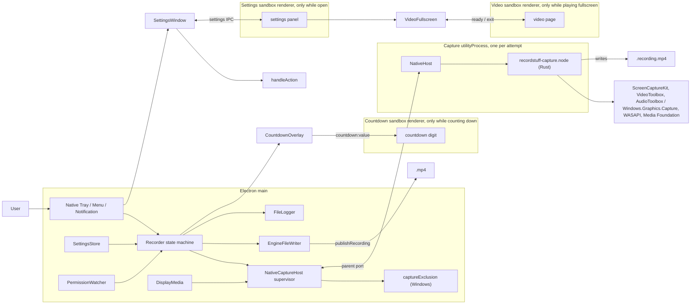

# Architecture

[English](architecture.md) | [繁體中文](../zh-TW/system-design/architecture.md)

For why recording no longer uses Chromium's capture, see [Why recording left Chromium's WebRTC capture](webrtc.md).

## Processes and responsibilities

The application has a main process; a capture `utilityProcess` that exists only during a recording attempt and loads the native engine; a settings renderer that exists only while the settings window is open; a countdown overlay renderer that exists only while a countdown runs; and a fullscreen video renderer that exists only while a recording plays over the screen. Electron also creates GPU/helper processes; this is not a claim about the number of operating-system processes.

The tray, menu and notifications are native Electron APIs in main. The settings panel is the one HTML page a user interacts with; it renders a view main sends and returns the id of the option the user picked. The countdown overlay is a click-through page that only draws the digit main sends and cannot reply. The fullscreen video page plays one recording over the screen and hands its playback state back when the viewer leaves. Main chooses the display, owns recording state, decides every action, and owns the file's lifecycle: its folder, name, sentinel, publication and history. The capture process captures, encodes, muxes and writes the file main created, and reports through the parent port.

Inside the capture process, the Rust module (`native/capture`, built into `recordstuff-capture.node`) runs one session at a time. Its JavaScript calls (`probe`, `prepare`, `stop`, `finish`, `cancel`, `microphones`) run on Node's worker pool, `record` returns at once, and events reach JavaScript through a thread-safe function. Below that, at a high level: the platform's capture callbacks (ScreenCaptureKit's screen and audio dispatch queues and the microphone's on macOS; Windows.Graphics.Capture's frame callback and one `recordstuff-sound` thread per WASAPI stream on Windows) hand frames and sound to the shared core; a `recordstuff-encoders` thread makes the encoders while capture starts; from `record` a `recordstuff-refresh` thread encodes the first frame, frames the pacer held back and the repeat of a still screen; the encoders run on their own threads (VideoToolbox's callbacks, the `recordstuff-h264` transform thread), audio is mixed and encoded under the core's audio lock on whichever thread delivers it; and one `recordstuff-writer` thread owns the file and the muxer.

| Module | Owns | Does not own |
| --- | --- | --- |
| `main/index.ts` | App lifecycle, composition, the engine host's wiring (entry and `.node` paths, display choice, own PIDs, the system-UI switch, Windows window exclusion), quit coordination | Capture, encoding or file bytes |
| `main/actions/actions.ts` | What every `AppAction` does, behind the quit gate and each preference's lock | Constructing collaborators or holding state of its own |
| `main/recording/recorder.ts` | Authoritative RecordingState, session IDs, ordering, deadlines, health guards, the countdown's timing and cancel, background saves | Electron or DOM APIs |
| `main/recording/countdown-overlay.ts` | The countdown window's lifetime, placement on the recorded display and the values it is sent | When to count, record or cancel |
| `renderer/countdown/countdown.ts` / `preload/countdown.ts` | Drawing the digit and its fades / the one value subscription | Timing, state or any reply to main |
| `main/library/video-fullscreen.ts` | The fullscreen video window's lifetime, its screen, its fades and the playback state it hands back | Which recording plays or its source URL (the settings window resolves it from the listing) |
| `renderer/video/video.ts` / `preload/video.ts` | Playing from the given time, its exit control / saying ready and leaving with the playback state | The window, its fades or closing it |
| `main/display/display-media.ts` | Which display an attempt records, main's refusal reason and the display diagnostic | Capturing it |
| `main/recording/native-capture-host.ts` | The per-attempt `utilityProcess`, readiness and heartbeat, message validation, crash and hang detection, each file's outcome, the finishing process | File-success decisions or recording state |
| `main/recording/native-host-process.ts` | Loading the engine, the host side of the protocol, output size and bit rate from the quality snapshot, mapping engine failures to protocol codes | Folder, name, deadlines or publication |
| `main/recording/capture-exclusion.ts` | Marking RecordStuff's windows excluded from capture on Windows while an attempt runs | When an attempt begins or ends |
| `main/recording/engine-file-writer.ts` / `file-writer.ts` | Reserving the temporary file, waiting for the engine's outcome and publishing it, keeping a partial / publication, write-error classification and the folder check | UI state or media bytes |
| `native/capture` (Rust) | Capture, frame pacing, audio alignment and mixing, H.264/AAC encoding, the hybrid MP4, writing and finishing the file, the write backlog bound | The file's name, publication, sentinel, history or any state beyond one session |
| `main/settings/settings.ts` | Committed settings and serialized saves | A running session's quality snapshot |
| `main/menus/tray-model.ts` / `tray.ts` | Pure projection of the tray's flat command menu / native presentation | Preferences, or a separate recording state machine |
| `main/app/ui-model.ts` | The action union and the context snapshot both interfaces share; the preference-lock rule they apply is `main/recording/recording-lock.ts` | Any projection of its own |
| `main/settings/settings-model.ts` / `model/*.ts` | Every preference, its stable ids, and the authorization of a panel request / each tab's rows (recording, audio, camera, studio, general, status, history, library) and the shape they share (`group.ts`) | Electron, IPC or persistence |
| `main/settings/settings-window.ts` | The panel window, sender validation and serialized saves | What a preference means |
| `renderer/settings/settings.ts` / `preload/settings.ts` | Rendering a view and echoing an id / the read-choose-capture-subscribe bridge | Preference state, actions or Node APIs |
| `main/permission/permission.ts` | Screen-permission cache and polling | Proof of system-audio permission |
| `main/lib/log.ts` | Text logging through a bounded asynchronous queue, with rotation | Media content |
| `main/recording/session-log.ts` | The per-launch run id and the versioned session record beside each capture and outcome line | Pairing recordings with sessions (a development analyzer's job) |
| `shared/i18n.ts` | English message keys, Traditional Chinese templates, language validation | OS dialog language or diagnostic translation |
| `shared/*` | State, protocol, quality and countdown contracts and pure functions | Electron or DOM dependencies |

## Trust boundaries and IPC

Every renderer enables sandboxing, context isolation, and web security, disables Node integration, and blocks navigation and new windows. The countdown overlay additionally disables background throttling. The overlay's preload exposes only `countdown.onValue`; main sends `countdown:value` with a digit or `null`, and the preload accepts only positive integers or `null`. Packaged builds load local HTML. Development builds may load the electron-vite URL.

The settings panel has its own preload exposing exactly four calls. `settings:capture`, `settings:read` and `settings:choose` are refused unless the sender is the panel window's main frame. A choose request carries a group id and a choice id — never an action — and main resolves the pair against a freshly built model, so a request can only perform work the app is offering at that moment, and only while the recording state allows it. Saves are serialized in request order and the answer reports the committed value.

| Direction | Message | Meaning |
| --- | --- | --- |
| Panel → main | `settings:capture { armed }` | Open or close the shortcut editor; while it is open the global shortcuts are suspended so the new combination reaches the panel |
| Panel → main | `settings:read` | The current view |
| Panel → main | `settings:choose { group, choice }` | Apply an offered option; answers with the view and whether it committed |
| Main → panel | `settings:changed` | State or context moved; re-render |

The capture process is not a renderer. Main forks it with `utilityProcess.fork` (service name `RecordStuff Capture`, piped stdio) running the built `native-host-process.js`, whose only argument is the absolute path of the `.node`; its stdout and stderr lines go to main's log prefixed `capture host:`. It runs native code with the app's identity, and on a signed bundle the screen and system-audio grants apply to it (the development Electron's `utilityProcess` is refused capture, so native measurements use a signed bundle). Its boundary is fault isolation, not a sandbox: a crash, abort or hang in native code ends or stalls that process, not main, and no media crosses into main at all. That is why the engine runs in a `utilityProcess` rather than in main (where a native crash ends the app) or as a separate executable (whose screen permission would have to be proven separately).

When the process goes away, main decides from what it knows:

- **It exits before `ready`** (the engine failed to load, which it logs through stderr and exits with code 3, or the 8-second readiness deadline passes): `start` rejects and the recorder fails the attempt with `capture_start_failed`.
- **It exits during a session**: `capture_host_crashed`; two unanswered pings (one every 5 s) while a session is watched: `capture_host_unresponsive`, and the process is killed. Before `record` either becomes `capture_start_failed` naming the phase. The recorder then fails the session and abandons the writer, which keeps a nonempty temporary file: the engine writes a fragmented MP4 that players read up to its last whole fragment (killing the process mid-recording left an 8.0 s playable file).
- **It exits after `stopped`, while finishing the file**, or stays silent for 150 s (`FINISH_BOUND_MS`, past the engine's own 120 s bound): the file's outcome rejects, the save fails with `output_write_failed`, and the temporary file is kept.

Main forks a fresh process for each attempt and exchanges the messages below over its parent port. Both ends run handwritten type guards (`isMainMessage`, `isHostMessage`). These validate required shapes, not strict rejection of extra fields or comprehensive resource quotas. There is no protocol-version negotiation because both ends ship together.

| Direction | Message | Meaning |
| --- | --- | --- |
| Main → host | `start { sessionId, quality, native }` | Prepare capture with the session quality snapshot; `native` carries the display id (CGDirectDisplayID on macOS), a physical point on it (Windows), the temporary file main created, RecordStuff's PIDs (main first) and the system-UI switch (macOS) |
| Main → host | `record { sessionId }` | Start the file at this moment (plan 040); refused for any other or unprepared session |
| Main → host | `stop { sessionId }` | Stop recording, release a prepared session or cancel a pending prepare |
| Main → host | `ping` | Check the host's responsiveness |
| Host → main | `ready` / `pong` | Engine loaded / heartbeat response |
| Host → main | `prepared { sessionId, mimeType, capture }` | Capture, encoders and file prepared, not recording; `capture` is the CaptureReport (size, rates, target bit rates, warnings) |
| Host → main | `started { sessionId }` | The engine is recording; main keeps the report from `prepared` |
| Host → main | `progress { sessionId, bytes }` | Bytes written so far, about once a second while media arrives |
| Host → main | `stopped { sessionId, tracksStoppedAt? }` | Capture has ended at the stop; the engine still finishes the file |
| Host → main | `finished { sessionId, file }` / `writeError { sessionId, code, detail }` | The file is finished (`bytes`, `finalizeMs`, and why it stayed fragmented, if it did) / the write error that ended it, `disk_full` or `output_write_failed` |
| Host → main | `error { sessionId, code, detail, displayFailure? }` | Failure the host observed; only the codes in `HOST_ERROR_CODES` |

What main validates and refuses:

- Every message from the current process passes `isHostMessage`; a malformed one is dropped and logged by its type only. Host error codes are limited to `HOST_ERROR_CODES`, write errors to `ENGINE_WRITE_ERROR_CODES`: folder, disk-check, deadline, supervision and launch codes are main's own findings, so a host that sends one is malformed rather than believed.
- A message for a session that is not the current one is not applied; a stale `prepared`, `started` or `progress` makes main send `stop` for that session so nothing keeps capturing unseen.
- `finished` and `writeError` after `stopped` are accepted only from the process finishing that file, matched by process and session id.
- The display is main's choice (`DisplayMedia`); the host is never told about another one, and main refuses to post `start` without a numeric display id.

The host accepts only `isMainMessage` shapes, refuses a `start` without `native` or while a session exists and a `record` for anything but its prepared session, and ignores a `stop` for another session. The engine rejects with `code|detail`; the host maps a code outside the protocol's lists to `capture_start_failed`, `capture_failed` or `output_write_failed`.

On Windows, Windows.Graphics.Capture cannot leave out another process's windows, so from `start` until the attempt is torn down main marks every RecordStuff window, and each one created meanwhile, with `setContentProtection(true)` (`WDA_EXCLUDEFROMCAPTURE`), and lets them back in when the process exits or 5 s after it was told to end. On macOS the engine leaves them out itself through ScreenCaptureKit's content filter, using the PIDs main sends.

There is no per-sample acknowledgement or backpressure over the port: media never crosses it. Inside the engine, capture and encoder callbacks hand encoded samples to the writer thread over a channel and never wait for the disk; media waiting for it is bounded at 64 MiB (`BACKLOG_LIMIT_BYTES`), past which the recording fails with `output_write_failed` and what was written is kept. Heartbeats detect host responsiveness, not continuing media; media has its own deadlines, the first nonempty `progress` and then a stall guard that warns after 10 s without one and fails at 30 s ([recording](recording.md#deadlines-and-supervision)).

## Recording data flow

1. **Open.** The recorder checks the folder (`ensureWritableDir`), writes the session sentinel and creates `<name>.recording.mp4` empty and exclusively (`EngineFileWriter.open`).
2. **Prepare.** `NativeCaptureHost.start` forks the process while `DisplayMedia` chooses the display, waits for `ready`, starts the heartbeat and posts `start`. The host probes the source size, takes the output size and video bit rate from `shared/quality.ts` (`fitWithinCap`, `videoBitsPerSecond`), and calls `prepare`: the platform starts capture, the encoders are made on their own thread, the file is opened, and until `record` only the newest frame is kept. The host answers `prepared`.
3. **Count down and record.** Main runs any countdown, then sends `record`. The engine takes `t0`, starts the writer and refresh threads and encodes the newest frame as a key frame at time zero; the host answers `started`.
4. **Record.** Capture is asked for four times the frame rate, and the pacer keeps one frame per slot of the frame rate's grid; a refresh at which the screen did not change re-encodes the newest picture at its slot, and a still screen repeats the last frame every second so key frames and fragments keep coming. Each sound input is placed on the session clock by counting samples and mixed into one stereo 48 kHz track, then encoded as AAC. The writer thread appends one fragment per track about every second, syncs every 5 s and reports progress every second.
5. **Stop and save.** On `stop`, the engine ends both tracks at that moment, waits up to 250 ms for the sound up to it, stops capture and flushes the encoders; the host sends `stopped` and the recorder goes idle while the save continues in the background. The writer appends a `moov` indexing every sample, syncs and rewrites the start of the old `moov` as a 64-bit `mdat` header, so the file becomes plain MP4 without copying; the host sends `finished`. `EngineFileWriter.finish` then publishes the file under its final name with an exclusive hard link (`publishRecording`), the sentinel is cleared and `saved` is emitted.
6. **Fail.** A capture or write failure, a crash or a missed deadline fails the session; the writer keeps a nonempty temporary file, which is a readable fragmented MP4, and the failure is reported with its file outcome ([recording](recording.md)).

## Packaging and signing the engine

`electron.vite.config.ts` builds the crate with `cargo build --release` before main on macOS and Windows and copies the library (`librecordstuff_capture.dylib` or `recordstuff_capture.dll`) to `out/native/recordstuff-capture.node`; a build there without Cargo fails, and `RECORDSTUFF_SKIP_NATIVE=1` skips it on purpose for builds that never record, whose recordings then fail at start with the load error. Native code cannot load from inside the asar archive, so `electron-builder.yml` unpacks `out/native/**` (`asarUnpack`) and `main/index.ts` rewrites the path to `app.asar.unpacked`. On macOS electron-builder signs the unpacked module with the app's certificate and hardened runtime, and `start-app.mjs --verify-app`, which local bundles and the release's mounted DMG pass through, requires it and checks its certificate. The Windows build is unsigned like the rest of its app; the installer smoke loads the installed module with `scripts/native-load.mjs`. CI builds and tests the crate on both runners; release builds compile it from source without a cache ([releases](releases.md)). Platforms other than macOS and Windows have no engine: a recording there fails when the module does not load.

## Data and persistence

| Data | Location | Lifetime |
| --- | --- | --- |
| RecordingState | Main memory | Reset on restart; not persisted |
| Main Session | Recorder memory | Quality and countdown snapshots, capture report, countdown timers, writer, deadline, stall and disk timers, until `stopped`, failure or cancel; a stopped session then lives in `saving` until its save settles |
| File outcomes and finishing processes | NativeCaptureHost memory | Per temporary path, from `start` until the writer takes the outcome; a process that reported `stopped` is kept until `finished`, `writeError`, exit or 150 s |
| Host session | Capture-process memory | Session id, phase (preparing, prepared, recording, stopping), temporary path and cancel flag, until `stopped` or failure |
| Engine session | Capture-process memory | Platform capture, the core (newest frame, pacer, mixer, encoders) and the writer's queue, at most 64 MiB, until the file is finished or the process ends |
| settings.json | Electron userData | Across restarts; current internal app name is lowercase recordstuff |
| `.recording.mp4` | User-selected folder | Created empty by main, written by the engine; active recording or preserved partial file |
| `.mp4` | Same folder | Successfully finished and published recording |
| recordstuff.log | Electron logs directory | Rotation above 5 MiB, three archives |
| Measurement Markdown/JSON | docs/verification/measurements | Local development evidence; gitignored and excluded from the packaged app |

The engine is the only writer of the media file; main creates it empty, publishes it and removes an empty one. Settings and logging modules open their own files.

## Startup and shutdown

Main initializes logging/error handlers and obtains a single-instance lock. It hides the Dock icon as the app finishes launching and again after ready (the bundle declares no `LSUIElement`; on macOS the icon returns, with the menu bar's menus, only while the window is open), loads settings, composes Recorder/host/permissions/Tray, subscribes to events, and starts permission polling. No capture process exists until an attempt: each one forks a fresh process, and with a countdown an overlay window, and main ends both when the attempt settles. A process that reported `stopped` is kept only until the file's outcome is known; no capture process, overlay renderer or heartbeat timer remains between recordings.

Closing all windows does not quit the app. Before-quit always waits for Recorder.shutdown, which includes failure cleanup even when the tray is idle, then for the settings, window-size and log writes and the failure-history save, before retrying quit ([deferred quit](desktop.md#deferred-quit)). Will-quit stops permission polling and destroys host, overlay and Tray. Power loss, forced main-process termination, and blocked storage do not carry a complete-durability guarantee.
