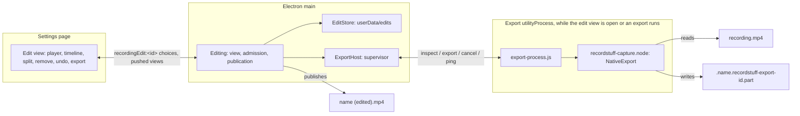

# Cutting a Recording

[English](editing.md) | [繁體中文](../zh-TW/system-design/editing.md)

Sources: the edit view's [owner in main](../../src/main/editing/editing.ts), its [edit records](../../src/main/editing/edit-store.ts), the export worker's [supervisor](../../src/main/editing/export-host.ts) and [process](../../src/main/editing/export-process.ts), the [shared contract](../../src/shared/editing.ts), the page's [controller](../../src/renderer/settings/controller/editor.ts) and [dialog](../../src/renderer/settings/tabs/library/editor.tsx); in the engine, the [source reader](../../native/capture/src/edit/source.rs), the [cut plan](../../native/capture/src/edit/plan.rs), the [remux](../../native/capture/src/edit/remux.rs), its [JavaScript interface](../../native/capture/src/export_api.rs) and the platform codecs for [macOS](../../native/capture/src/mac/edit.rs) and [Windows](../../native/capture/src/win/edit.rs). Editable recordings (plan 087) add the [shared description and scene](../../src/shared/editable.ts), the page's [camera and volumes](../../src/renderer/settings/tabs/library/editor-scene.tsx), the engine's [description](../../native/capture/src/editable.rs), [rendered export](../../native/capture/src/edit/render.rs) and its [macOS half](../../native/capture/src/mac/render.rs).

Plan 085 added the first slice of the editing phase: a recording's menu in the Recordings tab offers **Edit…**, which opens an edit view; parts of the recording are removed (at the start, the end or anywhere between, as many as wanted) and **Export** writes the kept parts to a new file beside the recording. The edit is remembered, so the view opens where it was left. The recording itself is never changed. Recording is not affected: nothing here runs during a recording, and a normal save never depends on any of it. Plan 087 added the second: a recording made with **Editable recordings** on keeps the camera and each sound input apart, so its edit view also places the camera and sets the volumes ([editable recordings](#editable-recordings)).

## The source is never written

Every path only reads the recording. Main opens it read-only to hash its ends; the engine opens it read-only to remux it. The export goes to a new file of its own, published under a name nothing holds; the edit lives in userData. Nothing in this feature opens the recording for writing, renames, moves or deletes it, so a failed, cancelled or crashed export, a full disk or a damaged edit record can lose the export or the edit, never the recording. The tests check the recording's checksum after every path, the fault injections included.

## Processes and ownership

| Part | Owns | Does not own |
| --- | --- | --- |
| `main/editing/editing.ts` | The open edit view's state, the recording's identity check, saving edits, admission, the export's temporary file, its journal and publication, clean-up at launch | Media, which never reaches main |
| `main/editing/edit-store.ts` | Edit records: path, format, atomic writes, bounded reads, the identity rule | The recording file |
| `main/editing/export-host.ts` | The worker process: lazy fork, readiness, message validation, pings, the cancel bound, crash and hang handling | Files or decisions |
| `main/editing/export-process.ts` | Loading the engine and serving one request at a time | Paths' choice, publication |
| `native/capture/src/edit` | Reading the recording's index, the cut plan, the remux into the file it is given | Names, publication, edit records |
| Renderer controller and dialog | Drawing the timeline, the transient splits and selection, Undo's stack, the preview's skipping | Saved edits or exports |

The worker is a `utilityProcess` of its own (service `RecordStuff Export`), forked when the edit view first needs the engine and ended when the view closes with nothing running, as the capture host is supervised: every message it sends is checked, a crash is its exit and a hang is two missed pongs while work is in flight. It loads the same `recordstuff-capture.node` as the capture host; main never does. Frame bytes stay in the worker; main hears plans, progress fractions and results.

## Edit records

An edit is a JSON record in `userData/edits/<hash of the recording's path>.json` (plan 085, D3), never a sidecar in the output folder, whose subfolders are the Recordings tab's categories. It holds the recording's identity (path, size, modification time and a SHA-256 of its first and last MiB), the video timescale, the removed ranges as sorted, non-overlapping integer pairs in that timescale (at most 256) and a revision; version 2 (plan 087) adds an editable recording's scene and is written only for one, so every other edit stays version 1 and readable by the version before; version 3 (2026-10-26) lets the scene's camera be hidden over stretches and is written only for such a camera. The recording is referenced, never copied.

- **One writer.** Main, which the single-instance lock makes unique per user; writes are queued in order.
- **Atomic.** A temporary file, fsync, rename and a fsync of the folder (`writeFileAtomic`'s `syncDirectory`; Windows has no folder handle to flush and journals the rename), so a failed or interrupted write leaves the last whole revision.
- **Bounded and never reset.** A record over 64 KiB, malformed, with overlapping ranges or with a newer version is reported as unreadable and kept as it is; the view says so and offers Discard, the user's explicit choice. Both versions are read field by field; no migration framework exists.
- **Stale.** A record whose identity no longer matches the file at its path is stale: the view says the recording changed and offers Discard. Nothing deletes a user's file.
- **Renamed or moved.** A recording renamed or moved to a category in the Recordings tab takes its edit along when the file is still the same; one moved in Finder leaves its edit behind.
- **Revisions.** Each save names the revision it changes; one made against an older revision is refused.

## Reading the recording

The engine reads the index of an MP4 it wrote, plain or fragmented (plan 076's hybrid file, finished or interrupted), and nothing else. Every size it reads is checked before use: the `moov` or a `moof` is read whole only up to 32 MiB, a sample may not exceed 64 MiB or reach past the end of the file, and there are at most 2^25 samples. A cut-off fragment ends the reading as it ends a player's. It refuses with a reason any file that is not one: another muxer's (Chromium-era recordings before plan 076 among them), more than one video or sound track, codecs other than H.264 and AAC, reordered pictures (`ctts`), sound packets of other than 1024 frames, a video edit list, or more than one sample description. The index takes about eight bytes a sample plus a decode time for video, the only memory that grows with the file; the samples themselves are read where they lie, in spans of at most 8 MiB.

## The cut

Removed ranges snap to the nearest frame start; the parts between them are kept. A kept part that resumes on a key frame is copied.

**Pictures (D2).** Recordings have a key frame at least every second and no reordering on both platforms, so a part may end at any frame by copying. Where one resumes inside a group of pictures, its pictures up to the next key frame (at most a second) are decoded from the preceding key frame and re-encoded by the engine's own H.264 encoder as a closed group that starts with a key frame: on macOS VideoToolbox decodes asynchronously into the recording's encoder, picture by picture, set up as for a recording but not in real time; on Windows Microsoft's software decoder and encoder. A run whose key frames are more than 4 s apart (only a damaged file has one; recordings have a key frame every second) resumes at its next key frame instead, and a run over 256 MiB is refused, so a run's pictures in memory stay bounded. The encoder is set to the source's level and frame rate, at twice the source's average bit rate (at least 2 Mbps, at most nine tenths of what the level allows, never below the source's rate). At the source's level its parameter sets were the source's own on every recording measured, so the export keeps one sample description.

Where they differ, the plan's rule was settled once by playing a file whose re-encoded pictures used a second `avc1` description (2026-10-24): AVFoundation (QuickTime's) decoded and sought it, but Chromium, the app's own player, stopped with a decode error at the first picture of the second description. So such a join resumes at the first key frame at or after the requested point, never before it: removed content never reappears and parts never overlap. The cost is up to a second less of the kept part; a part with no key frame left is dropped. The edit view marks each such join and says how much later it resumes. The engine learns the re-encoded parameter sets once per recording from one picture and the worker keeps them while the view is open, so the view's plan needs no further encoding. The second description stays in the muxer only for the fixture that repeats this check.

**Sound (the maintainer's choice of 2026-10-24, replacing D2's full re-encode).** Re-encoding the whole track ran at about 160 times real time on one thread, a sixth of the disk's speed on a 10 Mbps recording, against the gate of half. As LosslessCut, Avidemux's copy mode and `ffmpeg -c:a copy` cut sound, the AAC packets are copied unchanged; unlike them, the joins are sample-exact and faded: a window of a few packets (about 85 ms) around each join is decoded, cut to the frame, given a 5 ms raised-cosine fade on each side and re-encoded by the recording's AAC encoder, started early enough that its priming falls before the window. Copied packets keep their place only if each part starts at the same position on the 1024-frame packet grid as in the source, so the start of each part after the first moves by at most half a packet (10.7 ms at 48 kHz), by lengthening or shortening the last picture before the join. Pictures and sound move together, so inside each part their offset is exactly the source's, and the drift never accumulates. The head is not re-encoded: the copy starts two packets before the first kept frame, which the edit list skips as it skips an encoder's priming. The sound ends with the pictures or where the source's ends. No AAC edit list per join is used.

**The file.** Samples go through the engine's own muxer (`HybridMp4`) a fragment at a time, video interleaved with the sound up to the same time, and the file is made plain at the end, as a recording is. Media buffers are bounded independently of the file's length (a read span and a fragment); the output's sample index, about eight bytes a sample, grows with it, as a recording's does.

## Export, publication and clean-up

1. Main journals the temporary file's path (`userData/edits/exports-in-flight.json`, atomic) before the worker creates it, beside the recording: `.<name>.recordstuff-export-<12 hex>.part`, hidden, so the Recordings tab does not list it.
2. The worker creates it only if it does not exist, remuxes into it and syncs it in the muxer's finish; progress reaches the view about ten times a second.
3. Main publishes it under the first free `<name> (edited).mp4`, `<name> (edited 2).mp4`, and on (an export edited again counts on from its source's name: `Talk (edited)` exports as `Talk (edited 2)`, not `Talk (edited) (edited)`, whichever language named it): a hard link that fails rather than replaces, then the temporary name goes. A volume without hard links takes the name with an exclusive create, journalled first, and the file is renamed over that empty placeholder; Node has no rename that refuses to replace, so on such a volume a file another program puts at that name in the instant between the two calls would be replaced, the one exposure left. The placeholder's path is journalled before it is made and its inode once it is; it is only ever removed again while it is still that empty file. Nothing is published once the export is cancelled, even after the worker finished.
4. Cancel, a worker crash or hang, a full disk, a refused link or rename, or quit remove only the temporary file. A journal entry goes only once its file is gone; one that could not be removed (a drive away) stays for the next launch. At launch, in the journal's own queue so an export started meanwhile is journalled after it: every journalled temporary file with an export's own name, and every journalled placeholder that is still the empty file of the recorded inode, is removed; a placeholder whose inode was never recorded, and any other name, is left alone. A file that cannot be checked or removed now keeps its entry.

The listing refreshes and the new recording appears as one of its own.

## Admission

One export runs at a time, claimed as Export is pressed, before anything is awaited; it takes the edit as saved by the changes made before it, and a change made after it is refused. Before each save and export the recording's identity is checked again: one changed while its view was open shows its edit as stale and nothing is saved or exported against it. None starts while a recording, a Live preview or a save is in flight, or while RecordStuff quits; the view says why and Export is unavailable. A recording or Live preview that starts during an export cancels it (`onSessionStart`): the recording always wins. Quit cancels a running export and waits up to 2 s for it to end before the media shutdown; a publication still held up by a slow volume then leaves its temporary file journalled for the next launch. A cancelled export that has not ended within 1 s is ended with its worker. The view cannot close while it exports; its Cancel export comes first.

## The edit view

A dialog over the Recordings tab: the production player above a timeline of the recording's parts, side by side as long as they last, a kept part tinted and a removed one hatched, with the playhead. A press on the timeline puts the playhead there and selects the part under it, and a drag scrubs (2026-10-25, at the maintainer's request, so Split cuts wherever one chooses; each part is also a button named by its times and state, which Enter or Space selects from its start); **Split** (S) cuts the timeline at the playhead without removing anything; **Remove part** or **Keep part** (Delete) toggles the selection; **Undo** (⌘Z / Ctrl+Z) takes the last change back. Each change is saved at once and comes back snapped to frames. The preview plays what the export will hold, as the engine planned it: a frame shown in a removed range, or before a part's later key-frame resume, jumps to where the export continues, or pauses at the start of a removed tail. Export shows its progress and Cancel export, then the published name with Show in Finder (Open folder on Windows), or what failed with Export again. A stale or unreadable edit, a file that cannot be cut and a recording that went away each have their own state. English and Traditional Chinese. Since 2026-10-25, at the maintainer's request: the timeline shows a strip of the recording's pictures under its parts (a hidden video of its own seeks once per tile, so a long recording costs a few dozen decodes, once per view; a kept part is tinted over it, a removed one hatched); **Redo** (⇧⌘Z, or Ctrl+Shift+Z and Ctrl+Y) makes again what Undo took back, until a new change; the timeline's buttons are unavailable without being disabled while a change saves, so the keyboard's focus and the view's shortcuts stay; and once exported, Show in Finder is the main button with Export again beside it. After a hands-on walkthrough the same day: a split is a step Undo and Redo take back and make again (without a save, since splits are the view's own); S is read by the key's place, so it splits with an input method such as Zhuyin on; a drag on the timeline also ends where it is let go; a part removed or kept by the button stays selected though main snaps its ends to frames; the playhead is white with a cap, unlike a selected part's ring (and, since 2026-10-26, unlike a split, now an amber line with a black edge where one part ends and the next begins, with an amber mark under it that shows beside the playhead when the two meet, as straight after S), and its time shows to the tenth beside the export length. Then, at the maintainer's request, the timeline was made direct: handles at either end of the kept recording trim its start and end (a drag shows the frame at the handle; as sliders, the arrow keys step them by a tenth of a second (a frame since the same day), Shift by a second, saved when the key is let go); a drag across the timeline chooses a range that **Remove selection** (Delete) takes out; a click puts the playhead there and selects the part there, and a drag that starts on the playhead scrubs; a ruler marks the times under the timeline, and an untouched recording says how to trim and remove under it. Each trim and each removed range is one change Undo takes back. Split stays, after Remove, for cutting the timeline into parts by hand. The playhead now follows the preview from the first seek, which it could miss before the view next drew. A second hands-on round as a first-time user found the handles did not follow a real pointer while the timeline's own drags did, so the timeline takes hold of a handle itself: a press on a handle or within 6 px of one drags it, even when the press lands just beside its 12 px (since the same day, 8 px drawn and 8 px of reach). On the timeline Space plays or pauses and ← → step a frame (Shift, a second), as in other editors; the hint says how to cut until something is cut, then names those keys; the scene's Reset says what it resets (Reset camera and volumes, or Reset volumes); and the dialog leaves room for the ruler, the hint and an editable recording's controls, sized from the card so it does not change size as it opens. A third round found every task done on the first try, and one fault: an Undo that took the focused part away left the focus on the page, outside the dialog, so ⌘Z stopped; the focus now goes back to the selected part or the timeline. After it, the hint stays in sight with the gestures and every key (Shift's second and Redo included), the playhead's time shows to the hundredth so a frame's step is seen, a range being chosen shows where it runs and how long it is, and the playhead is marked on the ruler too. Then, at the maintainer's request: a range dragged across the timeline moves the preview with its moving end, as a trim handle and the playhead already did, so a cut is chosen by its picture; and **Skimming** (off by default, as Final Cut Pro's, a button with no key since S splits) shows the picture under the pointer as it moves over the timeline, with a thin skimmer line, and goes back to the playhead when the pointer leaves, unless a press there moved the playhead. A fourth round found every task it could try done on the first try; its pointer could neither hold a drag nor move without pressing, so the preview following a drag and Skimming's hover are checked by the UI tests alone. After it: the playhead's or range's time and the export length have a row of their own under the ruler, since a range's readout among the buttons pushed Export onto a new row and moved the picture; the hint is one line of the gestures, with the keys behind a keyboard button's tooltip (listed in full they took three lines of a small window); Skimming writes its state beside its name and is outlined in the accent while on; the ruler's playhead mark has a line; and the dialog is never taller than the window, scrolling in one too small for it. Asked whether the bars were too thick to cut precisely or to reach the ends: they reach both (a drag past the timeline stops at the recording's very start and end), but a handle taken hold of in its middle jumped to put its edge under the pointer, half a bar off, which in a long recording is seconds. A handle now keeps its distance from the pointer, so the edge moves exactly as far as the pointer; the bars are 8 px drawn with 8 px of reach beyond them, hiding less of the pictures; the times' row says where the export will start or end while a handle moves; a handle's arrow keys step a frame, as the timeline's do; and a handle moved while another change saves keeps moving, its own save waiting for that one. A fifth round confirmed it (a drag moved the edge as far as the pointer, a press without a move kept it, and both ends were reached exactly) and found a handle dragged past the timeline and let go there stayed drawn at the end without being saved, the export length left as it was: the press had ended with no release on the timeline. A press now ends however it ends (a release anywhere in the window, the timeline losing the pointer, or the window losing focus), and a handle so let go saves. After it, a focused handle's edge stays in the times' row after a key moves it; Remove keeps the width of its widest name, so the buttons after it stay put; a handle's reach is 10 px; and the keyboard button opens the editing shortcuts on a click. Then, at the maintainer's request after comparing other editors, the handles follow iPhone's and QuickTime's trimmer: they stand outside the kept recording with ‹ › on them, their cuts at the start's right edge and the end's left edge, so they cover none of its pictures; lines joined them above and below, framing what is kept (removed on 2026-10-26 at the maintainer's request: the red frame hid the selected part's ring, which shares its red); the track pads its sides by a handle's width, so a handle at the very start or end is seen whole; the ruler is aligned with the track; and a dragged handle's time shows above it. A sixth round found it read at once as that trimmer, its handles covering no kept picture, and a handle let go past the window saving with the full export length; after it, the export length is to the hundredth as the times beside it, the keyboard button is labelled, and the shortcuts list a handle's arrow keys. Then, as the maintainer found, an export's end no longer moves anything: its outcome takes the hint's line (one line, the file's name cut with an ellipsis and whole in its tooltip; a failure may wrap), Show in Finder takes Export's place with Export again beside it as an icon, and the export area keeps the width of its widest state, so the buttons beside it and the camera and sound rows under it stay put as an export starts, runs and ends; and the camera's resize handle shows the resize arrows along the diagonal it drags, a plain circle having read as nothing. The focus goes back into the view also when a change sends it behind the dialog, to a tab. The timeline's saving changes (Undo, Redo, Remove or Keep, a trim) now run one after another: a key pressed while one saves waits its turn instead of being lost, so ⇧⌘Z straight after ⌘Z redoes, and a handle moved again while its last move saves keeps its new place (both found by CI's slower runners).

**The toolbar and the line over the timeline (2026-10-26, the maintainer's choice of layouts, B′).** An action sits where what it acts on is (the maintainer's rule, the same day, after a first B′ that also had Remove in the toolbar): the toolbar holds what acts on the whole recording or at the playhead, Play, Undo and Redo, **Split** in words, then Options, the keys and Export at its end; it never wraps at the view's usual widths. The times left it for a small line of their own close over the timeline, apart from the toolbar: the playhead's (or a trim handle's) time and the export's length together at its end, and at its start, while nothing is chosen, how to choose ("Click a part or drag across the timeline to select it"). The lanes form one block with the pictures, right under them and a hair apart from each other, each 24 px, the playhead one line over the pictures and every lane, a single SVG holding its line and its cap as editors draw it, the cap's point on the line's middle by construction (the maintainer's question the same day: a line inside each, placed alike, broke where a lane's border made it a pixel narrower) (the maintainer's review the same day: sharing one clock, the gaps between them only took height from them and broke the line); a stretch the edit has not set is the lane's own ground, a set one keeps its outline. While a part or range is chosen, its actions float above it, a pointer at the selection's middle, its length named ("Selected 0:02.40") and each action's key right after its name: chosen on the pictures, on that line's foot, rising into the room above it but never to the toolbar; chosen on a lane, right over that lane's stretch, over the pictures or the lanes above it if need be (the maintainer's choice the same day: what they act on is then plain, and they no longer give way sideways to the times): its length, **Remove** with ⌫ (Keep for a removed part, as wide), and, for an editable recording, Hide camera with C and Volume with V; Delete, C and V work as before. The line is always as tall, so nothing below it moves as they come and go; they stand right over the selection and the times give way only where the actions meet them (the maintainer's review the same day: pushed aside for the times, the actions stood away from a selection at the end), and the playhead is one white line, and where the window is too narrow for their names they show their icons and keys alone over the line (Remove, the action made most, keeps its name, and the selection's length gives way), the times then as numbers alone; a toolbar under 520 px shows Split and Options by their icons. A chosen range is drawn in a neutral light, not the brand's red (which read as all of it about to be removed; red stays for what is removed): the pictures' faintly filled, the lanes' outlined, the lane a click chose it on filled. The action under the pointer or the focus marks the tracks it changes: Remove every one, Hide camera the camera's lane, Volume the sounds' lanes, the others' outlines fading. A part that starts at a split of the timeline's own offers **Join previous** among its actions (the maintainer's request the same day: a split had no way back but Undo, and only while it was the last change): the split goes, the joined part is chosen, one step Undo takes back; a boundary a cut makes is not a split and stays. **Revert to original recording**, last in Options, keeps every part again, drops the splits and puts an editable recording's camera and volumes back as recorded, as one change Undo takes back.

**Edited recordings (2026-10-26).** A recording that holds an edit carries an **Edited** badge after its time and size, a state only (a click there is the card's, unlike Editable's mark, which opens the view; the maintainer's reviews the same day), and its menu reads **Continue editing…**. Main keeps no record for an edit that changes nothing (nothing removed and an editable recording's scene as recorded): the save removes it instead, so the mark goes with Revert or with every change undone; the view's revision goes on, so Undo saves it again. `EditStore` reads which recordings hold one once at launch and keeps the list with every save, discard and move; the tab marks a recording whose record was made for the file's present size. An export is a recording of its own, with no link back to its source.

## Editable recordings

Plan 087. **Editable recordings** in Recording settings (macOS, off by default, locked while recording; Windows hides it until its engine supports it) records the screen, the camera and each sound input apart, so that after recording the camera's bubble can be moved, resized or hidden and the system's and the microphone's volumes set, then exported as an ordinary MP4. With it off recordings are as before; old recordings cannot gain what they never held.

**The file.** One MP4, the engine's hybrid fragmented file: the screen alone (H.264), the first sound track, the second sound track when both inputs record, and the camera at 1280×720 (H.264) when it records. Only the first track of each kind is enabled; the second sound and the camera are disabled alternates, so any player shows the screen with the first sound until it is exported. Each sound input has its own single-input mixer on the shared clock, so an input that delivers nothing records silence, never a shift; the camera's track starts at the recording's start and is black while the camera is hidden. A JSON description in `moov/udta/rsed` (at most 4 KiB, version 1) says the file is editable, which input each sound track holds and where the bubble was when the recording started; main checks it field by field ([shared](../../src/shared/editable.ts)) and treats a file without a valid one as an ordinary recording. The Recordings tab reads the box with its other facts and marks the card **Editable**. An interrupted editable recording opens and renders what it holds; a camera or second sound track left empty counts as absent.

**The scene.** The edit adds one scene for the whole recording, no keyframes: the bubble's place (as the Studio's camera layout: the free space's fractions), its width and height (fractions of the shorter side, the shape kept when resized), whether it is shown, and the system's and microphone's volumes on the Studio's percent scale, applied to what was recorded (100% leaves a track as recorded, since the volumes set while recording are already in it). Its rounding and mirror stay the recording's. It starts where the recording left the bubble, every track at 100%, and is saved in version 2 of the edit record. A drag, an arrow key (Shift for larger steps) or a slider updates the preview at once and saves when it ends; saves are queued in order, so the control keeps its focus, and each one is a step Undo takes back with the cuts. The controls are unavailable only while an export runs. Since 2026-10-25, at the maintainer's request: a handle on the corner facing the picture's middle resizes it from the opposite corner with its shape kept (the size slider is its keyboard counterpart, and shows its value); while the player's seek bar lies over the bubble, a press there inside the bubble moves the bubble, and the bar's buttons keep theirs; the bubble shows an edge under the pointer (since 2026-10-26, at the maintainer's request, no white edge at all: a soft dark ring outside it under the pointer or while held); the controls are grouped under Camera and Sound, each sound has a mute button that brings its volume back, its slider has 100% in the middle as the Studio's faders do, and **Reset** puts the camera and the volumes back as recorded (`EditorEditable.recorded`) as one change Undo takes back. A dragged bubble stays exactly where it is dropped, without snapping, as the Studio's does (2026-10-22); snapping was tried on 2026-10-25 and removed at the maintainer's request the same day.

**The camera over time.** Since 2026-10-26, at the maintainer's request, the camera can be hidden over any stretches of the recording, not only throughout. The scene's camera keeps `shown` and adds `hidden`, the stretches `[from, to)` in the video's timescale on the recording's own clock, as the cuts count (a stretch stays where it is when a cut before it is removed or kept again), at most 256, kept sorted, merged and within the recording by main when it saves. `shown: false` is Options' **Hide the camera throughout**, a switch over the stretches that keeps them (the maintainer's choice the same day, in place of a Show camera switch whose on dropped them): on, the export holds no camera, the lane reads hidden throughout and the camera button waits, saying why; off again, the camera follows the timeline's stretches. With no stretches the record is version 2's; any stretch makes it version 3, which an older version finds unreadable and keeps rather than reading it as shown throughout. The timeline has a lane under its pictures for an editable recording with a camera: a soft fill with a person where the camera is in the picture, an open dashed stretch with the person struck through where it is hidden, the removed parts dimmed and the playhead and the selection drawn across it; the trim handles keep to the pictures. The camera button after Remove, or C, acts on the range dragged across the timeline, else the selected part (its ends on frame starts): it hides the camera there, or, when it is hidden over all of it, shows it there again, as one change Undo takes back; with nothing selected it is unavailable and its tooltip says what to choose. So a stretch starts at any frame: the playhead put there, S, then C. A click on the lane selects its stretch there when the edit set it (a hidden one; Enter selects it from the keyboard), which the button then shows or hides; on a stretch not set, a click is as one on the pictures, the playhead there and the part there, since a lane not yet set is one stretch spanning the recording (the maintainer's report the same day: a click chose the whole of it); Delete there removes the range, as for any range. The switch's note says what the export holds: how many stretches hide the camera, how to make one, or, switched on, that there is no camera until it is switched off. Reset puts the stretches back as recorded, none. In the preview the bubble is not drawn while the playhead is in a hidden stretch (a hard cut, as the export makes; its element stays so its camera keeps following) and, paused there, its place shows as a dashed outline that says the camera is hidden there; it is followed frame by frame only while some stretch hides it. The rendered export leaves the camera out of a picture whose time falls in a stretch: that picture is the screen's own, and no camera picture is decoded for it.

**The volume over time.** Since 2026-10-26, at the maintainer's request, each sound input can also be at a volume of its own over stretches: the scene's `volumeStretches` holds, for the system's sound and the microphone's, `[from, to, percent]` on the same clock as the camera's stretches, sorted, apart and joined where neighbours share a volume, at most 256 an input, kept within the recording and only for an input the recording holds when main saves. A stretch's percent takes the place of the input's volume there (0% is silent); outside the stretches the input's own volume applies, so the Options slider still sets the rest. Any stretch makes the edit record version 3. Each input has a lane under the camera's: its own volume quiet with its name and percent, a stretch at a volume of its own filled with its percent, a muted one hatched with **Muted**; a click on a stretch at a volume of its own selects it, elsewhere on the lane it puts the playhead and selects the part there, and either lists that input first. The **Volume** button after the camera's, or V, opens a popup over the selected range or part (with nothing selected the button is unavailable and V says what to choose): each input's Mute (a press again gives it back), its slider (100% in the middle; heard while it moves, saved when let go) and **Back to the overall volume**, which gives every input back its own volume over the selection as one change. Each change is one Undo takes back; Reset clears the stretches. The camera's and the Volume button's names show in words while the panel is at least 1030 px wide (measured: the row first wraps at 1016 px in English with the longest readout), icons alone below. The preview sets each sound's gain for the playhead's time on every frame while any stretch exists, easing over about 4 ms; the rendered export multiplies each track's decoded sound by its volume frame by frame, a stretch's in place of its own, moving between them over 10 ms (a raised cosine) so a change does not click, and decodes nothing for a chunk a track is silent across. Options' **Lanes on the timeline** (the maintainer's request the same day) shows or hides each lane, the camera's and each input's: a hidden lane leaves the timeline and the trim handles shorten with it, the choice is this window's own look, remembered in its storage for the next edit views and runs of the app, as the sidebar's; what a hidden lane holds is still exported, and while it holds stretches Options says so under its switch; a change made to it (C, or the Volume popup) shows it again. A range chosen by a click on a lane is filled on that lane only and outlined on the pictures and the other lanes (the maintainer's report the same day: a stretch spanning the recording filled the whole timeline red, as if all of it were about to be removed); a range dragged across the pictures, the one Delete removes, keeps its fill. The Volume popup's give-back reads **Back to the overall volume** (「此範圍恢復整體音量」), the default stretches of the input lanes are drawn at the foreground's strength (in the dark theme the muted grey read as disabled), and the popup keeps its slider's keyboard focus through each save (Codex's computer-use round, which found the next arrow key moving the playhead). An input silent at its overall volume reads Muted on its lane with the struck-through icon, as a muted stretch does, only without the hatching that marks a stretch as the edit's own; and Options heads the two sliders **Overall volume**, saying that every part of the timeline without a volume of its own plays at them (the maintainer's question the same day: "System audio 0%" beside "Muted" read as two ways of saying one thing).

**The preview.** When the view opens, the worker copies the camera and second sound tracks into files of their own in `userData/edits/preview` (on the recording's clock, as they are, without re-encoding), served as `recordstuff-media://preview/<generation>/<track>` while that view is open, removed when it closes and at launch. The page plays them in step with the production player: they follow its play, pause, seek, rate and the removed parts it skips. The bubble is drawn over the player at the scene's place and size, with the recording's rounding and mirror. The sounds go through Web Audio as the export mixes them: each at its volume, summed, through the engine's soft limit (the same curve, `softLimit` in [audio-volume](../../src/shared/audio-volume.ts)), then the player's volume and mute, so what is heard is what is exported. A track that could not be copied (a damaged file) is left out of the preview and, for the camera, of the scene, as told in the log. The media scheme answers with `access-control-allow-origin: *` so Web Audio may read it.

**The rendered export.** Nothing can be copied when the picture changes, so an editable recording's export is always rendered, even without cuts ([render.rs](../../native/capture/src/edit/render.rs)): every kept screen picture and the camera picture of its time (the last captured at or before it) are decoded by VideoToolbox, composed by the recording's own Metal compositor at the scene's bubble (or not at all when hidden, which then decodes no camera) and encoded again by the recording's H.264 encoder, not in real time, at the source's level; the sound tracks are decoded a second at a time (two packets early, as the cut's rule), mixed at the scene's volumes through the engine's limiter, cut at the removed ranges with 5 ms raised-cosine fades at the joins only, and encoded to one AAC track. Pictures keep their own times closed up over the removed ranges, so no join waits for a key frame, unlike a cut. Bounds: a read span, at most 8 pictures in flight (a stalled encoder fails after 10 s), a second of sound per track and a fragment per track; cancel is checked at every picture. The output has one picture and one sound track and goes through 085's publication unchanged; the source is never written. Windows has no renderer and refuses it.

## Measurements

`pnpm bench:export` (plan 085's gates, 2026-10-24, M1 Pro, APFS, sources in the page cache; [record](../verification/history-2026-10.md#plan-085-closure--2026-10-24)): the remux with cuts on key frames ran at 0.60, 0.80 and 0.83 of a streaming copy's rate by the same worker on 64 MiB, 2 GiB and two-hour 60 fps sources (gate ≥ 0.5); two joins inside groups of pictures added 330–430 ms in a fresh worker; a cancelled export ended in 2 ms at p95 (gate 1 s). The worker's own memory during an export rose 26–38 MiB over the 65 MiB an idle utilityProcess holds with the engine loaded (absolute peak 92–104 MiB); the plan's 64 MiB gate is read as that increase, since the idle process alone exceeds it (maintainer's decision, 2026-10-24). A real 60 s 1080p60 recording exported with two smart-cut joins in 575 ms and with key-frame cuts in 73 ms, against 60 ms for copying it.

Plan 087's rendered export (the ignored `render_bench` test, 2026-10-25, a synthetic 20 s 1080p30 editable recording with a 720p camera and two tones, release build): 6.3 times real time with the camera composed and both sounds mixed, cancel ended in 30–34 ms (gate: at least real time, cancel within 2 s at p95). In the app a real 10 s 1080×1920 60 fps editable recording with the camera moved and the microphone at 50% rendered in about 3.5 s; the export played in QuickTime and its sound was within 10 ms of the picture. The editable recording's own cost is in the [tooling guide](tooling.md#export-benchmark) and plan 087's [record](../verification/history-2026-10.md#plan-087-step-1-the-editable-recordings-cost--2026-10-24).

## Limits

- Windows: the remux is shared code; its decoder and encoder calls are checked by CI's Windows tests only, not on hardware.
- A recording whose level is below 3.0 (a small area at a low bit rate), the lowest High level VideoToolbox can be set to, gets other parameter sets, so its joins inside groups resume at key frames.
- An export can be cut again; a file with a second sample description (made only by the player-check fixture) cannot.
- An edit follows a recording renamed or moved in the Recordings tab, not one renamed in Finder.
- Editable recordings are macOS only. A 4:3 camera is stretched into the 16:9 track. The scene is one place for the whole recording; the camera can be hidden and each input set to a volume of its own over stretches (2026-10-26), the camera with hard cuts, the volume with a 10 ms ease and no curves, but there is no per-part placement, no mouse-event recording and no automatic zoom (plan 087's D1). A stretch's ends are moved by selecting again, not by dragging them on the lane, and the camera hidden during a recording is black in its track, not a stretch the edit starts with. The rendered export re-encodes every picture, so it is slower than a cut's copy and its pictures are a second generation.
