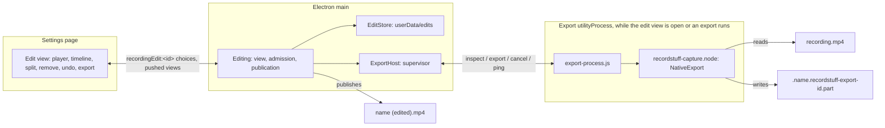
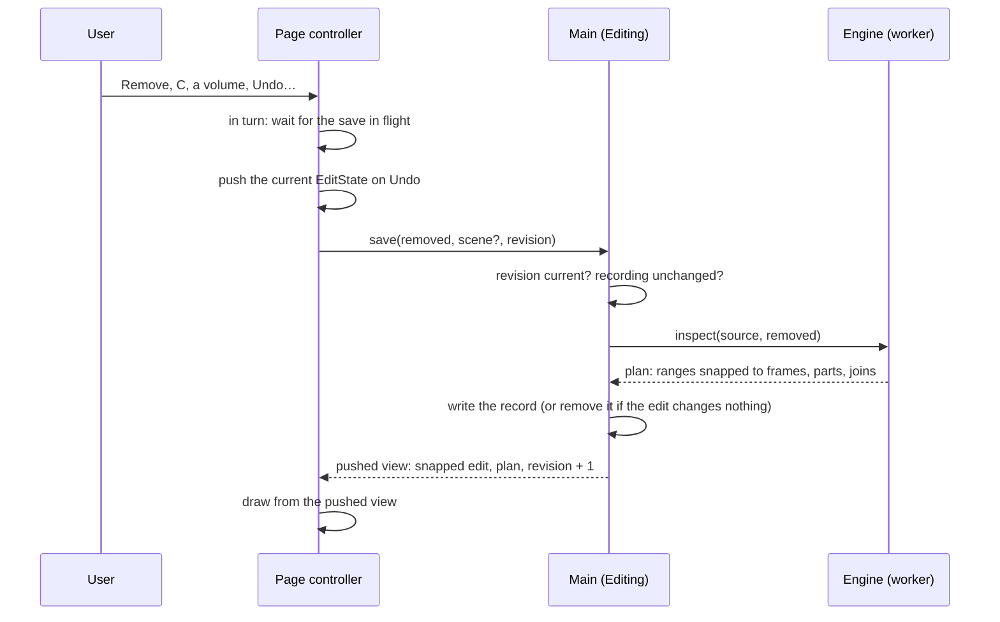

# Cutting a Recording

[English](editing.md) | [繁體中文](../zh-TW/system-design/editing.md)

Sources: the edit view's [owner in main](../../src/main/editing/editing.ts), its [edit records](../../src/main/editing/edit-store.ts), the export worker's [supervisor](../../src/main/editing/export-host.ts) and [process](../../src/main/editing/export-process.ts), the [shared contract](../../src/shared/editing.ts), the page's [controller](../../src/renderer/settings/controller/editor.ts) and [dialog](../../src/renderer/settings/tabs/library/editor.tsx); in the engine, the [source reader](../../native/capture/src/edit/source.rs), the [cut plan](../../native/capture/src/edit/plan.rs), the [remux](../../native/capture/src/edit/remux.rs), its [JavaScript interface](../../native/capture/src/export_api.rs) and the platform codecs for [macOS](../../native/capture/src/mac/edit.rs) and [Windows](../../native/capture/src/win/edit.rs). Editable recordings (plan 087) add the [shared description and scene](../../src/shared/editable.ts), the page's [camera and volumes](../../src/renderer/settings/tabs/library/editor-scene.tsx), the engine's [description](../../native/capture/src/editable.rs), [rendered export](../../native/capture/src/edit/render.rs) and its [macOS half](../../native/capture/src/mac/render.rs).

Plan 085 added the first slice of the editing phase: a recording's menu in the Recordings tab offers **Edit…**, which opens an edit view; parts of the recording are removed (at the start, the end or anywhere between, as many as wanted) and **Export** writes the kept parts to a new file beside the recording. The edit is remembered, so the view opens where it was left. The recording itself is never changed. Recording is not affected: nothing here runs during a recording, and a normal save never depends on any of it. Plan 087 added the second: a recording made with **Editable recordings** on keeps the camera and each sound input apart, so its edit view also places the camera and sets the volumes ([editable recordings](#editable-recordings)).

## The source is never written

Every path only reads the recording. Main opens it read-only to hash its ends; the engine opens it read-only to remux it. The export goes to a new file of its own, published under a name nothing holds; the edit lives in userData. Nothing in this feature opens the recording for writing, renames, moves or deletes it, so a failed, cancelled or crashed export, a full disk or a damaged edit record can lose the export or the edit, never the recording. The tests check the recording's checksum after every path, the fault injections included.

## Processes and ownership

| Part | Owns | Does not own |
| --- | --- | --- |
| `main/editing/editing.ts` | The open edit view's state, the recording's identity check, saving edits, admission, the export's temporary file, its journal and publication, clean-up at launch | Media, which never reaches main |
| `main/editing/edit-store.ts` | Edit records: path, format, atomic writes, bounded reads, the identity rule | The recording file |
| `main/editing/export-host.ts` | The worker process: lazy fork, readiness, message validation, pings, the cancel bound, crash and hang handling | Files or decisions |
| `main/editing/export-process.ts` | Loading the engine and serving one request at a time | Paths' choice, publication |
| `native/capture/src/edit` | Reading the recording's index, the cut plan, the remux into the file it is given | Names, publication, edit records |
| Renderer controller and dialog | Drawing the timeline, the transient splits and selection, Undo's stack, the preview's skipping | Saved edits or exports |

The worker is a `utilityProcess` of its own (service `RecordStuff Export`), forked when the edit view first needs the engine and ended when the view closes with nothing running, as the capture host is supervised: every message it sends is checked, a crash is its exit and a hang is two missed pongs while work is in flight. It loads the same `recordstuff-capture.node` as the capture host; main never does. Frame bytes stay in the worker; main hears plans, progress fractions and results.

## Edit records

An edit is a JSON record in `userData/edits/<hash of the recording's path>.json` (plan 085, D3), never a sidecar in the output folder, whose subfolders are the Recordings tab's categories. It holds the recording's identity (path, size, modification time and a SHA-256 of its first and last MiB), the video timescale, the removed ranges as sorted, non-overlapping integer pairs in that timescale (at most 256) and a revision; version 2 (plan 087) adds an editable recording's scene and is written only for one, so every other edit stays version 1 and readable by the version before; version 3 (2026-10-26) lets the scene's camera be hidden over stretches and is written only for such a camera. The recording is referenced, never copied.

- **One writer.** Main, which the single-instance lock makes unique per user; writes are queued in order.
- **Atomic.** A temporary file, fsync, rename and a fsync of the folder (`writeFileAtomic`'s `syncDirectory`; Windows has no folder handle to flush and journals the rename), so a failed or interrupted write leaves the last whole revision.
- **Bounded and never reset.** A record over 64 KiB, malformed, with overlapping ranges or with a newer version is reported as unreadable and kept as it is; the view says so and offers Discard, the user's explicit choice. Both versions are read field by field; no migration framework exists.
- **Stale.** A record whose identity no longer matches the file at its path is stale: the view says the recording changed and offers Discard. Nothing deletes a user's file.
- **Renamed or moved.** A recording renamed or moved to a category in the Recordings tab takes its edit along when the file is still the same; one moved in Finder leaves its edit behind.
- **Revisions.** Each save names the revision it changes; one made against an older revision is refused.

## Reading the recording

The engine reads the index of an MP4 it wrote, plain or fragmented (plan 076's hybrid file, finished or interrupted), and nothing else. Every size it reads is checked before use: the `moov` or a `moof` is read whole only up to 32 MiB, a sample may not exceed 64 MiB or reach past the end of the file, and there are at most 2^25 samples. A cut-off fragment ends the reading as it ends a player's. It refuses with a reason any file that is not one: another muxer's (Chromium-era recordings before plan 076 among them), more than one video or sound track, codecs other than H.264 and AAC, reordered pictures (`ctts`), sound packets of other than 1024 frames, a video edit list, or more than one sample description. The index takes about eight bytes a sample plus a decode time for video, the only memory that grows with the file; the samples themselves are read where they lie, in spans of at most 8 MiB.

## The cut

Removed ranges snap to the nearest frame start; the parts between them are kept. A kept part that resumes on a key frame is copied.

**Pictures (D2).** Recordings have a key frame at least every second and no reordering on both platforms, so a part may end at any frame by copying. Where one resumes inside a group of pictures, its pictures up to the next key frame (at most a second) are decoded from the preceding key frame and re-encoded by the engine's own H.264 encoder as a closed group that starts with a key frame: on macOS VideoToolbox decodes asynchronously into the recording's encoder, picture by picture, set up as for a recording but not in real time; on Windows Microsoft's software decoder and encoder. A run whose key frames are more than 4 s apart (only a damaged file has one; recordings have a key frame every second) resumes at its next key frame instead, and a run over 256 MiB is refused, so a run's pictures in memory stay bounded. The encoder is set to the source's level and frame rate, at twice the source's average bit rate (at least 2 Mbps, at most nine tenths of what the level allows, never below the source's rate). At the source's level its parameter sets were the source's own on every recording measured, so the export keeps one sample description.

Where they differ, the plan's rule was settled once by playing a file whose re-encoded pictures used a second `avc1` description (2026-10-24): AVFoundation (QuickTime's) decoded and sought it, but Chromium, the app's own player, stopped with a decode error at the first picture of the second description. So such a join resumes at the first key frame at or after the requested point, never before it: removed content never reappears and parts never overlap. The cost is up to a second less of the kept part; a part with no key frame left is dropped. The edit view marks each such join and says how much later it resumes. The engine learns the re-encoded parameter sets once per recording from one picture and the worker keeps them while the view is open, so the view's plan needs no further encoding. The second description stays in the muxer only for the fixture that repeats this check.

**Sound (the maintainer's choice of 2026-10-24, replacing D2's full re-encode).** Re-encoding the whole track ran at about 160 times real time on one thread, a sixth of the disk's speed on a 10 Mbps recording, against the gate of half. As LosslessCut, Avidemux's copy mode and `ffmpeg -c:a copy` cut sound, the AAC packets are copied unchanged; unlike them, the joins are sample-exact and faded: a window of a few packets (about 85 ms) around each join is decoded, cut to the frame, given a 5 ms raised-cosine fade on each side and re-encoded by the recording's AAC encoder, started early enough that its priming falls before the window. Copied packets keep their place only if each part starts at the same position on the 1024-frame packet grid as in the source, so the start of each part after the first moves by at most half a packet (10.7 ms at 48 kHz), by lengthening or shortening the last picture before the join. Pictures and sound move together, so inside each part their offset is exactly the source's, and the drift never accumulates. The head is not re-encoded: the copy starts two packets before the first kept frame, which the edit list skips as it skips an encoder's priming. The sound ends with the pictures or where the source's ends. No AAC edit list per join is used.

**The file.** Samples go through the engine's own muxer (`HybridMp4`) a fragment at a time, video interleaved with the sound up to the same time, and the file is made plain at the end, as a recording is. Media buffers are bounded independently of the file's length (a read span and a fragment); the output's sample index, about eight bytes a sample, grows with it, as a recording's does.

## Export, publication and clean-up

1. Main journals the temporary file's path (`userData/edits/exports-in-flight.json`, atomic) before the worker creates it, beside the recording: `.<name>.recordstuff-export-<12 hex>.part`, hidden, so the Recordings tab does not list it.
2. The worker creates it only if it does not exist, remuxes into it and syncs it in the muxer's finish; progress reaches the view about ten times a second.
3. Main publishes it under the first free `<name> (edited).mp4`, `<name> (edited 2).mp4`, and on (an export edited again counts on from its source's name: `Talk (edited)` exports as `Talk (edited 2)`, not `Talk (edited) (edited)`, whichever language named it): a hard link that fails rather than replaces, then the temporary name goes. A volume without hard links takes the name with an exclusive create, journalled first, and the file is renamed over that empty placeholder; Node has no rename that refuses to replace, so on such a volume a file another program puts at that name in the instant between the two calls would be replaced, the one exposure left. The placeholder's path is journalled before it is made and its inode once it is; it is only ever removed again while it is still that empty file. Nothing is published once the export is cancelled, even after the worker finished.
4. Cancel, a worker crash or hang, a full disk, a refused link or rename, or quit remove only the temporary file. A journal entry goes only once its file is gone; one that could not be removed (a drive away) stays for the next launch. At launch, in the journal's own queue so an export started meanwhile is journalled after it: every journalled temporary file with an export's own name, and every journalled placeholder that is still the empty file of the recorded inode, is removed; a placeholder whose inode was never recorded, and any other name, is left alone. A file that cannot be checked or removed now keeps its entry.

The listing refreshes and the new recording appears as one of its own.

## Admission

One export runs at a time, claimed as Export is pressed, before anything is awaited; it takes the edit as saved by the changes made before it, and a change made after it is refused. Before each save and export the recording's identity is checked again: one changed while its view was open shows its edit as stale and nothing is saved or exported against it. None starts while a recording, a Live preview or a save is in flight, or while RecordStuff quits; the view says why and Export is unavailable. A recording or Live preview that starts during an export cancels it (`onSessionStart`): the recording always wins. Quit cancels a running export and waits up to 2 s for it to end before the media shutdown; a publication still held up by a slow volume then leaves its temporary file journalled for the next launch. A cancelled export that has not ended within 1 s is ended with its worker. The view cannot close while it exports; its Cancel export comes first.

## The edit view

A dialog over the Recordings tab: the production player above a timeline of the recording's parts and, for an editable recording, a lane for the camera and one for each sound input. The page draws and asks; main decides and keeps. Nothing the page holds is the edit until main has saved it and pushed the view back.

### State and ownership

| State | Held by | Kept | Notes |
| --- | --- | --- | --- |
| Removed ranges, scene, revision | Main (`Editing`, `EditStore`) | In the edit record | The only edit; the page sends whole new values, never patches |
| The plan (parts, joins, export length) | Engine, through main | With the open view | Recomputed on every save; the preview follows it |
| Splits | Page controller | While the view is open | Cut the timeline into parts by hand; never saved, so an export never depends on them |
| Selection: one part or one range | Page controller | While the view is open | Always a stretch of time, never a track |
| Undo and Redo stacks of `EditState` (`removed`, `scene`, `splits`) | Page controller | While the view is open | Closing the view drops them; the record keeps only the latest edit |
| Scene draft | Page controller | While a drag or slider moves | Shown and heard at once, saved when committed |
| Lane visibility, Skimming | Page (window storage, app memory) | Across views | The window's own look; never part of the edit or the export |

### The selection model

A selection is a stretch of time across the pictures and every lane, drawn as one frame; it is never a single track. Where a click lands only decides which stretch: on the pictures, or on a lane where the edit has set nothing, the part there (parts are bounded by removed ranges and splits); on a stretch a lane's edit set (the camera hidden, a volume of its own), that stretch, so it can be changed or undone whole; a drag on any of them, the range dragged, clamped to the recording's start and end. The keyboard reaches the same stretches (each part and set stretch is a button). Each action then says which property of the stretch it changes: Remove takes the time out of every track, Hide camera changes only the camera, Volume each input on its own. So no action needs a per-track selection, and the timeline never shows one action acting on another track than it seems to. The head and tail of a recording are cut as any range is; there are no separate trim handles, since a trim was always stored as a removal touching the start or end.

### A change, end to end

- **One at a time.** Every saving change (Remove or Keep, Undo, Redo, a committed scene change, Revert) runs through one queue in the controller, after the save in flight, against the revision that save brought. A key pressed while a save is under way waits its turn instead of being lost, and the controls stay usable meanwhile; they are only unavailable while an export runs.
- **Optimistic, with revisions.** Each save names the revision it changes; main refuses one against an older revision. A refused or failed save takes its Undo entry back off, so the page never shows a change main does not hold.
- **Main snaps, the page follows.** Main sends the ranges through the engine's plan and keeps them as the plan snapped them to frame starts, a removal from the first frame kept from the recording's start. The page draws what comes back, not what it sent.
- **No empty records.** An edit that changes nothing (nothing removed, an editable recording's scene as recorded) is not kept: the save removes the record instead, so the recording reads as unedited again.
- **Splits are local.** A split, and joining a part to the one before it, change only the page's splits: a step Undo and Redo take and make again without a save.

### Undo, Redo and Revert

Undo and Redo restore whole `EditState`s; a step that changes only the splits needs no save. Revert to original recording is one change like any other: every part kept, the splits gone and an editable recording's scene as recorded, which Undo takes back while the view is open (it asks first, since the history goes with the view). The overall volumes' Reset sets both inputs' own volumes to 100% and leaves everything set on the timeline as it is.

### Keys, Escape and focus

The view's keys are handled on the dialog's root, which receives them from its popups too, since they render in the dialog's React tree. A text field keeps its keys; a slider takes only Undo and Redo, so its arrows stay its own. Escape is layered: an open popup takes it first (the overall volumes' panel, which stays open while the preview plays, takes it wherever the focus is), then the camera bubble's selection, then the timeline's selection; it never closes the view. When a change removes the focused element (an Undo merging the focused part, say) or sends the focus behind the dialog, the focus goes back to the selected part, else to the timeline, so the keys keep working; that place draws no focus ring, as the selection already shows what is chosen.

### Playing the edit larger

The preview plays an edit live; there is no edited file until Export writes one. Two ways show it larger, both playing the same edit:

- **Enlarge preview** (T, or its button over the picture) is the view's own state: the panel steps aside, the picture takes its room with the player's controls, and Escape, T or the button bring the timeline back. Nothing leaves the page.
- **Full screen** (F, a double-click, or its button) uses the player's full-screen viewer, a window of its own that covers the display without resizing RecordStuff's (desktop.md). The page waits for any change still saving, then asks main with `edited: true`; main builds a `PlaybackEdit` from the edit it holds (the skipped ranges, and for an editable recording the scene, the sounds and the preview tracks' URLs, once they are copied), never from the page, and hands it to the viewer. The viewer plays it with the same shared module as the preview (`player/edited-playback.ts`: skipping, followers, the mix), and when it is left the preview takes up at the viewer's place. The viewer's seek bar counts the recording's own time; a removed range is skipped as it plays.

A removal that would keep nothing is refused before it is sent, said a moment over the selection's actions, so nothing under the timeline grows; main still refuses one its snapping leaves empty.

### Edited recordings

`EditStore` reads once at launch which recordings hold a record and keeps the list with every save, discard and move; a recording with a record for the file's present size offers Continue editing… in its menu. An export is a recording of its own, with no link back to its source.

## Editable recordings

Plan 087. **Editable recordings** in Recording settings (macOS, off by default, locked while recording; Windows hides it until its engine supports it) records the screen, the camera and each sound input apart, so that after recording the camera's bubble can be moved, resized or hidden and the system's and the microphone's volumes set, then exported as an ordinary MP4. With it off recordings are as before; old recordings cannot gain what they never held.

**The file.** One MP4, the engine's hybrid fragmented file: the screen alone (H.264), the first sound track, the second sound track when both inputs record, and the camera at 1280×720 (H.264) when it records. Only the first track of each kind is enabled; the second sound and the camera are disabled alternates, so any player shows the screen with the first sound until it is exported. Each sound input has its own single-input mixer on the shared clock, so an input that delivers nothing records silence, never a shift; the camera's track starts at the recording's start and is black while the camera is hidden. A JSON description in `moov/udta/rsed` (at most 4 KiB, version 1) says the file is editable, which input each sound track holds and where the bubble was when the recording started; main checks it field by field ([shared](../../src/shared/editable.ts)) and treats a file without a valid one as an ordinary recording. The Recordings tab reads the box with its other facts and marks the card **Editable**. An interrupted editable recording opens and renders what it holds; a camera or second sound track left empty counts as absent.

**The scene.** The edit adds one scene for the whole recording, saved from version 2 of the edit record:

| Field | Meaning | Kept by main |
| --- | --- | --- |
| `camera.x`, `camera.y` | The bubble's place, as the Studio's camera layout (fractions of the free space) | Clamped to the picture |
| `camera.width`, `camera.height` | Its size, fractions of the shorter side; its shape is kept when resized | Bounded |
| `camera.shown` | `false` hides the camera throughout, over and above any stretches, which it keeps | — |
| `camera.hidden` | Stretches `[from, to)` hidden, at most 256 (version 3) | Sorted, merged, within the recording |
| `volumes.system`, `volumes.microphone` | Each input's own volume in percent, applied to what was recorded (100% leaves it as recorded) | Only for inputs the recording holds |
| `volumeStretches` | Per input, `[from, to, percent]` replacing its own volume there, at most 256 an input (version 3) | Sorted, apart, neighbours of one volume joined, within the recording |

The rounding and mirror stay the recording's. The scene starts where the recording left the bubble with every input at 100% (`EditorEditable.recorded`, which Revert returns to). Every stretch is on the recording's own clock in the video's timescale, as the removed ranges are, so removing or keeping a part before it never moves it. A record is written in the oldest version that holds it (1 without a scene, 2 with one, 3 once any stretch exists), so an older version keeps reading every edit it can and finds a newer one unreadable rather than misreading it. A camera hidden while recording is black in its track, not a stretch the edit starts with.

**The preview.** When the view opens, the worker copies the camera and second sound tracks into files of their own in `userData/edits/preview` (on the recording's clock, as they are, without re-encoding), served as `recordstuff-media://preview/<generation>/<track>` while that view is open, removed when it closes and at launch. The page plays them in step with the production player: they follow its play, pause, seek, rate and the removed parts it skips. The bubble is drawn over the player at the scene's place and size, with the recording's rounding and mirror. Where a stretch hides the camera, the bubble is not drawn (a hard cut, as the export makes); while any stretch exists the camera is followed frame by frame and each sound's gain is set for the playhead's time on every frame, easing over about 4 ms. The sounds go through Web Audio as the export mixes them: each at its volume, summed, through the engine's soft limit (the same curve, `softLimit` in [audio-volume](../../src/shared/audio-volume.ts)), then the player's volume and mute, so what is heard is what is exported. A track that could not be copied (a damaged file) is left out of the preview and, for the camera, of the scene, as told in the log. The media scheme answers with `access-control-allow-origin: *` so Web Audio may read it.

**The rendered export.** Nothing can be copied when the picture changes, so an editable recording's export is always rendered, even without cuts ([render.rs](../../native/capture/src/edit/render.rs)): every kept screen picture and the camera picture of its time (the last captured at or before it) are decoded by VideoToolbox, composed by the recording's own Metal compositor at the scene's bubble (or not at all when hidden throughout or when the picture's time falls in a hidden stretch, which then decodes no camera picture for it) and encoded again by the recording's H.264 encoder, not in real time, at the source's level; the sound tracks are decoded a second at a time (two packets early, as the cut's rule), mixed at the scene's volumes (a stretch's volume in place of the input's own, moving between them over a 10 ms raised cosine so a change does not click, and nothing decoded for a chunk an input is silent across) through the engine's limiter, cut at the removed ranges with 5 ms raised-cosine fades at the joins only, and encoded to one AAC track. Pictures keep their own times closed up over the removed ranges, so no join waits for a key frame, unlike a cut. Bounds: a read span, at most 8 pictures in flight (a stalled encoder fails after 10 s), a second of sound per track and a fragment per track; cancel is checked at every picture. The output has one picture and one sound track and goes through 085's publication unchanged; the source is never written. Windows has no renderer and refuses it.

## Measurements

`pnpm bench:export` (plan 085's gates, 2026-10-24, M1 Pro, APFS, sources in the page cache; [record](../verification/history-2026-10.md#plan-085-closure--2026-10-24)): the remux with cuts on key frames ran at 0.60, 0.80 and 0.83 of a streaming copy's rate by the same worker on 64 MiB, 2 GiB and two-hour 60 fps sources (gate ≥ 0.5); two joins inside groups of pictures added 330–430 ms in a fresh worker; a cancelled export ended in 2 ms at p95 (gate 1 s). The worker's own memory during an export rose 26–38 MiB over the 65 MiB an idle utilityProcess holds with the engine loaded (absolute peak 92–104 MiB); the plan's 64 MiB gate is read as that increase, since the idle process alone exceeds it (maintainer's decision, 2026-10-24). A real 60 s 1080p60 recording exported with two smart-cut joins in 575 ms and with key-frame cuts in 73 ms, against 60 ms for copying it.

Plan 087's rendered export (the ignored `render_bench` test, 2026-10-25, a synthetic 20 s 1080p30 editable recording with a 720p camera and two tones, release build): 6.3 times real time with the camera composed and both sounds mixed, cancel ended in 30–34 ms (gate: at least real time, cancel within 2 s at p95). In the app a real 10 s 1080×1920 60 fps editable recording with the camera moved and the microphone at 50% rendered in about 3.5 s; the export played in QuickTime and its sound was within 10 ms of the picture. The editable recording's own cost is in the [tooling guide](tooling.md#export-benchmark) and plan 087's [record](../verification/history-2026-10.md#plan-087-step-1-the-editable-recordings-cost--2026-10-24).

## Limits

- Windows: the remux is shared code; its decoder and encoder calls are checked by CI's Windows tests only, not on hardware.
- A recording whose level is below 3.0 (a small area at a low bit rate), the lowest High level VideoToolbox can be set to, gets other parameter sets, so its joins inside groups resume at key frames.
- An export can be cut again; a file with a second sample description (made only by the player-check fixture) cannot.
- An edit follows a recording renamed or moved in the Recordings tab, not one renamed in Finder.
- Editable recordings are macOS only. A 4:3 camera is stretched into the 16:9 track. The scene is one place for the whole recording; the camera can be hidden and each input set to a volume of its own over stretches (2026-10-26), the camera with hard cuts, the volume with a 10 ms ease and no curves, but there is no per-part placement, no mouse-event recording and no automatic zoom (plan 087's D1). A stretch's ends are moved by selecting again, not by dragging them on the lane, and the camera hidden during a recording is black in its track, not a stretch the edit starts with. The rendered export re-encodes every picture, so it is slower than a cut's copy and its pictures are a second generation.
