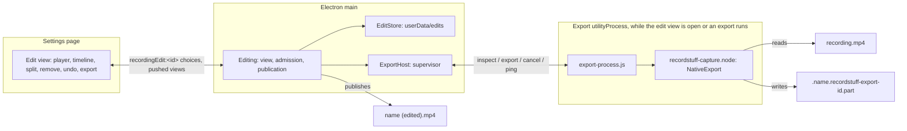

# Cutting a Recording

[English](editing.md) | [繁體中文](../zh-TW/system-design/editing.md)

Sources: the edit view's [owner in main](../../src/main/editing/editing.ts), its [edit records](../../src/main/editing/edit-store.ts), the export worker's [supervisor](../../src/main/editing/export-host.ts) and [process](../../src/main/editing/export-process.ts), the [shared contract](../../src/shared/editing.ts), the page's [controller](../../src/renderer/settings/controller/editor.ts) and [dialog](../../src/renderer/settings/tabs/library/editor.tsx); in the engine, the [source reader](../../native/capture/src/edit/source.rs), the [cut plan](../../native/capture/src/edit/plan.rs), the [remux](../../native/capture/src/edit/remux.rs), its [JavaScript interface](../../native/capture/src/export_api.rs) and the platform codecs for [macOS](../../native/capture/src/mac/edit.rs) and [Windows](../../native/capture/src/win/edit.rs).

Plan 085 added the first slice of the editing phase: a recording's menu in the Recordings tab offers **Edit…**, which opens an edit view; parts of the recording are removed (at the start, the end or anywhere between, as many as wanted) and **Export** writes the kept parts to a new file beside the recording. The edit is remembered, so the view opens where it was left. The recording itself is never changed. Recording is not affected: nothing here runs during a recording, and a normal save never depends on any of it.

## The source is never written

Every path only reads the recording. Main opens it read-only to hash its ends; the engine opens it read-only to remux it. The export goes to a new file of its own, published under a name nothing holds; the edit lives in userData. Nothing in this feature opens the recording for writing, renames, moves or deletes it, so a failed, cancelled or crashed export, a full disk or a damaged edit record can lose the export or the edit, never the recording. The tests check the recording's checksum after every path, the fault injections included.

## Processes and ownership

| Part | Owns | Does not own |
| --- | --- | --- |
| `main/editing/editing.ts` | The open edit view's state, the recording's identity check, saving edits, admission, the export's temporary file, its journal and publication, clean-up at launch | Media, which never reaches main |
| `main/editing/edit-store.ts` | Edit records: path, format, atomic writes, bounded reads, the identity rule | The recording file |
| `main/editing/export-host.ts` | The worker process: lazy fork, readiness, message validation, pings, the cancel bound, crash and hang handling | Files or decisions |
| `main/editing/export-process.ts` | Loading the engine and serving one request at a time | Paths' choice, publication |
| `native/capture/src/edit` | Reading the recording's index, the cut plan, the remux into the file it is given | Names, publication, edit records |
| Renderer controller and dialog | Drawing the timeline, the transient splits and selection, Undo's stack, the preview's skipping | Saved edits or exports |

The worker is a `utilityProcess` of its own (service `RecordStuff Export`), forked when the edit view first needs the engine and ended when the view closes with nothing running, as the capture host is supervised: every message it sends is checked, a crash is its exit and a hang is two missed pongs while work is in flight. It loads the same `recordstuff-capture.node` as the capture host; main never does. Frame bytes stay in the worker; main hears plans, progress fractions and results.

## Edit records

An edit is a version-1 JSON record in `userData/edits/<hash of the recording's path>.json` (plan 085, D3), never a sidecar in the output folder, whose subfolders are the Recordings tab's categories. It holds the recording's identity (path, size, modification time and a SHA-256 of its first and last MiB), the video timescale, the removed ranges as sorted, non-overlapping integer pairs in that timescale (at most 256) and a revision. The recording is referenced, never copied.

- **One writer.** Main, which the single-instance lock makes unique per user; writes are queued in order.
- **Atomic.** A temporary file, fsync, rename and a fsync of the folder (`writeFileAtomic`'s `syncDirectory`; Windows has no folder handle to flush and journals the rename), so a failed or interrupted write leaves the last whole revision.
- **Bounded and never reset.** A record over 64 KiB, malformed, with overlapping ranges or with a newer version is reported as unreadable and kept as it is; the view says so and offers Discard, the user's explicit choice. No migration framework exists until a version 2 does.
- **Stale.** A record whose identity no longer matches the file at its path is stale: the view says the recording changed and offers Discard. Nothing deletes a user's file.
- **Renamed or moved.** A recording renamed or moved to a category in the Recordings tab takes its edit along when the file is still the same; one moved in Finder leaves its edit behind.
- **Revisions.** Each save names the revision it changes; one made against an older revision is refused.

## Reading the recording

The engine reads the index of an MP4 it wrote, plain or fragmented (plan 076's hybrid file, finished or interrupted), and nothing else. Every size it reads is checked before use: the `moov` or a `moof` is read whole only up to 32 MiB, a sample may not exceed 64 MiB or reach past the end of the file, and there are at most 2^25 samples. A cut-off fragment ends the reading as it ends a player's. It refuses with a reason any file that is not one: another muxer's (Chromium-era recordings before plan 076 among them), more than one video or sound track, codecs other than H.264 and AAC, reordered pictures (`ctts`), sound packets of other than 1024 frames, a video edit list, or more than one sample description. The index takes about eight bytes a sample plus a decode time for video, the only memory that grows with the file; the samples themselves are read where they lie, in spans of at most 8 MiB.

## The cut

Removed ranges snap to the nearest frame start; the parts between them are kept. A kept part that resumes on a key frame is copied.

**Pictures (D2).** Recordings have a key frame at least every second and no reordering on both platforms, so a part may end at any frame by copying. Where one resumes inside a group of pictures, its pictures up to the next key frame (at most a second) are decoded from the preceding key frame and re-encoded by the engine's own H.264 encoder as a closed group that starts with a key frame: on macOS VideoToolbox decodes asynchronously into the recording's encoder, picture by picture, set up as for a recording but not in real time; on Windows Microsoft's software decoder and encoder. A run whose key frames are more than 4 s apart (only a damaged file has one; recordings have a key frame every second) resumes at its next key frame instead, and a run over 256 MiB is refused, so a run's pictures in memory stay bounded. The encoder is set to the source's level and frame rate, at twice the source's average bit rate (at least 2 Mbps, at most nine tenths of what the level allows, never below the source's rate). At the source's level its parameter sets were the source's own on every recording measured, so the export keeps one sample description.

Where they differ, the plan's rule was settled once by playing a file whose re-encoded pictures used a second `avc1` description (2026-10-24): AVFoundation (QuickTime's) decoded and sought it, but Chromium, the app's own player, stopped with a decode error at the first picture of the second description. So such a join resumes at the first key frame at or after the requested point, never before it: removed content never reappears and parts never overlap. The cost is up to a second less of the kept part; a part with no key frame left is dropped. The edit view marks each such join and says how much later it resumes. The engine learns the re-encoded parameter sets once per recording from one picture and the worker keeps them while the view is open, so the view's plan needs no further encoding. The second description stays in the muxer only for the fixture that repeats this check.

**Sound (the maintainer's choice of 2026-10-24, replacing D2's full re-encode).** Re-encoding the whole track ran at about 160 times real time on one thread, a sixth of the disk's speed on a 10 Mbps recording, against the gate of half. As LosslessCut, Avidemux's copy mode and `ffmpeg -c:a copy` cut sound, the AAC packets are copied unchanged; unlike them, the joins are sample-exact and faded: a window of a few packets (about 85 ms) around each join is decoded, cut to the frame, given a 5 ms raised-cosine fade on each side and re-encoded by the recording's AAC encoder, started early enough that its priming falls before the window. Copied packets keep their place only if each part starts at the same position on the 1024-frame packet grid as in the source, so the start of each part after the first moves by at most half a packet (10.7 ms at 48 kHz), by lengthening or shortening the last picture before the join. Pictures and sound move together, so inside each part their offset is exactly the source's, and the drift never accumulates. The head is not re-encoded: the copy starts two packets before the first kept frame, which the edit list skips as it skips an encoder's priming. The sound ends with the pictures or where the source's ends. No AAC edit list per join is used.

**The file.** Samples go through the engine's own muxer (`HybridMp4`) a fragment at a time, video interleaved with the sound up to the same time, and the file is made plain at the end, as a recording is. Media buffers are bounded independently of the file's length (a read span and a fragment); the output's sample index, about eight bytes a sample, grows with it, as a recording's does.

## Export, publication and clean-up

1. Main journals the temporary file's path (`userData/edits/exports-in-flight.json`, atomic) before the worker creates it, beside the recording: `.<name>.recordstuff-export-<12 hex>.part`, hidden, so the Recordings tab does not list it.
2. The worker creates it only if it does not exist, remuxes into it and syncs it in the muxer's finish; progress reaches the view about ten times a second.
3. Main publishes it under the first free `<name> (edited).mp4`, `<name> (edited 2).mp4`, and on: a hard link that fails rather than replaces, then the temporary name goes. A volume without hard links takes the name with an exclusive create, journalled first, and the file is renamed over that empty placeholder; Node has no rename that refuses to replace, so on such a volume a file another program puts at that name in the instant between the two calls would be replaced, the one exposure left. The placeholder's path is journalled before it is made and its inode once it is; it is only ever removed again while it is still that empty file. Nothing is published once the export is cancelled, even after the worker finished.
4. Cancel, a worker crash or hang, a full disk, a refused link or rename, or quit remove only the temporary file. A journal entry goes only once its file is gone; one that could not be removed (a drive away) stays for the next launch. At launch, in the journal's own queue so an export started meanwhile is journalled after it: every journalled temporary file with an export's own name, and every journalled placeholder that is still the empty file of the recorded inode, is removed; a placeholder whose inode was never recorded, and any other name, is left alone. A file that cannot be checked or removed now keeps its entry.

The listing refreshes and the new recording appears as one of its own.

## Admission

One export runs at a time, claimed as Export is pressed, before anything is awaited; it takes the edit as saved by the changes made before it, and a change made after it is refused. Before each save and export the recording's identity is checked again: one changed while its view was open shows its edit as stale and nothing is saved or exported against it. None starts while a recording, a Live preview or a save is in flight, or while RecordStuff quits; the view says why and Export is unavailable. A recording or Live preview that starts during an export cancels it (`onSessionStart`): the recording always wins. Quit cancels a running export and waits up to 2 s for it to end before the media shutdown; a publication still held up by a slow volume then leaves its temporary file journalled for the next launch. A cancelled export that has not ended within 1 s is ended with its worker. The view cannot close while it exports; its Cancel export comes first.

## The edit view

A dialog over the Recordings tab: the production player above a timeline of the recording's parts, side by side as long as they last, a kept part tinted and a removed one hatched, with the playhead. A part is selected by clicking it (each is a button named by its times and state); **Split** (S) cuts the timeline at the playhead without removing anything; **Remove part** or **Keep part** (Delete) toggles the selection; **Undo** (⌘Z / Ctrl+Z) takes the last change back. Each change is saved at once and comes back snapped to frames. The preview plays what the export will hold, as the engine planned it: a frame shown in a removed range, or before a part's later key-frame resume, jumps to where the export continues, or pauses at the start of a removed tail. Export shows its progress and Cancel export, then the published name with Show in Finder (Open folder on Windows), or what failed with Export again. A stale or unreadable edit, a file that cannot be cut and a recording that went away each have their own state. English and Traditional Chinese.

## Measurements

`pnpm bench:export` (plan 085's gates, 2026-10-24, M1 Pro, APFS, sources in the page cache; [record](../verification/history-2026-10.md#plan-085-closure--2026-10-24)): the remux with cuts on key frames ran at 0.60, 0.80 and 0.83 of a streaming copy's rate by the same worker on 64 MiB, 2 GiB and two-hour 60 fps sources (gate ≥ 0.5); two joins inside groups of pictures added 330–430 ms in a fresh worker; a cancelled export ended in 2 ms at p95 (gate 1 s). The worker's own memory during an export rose 26–38 MiB over the 65 MiB an idle utilityProcess holds with the engine loaded (absolute peak 92–104 MiB); the plan's 64 MiB gate is read as that increase, since the idle process alone exceeds it (maintainer's decision, 2026-10-24). A real 60 s 1080p60 recording exported with two smart-cut joins in 575 ms and with key-frame cuts in 73 ms, against 60 ms for copying it.

## Limits

- Windows: the remux is shared code; its decoder and encoder calls are checked by CI's Windows tests only, not on hardware.
- A recording whose level is below 3.0 (a small area at a low bit rate), the lowest High level VideoToolbox can be set to, gets other parameter sets, so its joins inside groups resume at key frames.
- An export can be cut again; a file with a second sample description (made only by the player-check fixture) cannot.
- An edit follows a recording renamed or moved in the Recordings tab, not one renamed in Finder.
