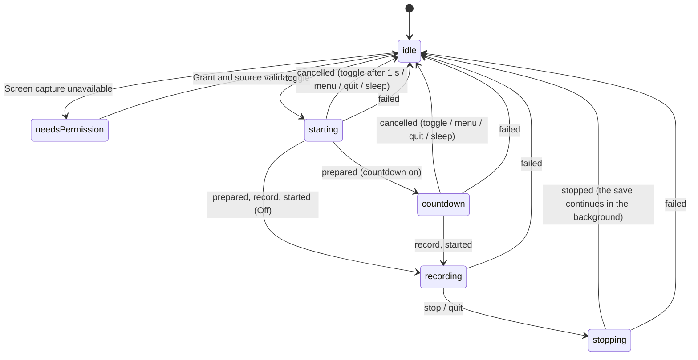

# Recording Pipeline and Storage

[English](recording.md) | [繁體中文](../zh-TW/system-design/recording.md)

Sources: [Recorder](../../src/main/recording/recorder.ts), [native capture host](../../src/main/recording/native-capture-host.ts) and [its process](../../src/main/recording/native-host-process.ts), [protocol](../../src/shared/protocol.ts), [engine file writer](../../src/main/recording/engine-file-writer.ts) and [publication](../../src/main/recording/file-writer.ts), [health thresholds](../../src/main/recording/recording-health.ts), [countdown values](../../src/shared/countdown.ts), [session sentinels](../../src/main/recording/session-sentinel.ts), [quality](../../src/shared/quality.ts), [display selection](../../src/main/display/display-media.ts), [own-window exclusion on Windows](../../src/main/recording/capture-exclusion.ts); the engine in [native/capture](../../native/capture/src): its [session core](../../native/capture/src/core/mod.rs), [pacing](../../native/capture/src/pacing.rs), [clock](../../native/capture/src/timing.rs), [mixer](../../native/capture/src/core/mixer.rs), [writer](../../native/capture/src/writer.rs), [muxer](../../native/capture/src/mux/mp4.rs), and the [macOS](../../native/capture/src/mac) and [Windows](../../native/capture/src/win) modules.

RecordStuff records through one path, the native engine of plan 076. For each attempt main forks an Electron `utilityProcess` (`RecordStuff Capture`) that runs the capture host and loads the Rust module (`recordstuff-capture.node`, built with napi-rs and unpacked from the asar archive). The engine captures (ScreenCaptureKit on macOS; Windows.Graphics.Capture and WASAPI on Windows), encodes with the platform's encoders (VideoToolbox and AudioToolbox; Media Foundation), muxes and writes the file itself (plan 076's D3, 2026-10-14). Main keeps the file's lifecycle: the folder and name, the free-space checks, the session sentinel, publication under the final name, history, notifications, and the state machine with its deadlines, quit and sleep. A native crash ends only the capture process; main fails the session and keeps what was written. The earlier path, a hidden Chromium renderer that recorded with `getDisplayMedia` and `MediaRecorder` and sent one-second pieces to main's writer, was removed on 2026-10-16. Platforms other than macOS and Windows have no engine: a recording there fails because the module does not load.

## State and user actions



NeedsPermission carries needsRelaunch. Idle may carry outputDirUnavailable. Countdown carries `remaining`, whole seconds, at least 1 and kept at 1 while `record` waits for `started`. A session's end (stopped or failed) settles into needsPermission instead of idle when the latest permission status is not granted ([screen permission](desktop.md#screen-permission)). Recording carries an ISO startedAt. Failure is an event, not a persistent failed state; a cancel is neither a failure nor a state. Clicking without permission emits permissionRequested; clicks during stopping, and during the first second of starting, are ignored and logged. During the countdown, and once a start has lasted a second, a click or the shortcut cancels (see [countdown](#countdown)). The Recorder's internal phases are finer than the state: `opening` (folder and file), `preparing` (until `prepared`), `countdown`, `arming` (`record` sent, waiting for `started`), `recording` and `stopping`.

## Start

1. Recorder checks idle/no existing session and OS preflight (macOS 13 or later), captures the quality and countdown snapshots, creates a session ID, and enters starting (the tray shows the hourglass).
2. ensureWritableDir creates only the default folder; custom folders must exist. It writes/removes a probe and rejects starts below 200 MiB free; a free-space lookup that fails is logged and the start proceeds, as the guard during recording does. Failure never silently selects a different folder. A check still unanswered at its attempt's deadline (a network volume that stopped answering) holds one of the main process's four file-system threads, so a new attempt on that folder waits on the same check instead of starting another until it answers.
3. Write the session's interruption sentinel naming the temporary path, then reserve `YYYY-MM-DD HH-mm-ss.recording.mp4` (local time, or the file-name template): `EngineFileWriter.open` creates it empty with exclusive `wx` and closes it, and the engine later opens that same file for writing, never creating a name of its own. A temporary-file collision rewrites the sentinel and retries suffixes `-2` through `-10`. The name is the local time of the start request, so with a countdown it precedes the first frame by preparation plus the countdown.
4. With a countdown, the overlay window is built now so the first digit appears on time. `NativeCaptureHost.start` ends any earlier capture process, registers the file whose outcome it will report, forks a fresh process and, at the same time, resolves the display through `DisplayMedia` ([screen selection](#screen-selection)), so neither waits for the other. With the microphone on (plan 074) main also asks macOS for microphone access alongside them, if macOS never has (`askMicrophoneAccess`), so the system prompt comes as the first recording with the microphone starts; the tray stays at starting without a countdown while it waits, `start` is posted only after the answer, within the 120 s capture-request deadline, and a refusal is left to the engine to report. The process must report `ready` within 8 s; the heartbeat starts. A refused display becomes a host `capture_start_failed` that main's refusal reason replaces. On Windows main computes a physical point on the display and marks its own windows excluded from capture ([own windows](#own-windows-and-system-ui)). Main then posts `start` with the quality snapshot and the native options: display ID, the Windows point, the reserved path, RecordStuff's process IDs (main first), the D6 switch (macOS only) and, with the microphone on, the chosen input's ID (none for the system default).
5. The host asks the engine to `probe` the display's size in pixels, applies the quality rules to choose the output size and the video bit rate ([quality](#quality-and-encoding)), and calls `prepare`. On macOS preparing reads the shareable content (kept 2 s from the probe, so an attempt asks the system once; bounded at 15 s; a missing grant fails here as `permission_denied`), finds the display (`no_display` when it is not shareable), builds the content filters, opens the reserved file, makes the encoders on their own thread while the `SCStream` starts (bounded at 10 s), and waits up to 3 s for the first frame. Windows does the same with its own sources (its first-frame bound is also 3 s; audio activation 5 s). With the microphone on, prepare also opens it (AVFoundation's `AVCaptureSession` on macOS, a WASAPI endpoint on Windows): access not allowed (denied, restricted, or never asked, since AVFoundation would then deliver silence), no input device, or a device that does not open fails the start as `microphone_unavailable`. A chosen input that is not connected (on Windows, also one not active) falls back to the system default input, and the report's warnings say `microphone: {id} is not connected; the default input is used`. From here capture runs, but only the newest frame is kept and nothing is written. The host replies `prepared` with the CaptureReport and logs `timing: probe … ms, prepare … ms (content …, filter …, stream start …, …)`; main logs `process ready` and `display chosen`, and its `prepared` line ends `mic off` or `mic on (<name>)` with the device the engine opened (CaptureReport's `microphone`). Permission, display, encoder, audio and microphone errors therefore all surface before any countdown. A stop that arrives while the engine prepares makes the host cancel it as soon as `prepare` returns and answer `stopped`.
6. With the countdown Off, main sends `record` at once. Otherwise it counts down ([countdown](#countdown)) and sends `record` at the end.
7. The engine takes the recording's time zero on its clock, starts its writer thread and returns at once; the host replies `started` (2 ms from `record` on 2026-10-14). The engine's refresh thread then encodes the newest captured frame at time zero as a key frame, so the file starts with a picture however still the screen is, and only then lets later frames and sound in. Main enters recording, emits captureStarted with the report from `prepared`, and arms the first-media deadline, the stall guard and the disk guard. REC appears only after capture began, so the first frames may show the stopwatch in the menu bar, as they showed `…` before; the digit never appears in them. The engine reports the bytes it has written once a second while media arrives (`progress`); the first nonzero report must come before the first-media deadline, and its log line (`first chunk … bytes (engine progress)`, a name kept from the hidden renderer because the acceptance runners time to it) marks it.

Measured on a signed bundle (plan 076, 2026-10-14 and 2026-10-15): pressing the shortcut to `prepared` took 457–535 ms, against 347–369 ms through Chromium; the native time is the process start (74–88 ms), the shareable-content query (59–83 ms) and ScreenCaptureKit's `startCapture` (206–227 ms). Starting the process ahead of time brought it to 437–439 ms at the cost of an idle process of about 73 MB; the maintainer declined that on 2026-10-15, since about 50 ms is inside the countdown, so no capture process exists between recordings. With the microphone on, `prepared` came after 611 and 666 ms, against about 440–670 ms with it off (plan 074, 2026-10-16).

## Countdown

Settings → Recording chooses Off, 3, 5 or 10 seconds; the default is 3, also for a settings file written before the field existed. Recording measured 318 ms from click to capture in the 2026-09-25 hotkey round ([plan 040 closure](../verification/history-2026-09.md#plan-040-closure--2026-09-26)), so the first frames showed the pointer leaving the menu bar and RecordStuff has no editor to trim them. Capture is prepared before the count and started at zero, as Cap does ([decision](decisions.md)).

- Recorder enters `countdown` with N and ticks once per second from one monotonic anchor taken at `prepared`; every tick is scheduled from that anchor, so timer lateness never accumulates. Each tick re-emits the state; the app logs `state → countdown (n)`.
- 300 ms before N seconds it asks the overlay to leave: the digit fades out over 120 ms and main destroys the window after one more settle interval (34 ms). Recorder waits for that confirmation at most 500 ms; past it the window is destroyed, the timeout is logged and capture proceeds. `record` goes out at N seconds, or when the dismissal settles if that is later.
- The overlay ([desktop](desktop.md#countdown-overlay)) is injected as a presenter with `show`, `update`, `dismiss` and `close`, so Recorder stays free of Electron. Presenter errors are logged and never fail a recording; the tray still shows the countdown.
- The countdown sound (plan 046, on by default, switchable in Settings → Recording) is read once per session with the countdown and passed to the presenter; the `prepared` log line ends with `sound on` or `sound off`. The overlay page plays a soft 523 Hz marimba-like tick at −20 dBFS with each new digit, the digit 1 a fifth higher, and nothing at zero, on cancel or with the countdown Off. Each tick lasts 140 ms from the digit's tick time, so the last one, with the digit 1, ends 860 ms before `record` and long before the overlay leaves: the recording stays clean by time separation, as the digit does, besides the engine leaving RecordStuff's own sound out ([audio](#audio)). `pnpm acceptance` checks the first 500 ms of a ticking session's audio at both pitches. Autorecord never ticks, so matrix and audio-quality recordings keep the material's audio alone.
- A toggle, the tray menu's Cancel recording or the shortcut before `record` cancels the attempt: timers cleared, host stopped, overlay closed, writer abandoned so the empty temporary file is removed, and the idle state from before the attempt returns. A `cancelled` event names the reason (`toggle`, `menu`, `quit` or `sleep`) and the log says `cancelled: session … (reason); no media was recorded`. No failure status, history entry, notification or display diagnostic is produced.
- After `record` was sent, a toggle becomes the existing stop-on-start request applied once `started` arrives, so a race of a few milliseconds cannot leave capture running. Should capture stop before its first frame, nothing was recorded: the attempt ends as that cancel (or quit or sleep), not as a failed start. With the countdown Off, `record` goes out at `prepared` while the state still reads starting, so the menu's Cancel recording, or a toggle after the grace, becomes the same request. A tray menu opened during the countdown is not updated while it stays open ([desktop](desktop.md#tray-and-notifications)), so its Cancel recording chosen after capture began stops the recording, which is saved.
- A toggle while starting (plan 065) cancels the attempt exactly as Cancel recording does once the start has lasted `START_CANCEL_GRACE_MS`, 1 s, on the Recorder's monotonic clock from the session's request, taken in the same step that enters starting: opening the folder or preparing capture, it is cancelled with no file, failure entry or notification; after `record`, it becomes stop-on-start. Within the grace the press is a double press and is ignored, as is every press while stopping; both are logged (`recorder: session <id> toggle ignored while starting (<n> ms after the start)` and `… while stopping (<n> ms after the stop)`), so a report that the shortcut did nothing can be told from a lost key. The starting menu's Cancel recording names the registered shortcut, as the countdown's does ([desktop](desktop.md#tray-and-notifications)).
- Plan 065's decisions, the maintainer's on 2026-10-03, rest on the retained log of 2026-09-12 to 2026-10-02, recorded through the hidden renderer: 739 starts with a median of 289 ms and a 95th percentile of 396 ms; the nine over 1 s all waited in preparation (1.1–9.4 s for permission denials, a missing audio track and the earlier 8 s limit; 120 s four times while the capture request stayed pending), none in opening the folder, and one, on 2026-09-13, after `record`. The fastest logged double press was 290 ms. The grace is 1 s rather than "at any time while starting" or "only while preparing"; the starting Cancel recording names the shortcut; and quit while opening or preparing cancels at once (see [terminal ownership](#terminal-ownership-and-normal-exit)) instead of waiting for the capture request, which once held a quit for 286 s.
- Every timing and appearance value lives in [countdown.ts](../../src/shared/countdown.ts) as an initial target; tune them only with written evidence.

## Deadlines and supervision

| Protection | Default | Outcome |
| --- | --- | --- |
| Folder/open phase | 8 s (`DEFAULT_START_TIMEOUT_MS`) | output_open_failed; a late writer is abandoned |
| Host ready | 8 s (`readyTimeoutMs`) | Start rejects as capture_start_failed; the next attempt forks a new process |
| Capture/interactive permission request (`start → prepared`) | 120 s | capture_start_failed and stop session |
| Inside the engine's prepare (macOS) | Shareable content 15 s, stream start 10 s, first frame 3 s | capture_start_failed (permission_denied for a missing grant) |
| Inside the engine's prepare (Windows) | Audio activation 5 s, first frame 3 s | capture_start_failed |
| Countdown overlay dismissal | 500 ms from the dismiss request, which comes 300 ms before N | Destroy the overlay, log it, record anyway |
| `record → started` | 8 s | capture_start_failed (while starting capture) |
| First nonzero `progress` after started | 8 s | capture_start_failed; preserve any written data |
| Next nonzero `progress` after media began | Warn once at 10 s, fail at 30 s; reset by every nonzero report, disarmed by stopped or failure | capture_failed with a stall detail; preserve the partial file |
| Output-folder free space | Poll every 5 s from started until stop; log once below 1 GiB | Below 200 MiB request the normal stop once; saved with a disk-almost-full reason, not a failure |
| Stop response (`stop → stopped`) | 10 s | stop_timeout |
| Sound up to the stop | The engine waits up to 250 ms | What has not arrived is silence; logged |
| File finish after `stopped` | Engine 120 s; host process 150 s (`FINISH_BOUND_MS`) | output_write_failed (engine), or the process is ended (host); the file is kept either way |
| Slow save | 30 s (`saveSlowMs`) | Logged and told once (`savingSlow`); never abandoned |
| Own windows let back in (Windows) | When the capture process exits, at most 5 s after it was told to end | Windows are capturable again |
| Quit wait | 13 s per attempt (stop timeout + 3 s) | Defer quit with localized feedback while any owned work remains; never truncate finalization |
| Heartbeat | Ping every 5 s while a session is in flight | Tear down when the check finds two unanswered pings: capture_host_unresponsive |

Before `record` nothing was captured, so the end of a source, display removal, a crashed or unresponsive host and a refused or timed-out `record` during preparation or countdown are start failures: `capture_start_failed` with a detail naming the phase (`while preparing capture`, `while counting down`, `while starting capture`), the display diagnostic still emitted and an empty outcome. A stale `prepared`, `started` or `progress` for a detached session triggers a host stop, so an abandoned attempt cannot keep capturing unseen.

These are project waiting limits, not OS standards or exact end-to-end timing guarantees. A timed-out disk operation is not actually canceled. The main-side health rows (stall, free space, slow save) are initial targets kept in one place, [recording-health.ts](../../src/main/recording/recording-health.ts); tune them only with written evidence. Heartbeats only prove the capture process's JavaScript answers; the stall guard proves the engine still writes media. The engine's writer sends `progress` only when media reached it during the last second, and a healthy still recording keeps sending it, because the engine encodes the last frame again every second while the screen stands still ([frame pacing](#frame-pacing)) and the audio track advances with the clock. A failed free-space poll is logged once and never stops a recording. `powerMonitor` suspend and resume are logged with the in-flight session ID so a later failure can be read against sleep; how sleep itself stops a recording or cancels an attempt is described under [file completion](#file-completion-and-failure).

## Terminal ownership and normal exit

The first failure wins at every layer. The engine reports the first capture or encoding failure once, as `capture_failed` while recording or draining to the stop and `capture_start_failed` while only prepared, and none once its drain has ended. The host forwards engine events only while its session lasts and drops that session as it sends `stopped`, so later capture events belong to nobody; from then on the engine answers only for the file, with `finished` or `writeError`. Main validates every inbound message (`isHostMessage`) and drops malformed ones; a host that sends a code only main can find (folder, disk deadline, supervision, launch) is malformed rather than believed. A `stopped` that arrives while the Recorder is not stopping is `capture_failed` ("capture host ended capture without a stop request").

Once Recorder accepts `stopped`, its finalizer owns the attempt and the recording is over: since 2026-10-09 the state returns to idle at once, releasing the display-sleep hold, and the file is finished in the background (the engine making it plain MP4, then main's size check and publication), owned like other recording work, so quit still waits for it, while the next recording may already start. `NativeCaptureHost` keeps the finishing process alive after the attempt is torn down, hands its outcome to the writer and ends the process afterwards, or once 150 s have passed (the engine's own bound is 120 s); a process that exits before reporting fails the save with the file kept. On the desktop the Recorder was idle 0–1 ms after `stopped` and the file finished 19–22 ms later (2026-10-15). `Recorder.saving` lists those saves for the tray and Settings; one still running after `saveSlowMs` (30 s, a drive that stopped answering) is logged and told once (`savingSlow`), and main never abandons it: a slow drive that still works finishes it, within the engine's bound. Its outcome (saved, failed with the partial kept, or the cancel of a start stopped before its first frame) is reported without touching the state, which may belong to the next recording by then; a save that finishes during that recording holds its saved notification until the recording ends, as the capture notices are held. Late host crashes/errors, duplicate stop messages and display removal cannot abandon a publishing file; the engine's write error still enters failure cleanup. All opening/finalizing/cleanup operations are registered before synchronous subscribers run. An opening timeout returns UI to idle immediately, but its result stays pending until the late open and close settle. Multiple failed attempts retain independent cleanup ownership.

Every `before-quit`, including idle, uses `installQuitCoordinator`. Repeated requests join one attempt and new recordings are blocked during admission. Capture is stopped automatically. No media exists before `record`, so quit never records a session that has not started (plan 040, for every countdown setting): quit during the countdown, while the folder opens or during preparation cancels it at once, as Cancel recording does (plan 065; before it, quit during preparation waited for `prepared` or the 120 s capture-request deadline). The host is told to stop and cancels the engine as soon as its prepare returns, so a late `prepared` is a stale session's and is stopped again; a folder check still in flight stays owned by the cancelled attempt, and quit waits for it. The attempt is also marked when quit is requested, so whatever ends it before the coordinator's check runs is that cancel. Only a session whose `record` was already sent keeps stop intent, so capture stops and saves as soon as it starts. Success requires no session and no outstanding work, including late opens, earlier failed attempts and failure-result verification/publication. The quit deadline only defers exit; the existing stop-response timer retains authority over a started capture's failure. Pending disk/result-publication work stays owned, the app stays open and the user can retry quitting. The app never destroys the host or exposes an unconfirmed retained path merely to meet a quit deadline. Force-quit, process kill and power loss bypass these guarantees and nothing is repaired afterwards; what the engine had written stays a fragmented MP4 readable up to its last whole fragment ([plain MP4 at save](#plain-mp4-at-save)). The one exit that does not wait for media is offered only while a quit waits for saves in the background alone: Quit Without Waiting for the Save (2026-10-09, [desktop](desktop.md#deferred-quit)) exits after bounded metadata flushes and leaves those saves' sentinels. The next launch reports such a session through its interruption sentinel (see [file completion](#file-completion-and-failure)). Only after this media phase does quit attempt the failure-history save; its explicit metadata-only exit can never abandon media work (see [desktop](desktop.md#deferred-quit)). Windows ends a session (shutdown, restart, sign-out) without `before-quit`, so each window's `query-session-end` is answered instead ([session-end.ts](../../src/main/app/session-end.ts), 2026-10-05): while recording work is pending the end is refused and the same quit runs; once it exits Windows goes on. With nothing pending the session ends as chosen. The hold is certain only while a window is visible (Settings open): Windows terminates an app with no visible window that refuses the end without a reason registered through ShutdownBlockReasonCreate, which Electron does not expose, so a recording made from the menu bar alone gets its stop and save started at once but may be terminated before they finish. Not verified on Windows hardware.

## Quality and encoding

| Setting | Rule |
| --- | --- |
| Video quality | Economy 0.07, Standard 0.13, High 0.24 bits/pixel/frame |
| Video bit rate | Output width × height × frame-rate setting × coefficient, rounded to 100 kbps, clamped to 1.5–60 Mbps; the encoder's average bit rate |
| Resolution | The probed source size in pixels unchanged; 1080p/1440p/4K caps preserve aspect/orientation, never upscale, and use even dimensions when downscaling. The engine scales to that size: `SCStreamConfiguration`'s width and height on macOS, the Direct3D 11 video processor on Windows |
| Frame rate | 30/60; only darwin enables 60; other platforms use 30 without rewriting stored settings. The setting is the encoder's rate and the pacer's grid ([frame-rate request](#frame-rate-request)) |
| Video codec | H.264: no frame reordering (decode order is presentation order, so no composition offsets), a key frame at least every second of presentation time (each fragment starts at one), BT.709 tags |
| Audio | AAC-LC, 48 kHz stereo, 256,000 bps target; Windows' encoder takes at most 192 kbps, so it records at 192 and says so in the warnings |
| Format | MP4 with H.264 + AAC (`video/mp4;codecs=avc1,mp4a.40.2`, reported in `prepared`), written as hybrid MP4 ([plain MP4 at save](#plain-mp4-at-save)) |

The host computes the size and bit rate from the settings in [quality.ts](../../src/shared/quality.ts) once the engine has probed the source, and passes them to `prepare`; the engine never reads settings. Encoders (plan 076's D4): on macOS VideoToolbox, which uses the Mac's media engine when it has one, and AudioToolbox's AAC converter; on Windows Media Foundation's H.264 and AAC transforms. Windows uses Microsoft's software H.264 encoder, which every edition with the media features has and which also runs on a device without a GPU; a GPU's hardware encoder (an asynchronous transform) is not implemented ([video.rs](../../native/capture/src/win/video.rs)). A Windows edition without Media Foundation fails the start as `capture_start_failed` with the detail `Media Foundation could not start`; there is no dedicated code for it. 60 fps stays macOS-only (`isFrameRateAvailable`): other platforms remain unverified at 60.

CaptureReport keeps its fields, so the Recorder's log and notices are unchanged: the output width and height, the frame-rate setting, 48,000 Hz and 2 channels, the requested bit rates, and warnings, which hold the engine's own (a macOS that cannot leave the menu bar out, RecordStuff not found among the shareable applications, Windows' lowered AAC rate) and a summary line (`native engine: source WxH, AAC priming N frames, X own app(s) excluded, Y system window(s) hidden`). Because the reported rate is the setting, the 60-to-30 downgrade notice (`frameRateDowngrade`) cannot fire natively, and because the engine scales to the size it was given, it never sets `capUnconfirmed`; both paths remain in the code. The bit rates are targets, not measured output; output still needs ffprobe measurement.

### Frame-rate request

The frame-rate setting goes to the engine unchanged, as the encoder's rate and the [pacer](#frame-pacing)'s grid. Capture itself is asked for more: a minimum frame interval of a quarter of the frame interval (`Pacer::capture_interval_ns`, 8.3 ms at 30 fps and 4.2 ms at 60), set as `SCStreamConfiguration.minimumFrameInterval` on macOS and `MinUpdateInterval` on Windows, well below any display's refresh period at these rates, so capture delivers every refresh and every slot has a frame near it. ScreenCaptureKit's minimum interval is a floor, not a period, and it delivers on the display's refresh: asked for an interval near the frame rate's, each frame lands two or three refreshes after the last, and 30 fps on a 60 Hz display comes out 33 or 50 ms apart. Measured on the signed bundle: twice the frame rate dropped 1.8% of 30 fps frames to 50 ms gaps (2026-10-14); asking for every refresh by name (no minimum interval) dropped 0.17% at both 30 and 60 fps against 0.06% and 0.11% with a quarter, for about the same CPU (10.8% against 10.4% of a core at 30 fps, 14.4% against 15.0% at 60; 2026-10-15). The quarter stays.

The hidden renderer met the same floor through Chromium and asked for 30.3 and 62.5 fps to record the setting (plan 041; results in the [verification history](../verification/history-2026-09.md#plan-041-closure--2026-09-26)); that request was removed with it.

## Frame pacing

The engine keeps one captured frame per slot of a grid anchored at the recording's time zero with the frame rate's interval ([pacing.rs](../../native/capture/src/pacing.rs)), as OBS's frame-rate divisor and Cap's pacing do: a 60 Hz display then gives 30 fps exactly, each kept frame two refreshes after the last. A frame more than half an interval before the next slot is left out; one at or after that is kept for the slot nearest it, and the slot after that becomes the next. A frame left out stays the newest picture: if the screen then stands still, the refresh thread encodes it at its slot once that time has come (`Pacer::due`), never later than the present, so a change captured afterwards is still newer.

- **Display time.** Frames keep ScreenCaptureKit's display time, about 11 ms ahead of their arrival (Windows: the frame's `SystemRelativeTime`). Stamping them on arrival moved the flash-to-beep offset from −7 and −15 ms to +5 and +3 ms but dropped 1.4% and 16% of the frames, because arrival jitters with the callback's scheduling and the grid keeps the wrong ones (2026-10-15).
- **Idle refreshes.** ScreenCaptureKit reports a refresh at which the screen did not change as an idle frame without a picture. When it is a slot's, the newest picture is encoded again at it (`frame_unchanged`), as Chromium repeats one, instead of the slot taking the next picture a refresh late. On 2026-10-16 the stop report's new counters showed capture never missing a refresh (33.3 ms apart at most) but sending 15–37 idle frames per 15 s, and every 50 ms gap at 30 fps on a 60 Hz display at an idle refresh.
- **A still screen.** While nothing changes, the last frame is encoded again every second (`REFRESH_NS`), so a key frame still comes every second, fragments keep closing and `progress` keeps reaching the stall guard.
- **The stop.** A frame is kept only when its time is before the stop. The newest change the pacer left out is encoded at its own capture time before the stop, so it lasts until the video's end; the muxer's own drop of later samples stays as a guard.

The stop report is logged with the host's timing line: how far ahead of the host clock frames were stamped (average and maximum), and `capture delivered N pictures and M frames without one, X ms apart at most`. Measured on a 60 Hz 1920×1080 display: dropped frames 0.00% at 30 fps and 0.06–0.22% at 60 fps (2026-10-14, against Chromium's 0.00% and 0.14–0.22%); in `pnpm matrix -- quick` 0.66–2.17% of 30 fps frames were 50 ms apart against Chromium's none (2026-10-15), 0.22–0.44% after the idle-refresh fix with CPU unchanged (2026-10-16). The cause of that remainder is not found; plan 078 follows it up with native cadence diagnostics, which do not exist yet beyond the stop report. Recording CPU on the same machine (2026-10-16, `pnpm measure:cpu -- --fps 60 --repeat 3`): 10.4% of a core at 30 fps and 14.0% at 60, against 15.3% and 23.3% through Chromium.

## Audio

The track's inputs are system audio (by default everything the system plays except RecordStuff), a chosen set of apps' sound or none, and the microphone; they are mixed into the one AAC track. The user chooses only whether the microphone joins the default system audio: chosen apps' sound is in the engine and its tests (`RECORDSTUFF_CAPTURE_AUDIO` is a development switch). The microphone (plan 074) is off by default and turned on in Settings → Recording → Audio or by the idle menu's Record microphone ([desktop](desktop.md#microphone-permission)), with the system default input or a chosen one; a session reads the switch and the device once, as it reads the quality. With it off nothing new is opened or mixed, so the recorded audio-quality evidence stands. With it on, the track is system audio plus the microphone, raw, at unity gain, with no voice processing ([audio quality](audio-quality.md#16-the-native-audio-path--why-it-preserves-fidelity)). Measured on macOS on 2026-10-16 ([audio quality §18](audio-quality.md#18-microphone-results--2026-10-16)), before the engine changes that followed the comparison against OBS, Chromium and Cap (the soft limit, the mono microphone, one-frame drift correction, taking a stalled microphone back, Windows' packet times and ducking opt-out): the system part kept its format and level, with no ducking; the microphone's sound arrived 20–40 ms before the frame of the same key press; recording CPU rose by about 3.4 points of a core. A desktop round on the changed engine the same day verified the mono microphone (an iPhone recording's left minus right was −inf dB over 35 s), a microphone-on `pnpm acceptance` pass and the lost microphone's notice and record; fidelity, sync and CPU were not measured again after the soft limit and drift change. The microphone is untested on Windows.

- **Capture.** On macOS system audio comes from the picture's `SCStream` (48 kHz stereo float, `excludesCurrentProcessAudio`), whose filter already leaves RecordStuff's apps and therefore their sound out; when the picture's filter is not the sound's (a window, chosen apps, or chosen apps' sound) a second, audio-only stream with its own filter carries it. On Windows it is WASAPI process loopback (Windows 10 2004 and later) of everything except RecordStuff's process tree, whose root is main, opened at 48 kHz stereo float with the audio engine converting. Neither path applies voice processing; the hidden renderer needed explicit constraints for that ([audio quality](audio-quality.md)). `pnpm audio:quality` passed every check natively and through Chromium on 2026-10-15, the clock at −0.07 ppm natively and −1.45 ppm through Chromium.
- **One clock.** Every timestamp is host time in nanoseconds (mach absolute time; QueryPerformanceCounter), counted from time zero at `record` ([timing.rs](../../native/capture/src/timing.rs)). Audio is placed by counting samples, as Cap does: the first buffer is placed exactly, and each later one continues where the last ended unless its timestamp disagrees by more than 10 ms (480 frames). A disagreement just past that, by at most 2 ms more, is a device clock drifting and is corrected by one frame per buffer, a frame of silence inserted or one dropped, so a microphone 20–100 ppm off is held at the tolerance without a whole-tolerance cut or hole every few minutes; a larger gap is filled with silence at once and a larger overlap dropped at once. The stop's log line reports, per input, the frames of silence inserted and dropped to keep it on the clock when there are any. Audio therefore cannot drift against video by much more than the tolerance however long the recording lasts: a 10-minute recording measured 0 ms drift with 600 of 600 flash–beep pairs, and audio and picture equally long in every file (2026-10-14, before the one-frame correction). On Windows a microphone's packet times follow Chromium's rule (crbug.com/1439283), since some drivers give QueryPerformanceCounter positions seconds off, or 0: a device whose first packet's position is more than 500 ms from the moment it arrived is timed by arrival (that moment less the packet's length) for the rest of the stream, and a packet flagged `AUDCLNT_BUFFERFLAGS_TIMESTAMP_ERROR` takes its arrival time ([timing.rs](../../native/capture/src/timing.rs) `PacketTimes`, [win/audio.rs](../../native/capture/src/win/audio.rs) `pump`). Loopback's positions are not checked: they come from the render clock the recording is timed by.
- **The mixer.** The track is the sum of the inputs, stereo, at unity gain: nothing is resampled, collapsed or levelled, and with one input it is that input's samples exactly ([mixer.rs](../../native/capture/src/core/mixer.rs)). With the microphone on there are two inputs, system audio and the microphone, summed sample by sample. Where two or more inputs with nonzero samples sum past −1 dBFS (loud media under a voice), a tanh soft limit takes the sum towards full scale without reaching it, continuous at the threshold; one input sounding, or a sum below −1 dBFS, is left exactly as it is, bit for bit, and the stop's log line counts the limited samples when there are any. It advances to where every input has delivered, so inputs that arrive at different delays still line up, and also with the clock, 500 ms behind it, counting what an input has not delivered by then as silence: WASAPI's loopback sends no packets while nothing plays, and without this the audio fragments would wait for the next sound. Sound that arrives for a part already mixed is dropped and counted; the stop's log line names those late frames by input when there are any.
- **Edit list.** The file's edit list skips the AAC encoder's priming, so presentation time 0 is the first captured frame. AudioToolbox reports its priming; Media Foundation's is measured when the encoder is made (0 frames on the CI runner, unconfirmed on Windows hardware).
- **Up to the stop.** At `stop` the track is cut at the stop's sample count; capture keeps running until the sound up to that moment has arrived, at most 250 ms, because capture hands audio over a few tens of milliseconds late. What has not arrived by then is silence, and the log says how long the drain took and how many frames were filled. The audio track is therefore as long as the video's.
- **Microphone capture.** On macOS an `AVCaptureSession` with an `AVCaptureAudioDataOutput` set to one channel of 48 kHz 32-bit float, so the OS converts; on Windows a WASAPI capture endpoint opened as 48 kHz mono float with `AUDCLNT_STREAMFLAGS_AUTOCONVERTPCM`, so the audio engine mixes the device's channels down. The core hears the one channel in both of the track's channels, as Cap does, so an audio interface's microphone on input 1 is not in the left ear only; a stereo microphone is recorded as mono. On Windows the stream calls `IAudioSessionControl2::SetDuckingPreference(TRUE)` (best effort) so opening it does not make Windows duck other apps, whose lowered sound the recorded system audio would carry. Starting it is described under [start](#start).
- **Losing the microphone and taking it back.** A microphone is told lost (`microphoneLost`, from the engine through the host to the Recorder) when it delivers no sound for 2 s while the session records or drains to the stop, and when its sound cannot be read (a sample-conversion error on macOS, a capture-pump error on Windows). The 2 s without sound is what tells a disconnection on both platforms: macOS posts the engine no AVFoundation notification, because AVFoundation keeps its device state on the main thread's run loop, which the Electron utility process the engine runs in does not run. The recording goes on with system audio, the microphone's part silent. A lost microphone is taken back only if the same session delivers sound again (a stall): the track takes it again from then on, the gap left as silence, and the engine tells `microphoneResumed`, which the Recorder logs as `microphone resumed: the microphone delivered sound again after {n} s`; a later dropout is told again. A disconnected device is not reopened on either platform: on macOS it stays out even after it is connected again and listed by the system, even as the default input; on Windows, after `AUDCLNT_E_DEVICE_INVALIDATED` (an unplugged endpoint), the pump ends and the microphone stays out for the rest of the recording. Reopening a reconnected microphone on macOS needs CoreAudio's HAL, whose property listeners need no main run loop ([plan 078](../../plans/078-native-capture-follow-ups.md)). Each dropout is logged as `microphone lost; recording continues without it: …`. The first per recording raises the notification "The microphone dropped out during the recording. Only system audio was recorded while it was out.", held until capture ends like the capture notices ([desktop](desktop.md#tray-and-notifications)), whose click opens Recording settings; the saved record carries `"microphoneLost":true`, and the session log's saved line adds "(the microphone dropped out partway)". An encoder failure that the microphone's sound happens to reach first is the recording's failure, `capture_failed`, not a lost microphone. On 2026-10-16 an iPhone Continuity microphone switched off 85 s into a recording gave the lost line, notice and record, and a file whose video and audio were both 98.984 s long. Later that day, on the changed engine, an iPhone Continuity microphone (twice) and a HUAWEI FreeClip 2 Bluetooth headset (twice) were each told lost by the 2 s without sound, with no AVFoundation notification; the recording went on, the record carried `microphoneLost` and the notice came at the end. None was taken back after it reconnected, with notification observers and also with a once-a-second `uniqueID` lookup, which is why both were removed. The resume path is covered by unit tests only; no stall that resumed was seen on hardware.
- **Listing the inputs.** The device picker's list (`listMicrophones`) comes from a short-lived capture process of its own, bounded at 8 s and ended once it answers, so the engine stays out of main and an attempt's process is never asked. It runs only while preferences are unlocked (idle), one at a time, is cancelled when a recording starts or the state leaves idle, re-checks at `ready` that it is still allowed, and is refreshed when the Settings window is activated.

## Message and stop ordering

<a id="chunk-and-stop-ordering"></a>

```mermaid
sequenceDiagram
    participant U as User
    participant R as Recorder
    participant N as NativeCaptureHost
    participant P as Capture process (engine)
    participant W as EngineFileWriter
    U->>R: toggle start
    R->>W: reserve .recording.mp4
    R->>N: start(id, quality, path)
    N->>P: fork; ready
    N->>P: start(id, quality, native)
    P-->>R: prepared(capture)
    Note over R: countdown N s (overlay leaves 300 ms before 0)
    R->>P: record(id)
    P-->>R: started(id)
    loop About once a second while media arrives
      P-->>R: progress(id, bytes)
    end
    U->>R: toggle stop
    R->>P: stop(id)
    P-->>R: stopped(id)
    Note over R: idle; the save goes on in the background
    R->>W: finish
    P-->>N: finished(id, file) or writeError
    N-->>W: the file's outcome
    W-->>R: final path (link or copy)
    R-->>U: saved notification
```

Every message carries the session ID, and the Recorder acts only on its current session's; a `prepared`, `started` or `progress` for any other session makes it stop that session. The process speaks only to its attempt: `start` while a session exists, or `record` for a session that is not prepared, is refused as `capture_start_failed`; a repeated `record` is ignored. The protocol has no sequence numbers, because no media crosses it: the engine writes the file, and `progress` only reports the bytes written so far.

`stop` while the engine prepares marks the session cancelled; the host cancels the engine once `prepare` returns and answers `stopped`. `stop` while prepared cancels it at once; the file stays empty and main removes it. `stop` while recording calls the engine's `stop`, which ends both tracks at that moment ([audio](#audio), [frame pacing](#frame-pacing)), halts capture, flushes the encoders and asks the writer to finish; it answers once capture has ended, the host logs the stop report and sends `stopped`, then calls `finish`, which answers once the file is plain or why it is not is known, and sends `finished` (bytes, how long after the stop, and why it stayed fragmented, if it did) or `writeError`. Separating the two (2026-10-15) keeps a slow volume's save out of the 10 s stop deadline: plan 076's first prototype finished the file before `stopped`, so such a save would have been killed as `stop_timeout`. A capture failure during recording sends `error` with `capture_failed`; a write failure sends `writeError` with `disk_full` or `output_write_failed`, and the Recorder fails the session in both cases unless the finalizer already owns it.

## File completion and failure

The engine's writer ([writer.rs](../../native/capture/src/writer.rs)) is one thread that owns the file and the muxer. Capture and encoder callbacks hand it encoded samples over a channel and never wait on the disk, so a slow or stalled volume cannot hold capture up and a busy main event loop cannot delay writing. It syncs the file every 5 seconds, as main's FileWriter did, and reports the bytes written once a second while media arrives. The first I/O failure is classified as main's `classifyWriteError` names it (ENOSPC, Windows' disk-full errors and Rust's `StorageFull` are disk_full; everything else output_write_failed), reported once as `writeError`, and nothing more is written; what was written stays. Media waiting for the disk is bounded at 64 MiB (`BACKLOG_LIMIT_BYTES`): past it the writer refuses all further media, so the file has no gap, and reports output_write_failed with a backlog detail. There is no pause, drop or retry, so sustained disk throughput below the bit rate ends the recording with a preserved partial instead of unbounded memory. There is no disk reservation, folder switch, quality downgrade or unlimited-recording guarantee.

After the engine's outcome, `EngineFileWriter.finish` checks the file's size and publishes it as `.mp4` with a hard link, trying suffixes `-2`, `-3`, … on a final-name collision ([publishRecording](../../src/main/recording/file-writer.ts)). A link never replaces an existing name (EEXIST moves on to the next suffix, up to `-100`, after which the save fails as output_write_failed and keeps the `.recording.mp4`), takes constant time and needs no free space, so saving takes the same time for a 15-second and a one-hour recording and a low-disk early stop can still save. The saved file is the same file the recording wrote, so its creation time is the recording's start. A volume that refuses the link for any other reason, such as exFAT (ENOTSUP) or some network volumes, falls back for this and every later suffix to an exclusive copy (`COPYFILE_EXCL`), which is synced before the temporary name is removed; that copy takes time proportional to the file and needs the file's size in free space. A failed publication reports disk_full for ENOSPC, like any other write, and output_write_failed otherwise. `COPYFILE_FICLONE` is still requested but on macOS never clones: libuv implements no clone there (`COPYFILE_FICLONE_FORCE` fails with ENOSYS in Electron 44), so before plan 037 every save, on APFS too, was a full copy. After publication the temporary name is removed on a best-effort basis; only then does Recorder emit saved with the actual destination. A cleanup failure leaves the temporary name, a second link to the saved file (or a full copy after the fallback), but does not invalidate the saved file. The log's `finalize timing` line names how long the host took to stop, the wait for the engine's outcome, the engine's finish (`to plain MP4`, or `kept fragmented (<reason>)`), main's size check, the publication (`by link` or `by copy (link <code>)`), the cleanup and the checkpoint took, and the bytes; its `flush` is always 0, since the engine syncs its own file.

Success requires nonempty media, and `EngineFileWriter.finish`, the only publication step, is the gate. The engine writes nothing until its first frame is encoded, so a stop before that leaves zero bytes. The engine's write error, or the reason it ended without finishing the file, is reported first with its own code (a reason without one is output_write_failed). Otherwise a zero-byte file is removed and the finish rejects with `capture_start_failed` and the detail `capture ended without media; no bytes were written`, the code the first-media deadline already uses; when a cancel or quit had asked to stop on start, the attempt ends as that cancel instead. Recorder routes the rejection through its single failure path, so no saved event or `.mp4` is produced and an immediate retry starts cleanly. Abandon is idempotent, so the failure path's later cleanup cannot delete a same-second retry that has reused the freed name. There is no minimum duration; a very short nonempty recording is saved.

Nonempty is a necessary minimum, not proof of a playable file. The engine starts the file with a key frame at time zero and ends both tracks at the stop, and Cap's AVFoundation writer likewise [rejects a finish without a last frame](https://github.com/CapSoftware/Cap/blob/ce785e705e79652adba4b8bf752669c4093499e0/crates/enc-avfoundation/src/mp4.rs#L961-L990) (static review at that revision), but nothing decodes the file at runtime. Playability is established only by media verification such as ffprobe and full decoding during acceptance.

Failure first detaches the session, clears deadlines, stops the host and returns the UI to idle; it then abandons the writer, which reads the file's size: a nonempty file is kept under its temporary name and reported as the partial path, an empty one is removed on a best-effort basis, and a size that cannot be read (other than a file already gone) marks preservation uncertain. A partial from a failure during recording is normally the fragmented file as written, since the capture process is ended when the attempt is torn down. Partial files are not automatically repaired or remuxed. Exclusive creation protects the temporary name and every final name. Complete writes are distinct from fsync durability and do not guarantee recovery after every crash, power loss or filesystem failure; stronger durability requirements need targeted tests before implementation changes.

The free-space guard reads `fs.statfs` of the output folder. Below the stop threshold it requests the normal stop, so the file is finished and published while space remains; the saved event carries `stoppedEarly: "lowDisk"`, the log says so, and the saved notification reads "Saved {file}. Stopped early: the disk is almost full." Such a recording is a success and never enters failure history. If publication still fails, the ordinary failure path and partial preservation apply.

Sleep is handled the same way (plan 050). From `starting` until the state settles, main holds one `powerSaveBlocker` of type `prevent-display-sleep` ([keep-awake.ts](../../src/main/recording/keep-awake.ts)), so idle display sleep and idle system sleep cannot end the capture; every path back to idle or needsPermission and `will-quit` release it, and the log names each blocker. A sleep the user asks for (Apple menu → Sleep, closing the lid without an external display, the power button) or a low-battery or thermal sleep cannot be refused, and in 035's N31 capture ended about 150 ms after it began. So the `powerMonitor` `suspend` handler, after only setting the tray's notification hold, calls `Recorder.systemWillSleep()` before any logging, and `stop()` sends the stop to the host before the `stopping` state reaches subscribers: a recording requests the normal stop with `stoppedEarly: "sleep"`, so the file is published like any stop and the saved notification reads "Saved {file}. Stopped because the Mac went to sleep."; a countdown is cancelled with reason `sleep` at once and an attempt still preparing when its `prepared` arrives, since unlike quit (plan 065) sleep does not stop a pending capture request (whatever else ends an attempt that sleep already marked before `prepared` — a host error or loss, a removed display, a timed-out or refused capture request, or a folder that did not open in time or reported an error — cancels it too, because nothing was captured), and one whose `record` was sent stops once capture starts. The engine ignores capture failures only once its drain to the stop has ended (at most 250 ms); a stream that ends inside the drain still reports `capture_failed`, and the Recorder, still stopping, fails the session. Through the hidden renderer macOS entered sleep about 5 s after `suspend` and the save took 13 ms (plan 050's acceptance), so it normally completes before sleep; a save still running when the Mac sleeps completes after waking, but timers keep counting during sleep, so its stop deadline may already have passed. Sleep during a recording has not yet run through the native engine (plan 077). Continuing the same file after waking is not attempted; Cap instead rebuilds its own capture into the same recording.

Before `record` nothing is written: the engine opens the reserved file at `prepare` but starts its writer at `record`, so a start failure or cancel leaves the empty file, which is removed, and its outcome is empty. (The hidden renderer's writer opened before a capture request that could wait 120 s and synced meanwhile, so its start failures first drained the writer for up to 2 s to report a retained disk error; nothing needs that now.)

Interruption evidence is one sentinel file per session in `userData/recording-sessions/`, named by the session ID and holding the session ID, start time and temporary path. It is written with the atomic writer before the temporary file is created, so a crash cannot leave a temporary file that no sentinel names; a failed write is logged once and does not block the recording. When the rewrite for a collision suffix fails, the earlier attempt's sentinel is removed, because it names the colliding file, which belongs to another session. Every terminal outcome removes the session's own sentinel after its result is published, and a normal quit waits for that removal. At launch, before the history restore, each unfinished sentinel left by an earlier process becomes one `app_terminated` failure entry ("RecordStuff did not exit normally while recording.") whose path is a lookup hint rechecked like a restored partial: partial only while a nonempty file exists there, otherwise unknown. Its time is the session's start. The sentinel is removed only once the entry has been saved, including by a later automatic history retry, so the history owns the evidence first and a reviewed, removed entry cannot return; its ID is derived from the session, so a history that stays unsaved retries at the next launch without a duplicate. The single-instance lock and the process's own session list guarantee that reported sentinels belong to dead processes. An interrupted sentinel write or invalid content names no media and is discarded; a sentinel that cannot be read at launch, or that a newer version wrote, is kept for a later launch. No other file in the output folder is scanned, and nothing is recovered, remuxed or repaired.

### Plain MP4 at save

The engine writes a hybrid MP4 ([mp4.rs](../../native/capture/src/mux/mp4.rs), [session.rs](../../native/capture/src/mux/session.rs)), written from ISO/IEC 14496-12, -14 and -15 with no code taken from other muxers (plan 076's D4 and D5). While recording, the file is an initialization segment (`ftyp`, then a `moov` with `mvex` and empty sample tables) followed by fragments (`moof` + `mdat`), each written in one append. Tracks are fragmented independently, one track per fragment as ISO BMFF allows, so a late audio packet never holds video back: a video fragment closes at the first key frame after a second of video, so every fragment starts with one, and an audio fragment every second. A file cut off at any point is still a fragmented MP4 that players read up to its last whole fragment, which is what a crash or a failure keeps: killing the capture process mid-recording left an 8.0 s playable partial whose tracks differed by 147 ms, because each track's fragments are flushed about once a second (2026-10-14), and `pnpm acceptance:lifecycle`'s `native-crash` mode keeps checking that the partial is kept.

A fragmented file is slow to open. On 2026-10-10, a 36-minute, 2.7 GB recording from the hidden renderer (2,106 fragments, no `sidx` or `mfra`) took about 1.1 s, 1,722 range requests and 358 MB read through `recordstuff-media:` before Chromium showed its first frame, repeated by every open, including the seek bar's frame preview and the full-screen window; the same media as a plain MP4 took 27–41 ms, 14–17 requests and 14–19 MB. Appending an `mfra` did not help: Chromium still read every fragment. AVFoundation (QuickTime, Quick Look) could not open that fragmented file at all (`-11832`), and opened the plain one. So the file is made plain before it is published, in place, as OBS's hybrid MP4 does ([`mp4_mux_finalise`](https://github.com/obsproject/obs-studio/blob/7d98bebe1115b12608837b622164ea5fe6d9483a/plugins/obs-outputs/mp4-mux.c#L2967-L3028), static review at that revision). The muxer keeps every sample's size, duration and sync flag and one MP4 chunk (an `stsc` run) per fragment while recording, and at `finish`, after a sync:

1. The whole `moov` is appended at the end: the sample tables of every sample where it already lies (`co64` past 4 GiB), the real durations, the edit list that skips the AAC priming, and no `mvex`. Then the file is synced.
2. The first 16 bytes of the old `moov` are overwritten with a 64-bit `mdat` header covering everything from there to the new `moov`, so the file reads `ftyp`, `mdat`, `moov`. Then the file is synced again.

Nothing is copied or moved and no space beyond the index is needed, so saving stays constant time. Interrupted between the two steps, the file is the fragmented one with an unused index after it, which players read as before. The muxer never leaves a file players cannot read: when the index cannot be written the file is truncated back to the fragmented one, when the header cannot be written its original 16 bytes are put back, and in each case the file is published fragmented with the reason in `finished` and the `finalize timing` line (`index not written: …`, `header not written: …`, `header not confirmed: …`). A writer that refused media for its backlog finishes nothing: the file stays fragmented, as written, and the save fails. Unlike OBS, which writes no barrier, each step is synced before the next, and the saved notification follows both. The temporary `.recording.mp4` is the one file throughout, so an interruption anywhere leaves the same evidence. Partial files stay fragmented; nothing rewrites them.

Cap takes the other route: it records DASH segments into a folder and, after stop, copies them into a new MP4 in the background ([remux.rs](https://github.com/CapSoftware/Cap/blob/8d808e09e0541efdf5e8318f57bbf3b2ed88bc76/crates/enc-ffmpeg/src/remux.rs), static review at that revision) while its editor plays the segments; RecordStuff saves one file the user can open at once, so it keeps OBS's in-place finish. The same finish was first built in TypeScript over MediaRecorder's fragments (`mp4-finalize.ts`, verified on 2026-10-10 by streaming four real recordings through it and comparing every packet with ffmpeg `framemd5`); the engine's muxer carries its cases (64-bit `mdat`, the index, a failed index write left fragmented) in its Rust tests, and the TypeScript module was removed with the hidden renderer.

## Errors

| Category | Codes | User outcome |
| --- | --- | --- |
| Permission/environment | permission_denied, unsupported_os_version | Settings/relaunch guidance or version explanation |
| Source/codec | no_display, display_unavailable, no_audio_track, mp4_unsupported | Refuse start and explain missing capability |
| Microphone | microphone_unavailable | Refuse start before any countdown: "The microphone was unavailable, so recording did not start.", with the platform's microphone privacy pane in the guidance |
| Capture | capture_start_failed, capture_failed, capture_host_crashed, capture_host_unresponsive | Return idle and reveal any preserved partial file; before `record` every capture loss is capture_start_failed with an empty outcome |
| Storage | output_open_failed, output_write_failed, disk_full | Explain location/disk failure and preserve bytes where possible |
| Stop | stop_timeout | Stop waiting for capture and attempt partial-file cleanup |
| Previous process | app_terminated | Reported only at launch from an interruption sentinel; says the app did not exit normally and the file may be incomplete; never sent by the capture host |

Who produces each: the engine rejects with `code|detail`, and the host passes on only the capture codes of `HOST_ERROR_CODES` (anything else becomes `capture_start_failed`) and only `disk_full` or `output_write_failed` as write errors.

- `permission_denied`: macOS, when the shareable-content query is declined or a stream refuses to start with `-3801`. A `permission_denied` while macOS reports access granted marks the running process as needing a relaunch (PermissionWatcher).
- `unsupported_os_version`: main's preflight, macOS before 13.
- `no_display`: the engine cannot find the display main chose (macOS: its ID is not among the shareable displays; Windows: no display contains the point). `display_unavailable` is main's own refusal ([screen selection](#screen-selection)).
- `no_audio_track`: Windows, when system-audio loopback gives no client. `mp4_unsupported` remains a host code, but no engine path reports it.
- `microphone_unavailable` (plan 074): with the microphone on, access is not allowed (macOS: denied, restricted, or never asked, which the development Electron always is, since it has no usage description and macOS refuses it without a prompt), there is no input device, or the device fails to open; on Windows also a failure at or after the capture client's `Initialize`, and `E_ACCESSDENIED` at `Activate` or `Initialize` is reported as "access is not allowed (Settings > Privacy & security > Microphone)". The guidance names System Settings → Privacy & Security → Microphone on macOS and Settings → Privacy & security → Microphone on Windows, or turning Microphone off. It is deliberately not grouped with the screen-permission failures, whose Open System Settings opens the Screen Recording pane. A microphone lost while recording is no failure ([audio](#audio)).
- `capture_start_failed`: every other failure before `record`, among them a source or encoder that cannot be made, a stream that does not start, no first frame within 3 s, Media Foundation not starting, a module that does not load (the process exits with code 3 before `ready`), and the no-media gate.
- `capture_failed`: a stream stopped with an error, a captured item closed, an encoder failing while recording (also when the microphone's sound reaches the failure first); main also uses it for a stall, a removed display and a `stopped` it did not ask for.
- `capture_host_crashed` (the process exited during a session) and `capture_host_unresponsive` (two unanswered pings) are main's own findings, as are the folder, disk and deadline codes.

Main replaces a host error with its own refusal reason only where that refusal explains it: `DisplayMedia.explain` maps `capture_start_failed`, `permission_denied` and `no_display` to the reason main refused the display for this attempt, once.

## Screen selection

`display-source.ts` separates live Screen API resolution from capture-source matching. Explicit choices store `{ kind: "display", id, label }`; labels are presentation only. Missing/duplicate targets fail immediately. Missing/duplicate capture sources or topology changes retry at 150 ms intervals, at most three enumerations. An enumeration exception is reported through `failed` and refuses the attempt as `capture_start_failed` (`source_missing`), not as a permission problem. The recorder timeout remains the outer bound for a hung enumeration. Settling or superseding an attempt cancels callbacks and retry timers; delayed completions cannot grant capture or replace diagnostics. `display-media.ts` owns this state across attempts: the preference snapshot, the refusal reason that explains the next host error, the active display watched for removal (also where the countdown overlay goes), and the display diagnostic. The Recorder begins a `DisplayMedia` attempt as the session starts, and `NativeCaptureHost` asks it for the display while the capture process starts; a display chosen for an attempt that has since been torn down is discarded by the host's generation check.

`display_unavailable` means the exact target could not safely resolve, with separate `target_missing`, `source_missing` or `topology_changed` detail. No matching by name, size or position occurs, and stored ids are never rewritten automatically. Id reuse is not proof of physical hardware identity. The engine receives Electron's display ID, which on macOS is the `CGDirectDisplayID` ScreenCaptureKit lists; on Windows those IDs name no monitor, so main also passes the physical point at the display's centre (`screen.dipToScreenPoint`), and the engine records the monitor that contains it. Screen metadata is logical DIP size and scale; output dimensions come from the engine's probe in pixels and the resolution cap.

Display removal is noticed by main's topology watcher, which invokes the recorder's idempotent `capture_failed` path with the `target_removed` diagnostic and preserves the partial without switching targets; the engine may report its own end first (macOS: the stream stopped with an error; Windows: the captured item closed). The hidden renderer's structured `displayFailure: "track_ended"` for a video track that ended is still accepted by the protocol, but the native host never sends it. Removal once a normal stop was sent, whether the host has replied or the file is already finalizing, does not create a failure or diagnostic: the stop reply or its deadline decides, and the file keeps what was recorded up to the stop. Display removal through the native engine has not yet been tested on hardware (plan 077).

Failure presentation is independent of the terminal event: failureStatus reports pending immediately and partial/empty/unknown after cleanup, while saved/failed remains the terminal contract. A size that cannot be read sets preservationUncertain and cannot be presented as confirmed preservation. See [recording failure results](desktop.md#recording-failure-results).

Failure IDs are UUIDs across recorder instances. Pending status includes the writer candidate path when known; settled events remove that candidate for empty results, retain it as a lookup hint for unknown results, and expose a partial path only for confirmed preservation. Each persisted result restores interrupted cleanup as unknown, never as ongoing processing or a successful save.

## Own windows and system UI

RecordStuff's own windows are left out of every recording, those opened after the start included (the countdown overlay, Settings), and nothing turns this off (075's D14, moved into plan 076 on 2026-10-15).

- **macOS.** The display's `SCContentFilter` excludes RecordStuff's applications: those whose process IDs main passes, and every app whose bundle identifier begins with main's, which covers its helpers. Excluding the application, rather than listing windows, also leaves out windows opened later and their sound. Off-screen windows are read too, because a menu-bar app with no visible window is otherwise missing from the shareable applications. When RecordStuff is not found, the report warns that its windows may be recorded; recordings from the development Electron app log that warning, the signed bundle reports `1 own app(s) excluded`, and the cause is plan 078's. On 2026-10-16 Settings, opened a second into a recording on the main display, was on the screenshot and absent from the recording's frame of the same moment, which showed the window behind it; RecordStuff's app menus in the menu bar were left out too, while its status item stays, as 075's D14 notes no product hides its own.
- **Windows.** Windows.Graphics.Capture records the whole display and cannot leave out another process's windows, so main marks its own with `setContentProtection(true)`, which is `SetWindowDisplayAffinity(WDA_EXCLUDEFROMCAPTURE)` there (shown black before Windows 10 2004), from `start` until the attempt is torn down; windows created meanwhile are marked as they appear. They are let back in once the capture process has exited, or at most 5 s after it was told to end, so screenshots of Settings work between recordings; a later attempt's exclusion is never undone by an earlier one's release. Untested on Windows hardware.

D6, Hide menu bar and Dock (Settings → Recording, after Screen, off by default, locked while recording, saved as `hideSystemUi`; decided 2026-10-14), leaves the system's chrome out of the recording while the user still sees it: the menu bar and its status items, the Dock, desktop icons and widgets. The filter lists their windows (those at the Dock, main-menu and status window levels, and Finder's and Notification Center's windows below the normal level) as exceptions, and on macOS 14.2 and later sets `includeMenuBar` off; an older macOS says in the warnings that it cannot. An app's open menu is that app's window above these levels, so it is still recorded, which the setting's ⓘ says. Off by default because existing recordings must not change after an update and what is on screen is what users expect to be recorded. On 2026-10-15 the engine reported 35 system windows hidden and the frame showed the wallpaper where the menu bar had been; the Dock was not on screen in that round, so its absence is plan 077's. The engine gets the switch only on macOS; on Windows the row reads Hide taskbar and is unavailable, because Windows.Graphics.Capture cannot leave the taskbar out, and nothing is cropped.

## Windows specifics

The Windows module ([native/capture/src/win](../../native/capture/src/win)) shares the core, the clock, the mixer, the writer and the muxer with macOS; what differs:

- Capture: Windows.Graphics.Capture of the monitor containing main's point, with the cursor and without the yellow border where the system allows it. Each BGRA frame is converted at once on the GPU by the Direct3D 11 video processor into NV12 at the recording's size (scaled, BT.709 limited range); only frames that are encoded are read back to memory. A device without a video processor (WARP, on a virtual machine or a runner without a GPU) copies each frame to a staging texture and converts encoded frames on the CPU. The captured item closing ends the recording as `capture_failed`.
- Encoding: Media Foundation's software H.264 encoder on its own thread, its Annex B output converted to the muxer's length-prefixed samples; the AAC encoder takes 16-bit PCM at 96–192 kbps only, so the 256 kbps target is lowered to 192 kbps with a warning, and its priming is measured when it is made.
- Sound: WASAPI process loopback of everything except RecordStuff's process tree, which keeps the countdown's ticks out as on macOS; it sends nothing while nothing plays, which the mixer's clock covers. The microphone is the chosen WASAPI capture endpoint or the default; a chosen one that is missing or not `DEVICE_STATE_ACTIVE` falls back to the default, and a failure at or after `Initialize` (48 kHz mono refused, the event, its handle, the capture service, `Start`) is `microphone_unavailable` for the microphone, `capture_start_failed` for loopback; `E_ACCESSDENIED` at `Activate` or `Initialize` names the privacy setting. The microphone is opened as 48 kHz mono float with `AUTOCONVERTPCM`, opts out of ducking with `SetDuckingPreference(TRUE)`, and has its packet times checked ([audio](#audio)); after `AUDCLNT_E_DEVICE_INVALIDATED` it stays out.
- Frame rate: 30 fps only (`isFrameRateAvailable`).
- Verification is by CI only (plan 076's D8, the maintainer's on 2026-10-14). The `native-windows` job on `windows-2025` runs `cargo test`, decodes a synthetic file, and records the display, an area, a window and one process's sound as live tests; `pnpm check` loads the module, and the installer smoke loads the installed one. On the runner (no GPU, a 1024×768 display through the CPU conversion) three seconds gave a decodable file with both tracks 3000 ms long and an AAC priming of 0 frames. Untested on Windows: real capture quality and frame timing, the video processor and any hardware path, own windows absent from the frames, system audio content and A/V sync, the microphone (the runner has none), DPI with several displays, CPU, long recordings, and the session-end hold. These are left to users' reports.

## Audit hardening

Explicit Cancel recording also cancels folder opening and capture preparation; repeated start toggles stay ignored for the first second of a start and cancel it after that (plan 065). A prepare that fails halts the streams it had started. `EngineFileWriter.finish` runs once and shares its promise; abandon is idempotent and, after a finish, keeps the file only if the finish failed, so repeated terminal calls cannot delete a newer recording.

Full-copy publication checks free space against the entire recording plus 8 MiB before copying. A destination whose post-copy open/sync/close fails is removed; the original remains. Successful publication writes a durable finalized-path checkpoint before removing its sentinel. A retained completed checkpoint is discarded at launch without an interruption warning. The small publication/checkpoint crash gap cannot prove completion, so an unfinished sentinel explicitly says completion is unknown and a final file may already exist. A failure likewise names its report on the sentinel (`failureId`) before publishing it: a process that ends while that failure's cleanup still runs (a stalled share, then a force quit) leaves a sentinel the next launch reports under the same id, so the history keeps one entry, the saved report, or the sentinel's when the report was never saved (2026-10-05).

Quit protection is installed before the first interactive asynchronous yield. After media settles, settings, geometry and log queues receive a bounded five-second flush; a timeout defers quit and reopens admission. Resolution-cap degradation would be visible in Settings, on the Screen row until the next recording starts or another display or resolution cap is chosen, and in a notification shown after the session settles ([desktop](desktop.md#tray-and-notifications)), with detailed capture warnings in the log; it is raised only when the report carries `capUnconfirmed`, which the native engine never sets ([quality](#quality-and-encoding)).
