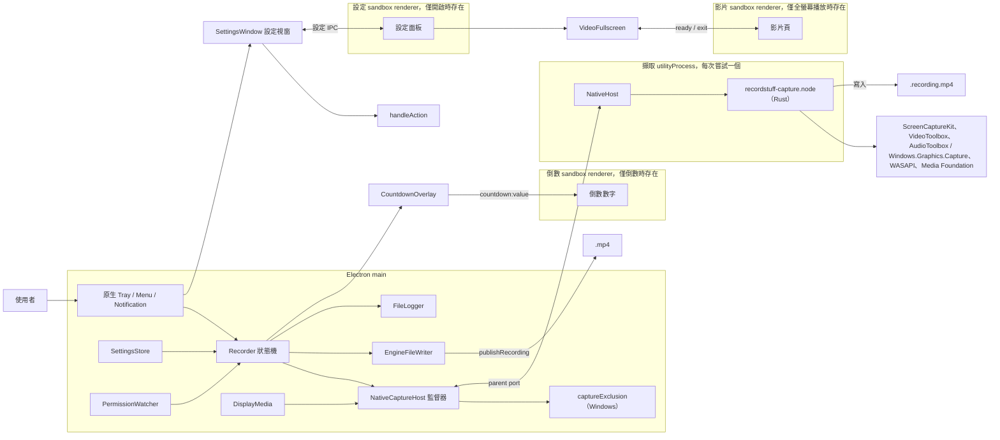

# 系統架構

[English](../../system-design/architecture.md) | [繁體中文](architecture.md)

錄影為何不再使用 Chromium 的擷取，見[錄影為何離開 Chromium 的 WebRTC 擷取](webrtc.md)。

## 程序與責任

應用層分成 main；只在錄影嘗試期間存在、載入原生引擎的擷取 `utilityProcess`；只在設定視窗開啟期間存在的設定 renderer；只在倒數期間存在的倒數 overlay renderer；以及只在錄影檔全螢幕播放期間存在的全螢幕影片 renderer。Electron 自身還會建立 GPU／helper 等程序；層數不等於作業系統看到的 PID 數。

Tray、選單與通知全在 main，使用原生 Electron API。設定面板是使用者唯一會操作的 HTML 頁面：只畫出 main 給的 view，並回傳使用者選到的選項 id。倒數 overlay 是點擊可穿透的頁面，只畫 main 傳來的數字，無法回傳。全螢幕影片頁面在整個螢幕上播放一支錄影，使用者離開時交回播放狀態。Main 選擇螢幕、持有錄影狀態、決定所有動作，並負責檔案的生命週期：資料夾、檔名、sentinel、發布與歷史。擷取程序負責擷取、編碼、封裝並寫入 main 建立的檔案，透過 parent port 回報。

擷取程序內，Rust 模組（`native/capture`，建置為 `recordstuff-capture.node`）一次執行一個 session。它的 JavaScript 呼叫（`probe`、`prepare`、`stop`、`finish`、`cancel`、`microphones`）在 Node 的 worker pool 執行，`record` 立即返回，事件經 thread-safe function 送回 JavaScript。往下概略來說：平台的擷取 callback（macOS 上是 ScreenCaptureKit 的畫面與聲音 dispatch queue，以及麥克風的 queue；Windows 上是 Windows.Graphics.Capture 的 frame callback，以及每個 WASAPI stream 一條 `recordstuff-sound` 執行緒）把畫面與聲音交給共用核心；擷取啟動的同時，`recordstuff-encoders` 執行緒建立編碼器；從 `record` 起，`recordstuff-refresh` 執行緒編碼第一格、pacer 暫留的畫面，以及靜止畫面的重複；編碼器在各自的執行緒上執行（VideoToolbox 的 callback、`recordstuff-h264` 轉換執行緒），聲音在核心的音訊鎖內、由送來聲音的那條執行緒混音並編碼；唯一的 `recordstuff-writer` 執行緒持有檔案與 muxer。

| 模組 | 擁有的資料／資源 | 不負責的工作 |
| --- | --- | --- |
| `main/index.ts` | App 生命週期、依賴組裝、引擎 host 的接線（入口與 `.node` 路徑、螢幕選擇、自身 PID、系統介面開關、Windows 視窗排除）、退出協調 | 不擷取、不編碼、不碰檔案 bytes |
| `main/actions/actions.ts` | 每個 `AppAction` 實際做的事，位於結束閘門與各偏好設定的鎖之後 | 不建立協作者，也不持有自己的狀態 |
| `main/recording/recorder.ts` | 唯一 `RecordingState`、session id、順序與 timeout、健康守衛、倒數的時間與取消、背景存檔 | 不 import Electron；不接觸 DOM |
| `main/recording/countdown-overlay.ts` | 倒數視窗的生命週期、放在被錄影螢幕上的位置與傳給它的值 | 不決定何時倒數、錄影或取消 |
| `renderer/countdown/countdown.ts` / `preload/countdown.ts` | 繪製數字與淡化／唯一的數值訂閱 | 不持有時間、狀態，也不回傳 main |
| `main/library/video-fullscreen.ts` | 全螢幕影片視窗的生命週期、所在螢幕、淡入淡出，以及交回的播放狀態 | 不決定播放哪支錄影或其來源網址（由設定視窗依清單查出） |
| `renderer/video/video.ts` / `preload/video.ts` | 從指定時間播放、結束全螢幕的操作／回報就緒並帶著播放狀態離開 | 不負責視窗、淡入淡出或關閉視窗 |
| `main/display/display-media.ts` | 一次嘗試錄哪個螢幕、main 的拒絕原因與螢幕診斷 | 不負責擷取 |
| `main/recording/native-capture-host.ts` | 每次嘗試的 `utilityProcess`、ready 與 heartbeat、訊息驗證、當機與無回應偵測、每個檔案的結果、正在完成檔案的程序 | 不作檔案成功判定，也不持有錄影狀態 |
| `main/recording/native-host-process.ts` | 載入引擎、協定的 host 端、由品質快照決定輸出尺寸與位元率、把引擎失敗對應到協定代碼 | 不管資料夾、檔名、期限或發布 |
| `main/recording/capture-exclusion.ts` | Windows 上，嘗試期間把 RecordStuff 的視窗標為不被擷取 | 不決定嘗試何時開始或結束 |
| `main/recording/engine-file-writer.ts` / `file-writer.ts` | 預留暫存檔、等待引擎結果並發布、保留部分檔案／發布、寫入錯誤分類與資料夾檢查 | 不決定 UI 狀態，也不碰媒體 bytes |
| `native/capture`（Rust） | 擷取、畫格節奏、聲音對齊與混音、H.264／AAC 編碼、hybrid MP4、寫入並完成檔案、寫入積壓上限 | 不管檔名、發布、sentinel、歷史，或單一 session 以外的任何狀態 |
| `main/settings/settings.ts` | 已提交設定、序列化保存佇列 | 不修改正在錄影的設定快照 |
| `main/menus/tray-model.ts` / `tray.ts` | Tray 扁平指令選單的純投影／原生圖示與通知 | 不放偏好設定，也不另建錄影狀態機 |
| `main/app/ui-model.ts` | 兩個介面共用的 action union 與 context 快照；它們套用的設定鎖定規則在 `main/recording/recording-lock.ts` | 自己不做任何投影 |
| `main/settings/settings-model.ts` | 所有偏好設定、穩定 id，以及面板請求的授權判定 | 不碰 Electron、IPC 或持久化 |
| `main/settings/settings-window.ts` | 設定視窗、來源驗證與序列化保存 | 不定義任何設定的語意 |
| `renderer/settings/settings.ts` / `preload/settings.ts` | 畫出 view 並回傳 id／read-choose-capture-subscribe 橋接 | 不持有設定狀態、不產生 action、不碰 Node API |
| `main/permission/permission.ts` | 螢幕授權驗證快取與輪詢 timer | 不認定系統音訊已授權 |
| `main/lib/log.ts` | 經有上限的非同步佇列寫入並輪替的文字 log | 不保存媒體 bytes |
| `main/recording/session-log.ts` | 每次啟動的 run id，以及每個 capture 與結果行旁的有版本 session record | 不負責配對錄影與 session（那是開發用分析器的工作） |
| `shared/i18n.ts` | 英文文案 key、繁體中文模板、語言驗證 | 不控制 OS 原生提示或翻譯技術日誌 |
| `shared/*` | 狀態、協定、品質與倒數的契約與純函式 | 不依賴 Electron 或 DOM |

## 信任邊界與 IPC

所有 renderer 都使用 `sandbox: true`、`contextIsolation: true`、`nodeIntegration: false`、`webSecurity: true`，並禁止新視窗與導覽；倒數 overlay 另外停用 background throttling。Overlay 的 preload 只提供 `countdown.onValue`；main 以 `countdown:value` 傳送數字或 `null`，preload 只接受正整數或 `null`。打包版載入本機 HTML；開發版可載入 electron-vite URL。

設定面板有自己的 preload，只暴露四個呼叫。`settings:capture`、`settings:read` 與 `settings:choose` 會驗證來源必須是設定視窗的 main frame，否則拒絕。choose 請求帶的是群組 id 與選項 id，不是 action；main 依當下重新產生的模型解析這組 id，因此請求只能做到 App 當下提供、而且錄影狀態允許的事。保存依請求順序序列化，回應會告知實際提交的值。

| 方向 | 訊息 | 意義 |
| --- | --- | --- |
| 面板 → main | `settings:capture { armed }` | 開啟或關閉快捷鍵編輯器；開啟期間暫停全域快捷鍵，讓新組合送到面板 |
| 面板 → main | `settings:read` | 取得目前的 view |
| 面板 → main | `settings:choose { group, choice }` | 套用一個被提供的選項；回傳 view 與是否真的提交 |
| main → 面板 | `settings:changed` | 狀態或 context 改變，重新繪製 |

擷取程序不是 renderer。Main 以 `utilityProcess.fork`（service name `RecordStuff Capture`、stdio 以 pipe 導出）執行建置後的 `native-host-process.js`，唯一的參數是 `.node` 的絕對路徑；它的 stdout 與 stderr 每行以 `capture host:` 前綴寫入 main 的 log。它以 App 的身分執行原生程式碼，在已簽署的 bundle 上，螢幕與系統音訊授權也適用於它（開發用 Electron 的 `utilityProcess` 會被拒絕擷取，因此原生量測使用已簽署的 bundle）。這道邊界提供的是故障隔離，不是 sandbox：原生程式碼的當機、abort 或卡住只會結束或卡住那個程序，不會波及 main，而且媒體完全不進入 main。這就是引擎放在 `utilityProcess`，而不是放在 main（原生當機會讓 App 結束），也不是獨立執行檔（其螢幕權限必須另外證明）的原因。

程序消失時，main 依它所知道的決定：

- **在 `ready` 之前結束**（引擎載入失敗，經 stderr 記錄後以代碼 3 結束，或超過 8 秒的 ready 期限）：`start` reject，recorder 以 `capture_start_failed` 讓這次嘗試失敗。
- **在 session 期間結束**：`capture_host_crashed`；監看 session 時兩次 ping（每 5 秒一次）未獲回應：`capture_host_unresponsive`，並結束該程序。在 `record` 之前，兩者都改為註明階段的 `capture_start_failed`。Recorder 接著讓 session 失敗並 abandon writer，非空的暫存檔會被保留：引擎寫的是分段 MP4，播放器可讀到最後一個完整片段（錄影中途結束該程序，留下可播放的 8.0 秒檔案）。
- **在 `stopped` 之後、完成檔案期間結束**，或沉默達 150 秒（`FINISH_BOUND_MS`，超過引擎自己的 120 秒上限）：檔案結果 reject，存檔以 `output_write_failed` 失敗，暫存檔保留。

Main 每次嘗試 fork 一個新程序，透過它的 parent port 交換下列訊息。雙方在接收處執行手寫 type guard（`isMainMessage`、`isHostMessage`）。驗證是必要欄位的形狀檢查，不是嚴格拒絕所有額外欄位或完整資源配額限制。協定沒有版本協商，因為兩端隨同一 App 一起出貨。

| 方向 | 訊息 | 意義 |
| --- | --- | --- |
| main → host | `start { sessionId, quality, native }` | 以本次的品質快照準備擷取；`native` 帶螢幕 id（macOS 上是 CGDirectDisplayID）、螢幕上的一個實體像素點（Windows）、main 建立的暫存檔、RecordStuff 的 PID（main 在前）與系統介面開關（macOS） |
| main → host | `record { sessionId }` | 從此刻開始寫檔（plan 040）；其他或尚未準備的 session 一律拒絕 |
| main → host | `stop { sessionId }` | 停止錄影、釋放已準備的 session，或取消仍在進行的 prepare |
| main → host | `ping` | 確認 host 仍回應 |
| host → main | `ready` / `pong` | 引擎已載入／心跳回應 |
| host → main | `prepared { sessionId, mimeType, capture }` | 擷取、編碼器與檔案已準備好，尚未錄影；`capture` 是 CaptureReport（尺寸、速率、目標位元率、warnings） |
| host → main | `started { sessionId }` | 引擎開始錄影；main 沿用 `prepared` 的報告 |
| host → main | `progress { sessionId, bytes }` | 目前已寫入的位元組數，媒體到達期間約每秒一次 |
| host → main | `stopped { sessionId, tracksStoppedAt? }` | 擷取已在停止點結束；引擎仍會完成檔案 |
| host → main | `finished { sessionId, file }` / `writeError { sessionId, code, detail }` | 檔案已完成（`bytes`、`finalizeMs`，以及若仍為分段格式的原因）／使檔案無法完成的寫入錯誤，`disk_full` 或 `output_write_failed` |
| host → main | `error { sessionId, code, detail, displayFailure? }` | host 觀察到的失敗；只接受 `HOST_ERROR_CODES` 中的代碼 |

Main 驗證與拒絕的內容：

- 來自目前程序的每則訊息都要通過 `isHostMessage`；格式錯誤的訊息被丟棄，只記錄它的 type。Host 錯誤代碼限於 `HOST_ERROR_CODES`，寫入錯誤限於 `ENGINE_WRITE_ERROR_CODES`：資料夾、磁碟檢查、期限、監督與啟動代碼都是 main 自己的判定，host 送來這些代碼會被視為格式錯誤，而不是被採信。
- 不屬於目前 session 的訊息不會生效；過期的 `prepared`、`started` 或 `progress` 會讓 main 對該 session 送 `stop`，不讓任何擷取在無人監看下繼續。
- `stopped` 之後的 `finished` 與 `writeError` 只接受來自正在完成該檔案的程序，並以程序與 session id 比對。
- 螢幕由 main 選定（`DisplayMedia`），host 不會被告知其他螢幕；沒有數字螢幕 id 時，main 不送 `start`。

Host 只接受 `isMainMessage` 形狀；沒有 `native`、或已有 session 時的 `start` 會被拒絕，`record` 只接受已準備好的那個 session，其他 session 的 `stop` 會被忽略。引擎以 `code|detail` reject；協定清單以外的代碼由 host 對應為 `capture_start_failed`、`capture_failed` 或 `output_write_failed`。

在 Windows 上，Windows.Graphics.Capture 無法排除其他程序的視窗，因此從 `start` 到嘗試被拆除為止，main 以 `setContentProtection(true)`（`WDA_EXCLUDEFROMCAPTURE`）標記每個 RecordStuff 視窗，以及期間新建的視窗；程序結束時，或通知它結束 5 秒後，再讓它們回到擷取範圍。macOS 上由引擎依 main 傳入的 PID，經 ScreenCaptureKit 的 content filter 自行排除。

Parent port 上沒有逐樣本 ACK 或背壓：媒體從不經過它。引擎內，擷取與編碼器 callback 經 channel 把編碼後的樣本交給 writer 執行緒，從不等待磁碟；等待寫入的媒體以 64 MiB 為上限（`BACKLOG_LIMIT_BYTES`），超過時錄影以 `output_write_failed` 失敗，已寫入的部分保留。心跳偵測 host 是否回應，不等於媒體持續到達；媒體另有期限：先是第一個非空的 `progress`，之後由停滯守衛在 10 秒沒有新進度時警告、30 秒時判定失敗（見[錄影設計](recording.md#期限與故障隔離)）。

## 錄影資料流

1. **開檔。** Recorder 檢查資料夾（`ensureWritableDir`）、寫入 session sentinel，並以獨占方式建立空的 `<name>.recording.mp4`（`EngineFileWriter.open`）。
2. **準備。** `NativeCaptureHost.start` 在 `DisplayMedia` 選擇螢幕的同時 fork 程序，等待 `ready`、啟動心跳並送出 `start`。Host 探測來源尺寸，以 `shared/quality.ts`（`fitWithinCap`、`videoBitsPerSecond`）決定輸出尺寸與影像位元率，再呼叫 `prepare`：平台啟動擷取，編碼器在自己的執行緒建立，檔案被開啟，在 `record` 之前只保留最新一格。Host 回覆 `prepared`。
3. **倒數與開始錄影。** Main 執行倒數（若有），再送出 `record`。引擎取得 `t0`，啟動 writer 與 refresh 執行緒，把最新一格編碼為時間零的關鍵影格；host 回覆 `started`。
4. **錄影。** 擷取以四倍影格率請求，pacer 在影格率格線的每個格位保留一格；畫面沒有變化的刷新會在其格位重新編碼最新畫面，靜止畫面每秒重複最後一格，讓關鍵影格與片段持續產生。每個聲音輸入以計算樣本數的方式放上 session 時鐘，混成一條 48 kHz 立體聲音軌，再編碼為 AAC。Writer 執行緒約每秒為每條軌道附加一個片段，每 5 秒 sync，每秒回報進度。
5. **停止與存檔。** 收到 `stop` 時，引擎在該時刻結束兩條軌道，最多等 250 ms 取得到該時刻為止的聲音，停止擷取並 flush 編碼器；host 送出 `stopped`，recorder 回到 idle，存檔在背景繼續。Writer 附加一個索引所有樣本的 `moov`，sync 後把舊 `moov` 的開頭改寫成 64 位元 `mdat` 標頭，檔案不經複製就成為一般 MP4；host 送出 `finished`。接著 `EngineFileWriter.finish` 以獨占硬連結把檔案發布為最終檔名（`publishRecording`），清除 sentinel 並發出 `saved`。
6. **失敗。** 擷取或寫入失敗、當機或錯過期限都會讓 session 失敗；writer 保留非空的暫存檔（可讀的分段 MP4），失敗連同檔案結果一起回報（見[錄影設計](recording.md)）。

## 引擎的打包與簽署

`electron.vite.config.ts` 在 macOS 與 Windows 上於 main 之前以 `cargo build --release` 建置 crate，並把產出的函式庫（`librecordstuff_capture.dylib` 或 `recordstuff_capture.dll`）複製為 `out/native/recordstuff-capture.node`；在這兩個平台上沒有 Cargo 時建置會失敗，`RECORDSTUFF_SKIP_NATIVE=1` 則刻意跳過，供不錄影的建置使用，這類建置的錄影會在開始時以載入錯誤失敗。原生程式碼無法從 asar 封存內載入，因此 `electron-builder.yml` 解開 `out/native/**`（`asarUnpack`），`main/index.ts` 把路徑改為 `app.asar.unpacked`。macOS 上 electron-builder 以 App 的憑證與 hardened runtime 簽署解開的模組；本機 bundle 與發布時掛載的 DMG 都會經過的 `start-app.mjs --verify-app` 要求它存在並檢查其憑證。Windows 建置與該平台的整個 App 一樣未簽章；安裝檔 smoke 以 `scripts/native-load.mjs` 載入安裝後的模組。CI 在兩種 runner 上建置並測試 crate；發布建置不使用快取，從原始碼編譯（見[發布自動化](releases.md)）。macOS 與 Windows 以外的平台沒有引擎：模組無法載入時錄影失敗。

## 資料模型與持久化

| 資料 | 所在位置 | 生命週期 |
| --- | --- | --- |
| `RecordingState` | main 記憶體 | App 重啟重設；不持久化 |
| main `Session` | Recorder 記憶體 | 品質與倒數快照、擷取報告、倒數 timer、writer、期限、停滯與磁碟 timer，直到 `stopped`、失敗或取消；已停止的 session 之後留在 `saving` 直到存檔結束 |
| 檔案結果與完成中的程序 | NativeCaptureHost 記憶體 | 依暫存路徑保存，從 `start` 到 writer 取走結果；回報 `stopped` 的程序保留到 `finished`、`writeError`、結束或 150 秒 |
| host session | 擷取程序記憶體 | session id、階段（preparing、prepared、recording、stopping）、暫存路徑與取消旗標，直到 `stopped` 或失敗 |
| 引擎 session | 擷取程序記憶體 | 平台擷取、核心（最新一格、pacer、混音器、編碼器）與 writer 佇列（上限 64 MiB），直到檔案完成或程序結束 |
| `settings.json` | `app.getPath('userData')` | 跨重啟保存；現有 App 名稱對應小寫 `recordstuff` |
| `.recording.mp4` | 使用者指定資料夾 | 由 main 建立為空檔、由引擎寫入；錄影中的檔案，失敗時可保留 |
| `.mp4` | 同一資料夾 | 正常完成並發布的錄影 |
| `recordstuff.log` | `app.getPath('logs')` | 5 MiB 輪替、3 個舊檔 |
| 量測 Markdown／JSON | `docs/verification/measurements/` | 本機開發證據；已 gitignore，不隨 App 發行 |

引擎是媒體檔唯一的寫入者；main 建立空檔、發布它，並移除空的檔案。設定與 log 模組會寫自己的檔案。

## 啟動與關閉

Main 先建立 logger、註冊未捕捉錯誤處理並取得 single-instance lock。在 App 完成啟動前及 ready 後隱藏 Dock（App 套件不宣告 `LSUIElement`；macOS 上只在視窗開著時連同選單列的選單一起出現）、載入設定、組裝 Recorder／host／權限 watcher／Tray、訂閱事件並開始權限輪詢。錄影嘗試之前不存在擷取程序：每次嘗試 fork 一個新程序，有倒數時另建 overlay 視窗，嘗試結束時由 main 一併結束。回報 `stopped` 的程序只保留到檔案結果確定為止；錄影之間不保留擷取程序或 overlay renderer，也沒有心跳 timer。

`window-all-closed` 不退出 App。`before-quit` 一律先等 `Recorder.shutdown()`（即使 tray 已 idle，也包含 failure cleanup），再等設定、視窗尺寸與 log 寫入以及失敗歷史保存，之後才再次 quit（[延後退出](desktop.md#延後退出)）；`will-quit` 停止權限輪詢並銷毀 host、overlay 與 Tray。硬斷電、main 強制終止、阻塞磁碟並不具有完整落盤保證。
