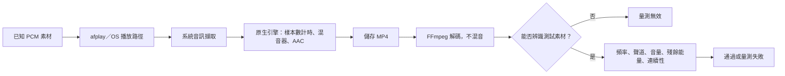

# 音質測試：我們測什麼，為什麼要測

[English](../../system-design/audio-quality.md) | [繁體中文](audio-quality.md)

本章說明開發用音質診斷系統，對應素材與報告第 2 版。目的是教讀者如何推理音訊問題，不代表所有錄音的音質已經正確。[工具文件](tooling.md#音質迴歸測試)提供指令，[驗證紀錄](../verification/README.md)保存實際結果，[錄影流程](recording.md)則說明正式程式如何擷取與儲存；其中音訊的部分，以及它為什麼能保留本套件量測的內容，見[第 16 節](#16-原生音訊路徑為什麼能保留音質)。自 2026-10-16（plan 076）起，錄影只透過原生擷取引擎進行，本工具的所有量測現在都經過它。舊 Chromium 擷取路徑的發現（第 15 節）保留為歷史，因為它們說明了本套件為什麼量這些項目。

Electron、Chromium、瀏覽器媒體 API 與內部 WebRTC 音訊處理在那條舊路徑中的角色，見[錄影為何離開 Chromium 的 WebRTC 擷取](webrtc.md)。

## 1. 從問題出發：使用者說「聽起來悶」

「MP4 裡有音軌」回答不了這個問題。我們真正想知道的是，錄音有沒有保留原音的重要資訊：頻率之間的比例、左右聲道的獨立資訊、音量、波形，以及時間上的連續性。

因此測試是一個有已知輸入的實驗：產生可重現的聲音，透過系統播放，使用真正的程式錄影，解碼成品，再將量測值與素材原本的性質比較。有已知輸入，異常結果才有可以查證的依據。聽感測試仍有價值：合成訊號能隔離特定機制，語音與音樂則幫助我們判斷這些差異在實際內容中是否重要。

這個實驗量的是整條「播放 → 擷取 → 編碼」路徑。失敗本身無法指出是哪一段造成。定位原因時，應保留同一測試，每次只改一個環節，或在編碼前增加 PCM 觀察點。FFmpeg AAC 對照組通過，只能證明該對照編碼器保留了這份素材，不能證明 App 使用的平台 AAC 編碼器（macOS 的 AudioToolbox、Windows 的 Media Foundation）表現相同。

## 2. 為什麼取樣率、聲道數與位元率不夠

| 看到的資訊 | 可以證明 | 不能證明 |
| --- | --- | --- |
| 48 kHz 取樣率 | 檔案使用的樣本時間格線 | 12 或 16 kHz 有沒有在擷取／濾波時消失 |
| 兩個聲道 | 每個音訊影格有兩個樣本值 | 左右是否真的保留不同資訊 |
| 較高 AAC 位元率 | 編碼儲存預算或實際資料率 | 來源品質良好、上游沒有低通濾波 |
| RMS 不為零 | 存在能量 | 是正確聲音、雜訊，還是失真 |
| 能成功解碼 | 串流可讀 | 編碼前是否已經掉樣本或改變聲音 |

48 kHz 的 Nyquist 上限是 24 kHz，但這只是理論上可表示的最高頻率。前面若有濾波器，仍可能把 10 kHz 以上全部移除。同樣地，把單聲道複製成左右兩份，就會得到標示 stereo 的檔案，卻沒有恢復立體聲資訊。提高位元率也無法重建編碼前已經遺失的資訊。

## 3. 三種「通過」不能混為一談

1. **偵測器正確：**正常對照通過，刻意破壞的對照會因為預期原因失敗。這屬於自動化測試。
2. **本機路徑品質符合門檻：**這個程式、OS 與裝置組合，能正確錄下測試素材。這需要實際錄影，不能靠假的媒體 API 證明。
3. **產品普遍可靠：**不同環境與代表性內容經過多次驗證，行為仍然良好。這需要更廣的證據與聽感確認，一台機器的一次成功並不足夠。

`pnpm check` 對已涵蓋案例支持第一種主張。`audio:quality record` 檢查第二種。兩者都不能單獨證明第三種。整個 repository 的測試總數，也不等於音質測試的涵蓋程度。

## 4. 第 2 版素材如何設計

素材是 48 kHz、雙聲道、PCM16 WAV，長度 12.1 秒。先用浮點樣本合成，再量化成 WAV。正常探測音保留振幅餘裕，工具不更改系統音量。

| 素材時間 | 內容 | 用途 |
| --- | --- | --- |
| 0–0.5 秒 | 靜音 | 留出擷取／播放啟動時間 |
| 0.5–1.0 秒 | 兩聲道的 1 kHz 標記 | 找到訊號，估計頻率比例 |
| 1.0–1.5 秒 | 靜音 | 排除無關的連續音，驗證對齊 |
| 從 1.5 秒開始，共十二個 0.8 秒區段 | 每段 0.6 秒聲音加 0.2 秒靜音 | 六個頻率先只放左邊，再只放右邊 |
| 11.1–11.6 秒 | 兩聲道的 2 kHz 標記 | 證明尾端素材存在，檢查結尾時間 |
| 11.6–12.1 秒 | 靜音 | 保留收尾餘裕 |

探測頻率是 250 Hz，以及 1、4、8、12、16 kHz，分別取樣低頻、中頻與逐漸升高的高頻。這些是診斷點，不是完整頻譜；如果兩點之間有很窄的頻率凹陷，仍可能漏掉。

每個探測區段都在有聲的聲道同時播放 1 kHz 參考音，稱為 pilot。pilot 與目標頻率的峰值振幅各為 0.125。1 kHz 區段只放一個正弦波，不放兩份相同的音。起訖標記振幅為 0.25。所有音調都有 10 ms 線性淡入淡出，避免素材邊界本身製造不必要的喀聲。

### 為什麼參考音必須同時存在

假設先播 1 kHz，之後才播 12 kHz。如果自動增益剛好在兩者之間下降，即使路徑的頻率響應完全平坦，依序比較也可能把音量下降誤認為「高頻流失」。

第 2 版比較的是**同一時間**存在的目標音與 1 kHz pilot。如果兩者同時乘上相同增益，比例中的增益會抵消。我們仍另外量 pilot 的音量，所以不會因為正規化而漏掉整段錄音變得很小聲。

這能減少不同探測區段之間的增益變化造成的誤判，但無法消除頻率選擇性處理，或一個區段內快速變動的增益。雙音素材本身也可能影響非線性／自適應處理的行為，因此結果描述的是這個受控刺激下的表現。

## 5. 時間對齊、時鐘，以及原本的誤報

擷取延遲會讓整個波形在時間上平移；時鐘不一致則會改變看到的頻率，並隨時間累積長度差異。這是兩種不同現象。

第 1 版拿樣本去匹配「精確等於指定頻率」的正弦波。例如乾淨的 16 kHz 音調偏移 10 ppm 後，實際是 16000.16 Hz。它的相位會逐漸偏離固定的參考波形。第 1 版把這個差異算成殘餘失真，即使輸入仍是乾淨正弦波。這個誤報已經實際重現，不只是理論上的可能。

第 2 版的流程是：

1. 以 10 ms 區塊尋找至少連續 300 ms 的穩定 1 kHz，忽略無關的啟動聲音。
2. 在有限頻率範圍內先粗搜，再局部細化，以最小化擬合殘差估計標記頻率。
3. 計算 `speed = 量得的標記頻率 / 1000`，以及 `clock_ppm = (speed - 1) × 1,000,000`。
4. 用 `觀察到的起點 + (素材時間 - 0.5) / speed` 將素材時間映射到解碼樣本。
5. 檢查應有長度、標記後的靜音，以及獨立的 2 kHz 結尾標記，比較實際結尾時間和預測時間。
6. 每個探測區段再估計當下的 1 kHz pilot，用相同的局部頻率比例擬合目標音，並另外回報頻率偏差。

搜尋範圍是指定頻率的 ±0.1%，最小半寬為 0.5 Hz；1 kHz pilot 搜尋 ±1 Hz。但通過門檻比較嚴格，為 ±200 ppm。搜尋可以超出通過門檻，才能把「過大的時鐘偏差」獨立列出，而不是叫作失真。這不是無限制地扭曲時間軸，也不是設法讓壞訊號通過。

起點格線是 10 ms，因此結尾時間允許 20 ms 誤差，邊界也保留餘裕。第 2 版驗證短錄音的時間一致性，不能證明長時間漂移穩定。[既有錄影驗證工具](tooling.md)負責 A/V 時間檢查；此 PCM 分析器不量容器時間戳的不連續。

## 6. 如何擬合正弦波與計算殘餘能量

補償時鐘後，一個有限分析視窗不一定包含整數個週期。如果只讀一個 FFT bin，或假設正弦與餘弦一定互相正交，就可能把真正的訊號能量漏算進殘差。

我們以最小平方法擬合：

`sample[n] ≈ DC + Σ(a[k] × sin(2πf[k]n/Fs) + b[k] × cos(2πf[k]n/Fs))`

Gram 矩陣將不同基底之間的重疊納入計算；正弦與餘弦係數允許任意相位。每個成分的功率是 `(a² + b²) / 2`。擬合出的 DC 成分會納入殘餘能量，而不是偷偷忽略。浮點運算相減造成的極小負殘差則夾回零。

一般區段包含 pilot 與目標兩個成分，1 kHz 區段只有一個。頻譜量測取中央 300 ms，避開淡入淡出與編碼邊界。殘餘能量代表模型無法解釋的部分，可能是雜訊、諧波、音量調變，或不均勻的時間變化。它是工程用殘差指標，**不是標準化 THD+N 儀器量測，也不是主觀音質分數**。

功率比例用 `10 × log10(Pout / Pref)`；振幅比例才用 `20 × log10(Aout / Aref)`。兩者混用會算錯 dB。−3 dB 功率比例約為一半，−20 dB 約為百分之一。內部下限讓 JSON 數值保持有限，因此接近下限的結果應理解為「幾乎沒有偵測到能量」，而不是精確的聲學靈敏度。

## 7. 每個門檻在防什麼問題

以下都是初始專案工程門檻，不是業界認證標準；每份報告都保存當次門檻。

| 檢查 | 初始門檻 | 為什麼要測／如何解讀失敗 |
| --- | --- | --- |
| 格式 | 48 kHz、恰好兩個聲道 | 在後處理可能掩蓋問題前，先拒絕錯誤格式 |
| 素材有效性 | 起始標記、安靜間隔、不同的結尾標記 | 避免量錯聲音或量錯時間區段 |
| 標記／局部 pilot 時鐘偏差 | ±200 ppm | 將時鐘偏差和波形損壞分開 |
| 結尾時間 | 頻率比例補償後 ±20 ms | 偵測較大的插入、刪除或對齊錯誤 |
| 目標／pilot 頻率響應 | ±3 dB | 偵測頻率失衡，包括可能造成悶聲的高頻流失 |
| pilot 增益 | 相對產生素材在 ±6 dB 內 | 補捉頻率比例刻意抵消掉的整體音量下降或放大 |
| 聲道分離 | ≥30 dB | 偵測串音與雙單聲道；比較擬合訊號的合計功率與另一聲道總功率 |
| 殘餘／訊號能量 | ≤−25 dB | 頻率擬合後，偵測中央視窗中無法解釋的雜訊／失真 |
| 成分最低音量 | 相對同成分中央視窗功率 ≥−15 dB | 在大部分有聲區段中偵測短暫消失或衰減 |
| 區塊最大削波比例 | 解碼振幅絕對值 ≥0.999 的樣本最多 0.1% | 找出短暫的數位滿刻度削波，避免被整個長檔案稀釋 |
| 後續靜音間隔 | 相對前段總功率 ≤−35 dB | 偵測混入其他聲音，或訊號溢入應該安靜的位置 |

聲道分離檢查只能發現資訊流失，不能重建立體聲。削波檢查也不能證明上游沒有類比削波，或低於滿刻度的限幅；殘差可能抓到其中一些效應。靜音間隔失敗可能是別的程式在發聲，要先檢查環境，再歸因於錄音程式。

## 8. 如何修掉原本的斷音漏報

第 1 版只看每段 600 ms 音調中央的 300 ms。即使把每段前後各刪掉 100 ms，測試仍會通過；三分之一的有聲內容已經不見，量測中心卻完好。

第 2 版以 10 ms 視窗、每次前進 5 ms，覆蓋每個探測音的 **20–580 ms**。外側各 20 ms 容納淡入淡出、起點量化與編碼邊界。每個區塊分別擬合 pilot 與目標，對照各自在中央視窗的功率，因此即使 pilot 還存在，也不能掩蓋高頻探測音消失。使用各成分擬合功率，也避免把雙音自然的拍頻包絡誤判成斷音。

相同區塊也檢查短暫削波；每個後續靜音間隔檢查中央 80 ms。這些是明確的涵蓋範圍選擇：

- 短到低於視窗靈敏度的損壞仍可能漏掉。
- 頭尾各 20 ms 保護區不在斷音檢查範圍內。
- 頻率響應、殘差與聲道分離仍是中央視窗的量測。
- 這套工具不宣稱驗證了任意內容中的每一個樣本。

## 9. pass、fail、invalid 與執行錯誤

| 結果 | 意義 | CLI 結束碼 |
| --- | --- | --- |
| `pass` | 成功辨識素材，所有必要檢查都通過 | 0 |
| `fail` | 量得的要求不符，包含格式錯誤或可辨識的長度截斷 | 1 |
| `invalid` | PCM、標記或間隔不足以支持可信分析，不輸出頻譜判定 | 2 |
| 執行錯誤 | 工具、輸入、權限、播放、逾時或檔案系統失敗 | 2 |

標記消失本身也可能是擷取路徑損壞造成。`invalid` 的意思是「無法支持頻率量測」，不是「程式沒有問題」。invalid 和 fail 都不能被當成驗證通過。原始報告保留之前完成的檢查；程序或輸入錯誤則記在 `error.json`。

## 10. 測試工具自己也必須被測試

分析器必須同時驗證敏感度與容忍度。只測壞素材，很容易做出一個什麼都判失敗的分析器；只測好素材，也很容易做出一個永遠通過的分析器。

| 對照案例 | 應有行為 | 原因 |
| --- | --- | --- |
| 正常 PCM、獨立合成的相位／時鐘對照 | 包含 ±10／20／100 ppm 都通過 | 容忍不應被叫作失真的量測差異 |
| 過大的時鐘偏差 | 時鐘失敗，乾淨波形的殘差仍通過 | 保留診斷項目的區別 |
| 真正的 FFmpeg AAC | 通過 | 加入實際量化／編碼行為，不只驗證理想數學 |
| 真正的低通、單聲道、44.1 kHz 檔案 | 對應項目失敗 | 驗證解碼路徑，不自動「修好」格式來掩蓋問題 |
| 只衰減目標頻率 | 頻率響應失敗 | 參考音存在不能掩蓋高頻流失 |
| 不同區段套用不同固定增益 | 增益仍在範圍內時，頻率響應通過 | 證明同時參考的設計目的 |
| 整段成分、或僅目標音的邊緣斷音 | 成分連續性失敗 | 重現並修復原本漏報 |
| 雙單聲道、交換／缺少聲道 | 不通過 | 聲道數不代表聲道資訊正確 |
| 諧波、短暫削波、靜音間隔污染 | 對應門檻失敗 | 覆蓋不同故障機制 |
| 結尾標記消失、無效／空 PCM | 不通過，不輸出無依據的頻譜結論 | 單靠長度可以被補靜音騙過 |
| 多次量測摘要 | 保留任何失敗，計算缺少／無效量測數 | 中位數不能掩蓋失敗的 run |
| CLI 錯誤、既有檔案／目錄 | 正確結束碼、保留既有證據 | 自動化不能假成功或覆寫舊結果 |

缺少 FFmpeg／ffprobe 時，整合測試會明確跳過。正式驗證環境應安裝這些工具並確認跳過數量；其餘單元測試不能取代整合覆蓋。

## 11. 重複量測與證據保存

`record <新目錄> --repeat 3` 會做三次獨立擷取，每次保存素材、log、報告與 MP4 路徑。`summary.json` 記錄 pass／fail／invalid 數量，以及各指標的最小值、中位數、最大值、有效量測數和缺少數。invalid run 不納入指標統計，但會明確計數。任何有效失敗都會保留 batch 的 fail；任何無效量測都讓 batch 成為 invalid。錄影中或尚未完成環境證據時，摘要維持 `incomplete`。如果執行中途失敗，預期／完成次數與 `error.json` 會指出尚未完成；部分 batch 不能宣稱通過。

工具在前後保存環境快照：OS／架構、Node／Electron／FFmpeg 版本、原始碼與素材雜湊，以及能讀取到的 macOS 音訊裝置資訊與音量設定。讀取失敗會標為未知。若觀察到裝置／音量改變，最終 batch 會標為 invalid。前後相同不代表中間完全沒變，也無法描述每個驅動程式或處理選項。

三次量測是重複性檢查，不是統計校準。要把一組資料提升為可比較的基準，應該：

1. 固定並記錄裝置、音量、程式／OS 版本與處理設定，暫停其他系統聲音。
2. 確認素材與解碼對照組通過。
3. 收集多次結果，同時看最差值和變動範圍，保留失敗。
4. 在同一路徑以代表性語音／音樂確認聽感。
5. 門檻變更應另外檢視、標示版本，保留舊結果原貌，不能為了某次失敗直接放寬。

我們不會從目前程式自動「學出」門檻，否則既有缺陷也會被學成正常音質。各指標範圍是觀察值，不是信賴區間，也不是自動與基準比較的功能。已知不好的資料是修正依據，不能成為通過基準。

## 12. 看到失敗後應如何推理

- **素材無效：**先查播放是否完成、其他聲音、格式、起訖標記與長度。缺少頻率響應欄位不是成功。
- **頻率響應失敗，但 pilot 音量穩定：**查路徑中的頻率選擇性流失，重複量測以區分自適應處理和穩定濾波。
- **增益失敗，但頻率響應平坦：**查音量控制與增益處理；此時沒有證據支持單純提高位元率。
- **聲道分離接近 0 dB：**查擷取前與擷取中的聲道混合。只要求兩個聲道，仍可能得到兩份相同單聲道。
- **頻率偏差很小但殘差失敗：**查雜訊、調變、失真與編碼器。指標本身不會唯一指出原因。
- **連續性或結尾時間失敗：**查掉樣本、資料交付間隔，以及既有容器／A/V 驗證結果。

每次只改一個變因，保留前後報告，並要求正常與劣化的偵測器對照仍然正確。不要只是加等化器讓數字變好看：它可能放大雜訊，也無法恢復已經消失的資訊。

## 13. 從 Cap 學到什麼

我們檢查了 Cap commit `17e17902691ca499de9e44b0dd7a19d8c4b630a8`，沒有執行它的測試套件。[語音 benchmark](https://github.com/CapSoftware/Cap/blob/17e17902691ca499de9e44b0dd7a19d8c4b630a8/scripts/benchmark-audio-intelligibility.py) 先對齊訊號，再評估 STOI／SI-SDR。[對齊測試](https://github.com/CapSoftware/Cap/blob/17e17902691ca499de9e44b0dd7a19d8c4b630a8/scripts/test-audio-intelligibility.py) 驗證聲音延後或提前，不應不公平地改變重疊語音的分數。這提醒我們量測方法本身也需要被驗證。

Cap 的[音訊整合測試](https://github.com/CapSoftware/Cap/blob/17e17902691ca499de9e44b0dd7a19d8c4b630a8/apps/media-server/src/__tests__/lib/audio-quality.integration.test.ts) 涵蓋音量／峰值、時間與邊界保留；[同步 workflow](https://github.com/CapSoftware/Cap/blob/17e17902691ca499de9e44b0dd7a19d8c4b630a8/.github/workflows/sync-tests.yml) 定義跨平台合成時間情境。我們採用的是分層對照、對齊驗證與明確保存證據的原則，不把另一個專案的測試數量當作品質保證。

它的語音 benchmark 會先轉成 16 kHz 單聲道，因此不能取代我們的立體聲與高頻檢查。STOI／SI-SDR、語音／音樂素材集、全頻掃描、長時間時鐘追蹤與更多裝置覆蓋，都是可能擴充的方向，**第 2 版尚未實作，也不宣稱具備**。新增時應先有明確問題，再用獨立的正常／劣化對照驗證。

## 14. 程式責任與不可破壞的條件

| 模組 | 責任 |
| --- | --- |
| [audio-quality.mts](../../../scripts/lib/audio/audio-quality.mts) | 純素材產生、WAV 序列化、有限頻率估計、擬合與門檻 |
| [audio-quality-tools.mts](../../../scripts/lib/audio/audio-quality-tools.mts) | 有界限的 FFprobe／FFmpeg 呼叫，啟動真正開發版程式與自有播放器 |
| [audio-quality-summary.mts](../../../scripts/lib/audio/audio-quality-summary.mts) | 彙總多次量測，不隱藏失敗或缺少值 |
| [CLI](../../../scripts/audio-quality.mts) | 驗證參數、新目錄、環境快照、重跑迴圈、JSON 與結束碼 |
| [Tests](../../../scripts/lib/audio/audio-quality.test.ts) | 正常／劣化對照、實際編碼器、CLI 契約與摘要行為 |

不可破壞的條件：不以混成立體聲或重新取樣掩蓋格式錯誤；只解碼前 60 秒，限制緩衝區與逾時；不修改正式音訊處理或使用者設定；不覆寫既有證據目錄；只終止自己啟動的子程序；保留歷史量測。第 1 版錄音不能拿來當第 2 版素材分析，應重新產生並錄影第 2 版，舊報告留作歷史證據。

## 15. 系統擷取修正：2026-09-14

> **歷史。**本節描述的是 Chromium 擷取路徑，plan 076 已於 2026-10-16 移除它。這些 constraint 已不存在於 App 中；保留這項發現，是因為它說明了為語音設計的處理會對系統混音造成什麼影響，以及第 16 節的原生路徑為什麼完全不做這類處理。下文的「現在」請讀作「2026-09-14 到 2026-10-16 之間」。

當時正式擷取請求明確設定 `echoCancellation: false`、`noiseSuppression: false`、`autoGainControl: false`。保留 `restrictOwnAudio: true`、ideal 兩聲道與 AAC 256 kbps 目標，當時沒有新增等化器、錄後轉檔或另一套擷取引擎。

為什麼這些設定重要：回音消除、降噪與自動增益對即時語音擷取有用途，但錄音程式應保留數位系統混音，包括音樂的頻譜細節與動態。為語音設計的處理可能改變這些內容。Chromium 的[音訊處理配置](https://chromium.googlesource.com/chromium/src/+/refs/heads/main/third_party/blink/renderer/modules/mediastream/media_stream_audio_processing_layout.cc)中，有依回音消除設定決定是否啟用的 processed display capture 路徑，支持這個可能機制。不過本次實驗證明的是**同時關閉三個設定**的效果，沒有分別隔離每一項的貢獻，也沒有驗證每個 Chromium 版本。

| 效果 | 對語音通話的用途 | 系統錄音為什麼關閉 |
| --- | --- | --- |
| 回音消除 | 移除喇叭播放後又被麥克風收進去的聲音，避免遠端講話者聽到自己 | 此程式擷取數位混音，不是麥克風的聲學回授，因此不需要為此再做消除 |
| 降噪 | 讓有背景雜訊的麥克風輸入更容易聽清楚人聲 | 音樂細節、環境聲或殘響可能被當成不需要的內容；錄音程式的目標是保留來源 |
| 自動增益 | 讓忽大忽小的說話聲保持容易辨識 | 可能改變原本刻意安排的強弱；來源已有的處理不應再由錄音程式重做一次 |

這些功能優化的目標是「對話清楚」，和「忠實重現」不同。若會議程式本來就會處理麥克風，RecordStuff 錄的是它處理後播放出來的聲音；關閉這裡的處理，不會關掉會議程式自己的處理。[WebRTC Audio Processing API](https://webrtc.googlesource.com/src/+/refs/heads/main/api/audio/audio_processing.h)說明了其語音增強用途，以及 capture／reverse stream 模型。

對照使用同一份 v2 素材與分析門檻。先前有效的基準量到約 0 dB 聲道分離，16 kHz 相對響應約 −44 到 −47 dB。修改後，兩次有效重複量測的所有診斷門檻都通過：16 kHz 相對同時 pilot 的差異在 0.004 dB 內，聲道分離超過 30 dB 門檻。極大的聲道分離數字接近分析器數值下限，不應理解成經校準的類比動態範圍。

最後三次量測是 **2 pass、0 fail、1 invalid**，整批仍為 invalid。第 1 次標記間隔混入聲音（−18.81 dB，未達辨識要求的 −30 dB），因此沒有輸出頻譜判定。更早的單次試驗雖然高頻已恢復，開頭仍有部分雜訊／間隔失敗。這些都保留在[驗證紀錄](../verification/README.md)，沒有放寬門檻、濾掉參考素材、刪除失敗試驗，或把無效 batch 改稱通過。

若 `getSettings()` 明確回報任一要求關閉的效果仍為 true，擷取端會加入 warning（直到這條路徑移除為止）。屬性缺少代表未知，不代表已證明關閉。迴歸測試當時確認明確的設定與 warning 行為；真正的探測錄音仍然必要，因為假的 constraint 斷言不能證明 OS 實際擷取了什麼。排除自身聲音當時繼續保留，因為不移除它就已經恢復了本機音質。

此修正只影響**使用重建版本之後的新錄音**，無法恢復舊檔已遺失的資訊。本機高頻與立體聲結果已改善；使用者原始內容的聽感比較，以及更多裝置／平台覆蓋，仍是另外需要的證據。

## 16. 原生音訊路徑：為什麼能保留音質

自 plan 076 起，App 透過在 Electron `utilityProcess` 中執行的原生引擎（Rust，`native/capture`）錄影。音訊路徑中沒有語音處理、RecordStuff 不做重新取樣，除了兩個輸入相加接近滿刻度時的軟性限幅之外，也沒有音量控制：

| 階段 | macOS | Windows |
| --- | --- | --- |
| 系統音訊 | ScreenCaptureKit，設定為 48 kHz、2 聲道、32-bit float，並排除 RecordStuff 自己程序的聲音 | WASAPI process loopback：系統播放的所有聲音，但排除 RecordStuff 的程序樹，以 48 kHz 立體聲 float 開啟 |
| 單一 App 的聲音（僅引擎與測試；尚無選擇器） | ScreenCaptureKit 依 App 篩選的聲音，格式相同 | 所選程序樹的 WASAPI process loopback |
| 麥克風（plan 074；預設關閉） | AVFoundation（`AVCaptureSession`），由 OS 轉成 48 kHz 單聲道 float，在音軌的兩個聲道都聽得到；不做語音處理 | 所選或預設 endpoint 的 WASAPI capture，以 48 kHz 單聲道 float 加 `AUTOCONVERTPCM` 開啟，在兩個聲道都聽得到；不使用通訊用處理管線，串流也選擇不觸發 ducking |
| 計時 | 每個輸入以樣本數放到 session 時鐘上（[timing.rs](../../../native/capture/src/timing.rs) 的 `AudioAligner`） | 相同 |
| 混音 | [mixer.rs](../../../native/capture/src/core/mixer.rs)：各輸入以單位增益相加（系統音訊，開啟麥克風時再加上麥克風），只在兩個以上輸入相加超過 −1 dBFS 時軟性限幅 | 相同 |
| 編碼 | 經 AudioToolbox 的 AAC-LC，使用品質設定的音訊碼率（256 kbps），輸入為 float | 經 Media Foundation 的 AAC-LC；它只接受 16-bit PCM、最高 192 kbps：float 樣本會先轉換，更高的設定會降為 192 kbps 並在 session 中發出警告 |
| 容器 | 引擎自己的 MP4 muxer；編碼器的 priming 以 edit list 略過 | 相同；Media Foundation 不公開它的 priming，所以在建立編碼器時量測 |

每個選擇對第 7 節的門檻為什麼重要：

- **格式。**OS 直接交付 48 kHz float，系統音訊為立體聲、麥克風為單聲道，因此引擎從不轉換取樣率。裝置格式不同時，轉換發生在 OS 裡、引擎拿到樣本之前（Windows 由音訊引擎轉換；macOS 由 ScreenCaptureKit 與 AVFoundation 交付設定的格式）。引擎比照 Cap，把麥克風的一個聲道放進音軌的兩個聲道，所以錄音介面第 1 軌的麥克風不會只在左聲道；立體聲麥克風因此會錄成單聲道。單聲道來源仍只是複製到兩個聲道的單聲道資訊，聲道分離門檻會偵測到；系統音訊保留兩個聲道。
- **不做處理。**路徑中沒有任何相當於 Chromium 回音消除、降噪或自動增益的處理，所以除非刻意加入這類處理，第 15 節的失敗機制不會再發生。
- **以樣本數決定時間戳。**音訊不採用每個 buffer 自己的時間。只要 buffer 的時間與樣本數的差距在 10 ms（480 個 frame）以內，它就接在上一個 buffer 結束的位置。剛超過容許值、最多再多 2 ms 的差距視為裝置時鐘漂移（麥克風的時鐘會偏 20–100 ppm），每個 buffer 只補上或丟掉 1 個 frame，所以漂移不會一次切掉或空出整整一個容許值；更大的缺口立即以靜音補上，更大的重疊立即丟棄。因此無論錄多久，音訊相對影像的漂移都不會明顯超過這個容許值，也從不為了校正時鐘而拉伸或重新取樣；停止的 log 會依輸入列出為了跟上時鐘而補上與丟棄的靜音 frame 數。Windows 的麥克風封包時間採用 Chromium 的規則（見[錄影設計](recording.md#音訊)）：裝置第一個封包的時間與到達時刻相差超過 500 ms，以及帶時間戳錯誤旗標的封包，都改以到達時間計時。停止時，擷取會繼續到停止時刻之前的聲音都已送達，所以音軌與影像一樣長。
- **混音器。**音軌是各輸入的立體聲總和，單位增益：不調整音量、不合併聲道；只有一個輸入時，音軌就是該輸入的原始樣本。音軌推進到每個輸入都已交付的位置，同時也跟著時鐘、落後它 500 ms 推進，所以完全沒送資料的輸入（沒有聲音時的 WASAPI loopback、卡住的裝置）會被視為靜音，而不會拖住音軌；在那之後才送達的聲音會被丟棄並計為遲到（引擎停止報告中的 `late_audio_frames`）。開啟麥克風時有兩個輸入，系統音訊與麥克風。兩個以上有非零樣本的輸入相加超過 −1 dBFS 時（人聲底下的大聲媒體），以 tanh 軟性限幅讓總和趨近但不到達滿刻度，在門檻處連續；沒有 compressor，低於 −1 dBFS 或只有一個輸入有聲音時（另一個是靜音，或麥克風關閉），音軌就是逐位元相同的總和。停止的 log 會列出被限幅的樣本數。單一輸入本身超過滿刻度時保持原樣，不歸限幅器處理。
- **麥克風處理。**麥克風以原始聲音混入：兩個平台都不做回音消除、降噪或自動增益（plan 074 的決定，2026-10-16）。不使用 macOS 的 voice-processing I/O 與 Windows 的通訊用擷取管線，因為在 macOS 上語音處理可能壓低其他 App 的輸出，等於壓低錄影要保留的系統音訊；第 15 節也已說明語音處理會對系統混音造成什麼影響。Windows 上開啟麥克風也可能讓 Windows 像通話時一樣壓低其他 App，所以麥克風串流會呼叫 `IAudioSessionControl2::SetDuckingPreference(TRUE)` 選擇不觸發（盡力而為；舊版 Windows 可能不提供）。代價是靠近喇叭的麥克風會把系統音訊稍晚再錄一次，連同房間的聲音；開關的 ⓘ 建議戴耳機。會議 App 對自己麥克風做的處理，仍在那些 App 裡進行。
- **編碼。**macOS 上編碼器收到的是 float 樣本，所以 AAC 量化是唯一的有損步驟。priming 的 edit list 讓第一個可聽見的樣本留在原本的時間，而不會讓整條音軌因編碼器延遲而位移。

這說明原生路徑為什麼應該通過本套件，但它不是量測；結果見第 17 節，開啟麥克風的結果見第 18 節。Windows 的音訊內容與保真度尚未在實機上測試（plan 076，D8）；CI 只檢查每個串流能開啟、交付並停止。

## 17. 原生引擎結果：2026-10-15

plan 076 第 7 步第 1 輪，在參考機 M1 Pro（macOS 26.6、Electron 44.3.0）上，使用相同的 v2 素材、分析器與門檻：`pnpm audio:quality -- record` 透過原生引擎通過所有檢查；作為對照，當天仍存在的 Chromium 路徑也通過。

| 量測 | 原生 | Chromium（歷史） | 門檻 |
| --- | --- | --- | --- |
| 時鐘偏移 | −0.07 ppm | −1.45 ppm | ±200 ppm |
| 目標／pilot 響應，最差的探測音 | 0.002 dB 內 | 0.002 dB 內 | ±3 dB |
| pilot 增益，最差的探測音 | 0.002 dB 內 | 0.002 dB 內 | ±6 dB |
| 聲道分離，最差的探測音 | 116.7 dB | 115.7 dB | ≥30 dB |
| 殘餘／訊號，最差的探測音 | −51.6 dB | −58.6 dB | ≤−25 dB |
| 最低 10 ms 音量，最差的探測音 | −0.008 dB | −0.007 dB | ≥−15 dB |

兩種引擎各有一次有效量測；這是同一台機器、同一條路由上的單次比較，不是重複量測的基準。這麼大的聲道分離數字接近分析器的數值下限，不是經校準的動態範圍。在單次量測能分辨的範圍內，增益與殘餘相近；原生引擎的時鐘偏移較小。原始報告留在本機（`docs/verification/measurements/`）；結論記錄在 [plan 076](../verification/history-2026-10.md#plan-076-結案--2026-10-16) 第 7 步。

## 18. 麥克風結果：2026-10-16

這些量測是在 plan 074 比對 OBS、Chromium 與 Cap 之後的引擎修改之前做的：軟性限幅、單聲道麥克風、逐 frame 漂移修正、暫時停頓的麥克風在同一個 session 再次送出聲音時重新收音，以及 Windows 的封包時間與不觸發 ducking（見[第 16 節](#16-原生音訊路徑為什麼能保留音質)）。它們描述的是當時的引擎。同一天在修改後的引擎上做的桌面驗收涵蓋了本節最後列出的項目；軟性限幅與漂移修改之後，保真度、同步與 CPU 都沒有重新量測。

plan 074 第 6 步，在 MacBook Pro（arm64、macOS 26）上使用 `pnpm start:app` 的打包 bundle、v2 素材與相同的分析器和門檻。`record` 驅動的是開發用 Electron，它沒有使用說明，macOS 不跳提示就拒絕讓它使用麥克風；因此這些量測以快捷鍵啟動打包 App 錄影，用 `afplay` 播放素材，再以 `pnpm audio:quality -- verify` 量測檔案。輸出接有線耳機、音量 100；輸入是系統預設，一台 BenQ 螢幕的 USB 麥克風。

| 條件（各 3 次） | 結果 | 增益，最差 | 殘餘，最差 | 聲道分離，最低 | 時鐘 |
| --- | --- | --- | --- | --- | --- |
| 關閉麥克風 | 3 次通過 | 0.001 dB 內 | −49.8 至 −54.0 dB | 116.6 至 123.3 dB | 0.03 至 0.41 ppm |
| 開啟麥克風、輸出靜音 | 3 次通過 | 變化 0.019 至 0.035 dB | −34.9 至 −35.9 dB | 36.1 至 41.0 dB | −0.3 至 +0.22 ppm |
| 開啟麥克風、輸出可聽見 | 未通過、未通過、無效 | — | — | — | — |

- **系統音訊部分的保真度。**ScreenCaptureKit 在輸出音量之前取得 App 的聲音，所以把輸出靜音後仍錄得到系統音訊部分，而麥克風只聽到安靜的房間。這幾次保持 48 kHz 立體聲，增益最多變動 0.035 dB；殘餘上升、聲道分離下降的幅度與房間加入的聲音相符（只有麥克風、沒有播放任何東西時：RMS −59.9 dBFS，峰值 −36.9 dBFS）。當時的混音器沒有重新取樣、沒有合併聲道，也沒有改變系統音量。限制：這台機器沒有靜音的虛擬輸入，所以「靜音」是以輸出靜音模擬；殘餘與聲道分離門檻量的是混音結果，不是單獨的系統音訊部分。
- **輸出可聽見。**麥克風收到耳機漏出的聲音與房間的聲音（其中一次的標記間隔為 −3.6 dB），混音裡有真正的麥克風聲音；本套件預期只有素材本身，因此未通過或無效。這正是麥克風要錄的聲音，不是混音器的缺陷。
- **壓低（ducking）。**沒有：開啟麥克風時，即使加上漏音，系統 1 kHz 的增益量到 +0.16 至 +1.24 dB，從未下降。
- **同步。**錄一個按鍵時由黑轉白的頁面並開啟麥克風，用力敲五次空白鍵：聲音起點相對白色影格為 −30、−40、−30、−30 與 −20 ms（解析度 10 ms；中位數 −30 ms，聲音較早）。畫面還要經過 Chrome 的繪製、合成與擷取，在 60 Hz 下是一到兩個影格，所以麥克風沒有延遲。限制：沒有把按鍵到發光的延遲分開量。
- **CPU。**`pnpm measure:cpu -- --minutes 2 --skip-settings --skip-playback`：開啟麥克風時以 30 fps 錄影平均為一個核心的 13.3%（p95 14.2%，編碼器 2.7%），同一天關閉時為 9.9%（10.6%、2.8%）；前後閒置為 0.048% 與 0.041%，結束後擷取程序已不存在。多出約 3.4 個百分點，全部在擷取程序中，可能來自 AVCaptureSession 的執行緒與 AVFoundation 的格式轉換：在 30% 的預算內，但超過已記錄基準 +25% 的警告線（13.0%），列為後續改善的候選。

這些量測不包括親耳試聽，Windows 的麥克風除 CI 外未經測試。原始報告留在本機（`docs/verification/measurements/`）；結論記錄在 [plan 074 結案](../verification/history-2026-10.md#plan-074-結案--2026-10-16)。

修改後的引擎（2026-10-16，同一天稍後，macOS）：

- **單聲道。**一段 iPhone 接續互通麥克風的錄音，左減右在 35 秒內都是 −inf dB：同一個聲道在兩邊完全相同。
- **端對端。**開啟麥克風的 `pnpm acceptance` 通過：10 次閃光、9 聲嗶聲（第一聲嗶聲落在檔案開頭、任何靜音之前，偵測器無法計入）、完整性檢查與取消檢查。
- **中斷。**iPhone 接續互通麥克風（兩次）與 HUAWEI FreeClip 2 藍牙耳機（兩次）在錄影中斷線，每次都由核心的 2 秒沒有聲音判定中斷；錄影繼續，儲存的紀錄帶 `microphoneLost`，通知在結束時出現。重新連上後都沒有收回（見[錄影流程](recording.md#音訊)）。
