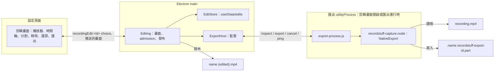
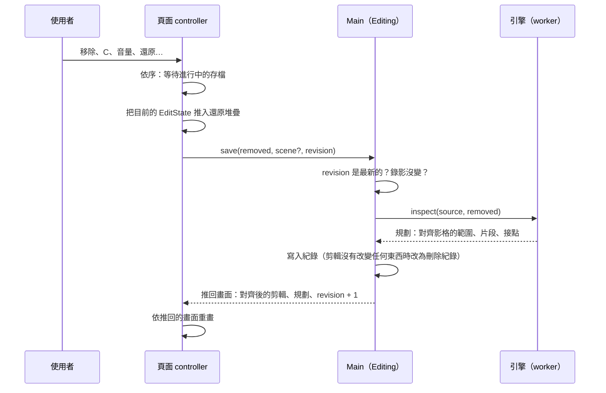

# 剪輯錄影

[English](../../system-design/editing.md) | [繁體中文](editing.md)

來源：剪輯畫面在 main 的[擁有者](../../../src/main/editing/editing.ts)、[剪輯紀錄](../../../src/main/editing/edit-store.ts)、匯出 worker 的[監管](../../../src/main/editing/export-host.ts)與[程序](../../../src/main/editing/export-process.ts)、[共用契約](../../../src/shared/editing.ts)、頁面的 [controller](../../../src/renderer/settings/controller/editor.ts) 與[對話框](../../../src/renderer/settings/tabs/library/editor.tsx)；引擎中的[來源讀取](../../../native/capture/src/edit/source.rs)、[剪輯規劃](../../../native/capture/src/edit/plan.rs)、[remux](../../../native/capture/src/edit/remux.rs)、[JavaScript 介面](../../../native/capture/src/export_api.rs)，以及 [macOS](../../../native/capture/src/mac/edit.rs) 與 [Windows](../../../native/capture/src/win/edit.rs) 的平台 codec。可剪輯錄影（plan 087）另加[共用的描述與場景](../../../src/shared/editable.ts)、頁面的[相機與音量](../../../src/renderer/settings/tabs/library/editor-scene.tsx)、引擎的[描述](../../../native/capture/src/editable.rs)、[算繪匯出](../../../native/capture/src/edit/render.rs)與其 [macOS 部分](../../../native/capture/src/mac/render.rs)。

Plan 085 加入剪輯階段的第一個切片：錄影分頁中錄影的選單提供「編輯…」，開啟剪輯畫面；可以移除錄影的任何部分（開頭、結尾或中間，數量不限），「匯出」把保留的片段寫成錄影旁的新檔案。剪輯會被記住，再次開啟時回到上次的狀態。錄影本身從不改變。錄影不受影響：這裡的一切都不在錄影期間執行，一般存檔也完全不依賴它。Plan 087 加入第二個切片：開啟「可編輯錄影」錄下的錄影會把相機與每個聲音輸入分開保存，因此剪輯畫面也能擺放相機與調整音量（[可剪輯錄影](#可剪輯錄影)）。

## 原始錄影從不被寫入

每條路徑都只讀取錄影。main 以唯讀開啟它以計算兩端的 hash；引擎以唯讀開啟它來 remux。匯出寫入自己的新檔案，以沒有被佔用的檔名發布；剪輯存在 userData。這項功能沒有任何地方以寫入模式開啟、改名、搬移或刪除錄影，因此匯出失敗、取消或當機、磁碟已滿、剪輯紀錄損壞，最多損失匯出結果或剪輯，不會損失錄影。測試在每條路徑之後都檢查錄影的 checksum，包含故障注入。

## 程序與職責

| 部分 | 負責 | 不負責 |
| --- | --- | --- |
| `main/editing/editing.ts` | 開啟中剪輯畫面的狀態、錄影身分檢查、儲存剪輯、admission、匯出的暫存檔、其 journal 與發布、啟動時的清理 | 媒體，永遠不進入 main |
| `main/editing/edit-store.ts` | 剪輯紀錄：位置、格式、原子寫入、有上限的讀取、身分規則 | 錄影檔 |
| `main/editing/export-host.ts` | worker 程序：延遲 fork、就緒、訊息驗證、ping、取消時限、當機與卡住的處理 | 檔案或決策 |
| `main/editing/export-process.ts` | 載入引擎，一次處理一個請求 | 路徑的選擇、發布 |
| `native/capture/src/edit` | 讀取錄影索引、剪輯規劃、remux 到指定的檔案 | 檔名、發布、剪輯紀錄 |
| Renderer controller 與對話框 | 繪製時間軸、暫時的分割點與選取、還原堆疊、預覽跳過 | 已儲存的剪輯或匯出 |

worker 是獨立的 `utilityProcess`（服務名稱 `RecordStuff Export`），在剪輯畫面第一次需要引擎時 fork，畫面關閉且沒有工作時結束，監管方式與 capture host 相同：它送出的每則訊息都經過檢查，當機以其結束判斷，卡住以工作進行中漏回兩次 pong 判斷。它載入與 capture host 相同的 `recordstuff-capture.node`；main 從不載入。影格位元組留在 worker 內；main 只收到規劃、進度比例與結果。

## 剪輯紀錄

剪輯是 `userData/edits/<錄影路徑的 hash>.json` 中的 JSON 紀錄（plan 085，D3），而不是儲存位置裡的 sidecar（它的子資料夾是錄影分頁的分類）。紀錄包含錄影的身分（路徑、大小、修改時間，以及前後各 1 MiB 的 SHA-256）、影片的 timescale、以該 timescale 表示的移除範圍（已排序、不重疊的整數對，最多 256 個）與 revision；version 2（plan 087）加入可剪輯錄影的場景，且只為這種錄影寫入，所以其他剪輯仍是 version 1，前一版也讀得懂。version 3（2026-10-26）讓場景的相機可以依時段隱藏，只為這種相機寫入。錄影只被參照，從不複製。

- **單一寫入者**：main，single-instance lock 讓它對每位使用者唯一；寫入依序排隊。
- **原子寫入**：暫存檔、fsync、rename，再 fsync 資料夾（`writeFileAtomic` 的 `syncDirectory`；Windows 沒有可 flush 的資料夾 handle，由 NTFS journal 保證 rename），所以失敗或中斷的寫入會留下上一個完整的 revision。
- **有上限且從不重設**：超過 64 KiB、格式錯誤、範圍重疊或版本較新的紀錄被回報為無法讀取，並原樣保留；畫面會說明並提供「捨棄編輯」，由使用者明確選擇。兩個版本都逐欄位讀取；沒有 migration 框架。
- **過期**：紀錄的身分與該路徑上的檔案不再相符時即為過期：畫面說明錄影已變動，並提供捨棄。不會刪除使用者的任何檔案。
- **改名或搬移**：在錄影分頁中改名或移到分類的錄影，若仍是同一個檔案，剪輯會跟著移動；在 Finder 中搬移的錄影則把剪輯留在原處。
- **Revision**：每次儲存都註明它所修改的 revision；基於較舊 revision 的修改會被拒絕。

## 讀取錄影

引擎只讀取它自己寫出的 MP4 索引：plain 或 fragmented（plan 076 的 hybrid 檔案，已完成或被中斷），其他一律不讀。讀到的每個大小在使用前都會檢查：`moov` 或 `moof` 最多完整讀取 32 MiB，單一 sample 不得超過 64 MiB 或超出檔案結尾，sample 總數最多 2^25。被截斷的 fragment 會結束讀取，與播放器的行為相同。不符合的檔案會附原因拒絕：其他 muxer 寫的檔案（包括 plan 076 之前 Chromium 時期的錄影）、多於一條影像或聲音軌、H.264 與 AAC 以外的 codec、重新排序的畫面（`ctts`）、不是每包 1024 frame 的聲音、影像的 edit list，或多於一個 sample description。索引每個 sample 約佔八個位元組，影像再加一個 decode time，這是唯一隨檔案長度增加的記憶體；sample 本身在原處讀取，每次最多 8 MiB。

## 剪輯方式

移除範圍會對齊到最近的影格起點；範圍之間的部分被保留。在 key frame 接續的保留片段直接複製。

**畫面（D2）**：兩個平台的錄影都至少每秒一個 key frame，且不重新排序畫面，所以片段可以在任何影格結束而只需複製。在 GOP 中間接續的片段，從接續點到下一個 key frame（最多一秒）的畫面，會從前一個 key frame 解碼，再用引擎自己的 H.264 encoder 重新編碼成以 key frame 開頭的封閉 GOP：macOS 上 VideoToolbox 非同步解碼，逐張交給錄影用的 encoder（設定與錄影相同，但不是即時模式）；Windows 上使用 Microsoft 的軟體解碼器與編碼器。key frame 間隔超過 4 秒的 run（只有損壞的檔案會有；錄影每秒都有 key frame）改從下一個 key frame 接續，超過 256 MiB 的 run 會被拒絕，讓 run 在記憶體中的畫面保持有上限。encoder 設為來源的 level 與影格率，bit rate 為來源平均的兩倍（至少 2 Mbps，至多為該 level 上限的九成，且不低於來源本身）。在來源的 level 下，所有量測過的錄影重新編碼後的參數集都與來源相同，因此匯出保持單一 sample description。

參數集不同時，plan 的規則已在 2026-10-24 以實際播放一次決定：重新編碼的畫面使用第二個 `avc1` description 的檔案，AVFoundation（QuickTime 所用）可以解碼並 seek，但 app 自己的播放器 Chromium 在第二個 description 的第一張畫面出現解碼錯誤而停止。因此這種接點從請求位置當下或之後的第一個 key frame 接續，絕不更早：移除的內容不會再出現，片段也不會重疊。代價是保留片段最多少一秒；沒有剩餘 key frame 的片段會被捨去。剪輯畫面會標出每個這樣的接點，並說明晚了多少接續。引擎對每段錄影只從一張畫面學一次重新編碼的參數集，worker 在畫面開啟期間保存，因此畫面的規劃不需要再編碼。第二個 description 只留給重複這項檢查的 fixture 使用。

**聲音（維護者 2026-10-24 的選擇，取代 D2 的整段重新編碼）**：整條音軌重新編碼在單執行緒約為 160 倍即時，對 10 Mbps 的錄影只有磁碟速度的六分之一，而 gate 要求一半。比照 LosslessCut、Avidemux 的 copy 模式與 `ffmpeg -c:a copy` 剪聲音的方式，AAC packet 原樣複製；與它們不同的是接點精確到 sample 並有淡入淡出：每個接點附近數個 packet（約 85 ms）的視窗會被解碼、剪到該影格、兩側加上 5 ms 的 raised-cosine 淡入淡出，再用錄影的 AAC encoder 重新編碼，encoder 提早開始，讓它的 priming 落在視窗之前。被複製的 packet 只有在每個片段於 1024 frame 的 packet 格線上與來源同一位置開始時才能保持原位，因此第一個之後的每個片段，起點最多移動半個 packet（48 kHz 下 10.7 ms），做法是拉長或縮短接點前最後一張畫面。畫面與聲音一起移動，所以每個片段內兩者的偏移與來源完全相同，偏差也不會累積。開頭不重新編碼：複製從第一個保留影格前兩個 packet 開始，由 edit list 跳過，就像跳過 encoder 的 priming。聲音隨畫面結束，或在來源聲音結束處結束。不使用每個接點一個的 AAC edit list。

**檔案**：sample 一次一個 fragment 經過引擎自己的 muxer（`HybridMp4`），影像與到同一時間為止的聲音交錯寫入，最後如同錄影一樣轉成 plain 檔案。媒體緩衝的上限與檔案長度無關（一個讀取區段與一個 fragment）；輸出的 sample 索引每個 sample 約八個位元組，隨長度增加，與錄影相同。

## 匯出、發布與清理

1. main 在 worker 建立暫存檔之前，把它的路徑記入 journal（`userData/edits/exports-in-flight.json`，原子寫入）；暫存檔位於錄影旁：`.<name>.recordstuff-export-<12 個十六進位字元>.part`，為隱藏檔，錄影分頁不會列出。
2. worker 只在該檔不存在時建立它，remux 進去，並在 muxer 的 finish 中 sync；進度約每秒十次送到畫面。
3. main 以第一個空著的 `<name> (edited).mp4`、`<name> (edited 2).mp4`……發布（再次編輯的匯出檔沿用其來源的名稱接續編號：`Talk（已編輯）` 匯出為 `Talk（已編輯 2）`，而非 `Talk（已編輯）（已編輯）`，不論是哪種語言命名的）：用失敗而非取代的 hard link，接著移除暫存檔名。不支援 hard link 的磁碟先把佔位檔記入 journal，以獨佔建立取得檔名，再把檔案 rename 到該空白佔位檔上；Node 沒有不取代的 rename，因此在這種磁碟上，其他程式恰好在兩次呼叫之間放到該名稱的檔案會被取代，這是僅存的暴露。佔位檔的路徑在建立前記入 journal，建立後再記下其 inode；只有在仍是那個空白檔時才會再被移除。匯出一旦被取消，即使 worker 已完成也不會發布。
4. 取消、worker 當機或卡住、磁碟已滿、link 或 rename 被拒、結束 App，都只移除暫存檔。journal 項目只在檔案確實不在之後才移除；無法移除的（例如磁碟暫時不在）留到下次啟動。啟動時（在 journal 自己的佇列中執行，期間開始的匯出會排在它之後記入）：journal 中名稱屬於匯出的暫存檔，以及仍是所記 inode 的空白佔位檔，都會被移除；沒有記下 inode 的佔位檔與其他名稱一律不動。暫時無法檢查或移除的檔案保留其項目。

列表會更新，新的錄影以獨立的一筆出現。

## Admission

同一時間只執行一個匯出，在按下「匯出」當下、任何等待之前就佔下位置；它採用之前的變更儲存後的剪輯，之後的變更會被拒絕。每次儲存與匯出之前都會重新檢查錄影的身分：畫面開啟期間被改變的錄影會顯示為過期，不會以它儲存或匯出。錄影、即時預覽或存檔進行中，或 RecordStuff 正在結束時，不會開始匯出；畫面會說明原因，匯出無法使用。匯出期間開始的錄影或即時預覽會取消匯出（`onSessionStart`）：錄影永遠優先。結束 App 會取消進行中的匯出，並在媒體關閉之前最多等它 2 秒；若發布仍卡在慢速磁碟，暫存檔會留在 journal 中，下次啟動時移除。取消後 1 秒內仍未結束的匯出，會連同 worker 一起結束。匯出期間無法關閉畫面，必須先「取消匯出」。

## 剪輯畫面

錄影分頁上方的對話框：上方是正式的播放器，下方是錄影各片段的時間軸；可剪輯錄影另有一條相機軌，以及每個聲音輸入各一條軌。頁面只負責畫與請求，main 負責決定與保存。在 main 存好並把畫面推回來之前，頁面手上的任何東西都還不是剪輯。

### 狀態歸屬

| 狀態 | 由誰持有 | 保存範圍 | 說明 |
| --- | --- | --- | --- |
| 移除範圍、場景、revision | Main（`Editing`、`EditStore`） | 剪輯紀錄 | 唯一的剪輯；頁面每次送出完整的新值，不送差異 |
| 規劃（片段、接點、匯出長度） | 引擎，經由 main | 畫面開啟期間 | 每次存檔重算；預覽跟著它 |
| 分割點 | 頁面 controller | 畫面開啟期間 | 手動把時間軸切成片段；從不存檔，所以匯出不依賴它 |
| 選取：一個片段或一段範圍 | 頁面 controller | 畫面開啟期間 | 一律是一段時間，不是某條軌 |
| `EditState`（`removed`、`scene`、`splits`）的還原與重做堆疊 | 頁面 controller | 畫面開啟期間 | 關閉畫面就清掉；紀錄只保存最新的剪輯 |
| 場景草稿 | 頁面 controller | 拖曳或滑桿移動期間 | 立即顯示與聽到，確定後才存檔 |
| 軌道的顯示與否、滑過預覽 | 頁面（視窗儲存空間、App 記憶體） | 跨剪輯畫面 | 視窗自己的外觀，從不屬於剪輯或匯出 |

### 選取模型

選取是一段時間，橫跨畫面與所有軌道，畫成一個框，永遠不是單一軌。點在哪裡只決定選哪一段時間：點畫面那條，或點軌上剪輯沒設定過的地方，選該處的片段（片段由移除範圍與分割點界定）；點軌上剪輯設定過的段（隱藏相機、自訂音量），選那一整段，方便整段修改或取消；在任何一條上拖曳，選拖過的範圍，並限制在錄影的開頭與結尾之內。鍵盤可以到達同樣的段落（每個片段與設定過的段都是按鈕）。接著由每個操作說明它改的是這段時間的哪一項屬性：「移除」把這段時間從所有軌道拿掉，「隱藏相機」只改相機，「音量」分別調整各輸入。所以沒有操作需要分軌選取，時間軸也不會出現某個操作看起來改的是別條軌。錄影的開頭與結尾和其他範圍一樣剪；沒有獨立的修剪把手，因為修剪一向是存成碰到開頭或結尾的移除範圍。

### 一次變更的完整流程

- **一次一個。** 所有會存檔的變更（移除或保留、還原、重做、確定的場景變更、復原成原始錄影）都經過 controller 的同一個佇列：排在進行中的存檔之後，並以那次存檔帶回的 revision 為基準。存檔期間按下的按鍵會排隊，不會被吃掉，控制項也照常可用；只有匯出進行中時才不可用。
- **樂觀更新加 revision。** 每次存檔都標明它要改的 revision；main 拒絕針對舊 revision 的存檔。被拒絕或失敗的存檔會把它的還原紀錄撤回，所以頁面不會顯示 main 沒有保存的變更。
- **main 對齊，頁面跟隨。** main 把範圍交給引擎規劃，保存規劃對齊到影格起點後的結果；從第一格開始的移除，起點記為錄影開頭。頁面畫的是推回來的結果，不是自己送出的值。
- **不留空紀錄。** 沒有改變任何東西的剪輯（沒有移除、可剪輯錄影的場景與錄製時相同）不保存：存檔會改為刪除紀錄，讓錄影回到未剪輯狀態。
- **分割點只在本地。** 分割與「接回前段」只改頁面的分割點：還原與重做可以撤回與重做，不需要存檔。

### 還原、重做與復原成原始錄影

還原與重做恢復完整的 `EditState`；只改分割點的步驟不需要存檔。「復原成原始錄影」和其他變更一樣是一次變更：保留所有片段、清除分割點，並把可剪輯錄影的場景回到錄製時的樣子；畫面開啟期間可用還原取回（它會先確認，因為關閉畫面後這段紀錄就不在了）。整體音量的「重設」把兩個輸入本身的音量設回 100%，時間軸上設定的一切維持不變。

### 按鍵、Esc 與焦點

剪輯畫面的按鍵在對話框的根元素處理；彈出選單也在對話框的 React 樹中，所以它們的按鍵同樣會到這裡。文字輸入框保留自己的按鍵；滑桿只接受還原與重做，方向鍵仍歸滑桿。Esc 分層處理：開著的彈出選單先處理（整體音量面板在預覽播放時保持開啟，不論焦點在哪都由它先處理），再來是相機泡泡的選取，最後是時間軸的選取；Esc 從不關閉剪輯畫面。當某個變更移除了有焦點的元素（例如還原合併了有焦點的片段），或把焦點送到對話框後面，焦點會回到選取的片段，沒有選取時回到時間軸，讓按鍵繼續有效；那個位置不畫焦點外框，因為選取框已經表示了選了什麼。

### 放大播放剪輯

預覽是即時播放剪輯；在「匯出」寫出檔案之前，並不存在剪好的影片。有兩種方式把它放大，播的是同一份剪輯：

- **放大預覽**（T，或畫面上的按鈕）是剪輯畫面自己的狀態：面板收起，畫面帶著播放器控制列填滿空間；按 Esc、T 或按鈕回到時間軸。不會離開頁面。
- **全螢幕**（F、雙擊畫面，或按鈕）使用播放器的全螢幕視窗：一個獨立視窗蓋住整個螢幕，不改變 RecordStuff 視窗的大小（desktop.md）。頁面先等仍在存檔的變更完成，再以 `edited: true` 請求 main；main 從自己持有的剪輯組出 `PlaybackEdit`（要跳過的範圍；可剪輯錄影另含場景、聲音與預覽軌網址，等它們複製完成），從不採用頁面送來的內容，交給全螢幕視窗。全螢幕視窗用和預覽相同的共用模組（`player/edited-playback.ts`：跳過、跟隨、混音）播放；離開時預覽從全螢幕播到的位置接續。全螢幕的進度條以錄影本身的時間計算，移除的範圍在播放時跳過。

會讓錄影一點都不剩的移除，在送出前就會被拒絕，提示短暫顯示在選取操作上方，時間軸下方不會多出一行；main 仍會拒絕因對齊影格而變成全部移除的情況。

### 已剪輯的錄影

`EditStore` 在啟動時讀取一次哪些錄影有剪輯紀錄，之後在每次存檔、捨棄與移動時更新清單；紀錄符合檔案目前大小的錄影，選單會顯示「繼續編輯…」。匯出是一支獨立的錄影，不連回來源。

## 可剪輯錄影

自 plan 097（D6）起，也可在錄影工作室選擇類型（同一個設定），而可剪輯錄影一律照原樣錄下每個輸入：不論 fader 為何都是 100%、不靜音、相機軌從不隱藏。音量、音量區段與隱藏區段都在這裡事後設定；錄影中 Studio 只提供音量表，tray 也不提供隱藏相機（[桌面](desktop.md#錄影工作室)）。

Plan 087。錄影設定中的「可編輯錄影」（macOS，預設關閉，錄影中鎖定；Windows 在引擎支援前隱藏）把畫面、相機與每個聲音輸入分開錄下，錄完後可以移動、縮放或隱藏相機泡泡，並分別設定系統聲音與麥克風的音量，再匯出成一般 MP4。關閉時錄影與以往相同；舊錄影無法取回它從未保存的內容。

**檔案。** 一個 MP4，即引擎的 hybrid fragmented 檔案：單獨的畫面（H.264）、第一條聲音軌、兩個輸入都錄時的第二條聲音軌，以及錄相機時 1280×720 的相機軌（H.264）。每種只有第一條軌啟用；第二條聲音與相機是停用的 alternate，所以在匯出前任何播放器都只顯示畫面與第一條聲音。每個聲音輸入在共用時鐘上有自己的單輸入 mixer，所以沒有送來聲音的輸入錄成靜音，絕不位移；相機軌從錄影開始起算，相機隱藏時為黑畫面。`moov/udta/rsed` 中的 JSON 描述（最多 4 KiB，version 1）說明檔案可剪輯、每條聲音軌是哪個輸入，以及錄影開始時泡泡的位置；main 逐欄位檢查它（[shared](../../../src/shared/editable.ts)），沒有有效描述的檔案視為一般錄影。錄影分頁讀取其他資訊時一併讀取這個 box，在卡片上標示「可編輯」。中斷的可剪輯錄影可以開啟，並算繪其中已有的內容；留空的相機或第二聲音軌視為不存在。

**場景。** 剪輯為整段錄影加入一個場景，從剪輯紀錄 version 2 開始保存：

| 欄位 | 意義 | main 保存時 |
| --- | --- | --- |
| `camera.x`、`camera.y` | 泡泡的位置，同工作室的相機版面（剩餘空間的比例） | 限制在畫面內 |
| `camera.width`、`camera.height` | 大小，短邊的比例；縮放時保持形狀 | 有上下限 |
| `camera.shown` | `false` 表示整段隱藏相機，優先於任何時段，時段本身保留 | — |
| `camera.hidden` | 隱藏的時段 `[from, to)`，最多 256 段（version 3） | 排序、合併、限制在錄影長度內 |
| `volumes.system`、`volumes.microphone` | 各輸入本身的音量（百分比），套用在錄到的內容上（100% 表示維持錄製時的樣子） | 只保留錄影實際有的輸入 |
| `volumeStretches` | 每條輸入的 `[from, to, percent]`，在那段取代它本身的音量，每條最多 256 段（version 3） | 排序、不重疊、相鄰同音量的合併、限制在錄影長度內 |

圓角與鏡像維持錄影本身的設定。場景一開始是錄影結束時泡泡的位置，所有輸入都是 100%（`EditorEditable.recorded`，也就是「復原成原始錄影」回到的狀態）。所有時段都以影片 timescale、依錄影本身的時鐘表示，與移除範圍相同，所以移除或保留前面的片段不會讓它們移動。紀錄以能容納內容的最舊版本寫入（沒有場景是 1、有場景是 2、有任何時段是 3），所以舊版本仍能讀它讀得懂的剪輯，遇到較新的則視為無法讀取，而不是讀錯。錄影時隱藏的相機在相機軌中是黑畫面，不是剪輯一開始就有的時段。

**預覽。** 剪輯畫面開啟時，worker 把相機與第二聲音軌複製成 `userData/edits/preview` 中各自的檔案（保持錄影時鐘、原樣、不重新編碼），在該畫面開啟期間以 `recordstuff-media://preview/<generation>/<track>` 提供，畫面關閉時與啟動時移除。頁面讓它們與正式播放器同步播放：跟隨播放、暫停、跳轉、速率，以及略過的移除片段。泡泡依場景的位置與大小、錄影的圓角與鏡像畫在播放器上。相機被時段隱藏的地方不畫泡泡（和匯出一樣是硬切）；只要有任何時段，相機就逐格跟隨，每條聲音的音量也在每一格依播放位置的時間設定，約以 4 ms 過渡。聲音經過 Web Audio，用匯出的方式混音：各自套用音量、加總、經過引擎的 soft limit（同一條曲線，[audio-volume](../../../src/shared/audio-volume.ts) 的 `softLimit`），再套用播放器的音量與靜音，所以聽到的就是匯出的。無法複製的軌（損毀的檔案）不出現在預覽中；相機的話也從場景中移除，並記錄在 log。媒體 scheme 回應 `access-control-allow-origin: *`，讓 Web Audio 能讀取。

**算繪匯出。** 畫面改變時沒有東西能直接複製，所以可剪輯錄影的匯出一律算繪，即使沒有剪輯（[render.rs](../../../native/capture/src/edit/render.rs)）：每個保留的畫面影格與該時間的相機影格（在它之前或同時最後擷取的一張）由 VideoToolbox 解碼，由錄影自己的 Metal compositor 依場景的泡泡合成（整段隱藏，或該影格的時間落在隱藏時段內時不合成，也不解碼那一格的相機），再由錄影的 H.264 encoder 以非即時模式、來源的 level 重新編碼；聲音軌每次解碼一秒（提早兩個 packet，同剪輯的規則），以場景的音量（時段內以該時段的音量取代輸入本身的音量，兩者之間以 10 ms raised cosine 過渡避免爆音；某條輸入整個區塊都靜音時不解碼）經過引擎的 limiter 混音，在移除範圍切開，只在接點加 5 ms raised-cosine 淡入淡出，編碼成一條 AAC 軌。影格保留自己的時間，在移除範圍處接攏，所以和剪輯不同，接點不必等 key frame。上限：一個讀取區段、最多 8 個進行中的影格（encoder 停滯 10 秒即失敗）、每條軌一秒的聲音與一個 fragment；每個影格都檢查取消。輸出只有一條畫面軌與一條聲音軌，沿用 085 的發布流程；來源從不被寫入。Windows 沒有 renderer，會拒絕。

## 量測

`pnpm bench:export`（plan 085 的 gate，2026-10-24，M1 Pro，APFS，來源在 page cache 中；[紀錄](../verification/history-2026-10.md#plan-085-結案--2026-10-24)）：在 64 MiB、2 GiB 與兩小時 60 fps 的來源上，切點落在 key frame 的 remux 速率分別是同一個 worker 串流複製的 0.60、0.80 與 0.83 倍（gate ≥ 0.5）；兩個位於 GOP 中間的接點在全新 worker 中增加 330–430 ms；取消後 p95 2 ms 內結束（gate 1 秒）。匯出期間 worker 自身的記憶體比載入引擎後閒置的 utilityProcess（65 MiB）多 26–38 MiB（絕對峰值 92–104 MiB）；plan 的 64 MiB gate 以這個增量計算，因為閒置程序本身就已超過（維護者 2026-10-24 的決定）。一段真實的 60 秒 1080p60 錄影，含兩個 smart cut 接點時匯出需 575 ms，切點在 key frame 時需 73 ms，複製同一檔案為 60 ms。

Plan 087 的算繪匯出（被 ignore 的 `render_bench` 測試，2026-10-25，合成的 20 秒 1080p30 可剪輯錄影，含 720p 相機與兩個音調，release build）：合成相機並混合兩條聲音時為即時的 6.3 倍，取消在 30–34 ms 內結束（gate：至少即時，取消 p95 在 2 秒內）。在 App 中，一段真實的 10 秒 1080×1920 60 fps 可剪輯錄影，相機移動、麥克風 50%，約 3.5 秒算繪完成；匯出檔在 QuickTime 中播放正常，聲音與畫面相差 10 ms 內。可剪輯錄影本身的成本見[工具指南](tooling.md#匯出基準測試)與 plan 087 的[紀錄](../verification/history-2026-10.md#plan-087-第一步可剪輯錄影的成本--2026-10-24)。

## 限制

- Windows：remux 是共用程式碼；解碼與編碼的呼叫只由 CI 的 Windows 測試檢查，未在實機上驗證。
- level 低於 3.0（低 bit rate 的小範圍錄影）的錄影，因為 VideoToolbox 可設定的最低 High level 是 3.0，重新編碼的參數集會不同，GOP 中間的接點因此從 key frame 接續。
- 匯出的檔案可以再剪輯；只有含第二個 sample description 的檔案（只由播放器檢查的 fixture 產生）不能。
- 剪輯會跟著在錄影分頁中改名或搬移的錄影，不會跟著在 Finder 中改名的錄影。
- 可剪輯錄影只支援 macOS。4:3 的相機會被拉伸到 16:9 的軌。場景是整段錄影一個位置；相機可以依時段隱藏、每條輸入可以依時段設定音量（2026-10-26），相機為硬切，音量有 10 毫秒過渡、沒有曲線，但沒有分段擺放、不錄滑鼠事件、沒有自動縮放（plan 087 的 D1）。時段的兩端要重新選取來調整，不能在相機軌上拖曳；錄影中隱藏相機時，相機軌錄到的是黑畫面，剪輯不會自動把它當成隱藏時段。算繪匯出會重新編碼每個影格，所以比剪輯的複製慢，畫面也是第二代編碼。
