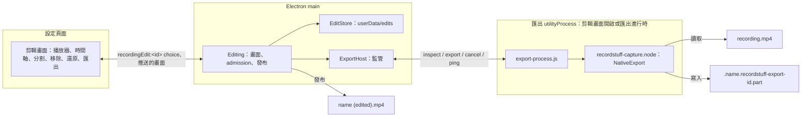

# 剪輯錄影

[English](../../system-design/editing.md) | [繁體中文](editing.md)

來源：剪輯畫面在 main 的[擁有者](../../../src/main/editing/editing.ts)、[剪輯紀錄](../../../src/main/editing/edit-store.ts)、匯出 worker 的[監管](../../../src/main/editing/export-host.ts)與[程序](../../../src/main/editing/export-process.ts)、[共用契約](../../../src/shared/editing.ts)、頁面的 [controller](../../../src/renderer/settings/controller/editor.ts) 與[對話框](../../../src/renderer/settings/tabs/library/editor.tsx)；引擎中的[來源讀取](../../../native/capture/src/edit/source.rs)、[剪輯規劃](../../../native/capture/src/edit/plan.rs)、[remux](../../../native/capture/src/edit/remux.rs)、[JavaScript 介面](../../../native/capture/src/export_api.rs)，以及 [macOS](../../../native/capture/src/mac/edit.rs) 與 [Windows](../../../native/capture/src/win/edit.rs) 的平台 codec。可剪輯錄影（plan 087）另加[共用的描述與場景](../../../src/shared/editable.ts)、頁面的[相機與音量](../../../src/renderer/settings/tabs/library/editor-scene.tsx)、引擎的[描述](../../../native/capture/src/editable.rs)、[算繪匯出](../../../native/capture/src/edit/render.rs)與其 [macOS 部分](../../../native/capture/src/mac/render.rs)。

Plan 085 加入剪輯階段的第一個切片：錄影分頁中錄影的選單提供「編輯…」，開啟剪輯畫面；可以移除錄影的任何部分（開頭、結尾或中間，數量不限），「匯出」把保留的片段寫成錄影旁的新檔案。剪輯會被記住，再次開啟時回到上次的狀態。錄影本身從不改變。錄影不受影響：這裡的一切都不在錄影期間執行，一般存檔也完全不依賴它。Plan 087 加入第二個切片：開啟「可編輯錄影」錄下的錄影會把相機與每個聲音輸入分開保存，因此剪輯畫面也能擺放相機與調整音量（[可剪輯錄影](#可剪輯錄影)）。

## 原始錄影從不被寫入

每條路徑都只讀取錄影。main 以唯讀開啟它以計算兩端的 hash；引擎以唯讀開啟它來 remux。匯出寫入自己的新檔案，以沒有被佔用的檔名發布；剪輯存在 userData。這項功能沒有任何地方以寫入模式開啟、改名、搬移或刪除錄影，因此匯出失敗、取消或當機、磁碟已滿、剪輯紀錄損壞，最多損失匯出結果或剪輯，不會損失錄影。測試在每條路徑之後都檢查錄影的 checksum，包含故障注入。

## 程序與職責

| 部分 | 負責 | 不負責 |
| --- | --- | --- |
| `main/editing/editing.ts` | 開啟中剪輯畫面的狀態、錄影身分檢查、儲存剪輯、admission、匯出的暫存檔、其 journal 與發布、啟動時的清理 | 媒體，永遠不進入 main |
| `main/editing/edit-store.ts` | 剪輯紀錄：位置、格式、原子寫入、有上限的讀取、身分規則 | 錄影檔 |
| `main/editing/export-host.ts` | worker 程序：延遲 fork、就緒、訊息驗證、ping、取消時限、當機與卡住的處理 | 檔案或決策 |
| `main/editing/export-process.ts` | 載入引擎，一次處理一個請求 | 路徑的選擇、發布 |
| `native/capture/src/edit` | 讀取錄影索引、剪輯規劃、remux 到指定的檔案 | 檔名、發布、剪輯紀錄 |
| Renderer controller 與對話框 | 繪製時間軸、暫時的分割點與選取、還原堆疊、預覽跳過 | 已儲存的剪輯或匯出 |

worker 是獨立的 `utilityProcess`（服務名稱 `RecordStuff Export`），在剪輯畫面第一次需要引擎時 fork，畫面關閉且沒有工作時結束，監管方式與 capture host 相同：它送出的每則訊息都經過檢查，當機以其結束判斷，卡住以工作進行中漏回兩次 pong 判斷。它載入與 capture host 相同的 `recordstuff-capture.node`；main 從不載入。影格位元組留在 worker 內；main 只收到規劃、進度比例與結果。

## 剪輯紀錄

剪輯是 `userData/edits/<錄影路徑的 hash>.json` 中的 JSON 紀錄（plan 085，D3），而不是儲存位置裡的 sidecar（它的子資料夾是錄影分頁的分類）。紀錄包含錄影的身分（路徑、大小、修改時間，以及前後各 1 MiB 的 SHA-256）、影片的 timescale、以該 timescale 表示的移除範圍（已排序、不重疊的整數對，最多 256 個）與 revision；version 2（plan 087）加入可剪輯錄影的場景，且只為這種錄影寫入，所以其他剪輯仍是 version 1，前一版也讀得懂。version 3（2026-10-26）讓場景的相機可以依時段隱藏，只為這種相機寫入。錄影只被參照，從不複製。

- **單一寫入者**：main，single-instance lock 讓它對每位使用者唯一；寫入依序排隊。
- **原子寫入**：暫存檔、fsync、rename，再 fsync 資料夾（`writeFileAtomic` 的 `syncDirectory`；Windows 沒有可 flush 的資料夾 handle，由 NTFS journal 保證 rename），所以失敗或中斷的寫入會留下上一個完整的 revision。
- **有上限且從不重設**：超過 64 KiB、格式錯誤、範圍重疊或版本較新的紀錄被回報為無法讀取，並原樣保留；畫面會說明並提供「捨棄編輯」，由使用者明確選擇。兩個版本都逐欄位讀取；沒有 migration 框架。
- **過期**：紀錄的身分與該路徑上的檔案不再相符時即為過期：畫面說明錄影已變動，並提供捨棄。不會刪除使用者的任何檔案。
- **改名或搬移**：在錄影分頁中改名或移到分類的錄影，若仍是同一個檔案，剪輯會跟著移動；在 Finder 中搬移的錄影則把剪輯留在原處。
- **Revision**：每次儲存都註明它所修改的 revision；基於較舊 revision 的修改會被拒絕。

## 讀取錄影

引擎只讀取它自己寫出的 MP4 索引：plain 或 fragmented（plan 076 的 hybrid 檔案，已完成或被中斷），其他一律不讀。讀到的每個大小在使用前都會檢查：`moov` 或 `moof` 最多完整讀取 32 MiB，單一 sample 不得超過 64 MiB 或超出檔案結尾，sample 總數最多 2^25。被截斷的 fragment 會結束讀取，與播放器的行為相同。不符合的檔案會附原因拒絕：其他 muxer 寫的檔案（包括 plan 076 之前 Chromium 時期的錄影）、多於一條影像或聲音軌、H.264 與 AAC 以外的 codec、重新排序的畫面（`ctts`）、不是每包 1024 frame 的聲音、影像的 edit list，或多於一個 sample description。索引每個 sample 約佔八個位元組，影像再加一個 decode time，這是唯一隨檔案長度增加的記憶體；sample 本身在原處讀取，每次最多 8 MiB。

## 剪輯方式

移除範圍會對齊到最近的影格起點；範圍之間的部分被保留。在 key frame 接續的保留片段直接複製。

**畫面（D2）**：兩個平台的錄影都至少每秒一個 key frame，且不重新排序畫面，所以片段可以在任何影格結束而只需複製。在 GOP 中間接續的片段，從接續點到下一個 key frame（最多一秒）的畫面，會從前一個 key frame 解碼，再用引擎自己的 H.264 encoder 重新編碼成以 key frame 開頭的封閉 GOP：macOS 上 VideoToolbox 非同步解碼，逐張交給錄影用的 encoder（設定與錄影相同，但不是即時模式）；Windows 上使用 Microsoft 的軟體解碼器與編碼器。key frame 間隔超過 4 秒的 run（只有損壞的檔案會有；錄影每秒都有 key frame）改從下一個 key frame 接續，超過 256 MiB 的 run 會被拒絕，讓 run 在記憶體中的畫面保持有上限。encoder 設為來源的 level 與影格率，bit rate 為來源平均的兩倍（至少 2 Mbps，至多為該 level 上限的九成，且不低於來源本身）。在來源的 level 下，所有量測過的錄影重新編碼後的參數集都與來源相同，因此匯出保持單一 sample description。

參數集不同時，plan 的規則已在 2026-10-24 以實際播放一次決定：重新編碼的畫面使用第二個 `avc1` description 的檔案，AVFoundation（QuickTime 所用）可以解碼並 seek，但 app 自己的播放器 Chromium 在第二個 description 的第一張畫面出現解碼錯誤而停止。因此這種接點從請求位置當下或之後的第一個 key frame 接續，絕不更早：移除的內容不會再出現，片段也不會重疊。代價是保留片段最多少一秒；沒有剩餘 key frame 的片段會被捨去。剪輯畫面會標出每個這樣的接點，並說明晚了多少接續。引擎對每段錄影只從一張畫面學一次重新編碼的參數集，worker 在畫面開啟期間保存，因此畫面的規劃不需要再編碼。第二個 description 只留給重複這項檢查的 fixture 使用。

**聲音（維護者 2026-10-24 的選擇，取代 D2 的整段重新編碼）**：整條音軌重新編碼在單執行緒約為 160 倍即時，對 10 Mbps 的錄影只有磁碟速度的六分之一，而 gate 要求一半。比照 LosslessCut、Avidemux 的 copy 模式與 `ffmpeg -c:a copy` 剪聲音的方式，AAC packet 原樣複製；與它們不同的是接點精確到 sample 並有淡入淡出：每個接點附近數個 packet（約 85 ms）的視窗會被解碼、剪到該影格、兩側加上 5 ms 的 raised-cosine 淡入淡出，再用錄影的 AAC encoder 重新編碼，encoder 提早開始，讓它的 priming 落在視窗之前。被複製的 packet 只有在每個片段於 1024 frame 的 packet 格線上與來源同一位置開始時才能保持原位，因此第一個之後的每個片段，起點最多移動半個 packet（48 kHz 下 10.7 ms），做法是拉長或縮短接點前最後一張畫面。畫面與聲音一起移動，所以每個片段內兩者的偏移與來源完全相同，偏差也不會累積。開頭不重新編碼：複製從第一個保留影格前兩個 packet 開始，由 edit list 跳過，就像跳過 encoder 的 priming。聲音隨畫面結束，或在來源聲音結束處結束。不使用每個接點一個的 AAC edit list。

**檔案**：sample 一次一個 fragment 經過引擎自己的 muxer（`HybridMp4`），影像與到同一時間為止的聲音交錯寫入，最後如同錄影一樣轉成 plain 檔案。媒體緩衝的上限與檔案長度無關（一個讀取區段與一個 fragment）；輸出的 sample 索引每個 sample 約八個位元組，隨長度增加，與錄影相同。

## 匯出、發布與清理

1. main 在 worker 建立暫存檔之前，把它的路徑記入 journal（`userData/edits/exports-in-flight.json`，原子寫入）；暫存檔位於錄影旁：`.<name>.recordstuff-export-<12 個十六進位字元>.part`，為隱藏檔，錄影分頁不會列出。
2. worker 只在該檔不存在時建立它，remux 進去，並在 muxer 的 finish 中 sync；進度約每秒十次送到畫面。
3. main 以第一個空著的 `<name> (edited).mp4`、`<name> (edited 2).mp4`……發布（再次編輯的匯出檔沿用其來源的名稱接續編號：`Talk（已編輯）` 匯出為 `Talk（已編輯 2）`，而非 `Talk（已編輯）（已編輯）`，不論是哪種語言命名的）：用失敗而非取代的 hard link，接著移除暫存檔名。不支援 hard link 的磁碟先把佔位檔記入 journal，以獨佔建立取得檔名，再把檔案 rename 到該空白佔位檔上；Node 沒有不取代的 rename，因此在這種磁碟上，其他程式恰好在兩次呼叫之間放到該名稱的檔案會被取代，這是僅存的暴露。佔位檔的路徑在建立前記入 journal，建立後再記下其 inode；只有在仍是那個空白檔時才會再被移除。匯出一旦被取消，即使 worker 已完成也不會發布。
4. 取消、worker 當機或卡住、磁碟已滿、link 或 rename 被拒、結束 App，都只移除暫存檔。journal 項目只在檔案確實不在之後才移除；無法移除的（例如磁碟暫時不在）留到下次啟動。啟動時（在 journal 自己的佇列中執行，期間開始的匯出會排在它之後記入）：journal 中名稱屬於匯出的暫存檔，以及仍是所記 inode 的空白佔位檔，都會被移除；沒有記下 inode 的佔位檔與其他名稱一律不動。暫時無法檢查或移除的檔案保留其項目。

列表會更新，新的錄影以獨立的一筆出現。

## Admission

同一時間只執行一個匯出，在按下「匯出」當下、任何等待之前就佔下位置；它採用之前的變更儲存後的剪輯，之後的變更會被拒絕。每次儲存與匯出之前都會重新檢查錄影的身分：畫面開啟期間被改變的錄影會顯示為過期，不會以它儲存或匯出。錄影、即時預覽或存檔進行中，或 RecordStuff 正在結束時，不會開始匯出；畫面會說明原因，匯出無法使用。匯出期間開始的錄影或即時預覽會取消匯出（`onSessionStart`）：錄影永遠優先。結束 App 會取消進行中的匯出，並在媒體關閉之前最多等它 2 秒；若發布仍卡在慢速磁碟，暫存檔會留在 journal 中，下次啟動時移除。取消後 1 秒內仍未結束的匯出，會連同 worker 一起結束。匯出期間無法關閉畫面，必須先「取消匯出」。

## 剪輯畫面

錄影分頁上方的對話框：正式的播放器，下方是錄影各片段的時間軸，依長度並排，保留的片段帶色調、移除的片段為斜線，並顯示播放位置。在時間軸上按下，播放位置就移到那裡，並選取該處的片段，拖曳可以來回瀏覽（2026-10-25 依維護者要求，讓「分割」能切在任何想要的位置；每個片段也是以時間與狀態命名的按鈕，按 Enter 或空白鍵會從片段開頭選取）；「分割」（S）在播放位置切開時間軸而不移除任何內容；「移除片段」或「保留片段」（Delete）切換選取片段的狀態；「還原」（⌘Z / Ctrl+Z）撤回上一次變更。每次變更立刻儲存，回來時已對齊到影格。預覽播放的就是匯出會包含的內容（依引擎的規劃）：顯示到移除範圍內、或片段延後到 key frame 接續之前的影格，會跳到匯出接續的位置，或在被移除的結尾開始處暫停。匯出會顯示進度與「取消匯出」，完成後顯示發布的名稱與「在 Finder 中顯示」（Windows 為「開啟資料夾」），失敗時說明原因並提供「再匯出一次」。過期或無法讀取的剪輯、無法剪輯的檔案、已經不在的錄影，各有自己的狀態。支援英文與繁體中文。2026-10-25 起依維護者要求：時間軸在片段下方顯示錄影的畫面縮圖（另一個隱藏的 video 每格跳轉一次，所以長錄影也只需解碼幾十張，每個畫面一次；保留的片段疊上色調，移除的片段為斜線）；「重做」（⇧⌘Z，或 Ctrl+Shift+Z 與 Ctrl+Y）重新套用「還原」撤回的變更，直到有新的變更為止；儲存變更期間，時間軸的按鈕不可用但不會被停用，所以鍵盤焦點與剪輯畫面的快捷鍵都保留；匯出完成後，「在 Finder 中顯示」是主要按鈕，「再匯出一次」在旁邊。同日實機操作後：分割也是「還原」與「重做」可以撤回與重做的一步（不需儲存，因為分割只屬於這個畫面）；S 依按鍵位置判斷，所以開著注音等輸入法也能分割；在時間軸上拖曳，放開的位置也會成為播放位置；用按鈕移除或保留的片段，即使 main 把兩端對齊到影格，仍維持選取；播放位置是帶有三角標記的白線，和選取片段的外框不同，精確到十分之一秒的時間顯示在匯出長度旁。之後依維護者要求，讓時間軸可以直接操作：保留範圍的兩端各有一個把手，可以修剪開頭與結尾（拖曳時預覽顯示把手位置的畫面；它們也是滑桿，方向鍵每次移動十分之一秒（同日起改為一格），Shift 為一秒，放開按鍵時儲存）；在時間軸上拖曳會選取一段範圍，「移除選取範圍」（Delete）把它移除；點一下會把播放位置移到那裡並選取該處的片段，從播放位置開始拖曳則可以來回瀏覽；時間軸下方有時間刻度，還沒剪過的錄影會在下方說明如何修剪與移除。每次修剪、每段移除的範圍都是「還原」可以撤回的一次變更。「分割」保留在「移除」之後，用來手動把時間軸切成片段。播放位置現在從第一次跳轉就跟著預覽，之前在畫面下次重繪前可能錯過。第二輪以第一次使用者身分的實機操作發現，真實游標拖不動把手，時間軸本身的拖曳卻可以，所以改由時間軸處理把手：按在把手上或距離把手 6 px 以內就能拖曳，即使沒有剛好按在 12 px 寬的把手上（同日起畫成 8 px，外加 8 px 的感應範圍）。在時間軸上，空白鍵播放或暫停，← → 逐格移動（Shift 為一秒），和其他剪輯軟體一樣；提示在還沒剪過時說明怎麼剪，之後改列出這些按鍵；場景的「重設」寫明重設的內容（「重設相機與音量」或「重設音量」）；對話框為刻度、提示與可剪輯錄影的控制項保留空間，並依卡片決定大小，開啟時不會改變尺寸。第三輪中每項任務第一次就完成，只發現一個問題：「還原」把有焦點的片段合併掉時，焦點會落到對話框外的頁面，⌘Z 就失效；現在焦點會回到選取的片段或時間軸。之後，提示一直顯示操作手勢與所有按鍵（包括 Shift 一秒與重做），播放位置精確到百分之一秒，看得出逐格的變化；選取範圍時顯示起訖與長度；時間刻度上也標出播放位置。之後依維護者要求：在時間軸上拖曳選取範圍時，預覽跟著拖曳中的那一端移動（修剪把手與播放位置本來就會），讓切點可以看著畫面決定；另外加入「滑過預覽」（預設關閉，與 Final Cut Pro 的略讀相同；只有按鈕，沒有快捷鍵，因為 S 已用於分割），開啟後滑鼠在時間軸上移動時，預覽顯示游標位置的畫面並有一條細線標示，滑鼠離開時回到播放位置，除非期間按下改變了播放位置。第四輪中能測的任務都第一次就完成；它的游標無法按住拖曳停下，也無法不按鍵移動，所以預覽跟隨拖曳與「滑過預覽」的懸停只由 UI 測試檢查。之後：播放位置或選取範圍的時間與匯出長度移到刻度下方自己的一列，因為選取範圍的較長文字放在按鈕列會把「匯出」擠到下一列並使畫面移動；提示改為一行操作手勢，按鍵收在鍵盤按鈕的提示中（完整列出時在小視窗佔三行）；「滑過預覽」在名稱旁寫出開關狀態，開啟時以強調色外框標示；刻度上的播放位置標記加上直線；對話框不會比視窗高，視窗太小時可以捲動。之後被問到把手是否太粗而難以對齊、或拖不到頭尾：頭尾都拖得到（拖出時間軸外會停在錄影的最開頭與最結尾），但抓在把手中間時，邊緣會跳到游標下，偏差半個把手寬，在長錄影中可達數秒。現在把手與游標保持抓取時的距離，邊緣移動的距離與游標完全相同；把手畫成 8 px，外加 8 px 的感應範圍，遮住較少畫面；拖曳時，時間列顯示匯出的開頭或結尾位置；把手的方向鍵改為一格，與時間軸相同；在其他變更存檔期間移動的把手仍會跟著移動，它自己的存檔會等前一個完成。第五輪確認了這些修正（拖曳時邊緣移動的距離與游標相同，原地按放不變，頭尾都能剛好到達），並發現把把手拖出時間軸外放開時，把手畫在端點卻沒有存檔，匯出長度不變：這次按壓在時間軸上沒有收到放開。現在不論按壓怎麼結束（在視窗任何地方放開、時間軸失去游標，或視窗失去焦點），都會結束手勢，這樣放開的把手也會存檔。之後，按鍵移動把手後，時間列仍顯示有焦點把手的位置；「移除」按鈕維持最長名稱的寬度，後面的按鈕不會移動；把手的感應範圍為 10 px；鍵盤按鈕按一下就會打開剪輯快捷鍵。之後依維護者在比較其他剪輯軟體後的要求，把手改成 iPhone 與 QuickTime 的修剪樣式：把手位於保留範圍外側並標示 ‹ ›，開頭把手的右緣與結尾把手的左緣就是切點，不會蓋住保留的畫面；上下曾以細線連接兩個把手，框出保留的範圍（2026-10-26 依維護者要求移除：這個紅框和選取片段的紅色外框同色，把它蓋住了；同日起，片段之間的分割線改為帶黑邊的琥珀色，與白色播放頭區分，線的底部另有琥珀色三角形標記，播放頭停在切點上（例如剛按 S）時仍看得到）；時間軸左右各留一個把手寬的空間，把手在最開頭或最結尾時也完整可見；刻度與時間軸對齊；拖曳把手時，時間顯示在把手上方。第六輪中，它一眼就被認出是這種修剪方式，把手不會蓋住保留的畫面，拖出視窗外放開也會以完整的匯出長度存檔；之後，匯出長度和旁邊的時間一樣精確到百分之一秒，鍵盤按鈕加上文字標籤，快捷鍵也列出把手上的方向鍵。之後依維護者的發現，匯出結束時不再讓任何東西移動：結果顯示在提示那一行（一行，檔名過長以刪節號截斷，完整名稱在提示框中；失敗訊息可以換行），「在 Finder 中顯示」取代「匯出」的位置，旁邊以圖示呈現「再匯出一次」，匯出區域維持最寬狀態的寬度，所以匯出開始、進行與結束時，旁邊的按鈕與下方的相機、聲音列都不會移動；相機的縮放控制點改為沿拖曳方向的斜向箭頭，因為單純的圓圈看不出用途。變更把焦點送到對話框後方的分頁時，焦點也會回到剪輯畫面。時間軸上會存檔的變更（還原、重做、移除或保留、修剪）改為依序執行：存檔期間按下的按鍵會排隊等候，不會被忽略，所以 ⌘Z 後立刻按 ⇧⌘Z 也會重做，把手在上一次移動存檔期間再次移動也會保留新位置（兩者都由 CI 較慢的機器發現）。

**工具列與時間軸上方的一行（2026-10-26，維護者在三種版面中選定 B′）。** 操作放在它作用的對象旁（同日維護者的原則；第一版 B′ 的工具列也有「移除」）：工具列只放作用於整段錄影或播放頭的操作，即播放、還原、重做、有文字的「分割」，右側是「選項」、按鍵說明與「匯出」；在剪輯畫面一般的寬度下不會換行。時間資訊移到時間軸正上方、字較小的一行，貼近時間軸並與工具列拉開距離：播放位置（拖曳把手時為把手時間）與匯出長度一起靠右；沒有選取時，左側提示如何選取（「點選片段，或在時間軸上拖曳選取範圍」）。各軌道直接貼在畫面那條下方，與它連成一塊，彼此只以細線分隔，每條 24 px，播放頭是一條貫穿整塊的線（同日維護者的檢視：它們共用同一個時間軸，間隔只是佔掉高度，也把播放頭切斷）；未設定的區段就是軌道本身的底色，已設定的（隱藏、靜音、自訂音量）保留外框。選取片段或範圍時，它的操作浮在選取範圍上方，並以小箭頭指向選取範圍的中點，選取長度附上名稱（「已選取 0:02.40」），每個操作的快捷鍵緊接在名稱之後：在畫面那條選取時，貼著這一行的底部往上延伸，但不會碰到工具列；在某條軌道上選取時，直接出現在那條軌道選取段的正上方，必要時蓋住上方的畫面或其他軌道（同日維護者的選擇：作用對象一目了然，也不再為了避開時間資訊而往旁邊移）：選取長度、附 ⌫ 的「移除」（選取已移除的片段時為等寬的「保留」），可剪輯錄影另有附 C 的「隱藏相機」與附 V 的「音量」；Delete、C、V 照常可用。這一行的高度固定，操作出現或消失時下方都不會移動；操作會避開時間資訊，視窗太窄放不下文字時只顯示圖示與按鍵（最常用的「移除」保留文字，選取長度則讓出位置），時間也只剩數字；工具列窄於 520 px 時，「分割」與「選項」只顯示圖示。選取範圍改用中性的淺色，不再是品牌紅（紅色讓人以為整段都要被刪除；紅色只留給已移除的部分）：畫面那條淡淡填色，各軌道只畫外框，點選軌道而選取時該軌道才填色。滑鼠或焦點停在浮動操作上時，會標出它會改到的軌道：「移除」是所有軌道，「隱藏相機」是相機軌，「音量」是聲音軌，其他軌道的外框淡出。「選項」最下方的「回復成原始錄影」會保留所有片段、清除分割點，並把可剪輯錄影的相機與音量回復成錄製時的樣子，視為一次變更，可用「還原」復原。

**已剪輯的錄影（2026-10-26）。** 有剪輯紀錄的錄影在卡片上標示「已剪輯」（點標示會開啟剪輯畫面，與「可剪輯」相同），選單項目改為「繼續編輯…」。沒有任何改變的剪輯（沒有移除任何部分，可剪輯錄影的場景也與錄製時相同）不保留紀錄：存檔時改為刪除紀錄，所以「回復成原始錄影」或把所有變更都還原後，標示也會消失；畫面的 revision 繼續遞增，因此「還原」可再次存檔。`EditStore` 在啟動時讀取一次哪些錄影有紀錄，之後隨每次存檔、刪除與搬移更新；分頁只標示紀錄符合檔案目前大小的錄影。匯出檔是獨立的錄影，不會連回來源。

## 可剪輯錄影

Plan 087。錄影設定中的「可編輯錄影」（macOS，預設關閉，錄影中鎖定；Windows 在引擎支援前隱藏）把畫面、相機與每個聲音輸入分開錄下，錄完後可以移動、縮放或隱藏相機泡泡，並分別設定系統聲音與麥克風的音量，再匯出成一般 MP4。關閉時錄影與以往相同；舊錄影無法取回它從未保存的內容。

**檔案。** 一個 MP4，即引擎的 hybrid fragmented 檔案：單獨的畫面（H.264）、第一條聲音軌、兩個輸入都錄時的第二條聲音軌，以及錄相機時 1280×720 的相機軌（H.264）。每種只有第一條軌啟用；第二條聲音與相機是停用的 alternate，所以在匯出前任何播放器都只顯示畫面與第一條聲音。每個聲音輸入在共用時鐘上有自己的單輸入 mixer，所以沒有送來聲音的輸入錄成靜音，絕不位移；相機軌從錄影開始起算，相機隱藏時為黑畫面。`moov/udta/rsed` 中的 JSON 描述（最多 4 KiB，version 1）說明檔案可剪輯、每條聲音軌是哪個輸入，以及錄影開始時泡泡的位置；main 逐欄位檢查它（[shared](../../../src/shared/editable.ts)），沒有有效描述的檔案視為一般錄影。錄影分頁讀取其他資訊時一併讀取這個 box，在卡片上標示「可編輯」。中斷的可剪輯錄影可以開啟，並算繪其中已有的內容；留空的相機或第二聲音軌視為不存在。

**場景。** 剪輯為整段錄影加入一個場景，沒有 keyframe：泡泡的位置（同工作室的相機版面：剩餘空間的比例）、寬與高（短邊的比例，縮放時保持形狀）、是否顯示，以及系統聲音與麥克風在工作室百分比刻度上的音量，套用在已錄下的內容上（100% 即維持原樣，因為錄影時設定的音量已在軌中）。圓角與鏡像維持錄影時的設定。場景從錄影留下泡泡的位置開始，每條軌 100%，存在剪輯紀錄的 version 2。拖曳、方向鍵（Shift 為較大步幅）或滑桿會立刻更新預覽，結束時儲存；儲存依序排隊，所以控制項保有焦點，每次都是「還原」可以和剪輯一起撤回的一步。只有匯出期間控制項不可用。2026-10-25 起依維護者要求：泡泡朝向畫面中央的角落有一個控制點，拖曳它會以對角為固定點、保持形狀縮放（大小滑桿是它的鍵盤對應，並顯示數值）；播放器的進度列蓋在泡泡上時，在泡泡範圍內按下會移動泡泡，進度列上的按鈕仍照常運作；滑鼠移到泡泡上時會顯示邊框（2026-10-26 起依維護者要求完全不畫白邊：滑鼠移上或拖曳時只在外側顯示淡黑色外圈）；控制項分成「相機」與「聲音」兩組，每個聲音有可恢復原音量的靜音按鈕，滑桿和錄影工作室的推桿一樣以 100% 為中間，「重設」把相機與音量恢復成錄影時的樣子（`EditorEditable.recorded`），是「還原」可以撤回的一次變更。拖曳的泡泡會停在放開的位置，不會吸附，與錄影工作室相同（2026-10-22）；2026-10-25 曾加入吸附，當天依維護者要求移除。

**依時段顯示相機。** 2026-10-26 起依維護者要求，相機可以在錄影的任何時段隱藏，不只整段。場景的相機保留 `shown`，並加入 `hidden`：以影片 timescale、依錄影本身時鐘表示的 `[from, to)` 時段，與剪輯相同（前面的片段被移除或保留時，時段不會移動），最多 256 段，main 儲存時會排序、合併並限制在錄影長度內。`shown: false` 是「選項」中的**隱藏所有相機畫面**，它是時段之上的總開關，會保留時段（同日依維護者選擇，取代打開時會清除時段的「顯示相機」開關）：開啟時匯出沒有相機，相機軌顯示整段隱藏，相機按鈕暫停並說明原因；關閉後相機回到時間軸上的時段設定。沒有時段時紀錄與 version 2 相同；只要有任何時段就存成 version 3，較舊的版本會把它視為無法讀取並保留，而不會當成整段顯示。有相機的可剪輯錄影，時間軸的畫面下方有一條相機軌：相機在畫面中的時段是帶人像的淡色填滿，隱藏的時段是斜線虛框與打叉的人像，移除的片段會變淡，播放位置與選取範圍也畫在上面；修剪把手只在畫面那一列。「移除」後面的相機按鈕或 C 作用於在時間軸上拖曳的範圍，否則是選取的片段（兩端對齊影格）：在那段隱藏相機；那段已全部隱藏時，則重新顯示，每次都是「還原」可以撤回的一步；沒有選取時按鈕不可用，提示會說要先選什麼。所以時段可以從任何影格開始：把播放位置移到那裡、按 S、再按 C。點相機軌上設定過的時段（隱藏的那段）會選取它（鍵盤按 Enter 也可以），再用按鈕顯示或隱藏；點在沒設定過的段上，則和點畫面縮圖一樣，把播放位置移到那裡並選取該處的片段，因為還沒設定的軌是一整段橫跨整段錄影（同日依維護者回報：點一下就選取了整段錄影）；在那裡按 Delete 會移除該範圍，與其他範圍相同。開關下方的說明寫出匯出的內容：有幾段隱藏相機、如何設定一段，或在開啟時說明關閉前都不會有相機。「重設」會把時段恢復成錄影時的樣子（沒有）。預覽中，播放位置在隱藏時段內時不畫泡泡（與匯出一樣硬切；元素保留，相機持續跟隨），暫停在那裡時，原位置顯示虛線外框與「此處隱藏相機」；只有在有時段隱藏時才逐格追蹤。算繪匯出時，時間落在隱藏時段的影格不合成相機，直接輸出螢幕原圖，也不為它解碼相機影格。

**依時段調整音量。** 2026-10-26 起依維護者要求，每條聲音輸入也可以在某些時段設定自己的音量：場景的 `volumeStretches` 為系統聲音與麥克風分別保存 `[from, to, percent]`，時鐘與相機時段相同，已排序、不重疊，相鄰且音量相同的會合併，每條最多 256 段；main 儲存時會限制在錄影長度內，並只保留錄影實際有的輸入。時段的百分比取代該輸入在那段的音量（0% 為靜音）；時段以外仍套用輸入本身的音量，所以「選項」的滑桿仍控制其餘部分。只要有任何時段，剪輯紀錄就是 version 3。每條輸入在相機軌下方有自己的軌：本身音量以淡色顯示名稱與百分比，自訂音量的時段以填色顯示百分比，靜音的時段為斜線並標示「靜音」；點自訂音量的時段會選取它，點在其他地方則移動播放位置並選取該處的片段，兩者都讓該輸入排在最前面。相機按鈕後的「音量」按鈕或 V 會開啟作用於選取範圍或片段的面板（沒有選取時按鈕不可用，按 V 會說明要先選什麼）：每條輸入有「靜音」（再按一次恢復）、滑桿（100% 在中間；移動時即可聽到，放開時儲存），以及「恢復整體音量」，一次讓所有輸入在選取範圍恢復本身音量。每次變更都是「還原」可以撤回的一步；「重設」會清除時段。面板寬至少 1030px 時，相機與音量按鈕會顯示文字（實測：英文在最長讀數時於 1016px 開始換行），更窄時只顯示圖示。預覽在有任何時段時，每一格都依播放位置設定各聲音的增益，以約 4 毫秒平滑過渡；算繪匯出逐格將每條音軌乘上它的音量（時段內用時段的音量），兩者之間以 10 毫秒的 raised cosine 過渡，避免爆音；整段都靜音的區塊不解碼。「選項」中的**時間軸上的軌**（同日依維護者要求）可以顯示或隱藏每條軌（相機軌與各輸入軌）：隱藏的軌離開時間軸，修剪把手跟著變短；這是這個視窗自己的外觀偏好，與側邊欄一樣存在它的儲存空間，下次開剪輯畫面、重新開 App 都沿用；隱藏的軌裡的設定仍會匯出，若還有時段，開關下方會說明；對它做變更（C 或音量面板）時會自動重新顯示。在軌上點選的範圍只在那條軌上填滿，畫面縮圖與其他軌只畫外框（同日依維護者回報：一段橫跨整段錄影的時段會讓整條時間軸變紅，看起來像全部都要被刪掉）；在畫面縮圖上拖曳的範圍（按 Delete 會移除的）維持填滿。音量面板的還原按鈕寫作「此範圍恢復整體音量」，輸入軌的預設段以前景色的強度繪製（深色模式下原本的灰色看起來像停用），面板的滑桿在每次存檔後都保有鍵盤焦點（Codex 的 Computer Use 回合發現下一次方向鍵會移動播放頭）。整體音量為 0% 的輸入，在軌上也寫「靜音」並用打叉圖示，與靜音時段一致，只是沒有表示「這段自己的設定」的斜線；「選項」的兩個滑桿加上標題「整體音量」，並說明時間軸上沒有自訂音量的部分都套用它們（同日依維護者的提問：「系統聲音 0%」和「靜音」並列，看起來像同一件事的兩種寫法）。

**預覽。** 剪輯畫面開啟時，worker 把相機與第二聲音軌複製成 `userData/edits/preview` 中各自的檔案（保持錄影時鐘、原樣、不重新編碼），在該畫面開啟期間以 `recordstuff-media://preview/<generation>/<track>` 提供，畫面關閉時與啟動時移除。頁面讓它們與正式播放器同步播放：跟隨播放、暫停、跳轉、速率，以及略過的移除片段。泡泡依場景的位置與大小、錄影的圓角與鏡像畫在播放器上。聲音經過 Web Audio，用匯出的方式混音：各自套用音量、加總、經過引擎的 soft limit（同一條曲線，[audio-volume](../../../src/shared/audio-volume.ts) 的 `softLimit`），再套用播放器的音量與靜音，所以聽到的就是匯出的。無法複製的軌（損毀的檔案）不出現在預覽中；相機的話也從場景中移除，並記錄在 log。媒體 scheme 回應 `access-control-allow-origin: *`，讓 Web Audio 能讀取。

**算繪匯出。** 畫面改變時沒有東西能直接複製，所以可剪輯錄影的匯出一律算繪，即使沒有剪輯（[render.rs](../../../native/capture/src/edit/render.rs)）：每個保留的畫面影格與該時間的相機影格（在它之前或同時最後擷取的一張）由 VideoToolbox 解碼，由錄影自己的 Metal compositor 依場景的泡泡合成（隱藏時不合成，也不解碼相機），再由錄影的 H.264 encoder 以非即時模式、來源的 level 重新編碼；聲音軌每次解碼一秒（提早兩個 packet，同剪輯的規則），以場景的音量經過引擎的 limiter 混音，在移除範圍切開，只在接點加 5 ms raised-cosine 淡入淡出，編碼成一條 AAC 軌。影格保留自己的時間，在移除範圍處接攏，所以和剪輯不同，接點不必等 key frame。上限：一個讀取區段、最多 8 個進行中的影格（encoder 停滯 10 秒即失敗）、每條軌一秒的聲音與一個 fragment；每個影格都檢查取消。輸出只有一條畫面軌與一條聲音軌，沿用 085 的發布流程；來源從不被寫入。Windows 沒有 renderer，會拒絕。

## 量測

`pnpm bench:export`（plan 085 的 gate，2026-10-24，M1 Pro，APFS，來源在 page cache 中；[紀錄](../verification/history-2026-10.md#plan-085-結案--2026-10-24)）：在 64 MiB、2 GiB 與兩小時 60 fps 的來源上，切點落在 key frame 的 remux 速率分別是同一個 worker 串流複製的 0.60、0.80 與 0.83 倍（gate ≥ 0.5）；兩個位於 GOP 中間的接點在全新 worker 中增加 330–430 ms；取消後 p95 2 ms 內結束（gate 1 秒）。匯出期間 worker 自身的記憶體比載入引擎後閒置的 utilityProcess（65 MiB）多 26–38 MiB（絕對峰值 92–104 MiB）；plan 的 64 MiB gate 以這個增量計算，因為閒置程序本身就已超過（維護者 2026-10-24 的決定）。一段真實的 60 秒 1080p60 錄影，含兩個 smart cut 接點時匯出需 575 ms，切點在 key frame 時需 73 ms，複製同一檔案為 60 ms。

Plan 087 的算繪匯出（被 ignore 的 `render_bench` 測試，2026-10-25，合成的 20 秒 1080p30 可剪輯錄影，含 720p 相機與兩個音調，release build）：合成相機並混合兩條聲音時為即時的 6.3 倍，取消在 30–34 ms 內結束（gate：至少即時，取消 p95 在 2 秒內）。在 App 中，一段真實的 10 秒 1080×1920 60 fps 可剪輯錄影，相機移動、麥克風 50%，約 3.5 秒算繪完成；匯出檔在 QuickTime 中播放正常，聲音與畫面相差 10 ms 內。可剪輯錄影本身的成本見[工具指南](tooling.md#匯出基準測試)與 plan 087 的[紀錄](../verification/history-2026-10.md#plan-087-第一步可剪輯錄影的成本--2026-10-24)。

## 限制

- Windows：remux 是共用程式碼；解碼與編碼的呼叫只由 CI 的 Windows 測試檢查，未在實機上驗證。
- level 低於 3.0（低 bit rate 的小範圍錄影）的錄影，因為 VideoToolbox 可設定的最低 High level 是 3.0，重新編碼的參數集會不同，GOP 中間的接點因此從 key frame 接續。
- 匯出的檔案可以再剪輯；只有含第二個 sample description 的檔案（只由播放器檢查的 fixture 產生）不能。
- 剪輯會跟著在錄影分頁中改名或搬移的錄影，不會跟著在 Finder 中改名的錄影。
- 可剪輯錄影只支援 macOS。4:3 的相機會被拉伸到 16:9 的軌。場景是整段錄影一個位置；相機可以依時段隱藏、每條輸入可以依時段設定音量（2026-10-26），相機為硬切，音量有 10 毫秒過渡、沒有曲線，但沒有分段擺放、不錄滑鼠事件、沒有自動縮放（plan 087 的 D1）。時段的兩端要重新選取來調整，不能在相機軌上拖曳；錄影中隱藏相機時，相機軌錄到的是黑畫面，剪輯不會自動把它當成隱藏時段。算繪匯出會重新編碼每個影格，所以比剪輯的複製慢，畫面也是第二代編碼。
