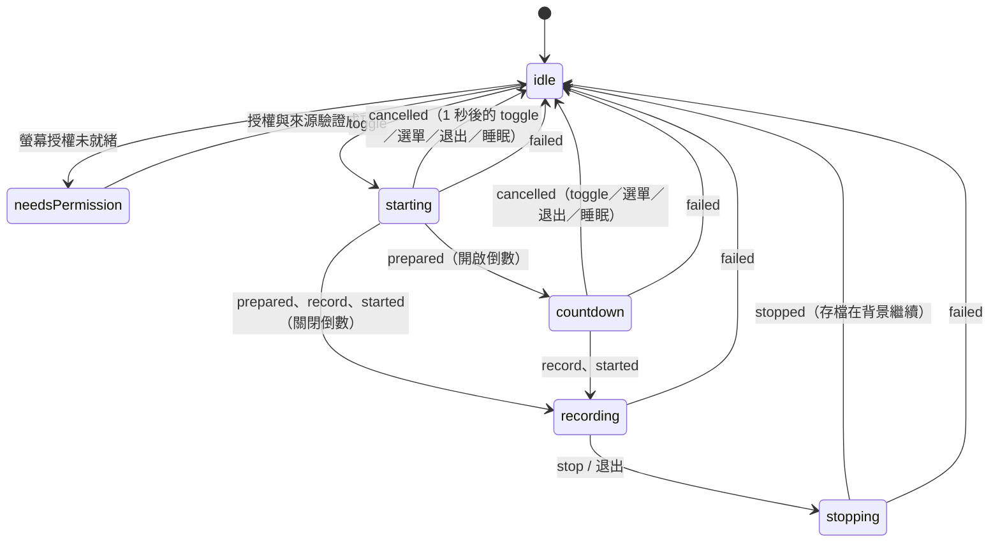
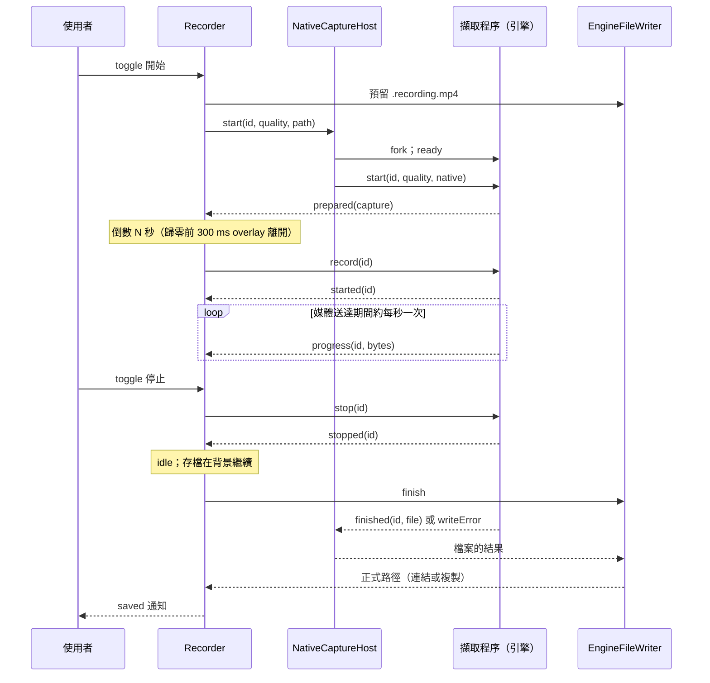

# 錄影管線與檔案設計

[English](../../system-design/recording.md) | [繁體中文](recording.md)

實作來源：[Recorder](../../../src/main/recording/recorder.ts)、[原生擷取 host](../../../src/main/recording/native-capture-host.ts) 與[其程序](../../../src/main/recording/native-host-process.ts)、[協定](../../../src/shared/protocol.ts)、[引擎檔案 writer](../../../src/main/recording/engine-file-writer.ts) 與[發布](../../../src/main/recording/file-writer.ts)、[健康門檻](../../../src/main/recording/recording-health.ts)、[倒數數值](../../../src/shared/countdown.ts)、[session sentinel](../../../src/main/recording/session-sentinel.ts)、[品質函式](../../../src/shared/quality.ts)、[螢幕選擇](../../../src/main/display/display-media.ts)、[Windows 的自身視窗排除](../../../src/main/recording/capture-exclusion.ts)、[相機配置](../../../src/shared/camera-layout.ts)、[各輸入音量](../../../src/shared/audio-volume.ts)、錄影工作室的[連結](../../../src/main/settings/studio-link.ts)、[port 訊息](../../../src/shared/studio-port.ts)與[預覽解碼器](../../../src/renderer/lib/preview-decoder.ts)；引擎位於 [native/capture](../../../native/capture/src)：[session 核心](../../../native/capture/src/core/mod.rs)、[相機畫面](../../../native/capture/src/core/camera.rs)、[節奏](../../../native/capture/src/pacing.rs)、[時鐘](../../../native/capture/src/timing.rs)、[混音器](../../../native/capture/src/core/mixer.rs)、[writer](../../../native/capture/src/writer.rs)、[muxer](../../../native/capture/src/mux/mp4.rs)、相機的[配置](../../../native/capture/src/camera_layout.rs)與[合成 shader](../../../native/capture/shaders/compose.wgsl) 及其[轉譯](../../../native/capture/build.rs)，以及 [macOS](../../../native/capture/src/mac) 與 [Windows](../../../native/capture/src/win) 模組（其中包括各平台的相機：[macOS](../../../native/capture/src/mac/camera.rs) 與 [Windows](../../../native/capture/src/win/camera.rs)，以及合成器：[macOS](../../../native/capture/src/mac/compositor.rs) 與 [Windows](../../../native/capture/src/win/compositor.rs)）。

RecordStuff 只有一條錄影路徑：plan 076 的原生引擎。每次嘗試時，main 會 fork 一個 Electron `utilityProcess`（`RecordStuff Capture`），在其中執行擷取 host 並載入 Rust 模組（`recordstuff-capture.node`，以 napi-rs 建置，從 asar 封存檔解出）。引擎負責擷取（macOS 用 ScreenCaptureKit；Windows 用 Windows.Graphics.Capture 與 WASAPI）、以平台編碼器編碼（VideoToolbox 與 AudioToolbox；Media Foundation）、封裝，並自行寫出檔案（plan 076 的 D3，2026-10-14）。Main 保有檔案的生命週期：資料夾與檔名、剩餘空間檢查、session sentinel、以正式檔名發布、紀錄、通知，以及含期限、退出與睡眠處理的狀態機。原生程式當機只會結束擷取程序；main 讓該 session 失敗並保留已寫入的內容。先前的路徑是以 `getDisplayMedia` 與 `MediaRecorder` 錄影、每秒把一段資料交給 main 的 writer 的隱藏 Chromium renderer，已於 2026-10-16 移除。macOS 與 Windows 以外的平台沒有引擎：模組載入失敗，錄影也就失敗。

## 狀態與操作

`needsPermission` 帶 `needsRelaunch`；`idle` 可帶 `outputDirUnavailable`。`countdown` 帶 `remaining`，為整數秒且至少為 1；`record` 等待 `started` 期間維持 1。最新權限狀態不是 granted 時，session 結束（stopped 或 failed）會進入 needsPermission 而不是 idle（見[螢幕權限](desktop.md#螢幕權限)）；`recording` 帶 ISO `startedAt`。錯誤是 `failed` 事件，沒有持久的 `failed` 狀態；取消既不是失敗也不是狀態。缺權限時點圖示只發 `permissionRequested`；stopping 期間與 starting 的第一秒內點擊無作用，並寫入 log。倒數期間，以及 start 已持續一秒後，點擊或按快捷鍵會取消（見[倒數](#倒數)）。Recorder 內部的階段比狀態更細：`opening`（資料夾與檔案）、`preparing`（等待 `prepared`）、`previewing`（即時預覽已準備好的 session，不寫入地保留著，狀態維持 idle；plan 075 的 D20，見[相機](#相機)）、`countdown`、`arming`（已送 `record`，等待 `started`）、`recording` 與 `stopping`。

## 開始流程

1. `Recorder.start()` 確認 idle、沒有 session，執行 OS preflight（macOS 13 以上）；建立 session id、品質與倒數快照，進入 starting 狀態（tray 顯示沙漏）。
2. `ensureWritableDir()` 只自動建立預設資料夾，自訂資料夾必須存在；實際寫入並刪除 probe，空間低於 200 MiB 時拒絕開始；查詢剩餘空間本身失敗時只記 log 並繼續開始，與錄影中的防護一致。不可用就報錯，不換到其他資料夾。檢查到該次嘗試的期限仍未返回時（網路磁碟不再回應），會佔住主程序四條檔案系統執行緒之一，因此同一資料夾的新嘗試改為等待同一個檢查，在它返回前不另起新的檢查。
3. 先寫入該 session 的中斷 sentinel 並記下暫存檔路徑，再預留 `YYYY-MM-DD HH-mm-ss.recording.mp4`（本地時間，或檔名範本）：`EngineFileWriter.open` 以排他的 `wx` 建立空檔後立即關閉，之後引擎開啟同一個檔案寫入，從不自行建立檔名。遇暫存檔撞名時改寫 sentinel 並改試 `-2` 至 `-10`。檔名是按下開始當下的本地時間，因此有倒數時會比第一個影格早「準備時間加倒數」。
4. 有倒數時此時就建立 overlay 視窗，讓第一個數字準時出現。`NativeCaptureHost.start` 結束先前的擷取程序、登記將回報結果的檔案、fork 新程序，並同時透過 `DisplayMedia` 決定螢幕（見[螢幕選擇](#螢幕選擇)），兩者互不等待。開啟麥克風時（plan 074），main 也會同時向 macOS 要求麥克風取用權（`askMicrophoneAccess`，僅在 macOS 從未詢問過時），因此系統提示會在第一次開著麥克風開始錄影時出現；等待期間 tray 停在 starting、不進入倒數，main 等到回答後才送出 `start`，仍在 120 秒的擷取請求期限內，拒絕則交由引擎回報。程序必須在 8 秒內回報 `ready`；心跳開始。螢幕被拒時成為 host 的 `capture_start_failed`，再由 main 的拒絕原因取代。Windows 上 main 會算出螢幕上的實體座標點，並把自己的視窗標記為不可擷取（見[自身視窗](#自身視窗與系統介面)）。接著 main 送出 `start`，帶品質快照與原生選項：螢幕 ID、Windows 的座標點、預留的路徑、RecordStuff 的程序 ID（main 在前）、D6 開關（只限 macOS）、開啟麥克風時所選輸入裝置的 ID（跟隨系統預設時不帶），以及開啟相機時（plan 075）的相機：裝置（跟隨系統預設時不帶）與泡泡，位置取被錄螢幕保存的位置，沒有則取主螢幕的，再沒有則用預設值（見[相機](#相機)）。
5. Host 請引擎 `probe` 螢幕的像素尺寸，套用品質規則決定輸出尺寸與影像位元率（見[品質與編碼](#品質與編碼)），再呼叫 `prepare`。macOS 的 prepare 會讀取可分享內容（自 probe 起保留 2 秒，所以一次嘗試只向系統要一次；上限 15 秒；缺少授權時在此以 `permission_denied` 失敗）、找出螢幕（不在可分享清單中則為 `no_display`）、建立內容過濾器、開啟預留的檔案、在 `SCStream` 啟動的同時於另一條執行緒建立編碼器（上限 10 秒），並等待第一個影格最多 3 秒。Windows 以自己的來源做同樣的事（第一個影格同樣 3 秒；音訊啟用 5 秒）。開啟麥克風時，prepare 也會開啟它（macOS 用 AVFoundation 的 `AVCaptureSession`，Windows 用 WASAPI endpoint）：未允許取用（拒絕、受限制，或從未詢問過，因為此時 AVFoundation 只會送出靜音）、沒有輸入裝置，或裝置無法開啟，都會以 `microphone_unavailable` 讓開始失敗。所選的輸入裝置未連接時（Windows 上也包括未啟用的裝置），改用系統預設輸入，報告的 warnings 會寫 `microphone: {id} is not connected; the default input is used`。開啟相機時，prepare 會在螢幕的 stream 之前開啟它，相機無法開啟時以 `camera_unavailable` 讓開始失敗（見[相機](#相機)）。從此擷取開始運作，但只保留最新影格，不寫入任何東西。Host 以 CaptureReport 回 `prepared`，並記下 `timing: probe … ms, prepare … ms (content …, filter …, stream start …, …)`；main 則記下 `process ready` 與 `display chosen`，其 `prepared` 那行以 `mic off` 或 `mic on (<name>)` 結尾，名稱是引擎實際開啟的裝置（CaptureReport 的 `microphone`）。因此權限、螢幕、編碼器、音訊與麥克風錯誤都會在倒數前出現。引擎準備期間收到的 stop，會讓 host 在 `prepare` 返回後立即取消它並回 `stopped`。
6. 倒數關閉時 main 立即送 `record`；否則先倒數（見[倒數](#倒數)），結束時才送 `record`。
7. 引擎以自己的時鐘取得錄影的時間零點、啟動 writer 執行緒並立即返回；host 回 `started`（2026-10-14 量到從 `record` 起 2 ms）。接著引擎的 refresh 執行緒把最新擷取的影格以關鍵影格編碼在時間零點，所以無論畫面多靜止，檔案都以一個畫面開始，之後才接收後續的影格與聲音。Main 進 recording，以 `prepared` 的報告發出 captureStarted，並啟動首份媒體期限、停滯保護與磁碟保護。REC 只在擷取開始後出現，所以最初幾格可能拍到選單列上的碼錶，一如以往會拍到 `…`；數字不會出現在其中。媒體持續送達時，引擎每秒回報一次已寫入的位元組數（`progress`）；第一個非零回報必須在首份媒體期限內到達，log 以 `first chunk … bytes (engine progress)` 標記它（名稱沿用自隱藏 renderer，因為驗收工具以它計時）。

在已簽署的 bundle 上量測（plan 076，2026-10-14 與 2026-10-15）：從按下快捷鍵到 `prepared` 為 457–535 ms，Chromium 為 347–369 ms；原生的時間由程序啟動（74–88 ms）、可分享內容查詢（59–83 ms）與 ScreenCaptureKit 的 `startCapture`（206–227 ms）組成。預先啟動程序可降到 437–439 ms，代價是一個約 73 MB 的閒置程序；維護者於 2026-10-15 決定不採用，因為約 50 ms 落在倒數之內，所以錄影之間不存在擷取程序。開啟麥克風時，`prepared` 分別在 611 與 666 ms 後到達，關閉時約 440–670 ms（plan 074，2026-10-16）。

## 倒數

「設定 → 錄影」可選關閉、3、5 或 10 秒；預設 3 秒，檔案沒有這個欄位時也是 3 秒。2026-09-25 的快捷鍵回合量到從點擊到開始擷取 318 ms（見 [plan 040 結案](../verification/history-2026-09.md#plan-040-結案--2026-09-26)），所以最初幾格會拍到滑鼠離開選單列，而 RecordStuff 沒有剪輯器可以剪掉。比照 Cap，倒數前先準備好擷取，歸零時才開始（見[設計決策](decisions.md)）。

- Recorder 以 N 進入 `countdown`，從 `prepared` 當下取得的同一個單調時間起點每秒 tick 一次；每個 tick 都依這個起點排程，timer 延遲不會累積。每個 tick 都重新發出狀態，App log 寫 `state → countdown (n)`。
- 在 N 秒前 300 ms 要求 overlay 離開：數字以 120 ms 淡出，main 再等一個穩定間隔（34 ms）後銷毀視窗。Recorder 最多等這個確認 500 ms；逾時就銷毀視窗、寫 log 並繼續擷取。`record` 在 N 秒送出；若 dismissal 更晚完成，則在它完成時送出。
- Overlay（見[桌面設計](desktop.md#倒數-overlay)）以具備 `show`、`update`、`dismiss`、`close` 的 presenter 注入，Recorder 因此不依賴 Electron。Presenter 錯誤只寫 log，永不讓錄影失敗；tray 仍會顯示倒數。
- 倒數音效（plan 046，預設開啟，可在「設定 → 錄影」切換）在每個 session 與倒數一起讀取一次並傳給 presenter；`prepared` log 行以 `sound on` 或 `sound off` 結尾。overlay 頁面在每個新數字時播放一聲 −20 dBFS、523 Hz 的柔和馬林巴般提示音，數字 1 升高五度；歸零、取消或倒數關閉時都不響。每聲從該數字的 tick 時間起持續 140 ms，因此最後一聲（數字 1）在 `record` 前 860 ms 就結束，遠早於 overlay 離開：錄影靠時間上的分離保持乾淨（與數字相同），此外引擎也會把 RecordStuff 自己的聲音排除在外（見[音訊](#音訊)）。`pnpm acceptance` 會以兩個音高檢查有音效的 session 錄影前 500 ms 的音訊。autorecord 永遠不發聲，因此矩陣與音訊品質錄影只有素材本身的聲音。
- 送出 `record` 前，toggle、tray 選單的「取消錄影」或快捷鍵都會取消這次嘗試：清除 timer、停止 host、關閉 overlay、abandon writer 讓空的暫存檔被刪除，並回到嘗試前的 idle。`cancelled` 事件帶取消原因（`toggle`、`menu`、`quit` 或 `sleep`），log 寫 `cancelled: session … (reason); no media was recorded`。不產生失敗狀態、歷史項目、通知或螢幕診斷。
- 送出 `record` 後，toggle 會變成既有的「開始後停止」要求，等 `started` 到達再套用，因此幾毫秒的競態不會讓擷取持續進行。若擷取在第一個 frame 之前就停止，表示什麼都沒錄到：這次嘗試以該取消（或結束、睡眠）收場，而非開始失敗。倒數設為「關」時，`record` 在 `prepared` 就送出，狀態仍是 starting，因此選單的「取消錄影」或超過寬限時間的 toggle 也會變成同一個要求。倒數期間開啟的 tray 選單在開著時不會更新（見[桌面設計](desktop.md#tray-與通知)），所以擷取開始後才點選其中的「取消錄影」，會停止錄影並存檔。
- starting 期間的 toggle（plan 065）：start 持續達 `START_CANCEL_GRACE_MS`（1 秒）後，toggle 會和「取消錄影」完全一樣地取消這次嘗試；時間以 Recorder 的 monotonic clock 從 session 請求起算，該時間點與進入 starting 在同一個同步步驟中取得。仍在開啟資料夾或準備擷取時，取消後不留檔案、失敗項目或通知；已送出 `record` 時則變成「開始後停止」。寬限時間內的按鍵視為連按而忽略，stopping 期間的按鍵也一律忽略；兩者都會寫入 log（`recorder: session <id> toggle ignored while starting (<n> ms after the start)` 與 `… while stopping (<n> ms after the stop)`），因此「快捷鍵沒反應」的回報可以和按鍵遺失區分。starting 選單的「取消錄影」會和倒數時一樣標出已註冊的快捷鍵（見[桌面設計](desktop.md#tray-與通知)）。
- Plan 065 的決定由維護者於 2026-10-03 做出，依據 2026-09-12 至 2026-10-02 經由隱藏 renderer 錄影時保留的 log：739 次 start，中位數 289 ms、第 95 百分位 396 ms；超過 1 秒的九次全部卡在準備階段（權限被拒、缺少音訊軌與舊的 8 秒時限造成 1.1–9.4 秒；擷取請求一直未回應時四次各 120 秒），沒有卡在開啟資料夾的，另有一次（2026-09-13）卡在 `record` 之後。log 中最快的連按間隔為 290 ms。寬限時間定為 1 秒，而非「starting 期間隨時可取消」或「只在準備期間可取消」；starting 的「取消錄影」標出快捷鍵；開啟資料夾或準備期間退出會立即取消（見[終止責任與正常退出](#終止責任與正常退出)），不再等待擷取請求，過去曾因此讓一次退出等了 286 秒。
- 所有時間與外觀數值都集中在 [countdown.ts](../../../src/shared/countdown.ts)，作為初始目標；只有書面證據支持時才調整。

## 期限與故障隔離

| 保護 | 預設值 | 失敗處理 |
| --- | --- | --- |
| 輸出資料夾／開檔階段 | 8 秒（`DEFAULT_START_TIMEOUT_MS`） | output_open_failed；late writer 回來後 abandon |
| host ready | 8 秒（`readyTimeoutMs`） | start 以 capture_start_failed 失敗；下次嘗試 fork 新程序 |
| 擷取／系統授權請求（`start → prepared`） | 120 秒 | capture_start_failed；停止該 session |
| 引擎 prepare 內部（macOS） | 可分享內容 15 秒、stream 啟動 10 秒、第一個影格 3 秒 | capture_start_failed（缺少授權時為 permission_denied） |
| 引擎 prepare 內部（Windows） | 音訊啟用 5 秒、第一個影格 3 秒 | capture_start_failed |
| 倒數 overlay 的 dismissal | 從 dismiss 要求起 500 ms；要求在 N 秒前 300 ms 發出 | 銷毀 overlay、寫 log，照常開始錄影 |
| `record → started` | 8 秒 | capture_start_failed（while starting capture） |
| started 後首個非零 `progress` | 8 秒 | capture_start_failed，保留已寫入資料 |
| 媒體開始後的下一個非零 `progress` | 10 秒記錄一次警告，30 秒判定失敗；每個非零回報重新計時，收到 stopped 或失敗時解除 | capture_failed，detail 註明停滯；保留部分檔 |
| 輸出資料夾可用空間 | 從 started 到停止前每 5 秒查詢；低於 1 GiB 記錄一次 | 低於 200 MiB 時只要求一次正常停止；以「磁碟即將滿」原因存檔，不算失敗 |
| stop 回應（`stop → stopped`） | 10 秒 | stop_timeout |
| 停止前的聲音 | 引擎最多等 250 ms | 尚未送達的部分以靜音補上；寫入 log |
| `stopped` 後完成檔案 | 引擎 120 秒；host 程序 150 秒（`FINISH_BOUND_MS`） | output_write_failed（引擎），或結束程序（host）；兩者都保留檔案 |
| 存檔過慢 | 30 秒（`saveSlowMs`） | 記 log 並告知一次（`savingSlow`）；不放棄 |
| 清理檢查無回應 | 15 秒（`cleanupCheckMs`） | 失敗的錄影檢查是否保留部分檔時，結果以「未知」回報並附上檔案路徑；取消時只記 log。停止回應的磁碟因此不會卡住退出 |
| 讓自身視窗恢復可擷取（Windows） | 擷取程序結束時；要求結束後最多 5 秒 | 視窗恢復可擷取 |
| 退出等待 | 每次嘗試 13 秒（停止期限另加 3 秒） | 尚有工作時延後退出並顯示在地化提示，不截斷存檔 |
| 心跳 | session 進行中每 5 秒送 ping | 檢查時已有 2 次未回 pong 就 teardown：capture_host_unresponsive |

`record` 之前沒有擷取任何內容，因此準備或倒數期間的來源結束、螢幕移除、host 當機或無回應，以及 `record` 被拒或逾時，都是啟動失敗：`capture_start_failed`，detail 註明階段（`while preparing capture`、`while counting down`、`while starting capture`），仍發出螢幕診斷，結果為 empty。已脫離的 session 若送來遲到的 `prepared`、`started` 或 `progress`，會要求 host 停止，避免被放棄的嘗試仍暗中擷取。

這些是專案的等待上限，不是 OS 標準或精準的全流程耗時保證。磁碟 I/O 不能因此被真正取消。main 端的健康檢查各列（停滯、可用空間、存檔過慢）是初始目標，集中在 [recording-health.ts](../../../src/main/recording/recording-health.ts)；只有書面證據支持時才調整。心跳只證明擷取程序的 JavaScript 仍會回應；停滯保護才證明引擎仍在寫入媒體。引擎的 writer 只在過去一秒內有媒體送達時才送 `progress`，而正常但畫面靜止的錄影仍會持續送出，因為畫面靜止時引擎每秒會再編碼一次最後的影格，顯示相機時則每個格位都編碼（見[影格節奏](#影格節奏)、[相機](#相機)），音軌也隨時鐘前進。可用空間查詢失敗只記錄一次，永不因此停止錄影。`powerMonitor` 的 suspend 與 resume 會連同進行中的 session id 寫入 log，讓之後的失敗能對照睡眠判讀；睡眠本身如何停止錄影或取消嘗試，見[寫檔與失敗](#寫檔與失敗)。

## 終止責任與正常退出

每一層都以第一個失敗為準。引擎只回報一次第一個擷取或編碼失敗：錄影中或排空到停止點期間為 `capture_failed`，僅 prepared 時為 `capture_start_failed`，排空結束後則一律不回報。Host 只在自己的 session 存續期間轉送引擎事件，並在送出 `stopped` 時放下該 session，因此之後的擷取事件不屬於任何人；此後引擎只為檔案負責，以 `finished` 或 `writeError` 回覆。Main 驗證每一則傳入訊息（`isHostMessage`），丟棄格式錯誤的訊息；host 若送來只有 main 才能發現的代碼（資料夾、磁碟期限、監督、啟動），會被視為格式錯誤而不採信。Recorder 不在 stopping 時收到的 `stopped` 是 `capture_failed`（「capture host ended capture without a stop request」）。

Recorder 接受 `stopped` 後由 finalizer 獨占該次收尾，錄影也就結束了：自 2026-10-09 起狀態立即回到 idle、釋放防止螢幕睡眠，檔案在背景完成收尾（引擎把它轉成一般 MP4，接著 main 檢查大小並發布），和其他錄影工作一樣被持有，所以退出仍會等它，下一段錄影則可以先開始。`NativeCaptureHost` 在嘗試 teardown 後仍讓正在收尾的程序存活，把結果交給 writer 後再結束它，或在 150 秒後結束（引擎自己的上限是 120 秒）；程序在回報前就結束時，存檔以失敗收場並保留檔案。在桌面上量到 Recorder 在 `stopped` 後 0–1 ms 回到 idle，檔案再過 19–22 ms 完成（2026-10-15）。`Recorder.saving` 為 tray 與設定列出這些收尾；超過 `saveSlowMs`（30 秒，磁碟不再回應）仍未完成的會記 log 並告知一次（`savingSlow`），main 絕不放棄它：仍在運作的慢速磁碟會在引擎的上限內完成。其結果（已存、失敗並保留部分檔，或第一個 frame 前停止的開始以取消收場）在回報時不碰狀態，因為那時狀態可能已屬於下一段錄影；在那段錄影期間完成的收尾，其已存通知會保留到錄影結束才送出，與擷取提醒的保留方式相同。遲到的 host crash／error、重複 stop 或螢幕移除不能 abandon 正在發布的檔案；引擎的寫入錯誤仍進入失敗清理。所有開檔、存檔、清理工作在同步 subscriber 執行前登記。開檔逾時立即讓 UI 回到 idle，但結果保持 pending，直到遲到的開檔與關閉完成。多次失敗各自保留清理工作的責任。

所有 `before-quit`（包含 idle）共用 `installQuitCoordinator`。重複退出加入同一嘗試，退出判定期間拒絕開始新錄影，並自動停止擷取。`record` 前不存在任何媒體，所以退出永遠不會錄下尚未開始的 session（plan 040，任何倒數設定皆然）：倒數期間、開啟資料夾期間或準備期間退出，都會和「取消錄影」一樣立即取消（plan 065；在此之前，準備期間退出會等到 `prepared` 或 120 秒的擷取請求期限）。host 會收到停止指令，並在 prepare 返回後立即取消引擎，因此遲到的 `prepared` 屬於過期 session，會再被停止一次；仍在進行的資料夾檢查由已取消的嘗試持有，退出會等它結束。要求退出時也會標記這次嘗試，因此在協調器檢查前結束它的任何原因都算作這次取消。只有已送出 `record` 的 session 保留停止意圖，擷取一開始就停止並收尾。必須沒有 session 與未完成工作，包含遲到開檔、先前失敗清理與失敗結果查核／發布，才允許退出。退出期限只延後退出；已開始擷取的失敗仍由既有停止回應 timer 判定。未完成的磁碟／結果發布工作仍被持有，App 保持開啟，使用者可重試退出。不為滿足退出期限摧毀 host 或宣稱未確認的保留路徑。強制退出、程序終止與斷電不受此保證保護，事後也不修復任何內容；引擎已寫入的部分仍是可讀到最後一個完整片段的分段 MP4（見[存檔時轉成一般 MP4](#存檔時轉成一般-mp4)）。唯一不等待媒體的退出，只在退出只剩背景收尾在等時提供：「不等待儲存直接結束」（2026-10-09，[桌面設計](desktop.md#延後退出)）會在有時限地寫入中繼資料後結束，並留下那些收尾的 sentinel。下次啟動會透過中斷 sentinel 回報這類 session（見[寫檔與失敗](#寫檔與失敗)）。只有在此媒體階段完成後，退出才嘗試保存失敗歷史；其明確的「只放棄提醒」退出永遠不會放棄媒體工作（見[桌面設計](desktop.md#延後退出)）。Windows 結束 session（關機、重新開機、登出）時不會送出 `before-quit`，因此改由每個視窗的 `query-session-end` 處理（[session-end.ts](../../../src/main/app/session-end.ts)，2026-10-05）：錄影工作仍在進行時會拒絕結束，並執行同一個退出流程；App 結束後 Windows 就會繼續。沒有進行中的工作時，照使用者的選擇結束。只有在有可見視窗時（例如 Settings 開著）才一定擋得住：沒有可見視窗的 App 拒絕結束時，若沒有透過 ShutdownBlockReasonCreate 註冊原因，Windows 會直接終止它，而 Electron 沒有提供這個 API；因此只從選單列錄影時，停止與存檔會立刻開始，但可能在完成前就被終止。未在 Windows 實機驗證。

## 品質與編碼

| 設定 | 實作規則 |
| --- | --- |
| 影像等級 | economy 0.07、standard 0.13、high 0.24 bits / pixel / frame |
| 位元率 | 輸出 width × height × 幀率設定 × 係數，四捨五入至 100 kbps，限制 1.5–60 Mbps；作為編碼器的平均位元率 |
| 解析度 | probe 得到的來源像素尺寸不縮放；1080p／1440p／4K 上限按來源方向交換長短邊，不放大，縮小時取偶數。由引擎縮放到該尺寸：macOS 用 `SCStreamConfiguration` 的寬高，Windows 用 Direct3D 11 視訊處理器 |
| 幀率 | 30／60；目前只有 darwin 開放 60；其他平台有效值為 30，不覆寫使用者檔案。設定值即編碼器的幀率與 pacer 的格線（見[幀率要求](#幀率要求)） |
| 影像編碼 | H.264：不重排影格（解碼順序即顯示順序，因此沒有組成時間偏移）、依顯示時間至少每秒一個關鍵影格（每個片段都從關鍵影格開始）、BT.709 標記 |
| 音訊 | AAC-LC、48 kHz 立體聲、目標 256,000 bps；Windows 的編碼器最高 192 kbps，因此以 192 錄製並在 warnings 註明 |
| 格式 | H.264 + AAC 的 MP4（`video/mp4;codecs=avc1,mp4a.40.2`，於 `prepared` 回報），以 hybrid MP4 寫入（見[存檔時轉成一般 MP4](#存檔時轉成一般-mp4)） |

引擎 probe 出來源尺寸後，host 依 [quality.ts](../../../src/shared/quality.ts) 的設定計算尺寸與位元率，再傳給 `prepare`；引擎從不讀取設定。編碼器（plan 076 的 D4）：macOS 用 VideoToolbox（Mac 有媒體引擎時會使用它）與 AudioToolbox 的 AAC 轉換器；Windows 用 Media Foundation 的 H.264 與 AAC transform。Windows 能用時以 GPU 的硬體 H.264 編碼器編碼，否則用 Microsoft 的軟體編碼器（見 [Windows 細節](#windows-細節)，plan 078）；沒有 Media Foundation 的 Windows 是 `media_components_missing`，在錄影前就會檢查（見[錯誤分類](#錯誤分類)）。60 fps 仍只限 macOS（`isFrameRateAvailable`）：其他平台的 60 fps 未經驗證。

CaptureReport 保留原有欄位，因此 Recorder 的 log 與提醒不變：輸出寬高、幀率設定、48,000 Hz 與 2 聲道、要求的位元率，以及 warnings；warnings 包含引擎自己的警告（無法排除選單列的 macOS、可分享 App 中找不到 RecordStuff 及其原因的證據、Windows 降低的 AAC 位元率、Windows 錄影用的是哪個 H.264 編碼器及原因、逐影格 log 的路徑）與一行摘要（`native engine: source WxH, AAC priming N frames, X own app(s) excluded, Y system window(s) hidden`）。引擎縮放到指定的尺寸，並以選定的幀率安排影格，因此 Chromium 路徑比較 Chromium 給的與要求的而發出的幀率降級與解析度上限無法確認提醒，已連同字串一起移除（plan 078）。位元率是目標而非量測結果；成品仍需 ffprobe 量測。引擎在 30 與 60 fps 都產出目標的 101–102%（2026-10-15/16），因此設定中的大小估計在兩種幀率下都是目標加上音訊（`estimatedBytesPerMinute`），不再為 MediaRecorder 把 60 fps 的影像加倍。

### 幀率要求

幀率設定原封不動交給引擎，作為編碼器的幀率與 [pacer](#影格節奏) 的格線。擷取本身要求得更多：最小影格間隔為影格間隔的四分之一（`Pacer::capture_interval_ns`，30 fps 為 8.3 ms，60 fps 為 4.2 ms），在 macOS 設為 `SCStreamConfiguration.minimumFrameInterval`、在 Windows 設為 `MinUpdateInterval`，遠低於這些幀率下任何螢幕的更新週期，因此擷取會送出每一次更新，每個格位附近都有影格。ScreenCaptureKit 的最小間隔是下限而非週期，且依螢幕更新送出影格：要求接近幀率的間隔時，每個影格都落在上一個之後的第二或第三次更新，60 Hz 螢幕上的 30 fps 就會出現 33 或 50 ms 的間隔。在已簽署的 bundle 上量測：要求兩倍幀率時，30 fps 有 1.8% 的影格間隔 50 ms（2026-10-14）；直接要求每次更新（不設最小間隔）在 30 與 60 fps 都掉 0.17%，四分之一則為 0.06% 與 0.11%，CPU 大致相同（30 fps 為一個核心的 10.8% 對 10.4%，60 fps 為 14.4% 對 15.0%；2026-10-15）。因此維持四分之一。

隱藏 renderer 透過 Chromium 遇到同樣的下限，曾要求 30.3 與 62.5 fps 才錄到設定值（plan 041；結果見[驗證歷史](../verification/history-2026-09.md#plan-041-結案--2026-09-26)）；這個要求已隨它移除。

## 影格節奏

引擎在以錄影時間零點為起點、間隔為影格間隔的格線上，每個格位保留一個擷取到的影格（[pacing.rs](../../../native/capture/src/pacing.rs)），做法與 OBS 的幀率除數和 Cap 的節奏控制相同：60 Hz 螢幕因此剛好得到 30 fps，每個保留的影格都在上一個之後兩次更新。比下一個格位早超過半個間隔的影格會被略過；在那之後的影格則保留給最近的格位，並以其後一個格位作為下一個。被略過的影格仍是最新畫面：若畫面隨後靜止，refresh 執行緒會在該格位的時間到達後把它編碼在該格位（`Pacer::due`），絕不晚於現在，因此之後擷取到的變化仍然較新。

- **顯示時間。**影格沿用 ScreenCaptureKit 的顯示時間，約比送達早 11 ms（Windows 為影格的 `SystemRelativeTime`）。改以送達時間標記時，閃光與嗶聲的偏差從 −7 與 −15 ms 變為 +5 與 +3 ms，但掉了 1.4% 與 16% 的影格，因為送達時間隨 callback 排程抖動，格線會保留錯的影格（2026-10-15）。
- **閒置更新。**畫面沒有變化的更新，ScreenCaptureKit 會以沒有畫面的 idle 影格回報。若它落在某個格位，就把最新畫面在該處再編碼一次（`frame_unchanged`），與 Chromium 重複一格的做法相同，而不是讓該格位晚一次更新才拿到下一個畫面。2026-10-16 停止報告新增的計數顯示每 15 秒有 15–37 個 idle 影格，而 60 Hz 螢幕上 30 fps 當時的每一個 50 ms 間隔都落在 idle 更新上。
- **跳過的更新。**ScreenCaptureKit 偶爾也會跳過一次更新，既不送畫面也不送 idle 影格：2026-10-17 的逐影格 log 在 60 Hz 下每 15 秒找到約五次，兩次送達相隔 33.3 ms（停止報告的「33.3 ms apart at most」先前被解讀為沒有漏掉更新）。被跳過的若是某個格位的更新，檔案中會出現與上一個相隔 50 ms 的影格，接著格線追上時再出現相隔 17 ms 的一個。現在，若自上一個保留的影格之後擷取送來過一個太早而未保留的影格，且下一次送達比上一個保留的影格晚了一個間隔又八分之一以上，就先在兩者之間的格位（上一個保留影格之後一個間隔）編碼最新畫面，再判斷新的送達（`Pacer::skipped`、`fill_skipped`）。只有在略過影格之後才會這樣做：只在畫面變化時才送影格的來源（Windows），若畫面變化比幀率慢，就照送來的保留。
- **靜止畫面。**畫面沒有變化時，每秒再編碼一次最後的影格（`REFRESH_NS`），因此仍然每秒有一個關鍵影格、片段持續關閉，`progress` 也持續送到停滯保護。顯示相機時則改為每個格位都編碼最新影格，並合成相機的最新畫面（`Core::encode_every_slot`，見[相機](#相機)），因此不論畫面多靜止，編碼器都以完整幀率運作；相機隱藏或關閉時，節奏維持原樣。
- **停止。**只保留時間早於停止點的影格。pacer 略過的最新變化會以它自己的擷取時間編碼在停止點之前，因此持續到影像結束；muxer 自己丟棄較晚樣本的機制仍保留作為防護。

停止報告與 host 的 timing 行一起寫入 log：影格比主機時鐘提前多少被標記（平均與最大值），以及 `capture delivered N pictures and M frames without one, X ms apart at most`；最長間隔為兩個更新週期，表示擷取跳過了一次更新。逐影格 log（見[工具](tooling.md#逐影格-log)）則一個影格一個影格記錄每次送達與每個編碼的影格，以及 pacer 的決定。在 60 Hz、1920×1080 的螢幕上量測：掉格在 30 fps 為 0.00%、60 fps 為 0.06–0.22%（2026-10-14，Chromium 為 0.00% 與 0.14–0.22%）；`pnpm matrix -- quick` 中 30 fps 有 0.66–2.17% 的影格間隔 50 ms，Chromium 為 0（2026-10-15），修正閒置更新後為 0.22–0.44%（2026-10-16）；補上跳過的更新後，三個案例都是 0.00%，最長間隔 33 ms，而同一個 build 不補時接連量到 0.44–0.66%（2026-10-17，plan 078）。Chromium 已無法再量，因為它的路徑已移除。同一台機器的錄影 CPU（2026-10-16，`pnpm measure:cpu -- --fps 60 --repeat 3`）：30 fps 為一個核心的 10.4%，60 fps 為 14.0%，Chromium 為 15.3% 與 23.3%。

## 音訊

音軌的輸入是系統音訊（預設為系統播放的所有聲音，RecordStuff 除外）、選定 App 的聲音或不收系統音訊，以及麥克風；全部混入同一條 AAC 音軌。使用者只決定麥克風是否加入預設的系統音訊：選定 App 的聲音只存在於引擎與其測試中（`RECORDSTUFF_CAPTURE_AUDIO` 是開發用開關）。麥克風（plan 074）預設關閉，可在「設定 → 錄影設定 → 音訊」或待命選單的「錄製麥克風」開啟（見[桌面設計](desktop.md#麥克風權限)），使用系統預設輸入或指定的裝置；每段錄影與品質一樣只讀取一次開關與裝置，自 plan 079 起可在錄影中切換裝置（見下方**錄影中切換**）。關閉時不會多開啟或混入任何東西，所以已記錄的音質證據仍然成立。開啟時，音軌是系統音訊加上未經處理的麥克風，除非使用者移動了某個輸入的音量推桿（見下方**音量**），否則為單位增益，不做語音處理（見[音質設計](audio-quality.md#16-原生音訊路徑為什麼能保留音質)）。2026-10-16 在 macOS 上的量測（見[音質設計第 18 節](audio-quality.md#18-麥克風結果2026-10-16)）是在比對 OBS、Chromium 與 Cap 之後的引擎修改（軟性限幅、單聲道麥克風、逐 frame 漂移修正、暫時停頓的麥克風恢復後重新收音、Windows 的封包時間與不觸發 ducking）之前做的：系統音訊部分保持原有格式與音量，沒有被壓低；同一次按鍵，麥克風的聲音比畫面早 20–40 ms 出現；錄影 CPU 約增加一個核心的 3.4 個百分點。同一天在修改後的引擎上做的桌面驗收確認了單聲道麥克風（一段 iPhone 錄音的左減右在 35 秒內都是 −inf dB）、開啟麥克風的 `pnpm acceptance` 通過，以及麥克風中斷的通知與紀錄；保真度、同步與 CPU 已由 plan 078 在 CoreAudio 的 HAL 上重新量測（[音訊品質 §19](audio-quality.md#19-coreaudio-hal-上的麥克風結果2026-10-17)）。麥克風尚未在 Windows 上測試。

- **擷取。**macOS 的系統音訊來自畫面的 `SCStream`（48 kHz 立體聲浮點、`excludesCurrentProcessAudio`），其過濾器已排除 RecordStuff 的 App，因此也排除了它們的聲音；當畫面的過濾器不是聲音的過濾器時（單一視窗、選定 App，或選定 App 的聲音），改由另一條有自己過濾器、只收音訊的 stream 提供。Windows 為 WASAPI process loopback（Windows 10 2004 以上），收錄 RecordStuff 程序樹以外的一切，以 48 kHz 立體聲浮點開啟，由音訊引擎轉換。兩條路徑都不做語音處理；隱藏 renderer 需要明確的條件才能關閉它（見[音質設計](audio-quality.md)）。2026-10-15 的 `pnpm audio:quality` 在原生與 Chromium 下都通過所有檢查，時鐘偏差原生為 −0.07 ppm，Chromium 為 −1.45 ppm。
- **單一時鐘。**所有時間戳都是以奈秒計的主機時間（mach absolute time；QueryPerformanceCounter），從 `record` 時的零點起算（[timing.rs](../../../native/capture/src/timing.rs)）。比照 Cap，音訊以累計樣本數定位：第一個緩衝區精確定位，之後每個都接在上一個結束處，除非其時間戳偏差超過 10 ms（480 個 frame）。剛超過容許值、最多再多 2 ms 的偏差視為裝置時鐘漂移，每個緩衝區只修正 1 個 frame（補 1 個 frame 的靜音或丟 1 個 frame），因此偏離 20–100 ppm 的麥克風會被穩定在容許值上，不會每隔幾分鐘就一次切掉或空出整整 10 ms；更大的空隙立即以靜音填補，更大的重疊立即丟棄。有修正時，停止的 log 行會依輸入列出為了跟上時鐘而補上與丟棄的靜音 frame 數。因此不論錄多久，音訊相對影像的漂移都不會明顯超過容許值：10 分鐘的錄影量到 0 ms 漂移，600 組閃光與嗶聲全部對上，每個檔案的音訊與畫面長度都相同（2026-10-14，在逐 frame 修正之前）。Windows 的麥克風封包時間採用 Chromium 的規則（crbug.com/1439283），因為有些驅動程式給的 QueryPerformanceCounter 位置差了好幾秒，甚至是 0：裝置第一個封包的位置與它到達的時刻相差超過 500 ms，這個串流之後就一律以到達時間（到達時刻減去封包長度）計時；帶有 `AUDCLNT_BUFFERFLAGS_TIMESTAMP_ERROR` 旗標的封包也改用到達時間（[timing.rs](../../../native/capture/src/timing.rs) `PacketTimes`、[win/audio.rs](../../../native/capture/src/win/audio.rs) `pump`）。Loopback 的位置不檢查：它們來自錄影本身計時所用的播放時鐘。
- **混音器。**音軌是各輸入以各自音量相加的立體聲總和，推桿沒動過時音量就是單位增益（0 dB）：不重新取樣、不合併聲道、不調整音量；只有一個 0 dB 的輸入時就是該輸入的樣本本身（[mixer.rs](../../../native/capture/src/core/mixer.rs)）。開啟麥克風時有兩個輸入，系統音訊與麥克風，逐樣本相加。兩個以上有非零樣本的輸入相加超過 −1 dBFS 時（人聲底下的大聲媒體），以 tanh 軟性限幅讓總和趨近但不到達滿刻度，在門檻處連續；只有一個輸入有聲音，或總和低於 −1 dBFS 時，完全不變（逐位元相同）；有被限幅的樣本時，停止的 log 行會列出數量。它推進到每個輸入都已送達的位置，因此延遲不同的輸入仍能對齊；同時也隨時鐘推進，落後時鐘 500 ms，把輸入到那時仍未送達的部分視為靜音：WASAPI 的 loopback 在沒有聲音播放時不送封包，沒有這一點音訊片段就得等下一個聲音。送達時對應部分已混好的聲音會被丟棄並計數；有這種遲到的 frame 時，停止的 log 行會依輸入列出。
- **音量**（plan 075 的 D21，2026-10-18）。系統音訊（連同選定 App 的聲音）與麥克風各有一個音量，由錄影工作室中每個音量表下方的推桿設定，就像 OBS 的混音器為每個來源各給一個推桿：以輸入原本音量的整數百分比計，範圍 0% 到 600%（2026-10-21 起；先前以整數 dB 計、範圍 −60 到 +12，會換算成最接近的 5%），保存為設定 `audioVolume`（[audio-volume.ts](../../../src/shared/audio-volume.ts)），預設 100%，每段錄影都會使用。main 把每個音量換算成 dB 再交給引擎（`volumeDb`）。引擎在每個緩衝區送達時，依其輸入的音量縮放樣本，位置在音量表、靜音與混音器之前（`Core::set_gains`、`NativeCapture.setGains`）：−60 dB 以下是靜音（推桿最底端，0%），最高 600%，約 +15.6 dB（`MAX_GAIN_DB`）；調高到單位增益以上的輸入會單獨經過混音器在 −1 dBFS 以上的 tanh 軟性限幅，讓調高的人聲不會被編碼器削波；100%（0 dB）時係數剛好是 1，樣本完全不動，所以已記錄的音質證據仍然成立。Recorder 在 session 準備好後、開始監看音量表或收音之前，以 `gain` 訊息送出音量，預覽或錄影期間每次變更時再送一次（`Recorder.updateGains`）；host 記下 `audio: system … dB, microphone … dB`，變更從各輸入的下一個緩衝區開始生效。2026-10-18（已簽署的 bundle，喇叭播放 440 Hz 音）錄影 6.5 秒時用鍵盤把「系統聲音」推桿拉到底，設定與引擎在 3 ms 內各自記下；檔案先前的峰值為 −24 dB，從 8 秒起就是靜音（−inf），而那個音仍在播放。同一天第 8 步的回合（麥克風開啟，收得到喇叭）在 12.2 秒把「系統聲音」推桿拉到底、15.2 秒把「麥克風」推桿拉到底：檔案的峰值先約 −23 dB，接著只剩麥克風的 −31 與 −41 dB，從 16 秒起靜音；「系統聲音」的音量表在推桿到底後 4.5 秒已降到靜音。
- **音量表與靜音**（D19）。錄影工作室的音量表在畫面中可見時，main 向 session 要求音量（`StudioLink`，帶 `watching` 的 `levels` 訊息，`NativeCapture.watchLevels`），擷取程序經錄影工作室的 port（也就是預覽的 port）直接送給頁面，不經過 main（計畫 081；`studio-port.ts`）；只有這時引擎才會在聲音送達時收集每類輸入的最大樣本（系統音訊與 App 的聲音合在一起，麥克風分開），位置在音量之後、靜音之前，並約每秒 10 次以 `levels` 事件回報（`LEVELS_INTERVAL_NS`；D21 之前為 15 次）。音量表範圍是 −60 dB 到滿刻度。已準備好的 session 在音量表被監看時也會讀取聲音，所以即時預覽的音量表在錄下任何東西之前就會跳動（見[相機](#相機)）；此時不混音也不寫入。靜音（`mute` 訊息、`NativeCapture.setMuted`）從該輸入的下一個聲音起以靜音取代它，因此輸入仍跟著時鐘，取消靜音也不必重新對齊；靜音輸入的音量表仍會跳動，只是變灰。靜音只屬於進行中的這段錄影，和隱藏相機一樣；音量則是設定。2026-10-17（已簽署的 bundle，系統的 Submarine 音效經喇叭循環播放，開啟 BenQ 螢幕的麥克風）在錄影 11.1–15.6 秒靜音系統音訊、17.9–22.1 秒靜音麥克風，recorder 與引擎都有記下，檔案每半秒的峰值也看得出來：未靜音時嗶聲為 −7.5 到 −8.9 dB，系統音訊靜音時為 −10.9 到 −11.4 dB（只剩麥克風收到的喇叭聲），麥克風靜音時嗶聲不變，但嗶聲之間的底噪從約 −55 dB 降到 −63 dB 與靜音。音量、音量表與靜音在 Windows 上也走共用的核心，未在實機測試。
- **Edit list。**檔案的 edit list 跳過 AAC 編碼器的 priming，因此顯示時間 0 就是第一個擷取到的影格。AudioToolbox 會回報它的 priming；Media Foundation 的則在建立編碼器時量測（CI runner 上為 0 個 frame，未在 Windows 實機確認）。
- **到停止為止。**`stop` 時音軌在停止點的樣本數處截斷；擷取繼續執行，直到停止前的聲音都已送達，最多 250 ms，因為擷取交出音訊會晚幾十毫秒。到那時仍未送達的部分是靜音，log 會記下排空花了多久、補了多少 frame。因此音軌與影像一樣長。
- **麥克風擷取。**macOS 使用 CoreAudio 的 HAL（plan 078 第 6 步，[mac/hal.rs](../../../native/capture/src/mac/hal.rs)）：以 UID 在裝置上開啟 AUHAL 輸入單元，以裝置本身的取樣率讀取單聲道 32-bit float，因為 AUHAL 在輸入端不轉換取樣率（Apple 的 TN2091），再以 AudioConverter 轉成 48 kHz（藍牙耳機以 16 或 24 kHz 運作）；每個緩衝區以它的 `mHostTime` 計時，也就是畫面樣本所用的主機時鐘。HAL 的即時執行緒只負責 render 緩衝區並交出去；轉換、混音與編碼在讀取執行緒上進行。它是一般的 HAL 單元，絕不是語音處理單元。UID 就是 AVFoundation 稱為裝置 unique ID 的字串，因此已儲存的選擇仍找得到，裝置清單也來自 HAL；授權狀態仍從 AVFoundation 讀取。它取代了 `AVCaptureSession`，後者的裝置狀態跟著 utility process 不執行的主 run loop 更新。Windows 以 48 kHz 單聲道 float 加 `AUDCLNT_STREAMFLAGS_AUTOCONVERTPCM` 開啟 WASAPI capture endpoint，由音訊引擎把裝置的聲道混成一個。核心把這一個聲道放進音軌的兩個聲道，比照 Cap，因此錄音介面第 1 軌的麥克風不會只出現在左耳；立體聲麥克風會錄成單聲道。Windows 上這個串流會呼叫 `IAudioSessionControl2::SetDuckingPreference(TRUE)`（盡力而為），讓開啟麥克風不會使 Windows 壓低其他 App 的聲音，否則錄到的系統音訊也會跟著變小。開啟方式見[開始流程](#開始流程)。
- **麥克風中斷與恢復。**以下情況會回報麥克風中斷（`microphoneLost`，由引擎經 host 傳給 Recorder）：錄影或排空到停止點期間連續 2 秒沒有送出聲音；以及它的聲音無法讀取（macOS 的取樣率轉換錯誤、Windows 的擷取 pump 錯誤）。兩個平台上，裝置斷線都是靠這 2 秒沒有聲音判定。每個樣本都剛好是零的緩衝也算沒有聲音（plan 089 的 D2，在音量與靜音之前判斷）：MacBook 闔蓋時，內建麥克風仍列出、也能開啟，卻只送出這種數位靜音，安靜的房間不會如此（BenQ 麥克風在安靜房間量到 −53 dBFS，沒有一個樣本是零）。這時中斷原因寫 `the microphone delivered only digital silence (every sample zero) for 2 s`；2026-10-23 闔蓋時，錄影開始 2.09 s 就回報。macOS 讀取端自己的重開仍以有沒有緩衝判斷，所以這種裝置不會被反覆重開。錄影繼續，只錄系統音訊，麥克風那一部分是靜音。聲音回來時，音軌從那時起重新收進它，中間的空隙留為靜音，引擎回報 `microphoneResumed`，Recorder 記為 `microphone resumed: the microphone delivered sound again after {n} s`；之後再中斷會再回報一次。在 macOS 上，斷線後重新連上的裝置也會讓聲音回來（plan 078 第 6 步）。離開的裝置不會讓它的 AUHAL 單元停止：HAL 會把單元移到另一個輸入，該輸入以自己的取樣率繼續送出聲音，所以單靠靜音永遠無法判定中斷（2026-10-17 的回合：iPhone 接續互通麥克風斷線、FreeClip 2 耳機放回充電盒後，接著錄到的都是另一支麥克風收到的房間聲音，耳機那次還因為以錯誤取樣率送達而丟了 290 萬個 frame）。因此讀取執行緒每 250 ms 檢查一次單元是否仍在錄它的裝置（`InputUnit::moved`：裝置仍存在、單元目前的裝置沒變、裝置的標稱取樣率沒變）；不是的話就立即關閉單元、丟棄它已排入的內容，之後的靜音在 2 秒後判定中斷。已經消失的裝置，或仍在但連續 2 秒沒有聲音的裝置，一旦 HAL 列出它就以同一個 UID 重新開啟，失敗時 2 秒後重試並逐步退避到 30 秒，與 Cap 透過 cpal 重新連接的做法相同。收回的一律是開始時開啟的裝置，或使用者之後切換到的裝置（plan 079），系統預設輸入也一樣：新的預設輸入不會取代它，錄影也絕不會自行切換到另一支麥克風（維護者的決定，2026-10-17）。HAL 不需要主 run loop 就能追蹤裝置，AVFoundation 則做不到（074 的探測）。Windows 上遇到 `AUDCLNT_E_DEVICE_INVALIDATED`（endpoint 被拔除）後，回報麥克風中斷，串流的執行緒每秒尋找同一個 endpoint ID，在它成為 `DEVICE_STATE_ACTIVE` 時重新開啟，開啟失敗後採用相同的退避；收回的是開始時開啟的裝置，預設裝置也一樣。這只經過 CI 的編譯檢查；沒有實際拔除過 Windows 麥克風。每次中斷都寫入 log：`microphone lost; recording continues without it: …`。每段錄影只在第一次中斷時發出通知「錄影途中麥克風曾中斷，中斷期間只錄到系統音訊。」，與擷取通知一樣保留到擷取結束（見[桌面設計](desktop.md#tray-與通知)），點按開啟錄影設定；儲存的紀錄帶 `"microphoneLost":true`，session log 的存檔行加上「(the microphone dropped out partway)」。麥克風的聲音剛好先碰到的編碼器失敗，是整段錄影的失敗（`capture_failed`），不算麥克風中斷。2026-10-16 在錄影 85 秒時關掉 iPhone 接續互通麥克風，得到上述中斷 log、通知與紀錄，檔案的影像與音訊都是 98.984 秒；在 AVFoundation 上，之後的斷線在裝置重新連上後都沒有收回。2026-10-17 在加上裝置檢查的 HAL 上，錄影 14 秒時把 HUAWEI FreeClip 2 放回充電盒：立即關閉（`stopped being recorded (the device is gone)`），2 秒後判定中斷，重新連上時以 16 kHz 重新開啟（`resumed … after 20.8 s`），檔案中間的 20 秒是靜音，沒有其他麥克風的聲音；影像與音訊都是 44.785 秒，沒有任何丟棄，紀錄帶 `microphoneLost`。收回 iPhone 接續互通麥克風則未能驗證：從 iPhone 端斷線後，macOS 就一直無法使用它。從 iPhone 本身的控制暫停約 1 秒，低於 2 秒，因此沒有回報。
- **錄影中切換**（plan 079 的 D3，維護者 2026-10-19 的決定）。錄影有收麥克風時，從倒數開始到停止為止，設定的「輸入裝置」保持可用，選擇其他裝置就會切換：main 儲存設定，Recorder 送出 `{ type: "microphone", sessionId, deviceId? }`（`Recorder.updateMicrophone`、`NativeCaptureHost.setMicrophone`；不帶 `deviceId` 代表系統預設輸入），host 呼叫 `NativeCapture.setMicrophone`。麥克風執行緒先開啟新裝置再關閉舊裝置，而且是嚴格的：選擇的裝置未連接時直接拒絕，不會改用預設輸入。舊裝置已排隊的聲音先進音軌，之後才是新裝置的聲音，兩者各有自己的佇列；aligner 會丟掉新裝置開頭與舊裝置結尾重疊的緩衝區，兩者之間的空隙留為靜音，而判定中斷的 2 秒無聲從切換時起算（`Shared::microphone_switched`），因為藍牙耳機開啟可能要一兩秒。引擎以兩個裝置的名稱回報 `microphoneSwitched`，Recorder 記為 `microphone switched from {a} to {b}`，存檔的 log 行與 session record 依序列出錄過的每個裝置（`microphones`，只在有切換時出現）；開不起來的裝置回報為 `microphoneSwitchFailed` 並記入 log，舊裝置繼續錄；選到的就是正在錄的裝置時（「跟隨系統」與該裝置本身），回報為保留。Recorder 一次只送一個切換，期間做的選擇等它有回覆後才送，因此每個回覆都對應到它所回覆的請求。此後中斷時收回的是新裝置。即時預覽則與其他輸入變更一樣重新準備。沒有收麥克風的錄影仍鎖定選單：開關本身在錄影中不會改變。Windows 上由 stream 的執行緒在封包之間做同樣的事（[win/audio.rs](../../../native/capture/src/win/audio.rs)），只經 CI 編譯檢查。macOS 上的實際錄影（plan 077，2026-10-22，[紀錄](../verification/history-2026-10.md#plan-077-結案--2026-10-22)）從 USB 螢幕的麥克風切到內建麥克風、再切到 HUAWEI FreeClip 2（以 16 kHz 開啟，325 ms）並切回；「跟隨系統」指向該耳機時保留不切換；`microphones` 列出全部四段，影像與音訊結束時間相差不到 1 ms。MacBook 闔上蓋子時，內建麥克風仍列出也能開啟，但只送出數位靜音，這不會被判定為遺失。
- **列出輸入裝置。**裝置選單的清單（`listMicrophones`）來自另一個短暫的擷取程序，上限 8 秒，回答後即結束，因此引擎不進入 main，也從不詢問錄影嘗試的程序。它只在偏好設定未鎖定（待命）時執行、一次一個；錄影開始或狀態離開待命時取消，在 `ready` 時再確認一次仍被允許；設定視窗被啟用、開啟麥克風，以及按下選單下方的「搜尋裝置」（plan 079 的 D2）時重新整理，按鈕在清單回來之前顯示忙碌。自 plan 079 起，清單也會自動跟著裝置連接更新：設定視窗可見且麥克風開啟時，另一個監看程序（`MicrophoneMonitor`、`NativeCaptureHost.openMonitor`）追蹤裝置清單（`watchDevices`），每次變化後回傳新的 `microphones` 清單；因為一次連接會通知好幾次，所以等最後一次通知後 300 ms 才列出（`DEVICES_SETTLE_MS`）。macOS 上監聽 HAL 的裝置清單與預設輸入，並讓 HAL 在自己的執行緒上通知，因為該程序不執行主 run loop（`hal::DeviceWatch`）；Windows 上用 `IMMNotificationClient`（只經 CI 編譯檢查）。與短暫的列出程序不同，它在錄影中也繼續執行，讓錄影中接上的輸入也能切換過去（D3；此時不擷取任何聲音）；關閉麥克風、結束 App，或視窗隱藏、關閉時，該程序就結束；自行結束的程序在視窗開著時最多重新啟動三次。2026-10-22（plan 077，[紀錄](../verification/history-2026-10.md#plan-077-結案--2026-10-22)）HUAWEI FreeClip 2 連上與收回充電盒時，沒有人碰視窗，監看程序就把它列入又移除；「搜尋裝置」也立即重新列出它。
- **設定中的輸入音量**（plan 079 的 D1）。「輸入裝置」下方的「輸入音量」在錄影之外顯示所選輸入的音量，讓使用者不必錄影就能確認麥克風收得到聲音：一條從 −60 dB 到滿刻度的水平音量表，`role="meter"`，畫法與錄影工作室的音量表相同。監看程序以與錄影相同的擷取方式讀取錄影會開啟的輸入（所選裝置，未連接時為預設輸入）：macOS 用 AUHAL 輸入單元，Windows 用 48 kHz 單聲道 WASAPI stream，每 50 ms 回報一次峰值與 RMS，每秒 20 次（`core::meter::LevelMeter`、`NativeCapture.startMeter`），位置在任何音量調整之前；不重新取樣、不混音、不寫入。只有在「錄影設定」分頁顯示音量表、視窗有焦點、麥克風開啟，且（macOS 上）已允許取用時才讀取；視窗失去焦點、關閉或隱藏、開始錄影、關閉麥克風時停止，選擇其他輸入時改讀那個輸入；裝置清單變化時也會重新開始。裝置離開或被 HAL 移走時停止（`meterStopped`），直到清單再次變化。錄影中這一列靜止，並說明錄影的音量請在錄影工作室查看。

## 相機

相機（plan 075，2026-10-17 與 2026-10-18）由引擎合成進錄下的影格，在 GPU 上、編碼器之前完成，與 OBS 合成其畫布的做法相同，而不是以螢幕上的視窗被錄進去，也不另存一條軌：使用者的螢幕保持乾淨，沒有東西蓋住下方的 App 或攔截它的點按，錄影中也能移動泡泡。預設關閉；「設定 → 錄影設定」中的「相機」開關或待命選單的「錄製相機」可開啟它並要求取用權，而主視窗的分頁「錄影工作室」顯示預覽並調整泡泡：寬與高為被錄螢幕短邊的 5–60%、圓弧圓角 0–100%（100% 為短邊的一半）、依螢幕各自保存的位置（以剩餘空間的比例表示），以及「錄影時鏡像」（[camera-layout.ts](../../../src/shared/camera-layout.ts)；權限與錄影工作室見[桌面設計](desktop.md)）。開關開啟且相機可用時，`start` 會帶上相機（見[開始流程](#開始流程)）；關閉時不開啟也不合成任何東西，錄影與以前相同。

- **macOS 的擷取**（[mac/camera.rs](../../../native/capture/src/mac/camera.rs)，D16）。AVFoundation 的 `AVCaptureSession` 搭配 `AVCaptureVideoDataOutput`，使用 1280×720 preset 與相機的 video-range 4:2:0 YUV（`420v`），以 IOSurface 為底的 pixel buffer 在 serial queue 上送達，並以每個影格的顯示時間換算成主機時鐘標記。不需要 run loop：iPhone 的接續互通相機在擷取程序與一般 Node 中都約每秒送出 30 個影格（2026-10-17）。指定的相機以 unique ID 尋找，未連接時改用系統預設。系統預設是 macOS 的 `systemPreferredCamera`（macOS 13），它跟隨接續互通相機與使用者在其他 App 中的選擇；沒有則用 AVFoundation 的預設，再沒有則用任何已連接的相機，但絕不用被暫停的相機：2026-10-17 `systemPreferredCamera` 有時什麼都不回答，而 AVFoundation 的預設是闔上螢幕後的 FaceTime HD 相機，它已連接但被暫停，能開啟、能運作卻不送任何影格，因此選「跟隨系統」的錄影開了它，結果沒有相機畫面；設定的裝置選單在自己的程序中讀取的清單也用同一條規則。引擎只讀取授權狀態：開關打開時由 main 詢問。
- **Windows 的擷取**（[win/camera.rs](../../../native/capture/src/win/camera.rs)）。Media Foundation 的 source reader：相機由 `MFEnumDeviceSources` 列出，以 symbolic link 尋找，相機接在同一個連接埠時它就不變；Windows 沒有系統預設相機，因此以列出的第一台代表它，指定的相機未連接時也改用它。NV12、接近 1280×720、最高 30 fps，由 reader 解碼相機的 MJPEG 並縮放（`ENABLE_ADVANCED_VIDEO_PROCESSING`），在自己的執行緒上讀取，每個影格上傳到 GPU，並在送達時以主機時鐘標記。
- **只保留最新影格。**每個影格交給核心的 `CameraFeed`（[core/camera.rs](../../../native/capture/src/core/camera.rs)），它只保留最新的一個及其時間，因此比錄影慢或快的相機都不會讓影格排隊：每次編碼影格時，合成器取用最新的那一個（核心測試以 15 與 60 fps 的相機餵給 30 fps）。
- **合成器**（D2、D15）。泡泡的圓角、裁切與鏡像只有一個來源，即 compute shader [compose.wgsl](../../../native/capture/shaders/compose.wgsl)：[build.rs](../../../native/capture/build.rs) 以 naga 驗證它，並轉譯成 Metal 的 MSL 與 Direct3D 11 的 HLSL（shader model 5.0），無法轉譯的 shader 會讓每個平台的建置都失敗。它的 `luma` kernel 寫入輸出的 Y plane，`chroma` 寫入 CbCr plane，依泡泡的覆蓋率混合螢幕與相機的 video-range YUV，邊緣在一個 luma 像素內反鋸齒；相機以符合泡泡形狀、置中的最大裁切填滿泡泡，BT.601 的相機影格會轉成錄影的 BT.709。shader 自己讀取 texture 而不用 sampler，因為 naga 的 HLSL 會把 sampler 寫成 Direct3D 12 的 sampler heap。參數來自 [camera_layout.rs](../../../native/capture/src/camera_layout.rs)（`compose_params`；錄影工作室的「相機」畫面用 `camera_view_params`，計畫 094：把泡泡的裁切放大成預覽輸出中、維持其形狀的置中最大長方形，圓角隨之放大，不讀取螢幕（`screen_on` 為 0），周圍是單一的 video-range 顏色 `CAMERA_VIEW_SURROUND`，即錄影工作室的邊框色），它的公式與 TypeScript 的配置共用同樣的 180 個案例（`camera-layout.cases.json`），因此預覽的泡泡與錄影的泡泡在每種解析度上限下都一致。不用 wgpu：它只能共用 shader，而 naga 已經做到，且它在 Windows 上沒有 Direct3D 11 後端；等到有編輯器或多 pass 的效果時才是改用它的時機，shader 已經是 WGSL。
  - macOS（[mac/compositor.rs](../../../native/capture/src/mac/compositor.rs)）由 Metal 把螢幕影格、相機影格與輸出都當作其 IOSurface plane 的 texture 就地讀寫（`CVMetalTextureCache`，不複製），在一個 command buffer 內、VideoToolbox 之前完成。它取代了每個影格都在 CPU 上重建 filter graph 的 Core Image 合成器，後者在 30 fps 約多花一個核心的 10 個百分點（2026-10-17）。它的輸出 buffer 採用和 VideoToolbox 給編碼器的 pool 相同的配置：補齊到完整的 16 像素 macroblock，每列 64 位元組對齊；沒有補齊時（1080 與 1800 列都差 8 列才滿一個 macroblock），VideoToolbox 會在編碼前把每個合成影格複製到補齊過的 buffer，1920×1080 每格約 0.5 ms CPU、2880×1800 約 0.6 ms（2026-10-19）。
  - Windows（[win/compositor.rs](../../../native/capture/src/win/compositor.rs)）由 Direct3D 11 在執行時編譯 HLSL（`D3DCompile`）。Direct3D 11.1 可以把 NV12 texture 的 plane 當作 render target 寫入，但 compute shader 要寫入只能靠 11.3 選用的 planar view，因此每個 kernel 寫入自己那個 plane 的 texture（`R8`，以及半尺寸的 `R8G8`），再以每個 plane 一個三角形把它畫進 NV12 輸出的 render target。螢幕的 NV12 會先複製到 kernel 能讀的 texture，因為擷取的 texture 只供視訊處理器使用；沒有視訊處理器的裝置（WARP）上，螢幕此時是記憶體中的 BGRA，會像編碼器那樣在 CPU 上轉換後再上傳。合成後的影格來自合成器自己的 pool，兩種 H.264 編碼器都把它當成擷取的影格接收（見[Windows 細節](#windows-細節)）。
  - 沒有相機時就沒有合成器，影格照舊送進編碼器；沒有相機影格（第一個影格之前或中斷期間）或隱藏時合成的影格，與螢幕影格逐位元組相同，兩個平台的像素測試都會檢查。
- **錄影中變更**（D7）。泡泡的位置、大小、圓角與鏡像在錄影中可從錄影工作室變更，從下一個編碼的影格起生效。Recorder 透過 `Recorder.updateCamera` 送出 `{ type: "cameraLayout", sessionId, camera, hidden }`（[協定](../../../src/shared/protocol.ts)，由 `isMainMessage` 檢查；`camera.deviceId` 會被忽略，因為錄影中不切換相機）；host 記下 `camera layout: …` 並呼叫 `NativeCapture.setCameraLayout(options, hidden)`，合成器在每個影格讀取配置（`Compositor::set_layout`、`set_hidden`）。變更只在 session 準備好之後才會被採用（即時預覽、倒數、開始或錄影中）；即時預覽仍在準備時變更的配置，會在準備好時送出。2026-10-17（已簽署的 bundle，iPhone 的相機）錄影中變更寬度，設定、recorder 與引擎在 4 ms 內各自記下並立即合成；錄影 3.6 秒時關閉「錄影時鏡像」，相機在 3.2 與 4.2 秒的影格之間翻轉；錄影中在預覽裡拖移泡泡，之後就合成在預覽所示的位置。
- **隱藏**（D13）。托盤錄影選單的「隱藏相機」／「顯示相機」與錄影工作室的「在錄影中顯示相機」只對該段錄影有效。隱藏時合成器不合成任何東西，相機保持開啟，因此再顯示時立即生效；再顯示時 pacer 移到目前的格位並喚醒 refresh 執行緒，因此隱藏期間空下的格位之後不會被補上。2026-10-17 在 13.1 秒「隱藏相機」、23.7 秒「顯示相機」，host 與引擎都在 20 ms 內記下，8、18 與 30 秒的影格依序顯示泡泡、只有螢幕、再次出現泡泡。
- **Pacer。**顯示相機時，`Core::encode_every_slot` 讓 refresh 執行緒在擷取沒填上的每個格位編碼最新的螢幕影格，並合成相機的最新畫面，因此畫面靜止時相機仍會動；隱藏或關閉時，回到畫面靜止時每秒一個影格的節奏（見[影格節奏](#影格節奏)）。此時編碼器一直以完整幀率運作，這是相機成本的大部分。實測：帶相機的檔案為 30.00–30.03 與 59.97–60.03 fps，相機每分鐘送出 1,766–1,795 個影格且沒有掉格（2026-10-17）；從錄影工作室開始的 60 fps 錄影，20.77 秒內 1,247 個影格，沒有超過 17.5 ms 的間隔（2026-10-18）。
- **開始時無法使用**（D11）。相機在準備階段、螢幕的 stream 之前開啟，因此未允許取用、沒有相機或相機無法開啟時，會在任何倒數之前以 `camera_unavailable` 讓開始失敗（見[錯誤分類](#錯誤分類)）；開啟的相機、其配置與預覽是否被監看會寫在報告的 warnings 中（`camera: …`）。2026-10-17 相機在準備階段以 219–241 ms 開啟。
- **相機慢出第一格**（plan 090 的 D1，維護者 2026-10-23 的選擇）。錄影從不等相機：螢幕的第一個影格到了就開始；相機送出第一格之前，合成器拿不到相機影格，因此錄影只顯示螢幕，泡泡從那一格起才出現（不合成佔位畫面），和 OBS、Loom 不等相機就開始的做法相同。相機的第一格從 `prepare` 開啟相機時起算（`CameraFeed::opened`，平台開始開啟時記下），而不是從錄影開始起算；它有 `CAMERA_FIRST_FRAME_NS`，也就是 10 秒，而不是中斷規則的 2 秒，中斷規則要等它送過影格之後才適用。plan 090 的回合（2026-10-23，iPhone 的接續互通相機，闔蓋）量到原因：相機剛用過時，第一格在開啟後 0.73–0.76 秒到；App 閒置後第一次開始時 2.05–2.08 秒；錄影工作室的即時預覽剛放掉相機就開始錄影時 2.65–3.09 秒，倒數關閉時這兩次錄影都在 2 秒後被判為中斷。預設的 3 秒倒數蓋過了所有情況（第一格在錄影開始前 0.80–1.75 秒就到）。10 秒內都沒有送出影格的相機回報為尚未就緒（`cameraNotReady`），絕不算中斷：Recorder 記為 `camera not ready; recording continues without it: the camera delivered no frame in the 10 s after it was opened`，每段錄影第一次發生時，在擷取結束後發出「錄影開始時相機尚未就緒，在相機送出畫面前只錄到螢幕畫面。」，儲存的紀錄帶 `"cameraNotReady":true`，session log 的存檔行加上「(the camera was not ready at the start)」。此後它被當作中斷的相機，照下述方式重新開啟，它的第一格回報恢復（`camera resumed: the camera delivered its first frame {n} s after it was opened`）。plan 090 之前，這種相機在錄影 2 秒時就被判為中斷，macOS 的監看執行緒也因此在 2 秒和 4 秒後重新開啟它；083 的回合記錄到它在第一格於 12 秒到之前被重開了兩次。平台在第一格之前看到裝置離開，仍立即算中斷。Windows 也一樣：2026-10-23 之前，它的 `prepare` 最多等 3 秒，等相機第一次讀取的結果或拒絕，所以拒絕讀取的相機會讓開始失敗；現在和 macOS 相同，只有無法開啟的相機會讓開始失敗（D11），開得起來但拒絕讀取的相機算中斷，照下述方式重新開啟。引擎以 `cameraReady` 回報第一格，錄影工作室的預覽依此顯示（見[桌面](desktop.md#錄影工作室)）。log 中相機的狀態行（`camera: after preparing …`、`camera: at the stop …`）結尾會寫出第一格何時到：`first frame {a} s after opening, {b} s from the recording's start`，或 `no frame yet`。
- **相機中斷與恢復**（D12）。已送過影格的相機，錄影中（`CAMERA_SILENT_NS`，從最後一個影格或第一個編碼的影格兩者中較晚者，到停止）連續 2 秒沒有送出影格，會回報中斷（`cameraLost`），和麥克風一樣（見[音訊](#音訊)）：錄影繼續，此後合成器拿不到相機影格，因此錄影只顯示螢幕，而不是凍結的畫面。中斷後的第一個影格回報恢復（`cameraResumed`，Recorder 記為 `camera resumed: the camera delivered frames again after {n} s`，{n} 與判斷中斷的算法相同，從最後一個影格或錄影開始兩者中較晚者起算；plan 093 之前，還沒送出任何影格的相機在這裡會寫成主機的開機時間），從那個影格起再次合成。平台也會立即回報中斷：macOS 上有一條監看執行緒每 250 ms 檢查裝置是否仍連接，不是的話就關閉其 session；Windows 上讀取失敗（拔除、取用權被收回、被其他 App 佔用）即為中斷，錄影中連續 2 秒沒有影格的來源會被關閉，以結束卡住的讀取。中斷的相機接著以開啟時的 unique ID 或 symbolic link 重新開啟，絕不換成別台，2 秒後重試，並經 4、8、16 秒逐步退避到 30 秒。macOS 上把相機合成進影格也可能失敗（GPU command buffer 出錯，例如睡眠與喚醒前後）：該影格只錄螢幕，失敗以中斷回報一次（2026-10-23 起，相機本身仍在送畫面時，合成恢復會回報為相機恢復，讓錄影工作室不再顯示中斷；期間相機本身也中斷時，由它自己回報恢復），錄影繼續；2026-10-22 以前這種情況會讓錄影失敗。Recorder 把每次中斷記為 `camera lost; recording continues without it: …`；每段錄影第一次中斷時，在擷取結束後發出「錄影途中相機曾中斷，中斷期間只錄到螢幕畫面。」，儲存的紀錄帶 `"cameraLost":true`，session log 的存檔行加上「(the camera dropped out partway)」。2026-10-18 維護者在錄影 31.6 秒時於當作接續互通相機的 iPhone 上選了「中斷連線」：2 秒沒有影格後回報中斷，錄影在沒有相機的情況下繼續，儲存時標記了中斷，通知也等到結束才出現；引擎重試同一台相機 9 次，由於 iPhone 一直保持中斷，始終沒有收回，維護者認為使用者自己選擇中斷連線時這樣是對的。拿起或解鎖 iPhone 不會讓它暫停（106 秒 3,250 個影格，沒有任何間隔超過 2 秒），而它的「暫停」送出的是黑色影格而不是沒有影格，所以兩者都不算中斷。錄影中相機恢復只經過核心測試，而 AVFoundation 的裝置清單在沒有 run loop 時是否會跟著離開的相機更新仍未確定：iPhone 中斷時兩份清單都沒有變化，手邊也沒有 USB 相機可拔。
- **關閉。**核心在擷取結束、已準備的 session 被釋放，以及 session 被丟棄時關閉相機（`CameraControl::close`），因此停止、取消、失敗、睡眠與退出都會關閉它並熄滅相機指示燈。2026-10-17 停止時與倒數到 2 被取消時，指示燈都立即熄滅；2026-10-18 從托盤取消倒數後 2.5 秒，選單列的相機指示已消失，暫存檔也已移除。
- **相機畫面的延遲。**停止時 session 會記下 `camera: the camera's picture N ms older than its frame on average (min to max ms) in K frame(s)`（`CameraAges`）：每個合成影格的時間減去其中相機影格的擷取時間。2026-10-18 以 60 fps 搭配 iPhone 的接續互通相機（含無線連線）量到平均 113.9 ms，1,005 個影格介於 87.7 到 138.7 ms。Windows 在相機影格送達時才標記，因此它的數字不含相機與 Media Foundation 持有畫面的時間。
- **預覽**（D17、D19、D20）。每個 session 都有預覽：以同一組 kernel 合成為 960 像素寬（`PREVIEW_WIDTH`；plan 095 的 D3 之前為 640，串流位元率隨之由 1 Mbps 改為 2.25 Mbps，每個像素的品質不變；輸出較窄時用輸出的寬度，`preview_size`），頻率由錄影工作室的頁面經它的 port 要求（`NativeCapture.setPreviewRate`）：每秒 5、10 或 15 次（`PREVIEW_RATES`，計畫 092 的 D1；頁面說出自己的頻率前為 10，`PREVIEW_FPS`；錄影本身維持自己的幀率）。預覽執行緒在 `PreviewControl`（[preview.rs](../../../native/capture/src/core/preview.rs)）上等待下一格的時間，只在要產生一格時醒來；頁面開始觀看、或變更頻率或畫面時立刻醒來並重新排程；沒有人觀看時一直睡到再被觀看或停止。顯示的是頁面的 `view`（D3，`NativeCapture.setPreviewView`）：合成畫面、不含相機的螢幕（`PreviewView::Screen`，合成器畫預覽時不帶相機影格），或只有相機（`PreviewView::Camera`，計畫 094，以 `camera_view_params` 從相機的完整影格繪製，因此比把泡泡放大更清晰），從立刻產生的關鍵影格開始；錄影本身的影格一律是合成畫面。預覽編碼成 2.25 Mbps 的 H.264 串流，編碼器設定為每秒 15 格（`PREVIEW_ENCODER_FPS`，提供的最高頻率），macOS 用 VideoToolbox，Windows 用 Microsoft 的軟體編碼器，每個關鍵影格都附 `avcC`，讓較晚加入的頁面也能開始；沒有相機的 session 以自己的隱藏合成器產生預覽，因此錄影工作室只顯示螢幕。只有錄影工作室的預覽在畫面中可見時才產生影格：main 把一個新的 `MessageChannelMain` 的一端交給 session 的擷取程序、另一端交給頁面（`StudioLink`、`cameraPreview` 訊息、`NativeCapture.setCameraPreview`；同一個 port 也傳音量與頁面的頻率與畫面），因此影格從引擎直達 renderer，不經過 main，頁面再以 WebCodecs 的 `VideoDecoder` 用軟體解碼畫進 canvas（[preview-decoder.ts](../../../src/renderer/lib/preview-decoder.ts)）：Chromium 的硬體解碼器會壓住約六個影格（15 fps、`optimizeForLatency` 與 Constrained Baseline 串流下落後 397 ms），軟體解碼則在送出後約 2.5 ms 就顯示每個影格，處理器時間相同。編碼器失敗的預覽會停止顯示，錄影不受影響。D17 的選項中，讀回 NV12 影格再以 WebGL 繪製的做法比錄影多出 12.7 個百分點（2026-10-17），由 main 承載原生圖層的做法沒有採用；把合成器的 IOSurface 經 Electron 的 `sharedTexture` 交給錄影工作室、不必編碼也不必解碼的做法，在 macOS 上能運作但沒有省到 CPU，因此沒有保留（[plan 080 的紀錄](../verification/history-2026-10.md#plan-080-結案--2026-10-19)）。即時預覽之前，錄影工作室顯示螢幕外框，並以 `getUserMedia` 只顯示相機，從不擷取螢幕；且只在預覽開啟、畫面為「合成」時如此，或在「相機」畫面中單獨放大顯示（計畫 094）：錄影工作室的預覽為「關閉」（計畫 092 的預設）時，頁面既不觀看引擎的預覽，也不開相機（[桌面](desktop.md#錄影工作室)）。
- **即時預覽**（D5、D20）。錄影工作室的「即時預覽」會準備錄影本身的 session（經過過濾器的螢幕、合成的相機、系統音訊與麥克風），並在 Recorder 的 `previewing` 階段不寫入地保留它，狀態維持 idle，因此托盤與快捷鍵仍能開始錄影；預覽不寫 sentinel。從錄影工作室、托盤或快捷鍵按下開始，會把這個 session 經過倒數帶進錄影，不中斷、不重開相機，並在那時以開始的時間命名檔案（`EngineFileWriter.retarget`），若仍在準備則在準備好時接手。離開錄影工作室、隱藏或關閉視窗、睡眠與退出會以取消（`preview`）結束預覽；無法開始的預覽不算任何錄影的失敗（不回報也不保留任何東西，錄影工作室會說明原因）；錄影工作室開著時，螢幕、品質、選單列、資料夾、麥克風或相機的變更會重新準備預覽。2026-10-18（已簽署的 bundle，開啟相機與麥克風）即時預覽以 783 ms 準備好，暫存檔保持空的；按下開始後經過 3 秒倒數，畫面從未中斷，相機只開啟一次（預覽與錄影共 912 個影格，沒有掉格），檔名為開始時的 00-46-31，而不是預覽的 00-46-16；第二次預覽在切換分頁時被取消（`cancelled (preview) while previewing`），暫存檔移除、擷取程序結束，沒有留下失敗紀錄。兩個平台已知的限制：即時預覽期間（錄影之前）卡住的相機，要等錄影開始才會回報中斷或重新開啟，因為中斷只在錄影中判定。
- **CPU**（D18、D21；見[工具](tooling.md#cpu-預算)）。以 Metal 合成並每個格位都編碼，相較沒有相機的錄影，在 30 fps 約多花一個核心的 4 個百分點、60 fps 約 7 個（Core Image 約 10 個；2026-10-17）。2026-10-18 在參考用 M1 Pro 上、錄影工作室放在第二個螢幕量測（`pnpm measure:cpu -- --camera preview=0 --skip-settings --skip-playback --studio --fps 60 --minutes 2`；R 為帶相機且關閉錄影工作室的錄影，S 為同樣的錄影但錄影工作室顯示它，L 為保留 50 秒的即時預覽）：待命 0.042%；R 在 30 fps 為 15.5%、60 fps 為 19.4%；S 為 24.5% 與 30.7%；L 兩者都是 16.9%。所有絕對預算都通過（R ≤ 30%／40%、S ≤ 28%／33%、L ≤ 20%／25%），但 S 比 R 多出 8.9 與 11.3 個百分點，超過 D18 的 8，幾乎都是頁面解碼與繪製預覽的成本；D21 接受這個數字，因為只有錄影工作室開著且在畫面中可見時才會花。15 fps 時，S 在第一輪最佳化後仍比 R 多約 14 個百分點。自 plan 092 起預覽頻率由使用者選擇、預設「關閉」；各頻率的成本見工具指南的[管線 baseline](tooling.md#管線-baseline)。錄影工作室開過之後，Chromium 會保留它的 `VideoCaptureService` 與 `AudioService`（`getUserMedia` 取得的相機畫面及其音訊）供下次使用，一分鐘內只用 0.00 秒與 0.01 秒的 CPU。
- **Windows。**2026-10-18 建置，依 plan 075 對 Windows 的範圍只由 CI 檢查：合成器的六個像素測試（沒有相機時逐位元組相同、圓角泡泡及其顏色、隱藏、下一個影格採用新配置、鏡像、預覽的縮放、從記憶體上傳的螢幕）與預覽串流的測試在 `windows-2025` runner（WARP）上通過。Windows 上的真實相機（開啟、影格、中斷與恢復、停止時的指示燈）未測試：手邊沒有附相機的 Windows 機器。

## 訊息與停止順序

每則訊息都帶 session id，Recorder 只處理目前 session 的訊息；其他 session 的 `prepared`、`started` 或 `progress` 會讓它停止那個 session。程序只對自己的嘗試回應：已有 session 時的 `start`，或對未 prepared 的 session 送來的 `record`，都以 `capture_start_failed` 拒絕；重複的 `record` 會被忽略。協定沒有序號，因為沒有媒體經過它：檔案由引擎寫入，`progress` 只回報目前已寫入的位元組數。

引擎準備期間收到 `stop` 會把 session 標記為已取消；host 在 `prepare` 返回後取消引擎並回 `stopped`。prepared 時收到 `stop` 會立即取消；檔案保持空白，由 main 刪除。錄影中收到 `stop` 時呼叫引擎的 `stop`：它在那一刻結束兩條音軌（見[音訊](#音訊)、[影格節奏](#影格節奏)）、停止擷取、flush 編碼器並要求 writer 完成檔案；擷取結束時它就回覆，host 寫下停止報告並送出 `stopped`，接著呼叫 `finish`，它在檔案轉成一般 MP4、或確知為何沒有轉成時回覆，host 再送出 `finished`（位元組數、停止後經過多久，以及仍為分段格式時的原因）或 `writeError`。兩者分開（2026-10-15）讓慢速磁碟的存檔不受 10 秒停止期限約束：plan 076 的第一個原型在 `stopped` 前就完成檔案，這種存檔會被當成 `stop_timeout` 終止。錄影中的擷取失敗會送出帶 `capture_failed` 的 `error`；寫入失敗會送出帶 `disk_full` 或 `output_write_failed` 的 `writeError`；兩種情況下，除非 finalizer 已接手，Recorder 都會讓 session 失敗。

## 寫檔與失敗

引擎的 writer（[writer.rs](../../../native/capture/src/writer.rs)）是一條擁有檔案與 muxer 的執行緒。擷取與編碼器的 callback 透過 channel 把編碼後的樣本交給它，從不等待磁碟，因此緩慢或卡住的磁碟無法拖住擷取，忙碌的 main 事件迴圈也不會延遲寫入。它每 5 秒 sync 一次檔案（與 main 的 FileWriter 過去相同），並在媒體送達期間每秒回報一次已寫入的位元組數。第一個 I/O 錯誤依 main 的 `classifyWriteError` 的命名分類（ENOSPC、Windows 的磁碟已滿錯誤與 Rust 的 `StorageFull` 為 disk_full，其餘為 output_write_failed），以 `writeError` 回報一次，之後不再寫入任何東西；已寫入的內容保留。等待寫入磁碟的媒體上限為 64 MiB（`BACKLOG_LIMIT_BYTES`）：超過後 writer 拒絕之後的所有媒體，因此檔案不會出現缺口，並以 output_write_failed 與積壓 detail 回報。不暫停、不丟棄、不重試，因此持續低於位元率的磁碟吞吐量會以保留部分檔結束錄影，而不是無限制占用記憶體。沒有磁碟空間預留、切換資料夾、降低品質或無限長錄影承諾。

收到引擎的結果後，`EngineFileWriter.finish` 檢查檔案大小，以硬連結把它發布成 `.mp4`；正式檔撞名時依序嘗試 `-2`、`-3` 等尾碼（[publishRecording](../../../src/main/recording/file-writer.ts)）。連結不會取代既有名稱（EEXIST 就換下一個尾碼，最多到 `-100`；之後存檔以 output_write_failed 失敗並保留 `.recording.mp4`），耗時固定且不需要剩餘空間，因此 15 秒與一小時的錄影儲存所需時間相同，低空間提前停止也仍能儲存。儲存的檔案就是錄影寫入的那個檔案，所以建立時間是錄影開始的時間。若磁碟區因其他原因拒絕連結，例如 exFAT（ENOTSUP）或部分網路磁碟區，這個與之後每個尾碼都改用排他複製（`COPYFILE_EXCL`），複本 sync 後才移除暫存名稱；複製耗時與檔案大小成正比，且需要與檔案同樣大小的剩餘空間。發布失敗時，ENOSPC 與其他寫入一樣回報 disk_full，其餘回報 output_write_failed。程式仍要求 `COPYFILE_FICLONE`，但在 macOS 上從不會 clone：libuv 在 macOS 沒有實作 clone（Electron 44 中 `COPYFILE_FICLONE_FORCE` 回傳 ENOSYS），所以 plan 037 之前每次儲存，包括 APFS，都是完整複製。發布後盡力刪除暫存名稱，之後 Recorder 才以實際存檔路徑發 saved。清理失敗會留下暫存名稱，它是已儲存檔案的第二個連結（改用複製時則是完整副本），但不影響已成功儲存的影片。log 的 `finalize timing` 行記錄 host 停止、等待引擎結果、引擎的收尾（`to plain MP4`，或 `kept fragmented (<原因>)`）、main 的大小檢查、發布（`by link` 或 `by copy (link <code>)`）、清理與 checkpoint 各花多少時間，以及位元組數；其中 `flush` 一律為 0，因為引擎自行 sync 它的檔案。

成功必須有非空媒體，而唯一的發布步驟 `EngineFileWriter.finish` 就是關卡。引擎在第一個影格編碼前不寫入任何東西，因此在那之前停止會留下零位元組。引擎的寫入錯誤，或它沒有完成檔案就結束的原因，優先以原代碼回報（沒有代碼的原因為 output_write_failed）。否則零位元組的檔案會被刪除，finish 以 `capture_start_failed` 與 detail `capture ended without media; no bytes were written` 拒絕，與首份媒體期限使用同一代碼；若取消或退出曾要求開始後停止，則這次嘗試改以該取消收場。Recorder 把這個拒絕導入單一失敗流程，因此不發 saved，也不產生 `.mp4`，可立即重試。Abandon 具冪等性，失敗流程稍後的清理不會刪掉在同一秒內重用該檔名的重試錄影。沒有最短錄影秒數；非常短但非空的錄影照常儲存。

非空只是必要的最低門檻，不代表檔案可播放。引擎以時間零點的關鍵影格開始檔案，並在停止點結束兩條音軌；Cap 的 AVFoundation writer 同樣[在沒有最後影格時拒絕 finish](https://github.com/CapSoftware/Cap/blob/ce785e705e79652adba4b8bf752669c4093499e0/crates/enc-avfoundation/src/mp4.rs#L961-L990)（該 revision 的靜態檢視），但執行期沒有任何東西會解碼檔案。可播放性只由驗收時的媒體檢查（如 ffprobe 與完整解碼）確立。

失敗時先清除 session、清除期限、stop host 並讓 UI 回到 idle，再 abandon writer：它讀取檔案大小，非空檔案以暫存名稱保留並回報為部分檔路徑，空檔案盡力刪除，無法讀取大小（檔案已不存在除外）則標記保留狀態無法確認。錄影中失敗留下的部分檔通常就是寫入時的分段檔，因為嘗試 teardown 時擷取程序會被結束。部分檔案沒有自動修復或重新封裝。排他建立保護暫存名稱與每一個正式檔名。完整寫入與 fsync 耐久性是不同保證，不承諾所有 crash、斷電或檔案系統故障都可復原；更完整的耐久性需求應先建測試，再改實作。

可用空間保護讀取輸出資料夾的 `fs.statfs`。低於停止門檻時要求正常停止，讓檔案在仍有空間時完成並發布；saved 事件帶有 `stoppedEarly: "lowDisk"`，log 會註明，存檔通知顯示「已儲存 {file}。磁碟空間即將用盡，已提前停止錄影」。這類錄影屬於成功，不進入失敗紀錄。若發布仍失敗，沿用一般失敗流程與部分檔保留。

睡眠也用同樣的方式處理（plan 050）。從 `starting` 到狀態回到穩定之前，main 會持有一個類型為 `prevent-display-sleep` 的 `powerSaveBlocker`（[keep-awake.ts](../../../src/main/recording/keep-awake.ts)），因此閒置造成的螢幕睡眠與系統睡眠不會結束擷取；每一條回到 idle 或 needsPermission 的路徑與 `will-quit` 都會釋放它，log 會記下每個 blocker。使用者要求的睡眠（Apple 選單 →「睡眠」、沒有外接螢幕時闔上筆電、電源鍵），以及低電量或過熱造成的睡眠都無法拒絕，035 的 N31 量到擷取在睡眠開始後約 150 ms 結束。所以 `powerMonitor` 的 `suspend` handler 只先設定 tray 的通知保留，接著在任何 log 之前呼叫 `Recorder.systemWillSleep()`，而 `stop()` 會在 `stopping` 狀態傳給訂閱者之前就把停止送到 host：錄影中時以 `stoppedEarly: "sleep"` 要求正常停止，因此檔案會像一般停止一樣發布，存檔通知顯示「已儲存 {file}。Mac 進入睡眠，已停止錄影。」；倒數會立即以 `sleep` 為原因取消，仍在準備的嘗試則在 `prepared` 到達時取消，因為睡眠不像退出（plan 065）會停止待處理的擷取請求（已被睡眠標記的嘗試，若在 `prepared` 前因其他原因結束，例如 host 錯誤或遺失、螢幕被移除、擷取請求逾時或被拒，或資料夾未在時限內開啟或回報錯誤，也會取消，因為尚未擷取任何內容），已送出 `record` 的嘗試會在擷取開始後立刻停止。引擎只在排空到停止點的過程結束後（最多 250 ms）才忽略擷取失敗；在排空期間結束的 stream 仍會回報 `capture_failed`，仍在 stopping 的 Recorder 會讓 session 失敗。經由隱藏 renderer 時，macOS 在 `suspend` 約 5 秒後才進入睡眠，存檔只花 13 ms（plan 050 的驗收），所以通常會在睡眠前完成；若 Mac 睡著時存檔仍在進行，會在醒來後完成，但計時器在睡眠期間照常計時，停止期限可能已經到期。經由原生引擎（plan 077，2026-10-22，[紀錄](../verification/history-2026-10.md#plan-077-結案--2026-10-22)），`suspend` 後 304 ms host 停止、再 21 ms 存檔完成，早於 macOS 約 5 s 後真正睡眠；存檔通知在睡眠期間暫緩、醒來後顯示，也沒有留下 sentinel。該回合兩段錄影都沒有遇到 stream 在 drain 期間結束的情況。醒來後不會接續同一個檔案；Cap 則是把自己的擷取重建回同一段錄影。

`record` 之前不寫入任何東西：引擎在 `prepare` 時開啟預留的檔案，但在 `record` 時才啟動 writer，因此開始失敗或取消只會留下空檔並被刪除，結果為 empty。（隱藏 renderer 的 writer 在可能等待 120 秒的擷取請求之前就開啟並持續 sync，所以它的開始失敗會先排空 writer 最多 2 秒，以回報已保留的磁碟錯誤；現在已不需要。）

中斷證據是每個 session 一個 sentinel 檔，位於 `userData/recording-sessions/`，檔名為 session id，內容為 session id、開始時間與暫存檔路徑。它在建立暫存檔之前以原子寫入完成，因此當機不會留下沒有任何 sentinel 記錄的暫存檔；寫入失敗只記錄一次，不阻擋錄影。為撞名改用後綴時若改寫 sentinel 失敗，會移除前一次嘗試的 sentinel，因為它指向的撞名檔屬於另一個 session。每個終止結果在發布結果後移除該 session 自己的 sentinel，正常退出會等待移除完成。啟動時、在紀錄還原前，先前程序留下的每個 sentinel 都會成為一筆 `app_terminated` 失敗紀錄（「RecordStuff 在錄影期間未正常結束」），其路徑是查找線索，以還原部分檔的相同方式重新檢查：只有該處存在非空檔案時才是 partial，否則為 unknown。紀錄時間為該 session 的開始時間。只有該紀錄已寫入磁碟（包含之後歷史自動重試成功）後，才移除 sentinel，讓失敗紀錄先接手證據，已確認並移除的紀錄也不會再出現；紀錄 ID 由 session 推導，因此紀錄始終未能保存時，下次啟動會重試而不重複新增。單一執行個體鎖與本程序自己的 session 清單確保被回報的 sentinel 都屬於已結束的程序。完整的暫存寫入（`<id>.json.tmp`，已在重新命名前寫入磁碟，但斷電讓重新命名沒有落盤）是最新內容，會取代原本的 sentinel；寫到一半的寫入或無效內容沒有指向任何媒體，會直接捨棄；啟動時暫時無法讀取的 sentinel，以及較新版本寫下的 sentinel，則保留到之後的啟動。不掃描輸出資料夾中的其他檔案，也不復原、重新封裝或修復任何內容。

### 存檔時轉成一般 MP4

引擎寫的是 hybrid MP4（[mp4.rs](../../../native/capture/src/mux/mp4.rs)、[session.rs](../../../native/capture/src/mux/session.rs)），依 ISO/IEC 14496-12、-14 與 -15 撰寫，沒有取用其他 muxer 的程式碼（plan 076 的 D4 與 D5）。錄影期間，檔案是一個初始化片段（`ftyp`，接著是帶 `mvex`、樣本表為空的 `moov`），之後是一個個片段（`moof` + `mdat`），每個片段以一次附加寫入。各軌獨立分段，依 ISO BMFF 的允許一個片段只含一軌，因此遲到的音訊封包不會拖住影像：影像片段在滿一秒後的第一個關鍵影格關閉，所以每個片段都從關鍵影格開始，音訊片段則每秒關閉。檔案在任何位置被截斷，仍是播放器能讀到最後一個完整片段的分段 MP4，這也就是當機或失敗時保留下來的內容：錄影中終止擷取程序，留下一個 8.0 秒可播放的部分檔，兩軌長度差 147 ms，因為每軌的片段約每秒才寫出一次（2026-10-14）；`pnpm acceptance:lifecycle` 的 `native-crash` 模式持續檢查部分檔有被保留。

分段檔開啟很慢。2026-10-10 實測一支來自隱藏 renderer、36 分鐘、2.7 GB（2,106 個片段，沒有 `sidx` 或 `mfra`）的錄影：Chromium 顯示第一個畫面前，經由 `recordstuff-media:` 花了約 1.1 秒、1,722 次範圍請求、讀取 358 MB，而且每次開啟都重來一次，包括進度條的畫格預覽與全螢幕視窗；同樣的媒體改成一般 MP4 只要 27–41 ms、14–17 次請求、14–19 MB。在檔尾補上 `mfra` 沒有幫助，Chromium 仍會讀過每個片段。AVFoundation（QuickTime、快速查看）完全無法開啟那個分段檔（`-11832`），一般 MP4 則可以。所以檔案在發布前就地轉成一般 MP4，做法與 OBS 的 hybrid MP4 相同（[`mp4_mux_finalise`](https://github.com/obsproject/obs-studio/blob/7d98bebe1115b12608837b622164ea5fe6d9483a/plugins/obs-outputs/mp4-mux.c#L2967-L3028)，該 revision 的靜態檢視）。錄影期間 muxer 記下每個樣本的大小、長度與同步旗標，並把每個片段當成一個 MP4 chunk（`stsc` 的一段）；`finish` 時，先 sync，然後：

1. 在檔尾附加完整的 `moov`：每個樣本在原處的樣本表（超過 4 GiB 用 `co64`）、實際長度、跳過 AAC priming 的 edit list，並拿掉 `mvex`。接著 sync。
2. 把舊 `moov` 的前 16 個位元組改寫成 64 位元的 `mdat` 標頭，涵蓋從該處到新 `moov` 之前的全部內容，讓檔案依序為 `ftyp`、`mdat`、`moov`。接著再 sync 一次。

過程中不複製也不搬移資料，除了索引本身不需要額外空間，所以存檔時間仍然固定。若在兩步之間中斷，檔案是「分段檔加上未使用的檔尾索引」，播放器仍照以前讀取。muxer 絕不留下播放器讀不了的檔案：索引寫不進去時，把檔案截回原本的分段檔；標頭寫不進去時，放回原本的 16 個位元組；這些情況下都以分段格式發布，並在 `finished` 與 `finalize timing` 行寫出原因（`index not written: …`、`header not written: …`、`header not confirmed: …`）。因積壓而拒絕過媒體的 writer 不會完成任何東西：檔案照寫入時的樣子保持分段格式，存檔以失敗收場。OBS 沒有任何寫入屏障，這裡每一步都先 sync 才進行下一步，存檔通知也在兩步之後才發出。暫存的 `.recording.mp4` 自始至終是同一個檔案，所以任何時間點中斷留下的證據都相同。部分檔案仍是分段格式，不會被改寫。

Cap 走另一條路：它把 DASH 片段錄進一個資料夾，停止後在背景複製成新的 MP4（[remux.rs](https://github.com/CapSoftware/Cap/blob/8d808e09e0541efdf5e8318f57bbf3b2ed88bc76/crates/enc-ffmpeg/src/remux.rs)，該 revision 的靜態檢視），期間由編輯器直接播放片段；RecordStuff 存的是使用者可以立刻打開的單一檔案，所以採用 OBS 的就地收尾。同樣的收尾最初以 TypeScript 針對 MediaRecorder 的片段實作（`mp4-finalize.ts`，2026-10-10 以四支真實錄影串流通過它、並以 ffmpeg `framemd5` 比對每個封包驗證）；引擎的 muxer 在 Rust 測試中延續了它的案例（64 位元 `mdat`、索引、索引寫入失敗時維持分段），TypeScript 模組則隨隱藏 renderer 移除。

## 錯誤分類

| 類型 | code | 對使用者的結果 |
| --- | --- | --- |
| 權限／環境 | permission_denied、unsupported_os_version | 引導系統設定／重啟或說明版本 |
| 來源／編碼 | no_display、display_unavailable、no_audio_track、media_components_missing | 不開始錄影，說明缺少能力 |
| 麥克風 | microphone_unavailable | 在任何倒數之前拒絕開始：「麥克風無法使用，因此沒有開始錄影」，指引中列出該平台的麥克風隱私權設定 |
| 相機 | camera_unavailable | 在任何倒數之前拒絕開始：「相機無法使用，因此沒有開始錄影」，指引中列出連接相機、該平台的相機隱私權設定，或關閉「相機」 |
| 擷取 | capture_start_failed、capture_failed、capture_host_crashed、capture_host_unresponsive | 回 idle；有部分檔則提供位置；`record` 前任何擷取中斷都是 capture_start_failed，結果為 empty |
| 檔案 | output_open_failed、output_write_failed、disk_full | 說明位置／磁碟問題，盡力保留 bytes |
| 停止 | stop_timeout | 停止等待擷取回覆並盡力保留部分檔 |
| 先前程序 | app_terminated | 只在啟動時依中斷 sentinel 回報；說明 App 未正常結束、檔案可能不完整；擷取 host 永遠不會送出 |

各代碼的來源：引擎以 `code|detail` 拒絕，host 只轉送 `HOST_ERROR_CODES` 中的擷取代碼（其他一律成為 `capture_start_failed`），寫入錯誤也只轉送 `disk_full` 或 `output_write_failed`。

- `permission_denied`：macOS 上可分享內容的查詢被拒，或 stream 以 `-3801` 拒絕啟動。macOS 回報已授權卻仍收到 `permission_denied` 時，將目前的程序標記為需要重新啟動（PermissionWatcher）。
- `unsupported_os_version`：main 的 preflight，macOS 13 之前。
- `no_display`：引擎找不到 main 選定的螢幕（macOS：其 ID 不在可分享的螢幕中；Windows：沒有螢幕包含該座標點）。`display_unavailable` 是 main 自己的拒絕（見[螢幕選擇](#螢幕選擇)）。
- `no_audio_track`：Windows 上系統音訊 loopback 沒有給出 client。
- `media_components_missing`（plan 078）：沒有 Media Foundation 的 Windows，即沒有安裝 Media Feature Pack 的 Windows N 版本。main 在啟動時檢查 System32 中的 `mfplat.dll`、`mfh264enc.dll` 與 `mfaacenc.dll`，就像在 macOS 上檢查螢幕權限：缺少任何一個時，「開始錄影」不可用且托盤說明原因，快捷鍵會被拒絕並記入 log，設定的狀態卡也會說明，並提供「開啟選用功能」（`ms-settings:optionalfeatures`）。這個代碼是那項檢查看不到時的最後一道防線：沒有 `mfplat.dll` 時模組根本無法載入，因為 windows-rs 以 import 連結它（此時 host 程序以代碼 4 而非 3 結束）、Media Foundation 無法啟動，或 H.264 或 AAC 編碼器沒有註冊。它的指引會提到「選用功能」中的 Media Feature Pack 與重新啟動。Chromium 路徑的 `mp4_unsupported` 已隨該路徑移除；含有它的失敗紀錄會變成無法讀取，維護者已接受（2026-10-16），設定中的「重設失敗紀錄」可以取代它。
- `microphone_unavailable`（plan 074）：開啟麥克風時，未允許取用（macOS：拒絕、受限制，或從未詢問過；開發用 Electron 永遠如此，因為它沒有使用說明，macOS 不跳提示就拒絕）、沒有輸入裝置，或裝置無法開啟；Windows 上也包括 capture client `Initialize` 時與之後的失敗；`Activate` 或 `Initialize` 回傳 `E_ACCESSDENIED` 時，回報為「access is not allowed (Settings > Privacy & security > Microphone)」。指引在 macOS 上指向「系統設定 → 隱私權與安全性 → 麥克風」，Windows 上指向「設定 → 隱私權與安全性 → 麥克風」，或請使用者關閉「麥克風」。它刻意不與螢幕權限失敗歸為一類，因為後者的「打開系統設定」開的是螢幕錄製面板。錄影中麥克風中斷不算失敗（見[音訊](#音訊)）。
- `camera_unavailable`（plan 075 的 D11）：開啟相機時，未允許取用（macOS：只要不是已授權都算，因為開關打開時 main 就會詢問，而沒有取用權時開啟也不會送出任何影格）、沒有連接相機，或相機無法開啟、無法加入 session，或給的格式引擎無法讀取；Windows 上也包括無法列出相機（2026-10-23 起，開得起來但拒絕讀取的相機和 macOS 一樣算中斷，不會讓開始失敗）。指引在 macOS 上指向「系統設定 → 隱私權與安全性 → 相機」，Windows 上指向必須允許桌面應用程式的「設定 → 隱私權與安全性 → 相機」，或請使用者關閉「相機」。錄影中相機中斷不算失敗（見[相機](#相機)）。
- `capture_start_failed`：`record` 之前的其他所有失敗，包括無法建立的來源或編碼器、無法啟動的 stream、3 秒內沒有第一個影格、因其他原因模組載入失敗（程序在 `ready` 前以代碼 3 結束），以及無媒體關卡。
- `capture_failed`：stream 帶錯誤停止、擷取的項目關閉、錄影中編碼器失敗（包括麥克風的聲音先碰到的失敗）；main 也以它表示停滯、螢幕被移除，以及非它要求的 `stopped`。
- `capture_host_crashed`（session 期間程序結束）與 `capture_host_unresponsive`（兩次 ping 未回）是 main 自己的判定，資料夾、磁碟與期限代碼也是。

Main 只在自己的拒絕能解釋時才以拒絕原因取代 host 錯誤：`DisplayMedia.explain` 把 `capture_start_failed`、`permission_denied` 與 `no_display` 換成 main 這次拒絕螢幕的原因，且只換一次。

## 螢幕選擇

`display-source.ts` 分開處理 Screen API 的目前目標與錄影來源配對。指定螢幕保存 `{ kind: "display", id, label }`，名稱只供顯示。目標缺失或 id 重複立即拒絕；來源缺失／重複或配置變更每隔 150 ms 重試，最多列舉三次。在 macOS 上，有螢幕卻列出空的來源時立即以 `permission_denied` 拒絕（plan 089 的 D1，2026-10-23）：授權被撤銷並在系統設定選「稍後」時，每次這樣的列舉約等 3 s，三次共 9.3 s；只有同一請求中螢幕曾經變動才保留重試。這次嘗試的擷取程序就緒後，請求也會與第一次列舉同時問引擎（`checkScreenAccess`，即引擎的 `probe`）ScreenCaptureKit 是否允許擷取，引擎一回答 `denied`（`-3801`）就拒絕；顯示器在程序就緒前已選定時不問（授權正常時的常態），開始錄影自己的 probe 會等進行中的檢查結束，讓 `prepare` 用自己的 content。每行 `display media:` 都帶 `timing <ms> ms (<n> source(s), <n> display(s)), …; [engine access <回答> <ms> ms;] total <ms> ms`。簽章 bundle 上，撤銷的授權靠引擎的回答在 92 ms 被拒絕，授予則是 15–17 ms。列舉例外經 `failed` 回報，並以 `capture_start_failed`（`source_missing`）拒絕這次嘗試，不當成權限問題。掛住的列舉仍受 recorder 的開始逾時限制；作業結束或被新作業取代會取消 callback 與重試計時器，延遲結果不能授予錄影或覆寫診斷。`display-media.ts` 保存跨作業的狀態：偏好快照、用來解釋下一個 host 錯誤的拒絕原因、監看是否被移除的使用中螢幕（也是倒數 overlay 出現的螢幕），以及螢幕診斷。Recorder 在 session 開始時啟動一次 `DisplayMedia` 作業，`NativeCaptureHost` 在擷取程序啟動的同時向它取得螢幕；為已 teardown 的嘗試選出的螢幕，會被 host 的世代檢查丟棄。

`display_unavailable` 表示無法安全解析精確目標，另以 `target_missing`、`source_missing` 或 `topology_changed` 區分原因。不按名稱、尺寸或位置配對，也不自動改寫 id；id 被重用並不能證明同一實體硬體。引擎收到的是 Electron 的螢幕 ID，在 macOS 上就是 ScreenCaptureKit 列出的 `CGDirectDisplayID`；在 Windows 上這些 ID 不對應任何顯示器，因此 main 另外傳入螢幕中心的實體座標點（`screen.dipToScreenPoint`），引擎錄製包含該點的顯示器。螢幕資料是 DIP 邏輯尺寸與縮放比例；輸出尺寸來自引擎以像素 probe 的結果與解析度上限。

螢幕移除由 main 的拓樸監看發現，它以 `target_removed` 診斷走 recorder 的冪等 `capture_failed` 路徑，保留部分檔而不切換來源；引擎也可能先回報自己的結束（macOS：stream 帶錯誤停止；Windows：擷取的項目關閉）。隱藏 renderer 在 video track 結束時送出的結構化 `displayFailure: "track_ended"` 仍為協定所接受，但原生 host 從不送出。正常停止已送出後（不論 host 是否已回覆、檔案是否已在 finalize）的螢幕移除不產生失敗或診斷：由停止回覆或其期限決定結果，檔案保留停止前錄到的內容。經由原生引擎的實機結果（plan 077，2026-10-22，[紀錄](../verification/history-2026-10.md#plan-077-結案--2026-10-22)）：拔掉正在錄的螢幕會記錄 `target_removed`，以 `capture_failed` 結束這次錄影並保留 fragmented 的殘檔；殘檔的畫面比聲音早約 1.4 s 結束，因為 main 的監看在 stream 最後一格之後這麼久才發現移除。保存的螢幕仍不在時開始錄影會以 `display_unavailable`（`target_missing`）拒絕，改選剩下的螢幕後錄影正常。

失敗呈現獨立於終止事件：failureStatus 立即回報 pending，清理後回報 partial／empty／unknown；saved／failed 仍為終止契約。無法讀取大小會設定 preservationUncertain，不得顯示為已確認保留。見[錄影失敗結果](desktop.md#錄影失敗結果)。

失敗 ID 使用跨 Recorder 實例的 UUID。清理中事件在已知時帶入 writer 候選路徑；完成事件在沒有內容時移除候選資訊，無法確認時保留為查找線索，只有確認保留才提供部分檔案路徑。保存的各筆結果在重啟後將中斷清理呈現為無法確認，不會一直處理中或宣稱儲存成功。

## 自身視窗與系統介面

RecordStuff 自己的視窗（包括開始後才開的，例如倒數 overlay 與 Settings）會被排除在每一段錄影之外，且無法關閉（075 的 D14，於 2026-10-15 移入 plan 076）。相機的泡泡不是視窗：它由引擎畫進影格（見[相機](#相機)），因此不需要例外；顯示預覽的錄影工作室是 RecordStuff 的視窗之一，和其他視窗一樣被排除。2026-10-18 從停在被錄螢幕上的錄影工作室開始一段 60 fps 錄影，影格中有泡泡，沒有任何 RecordStuff 的視窗。

- **macOS。**螢幕的 `SCContentFilter` 排除 RecordStuff 的 App：main 傳入的程序 ID 所屬的 App，以及 bundle identifier 以 main 的 bundle identifier 開頭的所有 App，涵蓋其 helper。排除整個 App 而非列出視窗，也會排除之後才開的視窗及其聲音。畫面外的視窗也會讀取。不過 ScreenCaptureKit 只在 App 擁有視窗時才列出它，而什麼都沒開的選單列 App 沒有任何視窗：在 macOS 26 上，狀態列項目是控制中心的視窗。plan 078 發現這就是開發版 App 記下 `RecordStuff's own app was not found among the shareable applications`、而已簽署的 bundle 回報 `1 own app(s) excluded` 的原因：後者的每段錄影都有倒數，準備擷取時倒數 overlay 視窗已經存在；沒有倒數又什麼都沒開時，兩種 build 都會錄進錄影期間開啟的 Settings 視窗或播放器。因此 main 在 macOS 上於引擎讀取可擷取內容之前建立一個隱藏的 1 像素 `BaseWindow`（`NativeCaptureHost` 的 `beforeCapture`），只建立一次、從不顯示，沒有頁面，所以也沒有 renderer 程序。仍找不到 RecordStuff 時，警告會附上證據：要求的程序 ID、列出了多少 App 與視窗、這些程序擁有的視窗，以及相關的 App。2026-10-16 在主螢幕錄影開始一秒後開啟的 Settings 出現在截圖上，卻不在同一時刻的錄影影格中，該影格顯示的是它後方的視窗；選單列上 RecordStuff 的 App 選單也被排除，但它的狀態列項目仍在，075 的 D14 指出沒有產品會隱藏自己的狀態列項目。
- **Windows。**Windows.Graphics.Capture 錄的是整個螢幕，無法排除其他程序的視窗，因此 main 從 `start` 起到嘗試 teardown 為止，以 `setContentProtection(true)` 標記自己的視窗，在 Windows 上即 `SetWindowDisplayAffinity(WDA_EXCLUDEFROMCAPTURE)`（Windows 10 2004 之前顯示為黑色）；期間建立的視窗會在出現時標記。擷取程序結束後，或要求結束後最多 5 秒，視窗恢復可擷取，因此錄影之間仍能截取 Settings；之後嘗試的排除絕不會被較早嘗試的恢復解除。未在 Windows 實機測試。

D6「隱藏選單列與 Dock」（「設定 → 錄影」中「螢幕」之後，預設關閉，錄影中鎖定，以 `hideSystemUi` 保存；2026-10-14 決定）讓錄影排除系統外框，而使用者仍看得到它們：選單列與其狀態列項目、Dock、桌面圖示與小工具。過濾器把它們的視窗（位於 Dock、主選單與狀態視窗層級的視窗，以及 Finder 與通知中心位於一般層級以下的視窗）列為例外，並在 macOS 14.2 以上關閉 `includeMenuBar`；較舊的 macOS 會在 warnings 說明無法這樣做。App 開啟中的選單是該 App 位於這些層級之上的視窗，所以仍會被錄進去，設定的 ⓘ 也這樣說明。預設關閉，是因為更新後既有的錄影結果不應改變，而使用者預期錄下的就是螢幕上的內容。2026-10-15 引擎回報隱藏了 35 個系統視窗，影格中原本選單列的位置顯示的是桌布；該回合 Dock 不在畫面上。2026-10-22 讓 Dock 顯示時（plan 077，[紀錄](../verification/history-2026-10.md#plan-077-結案--2026-10-22)），開關關閉的錄影影格中有 Dock，開啟時 Dock 與選單列都不在。只有 macOS 會把這個開關交給引擎；Windows 上該列顯示為「隱藏工作列」且不可用，因為 Windows.Graphics.Capture 無法排除工作列，也不做任何裁切。

## Windows 細節

Windows 模組（[native/capture/src/win](../../../native/capture/src/win)）與 macOS 共用核心、時鐘、混音器、writer 與 muxer；不同之處如下：

- 擷取：以 Windows.Graphics.Capture 擷取包含 main 座標點的顯示器，包含游標，系統允許時不顯示黃色邊框。每個 BGRA 影格立即在 GPU 上由 Direct3D 11 視訊處理器轉成錄影尺寸的 NV12（縮放、BT.709 limited range）；只有要編碼的影格才讀回記憶體。沒有視訊處理器的裝置（WARP，例如虛擬機或沒有 GPU 的 runner）會把每個影格複製到 staging texture，編碼的影格再於 CPU 上轉換。擷取的項目關閉時，錄影以 `capture_failed` 結束。
- 編碼（plan 078 第 4 步；維護者於 2026-10-16 決定：硬體編碼器，預設開啟，與 Cap 相同）：GPU 的硬體 H.264 編碼器，是以 `MFTEnum2` 依擷取裝置的 adapter LUID 找到、並交給它 Direct3D 裝置的 Media Foundation 非同步 transform，直接取用轉換好的 NV12 texture，因此編碼的影格不必讀回記憶體（[win/hardware.rs](../../../native/capture/src/win/hardware.rs)）；一個與平台無關的 driver 依它的要求餵資料並監看它（[async_encoder.rs](../../../native/capture/src/async_encoder.rs)）。比照 Cap（revision `83237e9`，AGPL 程式碼只供參考設計）、OBS 與 Chromium，它們都不會在沒有退路的情況下信任硬體編碼器（[encoder_choice.rs](../../../native/capture/src/encoder_choice.rs)）：WARP 上絕不使用，AMD 的也絕不使用（Cap 略過它；OBS 在 AMD 的壞掉後不再使用 Media Foundation 編碼器），新的 adapter、驅動程式或尺寸要先通過自我測試：編碼幾個灰色影格，再以 Microsoft 的軟體解碼器解回來檢查是否仍是灰色，因為有些驅動程式能開啟 session，之後卻輸出綠色或黑色影格。結果保存在 main 以 `RECORDSTUFF_ENGINE_DATA` 指定的資料夾（`userData/engine`）中的 `h264-encoders.txt`，因為每段錄影都在自己的程序中執行。第一個樣本到達 muxer 之前的失敗（自我測試、開啟、錯誤或 watchdog）會默默改用軟體編碼器錄影，硬體編碼器還持有的影格也一併交給它；錄影途中 watchdog 觸發（收了 60 個影格卻沒有樣本、連續三次被拒、5 秒沒有任何輸出、`MEError`）時，錄影以已寫入的內容 `capture_failed` 結束。兩種失敗都會被記下，該 adapter 與驅動程式之後的錄影改用軟體編碼器。`RECORDSTUFF_SOFTWARE_ENCODER=1` 強制使用軟體編碼器；沒有使用者設定。否則就和以前一樣，用 Microsoft 的軟體 H.264 編碼器在自己的執行緒上執行；warnings 會寫出編碼器與原因。不論哪一種，Annex B 輸出都轉成 muxer 用的長度前綴樣本。AAC 編碼器只接受 16 位元 PCM 與 96–192 kbps，因此 256 kbps 的目標會降為 192 kbps 並附上警告，其 priming 在建立時量測。
- 聲音：WASAPI process loopback 收錄 RecordStuff 程序樹以外的一切，與 macOS 一樣讓倒數提示音不進入錄影；沒有聲音播放時它不送任何東西，由混音器的時鐘補上。麥克風是所選或預設的 WASAPI capture endpoint；所選裝置不存在或不是 `DEVICE_STATE_ACTIVE` 時改用預設，`Initialize` 時與之後的失敗（拒絕 48 kHz 單聲道、event、其 handle、capture service、`Start`）對麥克風是 `microphone_unavailable`，對 loopback 是 `capture_start_failed`；`Activate` 或 `Initialize` 回傳 `E_ACCESSDENIED` 時會指出隱私權設定。麥克風以 48 kHz 單聲道 float 加 `AUTOCONVERTPCM` 開啟，以 `SetDuckingPreference(TRUE)` 避免觸發 ducking，封包時間也會檢查（見[音訊](#音訊)）；遇到 `AUDCLNT_E_DEVICE_INVALIDATED` 後回報中斷，重新連上時依 endpoint ID 重新開啟（見[音訊](#音訊)）。
- 相機（plan 075）：Media Foundation 的 source reader 與 Direct3D 11 合成器，後者把 compose.wgsl 的 kernel 結果畫進 NV12 render target，在 WARP 上則以讀回記憶體的螢幕為來源；預覽來自 Microsoft 的軟體編碼器（見[相機](#相機)）。只經 CI 檢查；未以真實相機測試。
- 幀率：只有 30 fps（`isFrameRateAvailable`）。
- 驗證只靠 CI（plan 076 的 D8，維護者於 2026-10-14 決定）。`windows-2025` 上的 `native-windows` job 執行 `cargo test`、解碼合成檔案，並以 live test 錄製螢幕、區域、視窗與單一程序的聲音；`pnpm check` 載入模組，安裝程式 smoke 載入已安裝的模組。硬體編碼器方面，沒有 GPU 的 runner 測試 WARP 不會列出任何硬體編碼器、軟體編碼器會錄影並附上原因、自我測試對軟體編碼器的檢查（灰色解回灰色，黑色則否），以及 driver 面對會停滯、拒絕輸入、失敗與改變格式的假非同步 transform；真實 GPU（NVIDIA、Intel）、它們產生的畫面與省下的 CPU 都未測試，依使用者回報修正。在 runner 上（沒有 GPU，1024×768 的螢幕走 CPU 轉換）三秒的錄影得到可解碼的檔案，兩軌都是 3000 ms，AAC priming 為 0 個 frame。未在 Windows 上測試：真實的擷取品質與影格時序、視訊處理器與任何硬體路徑、影格中是否沒有自身視窗、系統音訊內容與音畫同步、麥克風與相機（runner 都沒有）、多螢幕的 DPI、CPU、長時間錄影，以及 session 結束時的阻擋。這些留待使用者回報。

## 稽核加固

「取消錄影」也可取消資料夾開啟與擷取準備；重複的開始切換在 start 的第一秒內忽略，之後會取消這次 start（plan 065）。失敗的 prepare 會停止它已啟動的 stream。`EngineFileWriter.finish` 只執行一次並共用同一個 Promise；abandon 具冪等性，且在 finish 之後只有 finish 失敗時才保留檔案，避免重複的終止呼叫刪到較新的錄影。

完整複製發佈前，先確認可用空間至少有整個錄影大小加 8 MiB。複製後的 open／sync／close 失敗會移除目的檔，保留原始錄影。成功發佈後先持久化 finalized-path checkpoint 再刪 sentinel；下次啟動遇到完成 checkpoint 不再誤報中斷。發佈與 checkpoint 之間的小型崩潰空窗無法證明完成，因此未完成 sentinel 明確說明完成狀態未知，可能已有正式檔。失敗時也一樣，會在發布失敗紀錄之前先把它的 id 記到 sentinel（`failureId`）：失敗的清理還在進行時程序就結束了（例如分享磁碟卡住後被強制結束），下次啟動會以同一個 id 回報留下的 sentinel，因此失敗紀錄只有一筆：已儲存的那筆，或在它沒能儲存時改用 sentinel 的那筆（2026-10-05）。

退出保護在第一次可互動的非同步等待之前安裝。媒體安全後，設定、視窗尺寸與 log 佇列最多等待五秒 flush；逾時延後退出並重新開放操作。解析度上限無法確認時，會在設定的「螢幕」列顯示，直到下一次錄影開始或改選其他螢幕或解析度上限為止，並在該次錄影結束後以通知告知（[desktop](desktop.md#tray-與通知)），詳細擷取警告則保留於 log；但只有報告帶 `capUnconfirmed` 時才會出現，而原生引擎從不設定它（見[品質與編碼](#品質與編碼)）。
